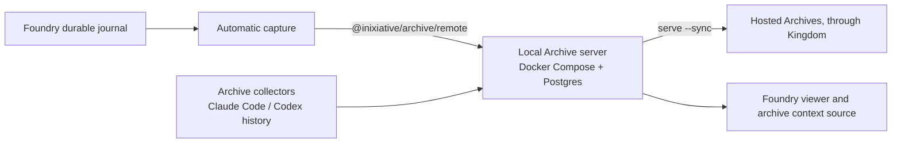

# Local Archive and session capture: Warden knowledge (Foundry)

<!-- Region `archive`; concepts: archive-capture, archive-server. Generated by ~/.foundry/evals/warden-regions/foundry/assemble.py from the three-run consensus. The membership, parts 1–2, the glossary and the bypass lines were written by an LLM (v1). Parts 3–4 are placed verbatim from the sources named on each unit. Edit the sources, not this file. -->

**Routing:** Is this about the machine's local Archive (`@inixiative/archive`) and Foundry's use of it: `bun run archive setup` / runArchiveSetup / startLocalArchive (`archive up`, Docker Compose, 127.0.0.1:4700, server.token), automatic journal capture (ArchiveCapture, 30-second retry, whole-thread snapshots), running the Archive CLI (runArchiveCli, runFoundryArchiveCli, preview/import/collect/list/search/export), the `archive` context source (ArchiveContextSource), run stamps (stampFoundryRun, `.archive-run`, run:foundry), ThreadContextTracker, the `/api/archives` viewer routes, ArchiveSettings / ProjectArchive, or the Archive server itself (collectors, `archive agents`, destinations.json routing, tags, references, claims, retention, `captureRunSessions`, `captureToolCallsAndResults`, the `/api/v1/archive/<action>` HTTP API)? Plain jobs: 'save this session history', 'search past sessions', 'start the archive', 'publish sessions to the org's hosted archive', 'mark these sessions as test runs'.

## Contents

- [Glossary](#glossary)
- [1. What this Warden covers](#1-what-this-warden-covers)
- [2. The domain](#2-the-domain)
- [3. Everything that exists here, by class](#3-everything-that-exists-here-by-class)
  - [Class `archive-capture`](#class-archive-capture-foundrys-use-of-the-local-archive-setup-journal-capture-archive-commands-archive-as-a-context-source-thread-context)
- [4. The specifics, in full](#4-the-specifics-in-full)
  - [4a. Doc sections](#4a-doc-sections)
    - `docs/session-archives.md`: (preface); Set up the local Archive; Local capture; Archive commands; Feed archives into Foundry context; Archive console; Fidelity and current scope
    - `README.md`: Session archives
    - `@inixiative/archive/README.md`: What runs today; Local setup; Connect to BYO hosting; Always-on local archiving; Connect through Kingdom; Routing; Tags, references, actors and retention; Tags, references, actors and retention › HTTP API; Limits; Development
  - [4b. Code entries](#4b-code-entries)

## Glossary

**archive agents**  
Declares collectors in `agents.json` and installs them as launchd / systemd units.

**archive up**  
Archive CLI command that creates `~/.local/share/archive/server.token` and starts the Compose stack.

**archive-capture**  
Class: Foundry's use of the local Archive: setup, journal capture, archive commands, context source, thread context.

**archive-server**  
Class: the Archive itself (@inixiative/archive): deployment, collectors, routing, tags/references/retention, HTTP API.

**ARCHIVE_RUN**  
Env var (test | oracle | foundry) stamping the snapshots a process writes.

**ArchiveCapture**  
Writes each journalled thread to the local Archive as a whole-thread snapshot, retrying failures every 30 s.

**ArchiveContextSource**  
Context source of type `archive`: searches the local Archive for the bound project as historical evidence.

**bun run archive:viewer**  
Archive console: the normal viewer with journal and capture, no model agents.

**captureRunSessions**  
Archive setting: keep run-tagged sessions (on by default) or drop explicitly stamped ones.

**captureToolCallsAndResults**  
Archive setting: keep tool calls and results (on by default); off strips them and marks coverage partial.

**claims**  
Lease a driver such as Foundry holds on sessions it records, so collectors skip them until fulfilled or lapsed.

**collector**  
Archive process that scans Claude Code / Codex history directories and imports sessions by exact project root.

**destinations.json**  
Archive routing config: organizations (owning projects) and destinations; one archive per organization.

**@inixiative/archive/remote**  
HTTP client (ArchiveClient) Foundry writes captures through.

**local Archive**  
The one Archive per machine: Docker Compose server + Postgres on 127.0.0.1:4700; holds the database.

**localArchive()**  
How every Archive client finds the server: ARCHIVE_URL or 127.0.0.1:4700, token from ARCHIVE_TOKEN or server.token.

**references**  
Links to integration items (GitHub repo/branch/PR, Linear issue) found in a session; a mention, not proof.

**run tags**  
`run:test`, `run:oracle`, `run:foundry`: sessions that are not a person's work; kept but exempt from learning.

**runArchiveCli**  
Spawns the Archive CLI in a subprocess; Foundry never imports it (it would resolve Foundry's Prisma client).

**serve --sync**  
The Archive server's onward publication to destinations every 30 s, with backoff.

**stampFoundryRun**  
Stamps a folder Foundry made for its own sessions with the run kind (`.archive-run`).

**tagger / suggestedTags**  
Haiku on primed subscription sessions suggests junk, category and project tags; suggestions are never applied.

**ThreadContextTracker**  
Tracks a thread's repository, branch, root and referenced PRs/tickets, refreshed on capture or worktree change.

**tombstone**  
Row left by delete or retention so an unchanged transcript is not imported again.

**whole-thread snapshot**  
Each capture is the full thread, so re-capturing is safe.

## 1. What this Warden covers

The local Archive that holds this machine's session history, and how Foundry feeds it: setup, automatic whole-thread capture from the journal without a model, running the Archive CLI, reading archived sessions back as historical context, and the Archive server's own collectors, routing, tags and retention.

## 2. The domain

archive-capture is Foundry's side. One Archive runs per machine in Docker Compose; `bun run archive setup` (runArchiveSetup) starts it when it is not answering and checks it, while startLocalArchive only runs `archive up`. Foundry finds it like every client (`localArchive()`: ARCHIVE_URL or 127.0.0.1:4700, token from ARCHIVE_TOKEN or server.token) and never imports the Archive CLI or server, which bind their own Prisma client: runArchiveCli spawns it, runFoundryArchiveCli is `bun run archive` (setup, else passthrough). A viewer with a durable journal runs ArchiveCapture: whole-thread snapshots after journal events, retried every 30 seconds until an Archive answers; the journal stays the source of truth, no model is called, Foundry keeps no archive store and publishes nowhere itself, and nothing is scrubbed. ThreadContextTracker derives repository, branch and linked PRs/tickets per snapshot. stampFoundryRun marks folders Foundry creates for its own sessions with the run kind. ArchiveContextSource reads search results back as historical evidence for a layer. The `/api/archives` routes and ArchiveSettings / ProjectArchive show status and destinations; Archive owns routing, Foundry only reads and asks.

archive-server is the Archive itself (documented in the `@inixiative/archive` README, no Foundry members): collectors and `archive agents` for Claude Code / Codex histories, folder filters, one archive per organization in `destinations.json`, onward publication (`serve --sync`) to hosted Archives through Kingdom by Signet, tags vs suggestions vs run tags vs project tags, references, claims, tombstones, compaction, the `captureRunSessions` and `captureToolCallsAndResults` settings, and the HTTP API.

Not here: the journal Foundry captures from (LocalSessionStore) and thread trees are `threads-journal`; how a context source is attached to a layer is `context-memory`; pairing with Kingdom and Signets are `kingdom`; the viewer server and settings shell are `viewer`; `bun run setup` / doctor are `install-daemon`; correction mining (`foundry repeats`) is `feedback`.

## 3. Everything that exists here, by class

Find the problem in plain words, then point at the exact thing. Each class opens with job tables where a class has confusable siblings (which to use when; *Said as* gives the plain words for that job), then one table of every member: **Problem** is the job in the user's or agent's words (match on these); **Use** is the exact member, its kind and `where`, then when to choose it; **Read** is the doc § that describes it (code members) or the code it is about (doc members); **Signs you're bypassing it** is the hand-rolled code an agent writes when it rebuilds the primitive, plus the errors it throws. Quote Use and Read in a pointer ("look over here: createLock, packages/db/src/lock/createLock.ts, CONCURRENCY.md § Distributed Lock"). Code members come from the catalog, described from the code; doc members are named in the doc sections in part 4. *Also here, by name* lists the parts of a larger system.

### Class `archive-capture`: Foundry's use of the local Archive: setup, journal capture, archive commands, archive as a context source, thread context

**Job: start or talk to the local Archive** (runArchiveSetup vs startLocalArchive vs bun run archive setup vs runArchiveCli vs runFoundryArchiveCli) — docs/session-archives.md § Set up the local Archive, § Archive commands; catalog choose lines

*Said as:* "start the archive", "run an archive command from Foundry", "make sure the archive is up"

| Member | Use when | Not when (use instead) |
|---|---|---|
| **runArchiveSetup** | start it if not answering, then verify reachable | just `archive up` (use startLocalArchive) |
| **startLocalArchive** | low-level `archive up` in Docker Compose | you need the reachability check (use runArchiveSetup) |
| **bun run archive setup** | a person setting it up from the terminal | code paths (use runArchiveSetup) |
| **runArchiveCli** | programmatic subprocess run of any Archive CLI command | the human entry (use runFoundryArchiveCli) |
| **runFoundryArchiveCli** | `bun run archive`: setup, else passthrough | calling from code (use runArchiveCli) |

**Job: get Foundry's sessions into the Archive correctly labelled** (ArchiveCapture vs ThreadContextTracker vs stampFoundryRun) — docs/session-archives.md § Local capture; @inixiative/archive/README.md § Tags, references, actors and retention

*Said as:* "save this thread to the archive", "record which PR this session touched", "mark these as Foundry's own sessions"

| Member | Use when | Not when (use instead) |
|---|---|---|
| **ArchiveCapture** | copy journalled threads as whole snapshots, with retry | labelling a run folder (use stampFoundryRun) |
| **ThreadContextTracker** | repository, branch and linked PRs/tickets per thread | writing the snapshot (use ArchiveCapture) |
| **stampFoundryRun** | a folder Foundry creates for its own sessions | a person's session (never stamp) |

**Job: search past sessions** (ArchiveContextSource vs Archive context source vs bun run archive) — docs/session-archives.md § Feed archives into Foundry context, § Archive commands

*Said as:* "give the agent past session history", "search old sessions for this"

| Member | Use when | Not when (use instead) |
|---|---|---|
| **ArchiveContextSource** | code: the `archive` source behind a layer | configuring it (see Archive context source (kingdom)) |
| **Archive context source (composition)** | the source config `type: archive` attached by sourceIds | a one-off search (use bun run archive) |
| **bun run archive** | a person searching from the terminal | agents need it as context (use ArchiveContextSource) |

**Job: show Archive state in the dashboard** (ArchiveSettings vs ProjectArchive vs Archive viewer routes) — docs/session-archives.md § Set up the local Archive, § Local capture

*Said as:* "show where this project's sessions publish", "archive status in settings"

| Member | Use when | Not when (use instead) |
|---|---|---|
| **ArchiveSettings** | the whole page: local, hosted, per-project publishing | one project (use ProjectArchive) |
| **ProjectArchive** | one project's captured sessions and destinations | the global page (use ArchiveSettings) |
| **Archive viewer routes (viewer)** | the `/api/archives` endpoints behind both | UI rendering |

| Problem | Use | Read | Signs you're bypassing it |
|---|---|---|---|
| save every thread to the local archive; copy the session history out of the journal; I'll write each thread to the archive after it changes; keep retrying the capture until the archive is up | **ArchiveCapture** · primitive `packages/foundry/src/archives/capture.ts#ArchiveCapture` — The journal stays the source of truth; use this to copy threads into the Archive. For one-off capture use captureThread. | docs/THREAD-TREE.md § A.4 Who writes what, and when | a Foundry-side archive table or per-message delta writes, or a capture that drops a thread when the Archive is down (docs/session-archives.md § Local capture) |
| give the agent past session history as context; search old sessions for the current focus; I'll query the archive search API from a context source; past work as evidence, not instructions | **ArchiveContextSource** · primitive `packages/foundry/src/archives/context-source.ts#ArchiveContextSource` — Use for past-session evidence; other context sources cover live project state. | — | a custom context source calling the Archive search API, or a layer prompt presenting past sessions as instructions (docs/session-archives.md § Feed archives into Foundry context) |
| the archive settings page; show local and hosted archives in settings; set up an archive from the dashboard | **ArchiveSettings** · primitive `packages/foundry/src/viewer/ui/archive-settings.js#ArchiveSettings` — show the Archive settings page: local Archive, hosted ones and per-project publishing | — | — |
| is the local archive configured and reachable; check the archive is answering; I'll ping the archive health endpoint | **archiveStatus** · primitive `packages/foundry/src/archives/local.ts#archiveStatus` — report whether the local Archive is configured and reachable | — | — |
| link to set up a hosted archive in Kingdom; only link https or local Kingdoms | **hostedSetupUrl** · primitive `packages/foundry/src/viewer/ui/hosted-archive-link.js#hostedSetupUrl` — build the Kingdom dashboard setup link, only for https or loopback Kingdoms | — | building the Kingdom `dashboard?setupArchive=1` link by string concatenation without the https / loopback check (docs/session-archives.md § Kingdom pairing; catalog: hostedSetupUrl) |
| show this project's archived sessions; where do this project's sessions publish; per-project archive panel | **ProjectArchive** · primitive `packages/foundry/src/viewer/ui/archive-settings.js#ProjectArchive` — show a project's captured Archive sessions and where its sessions publish | — | — |
| run an archive command from Foundry code; spawn the archive CLI as a subprocess; I'll import the archive package and call it directly; shell out to archive up | **runArchiveCli** · primitive `packages/foundry/src/archives/local.ts#runArchiveCli` — Always use this, never import the Archive CLI: it would resolve Foundry's own Prisma client. | — | importing `@inixiative/archive`'s CLI or server into Foundry, or shelling out to `archive` with a hand-built spawn (docs/session-archives.md § Set up the local Archive; catalog: runArchiveCli ("never import the Archive CLI")) |
| set up the archive and check it's reachable; start the archive if it isn't answering; I'll run docker compose up for the archive; make sure the archive is running before capture | **runArchiveSetup** · primitive `packages/foundry/src/archives/setup.ts#runArchiveSetup` — Full setup with checks; startLocalArchive only runs `archive up`. | — | running `docker compose up` or `archive up` directly and assuming the Archive is reachable (docs/session-archives.md § Set up the local Archive; catalog choose line) |
| what runs behind the archive script; setup or pass everything else to the archive CLI; the human entry point for archive commands | **runFoundryArchiveCli** · primitive `packages/foundry/src/archives/cli.ts#runFoundryArchiveCli` — Entry point for humans; runArchiveCli is the programmatic subprocess runner. | — | — |
| mark this folder as Foundry's own run; keep Foundry's sessions out of the learning data; I'll write a marker file so the archive knows it's ours | **stampFoundryRun** · primitive `packages/foundry/src/archives/run-stamp.ts#stampFoundryRun` — Use for any session folder Foundry creates so the Archive can tell run kinds apart. | — | Foundry-created session folders with no run stamp, or a hand-written `.archive-run` file (@inixiative/archive/README.md § Tags, references, actors and retention (Run tags); catalog: stampFoundryRun) |
| just bring the archive container up; run archive up without checking it; start the docker compose stack for the archive | **startLocalArchive** · primitive `packages/foundry/src/archives/local.ts#startLocalArchive` — Low-level start; runArchiveSetup also verifies it is running and reachable. | — | — |
| which repo and branch was this thread on; record the PRs and tickets a thread mentions; I'll parse PR links out of the messages myself; refresh the thread's branch when the worktree changes | **ThreadContextTracker** · primitive `packages/foundry/src/archives/thread-context.ts#ThreadContextTracker` — track each thread's repository, branch, root and referenced PRs/tickets, refreshed on capture or worktree change | docs/reference/FOUNDRY-ACP.md § 4. The ACP surface › 4.2 Method map | — |
| search my past sessions from the terminal; list or export archived sessions; import a Codex history file into the archive | **bun run archive** · script `package.json` — archive:viewer for browsing in a UI; `bun run archive setup` configures the Archive as a source. | docs/session-archives.md § Archive commands; docs/session-archives.md § Set up the local Archive | — |
| browse archived sessions without running agents; open the archive console | **bun run archive:viewer** · script `package.json` — viewer for the Foundry dashboard; archive for the Archive CLI. | — | — |
| where the archive integration code lives; add archive capture or search code | **packages/foundry/src/archives** · system `packages/foundry/src/archives` — capture threads into the local Archive, search it as context, and run its setup and CLI | — | — |
| stop the archive collector importing our sessions twice; claim the sessions Foundry records | **Archive capture claim** · pattern CLAUDE.md, Config — Capture claims native sessions with a lease so the Archive collector skips them unless Foundry dies. | part 4 | — |
| stop the collector archiving it twice; claim the native session while the thread is live; fall back to raw capture if we crash | **Archive claim lease** · pattern docs/THREAD-TREE.md § a-4 (Claim, Collector) — claim native sessions with a renewable lease so the collector skips them, falling back if the lease lapses | part 4 | a permanent lock or exclusion list keeping the collector off Foundry's sessions, or capture failing when Archive answers 404 on the claim routes (docs/THREAD-TREE.md § A.4 (Claim, Collector); § A.8 As built › Claims) |
| capture after each journal event; capture failed because the archive was down; I'll add a retry queue for failed archive writes | **Journal-driven snapshot capture with retry** · pattern packages/foundry/src/archives — Capture whole-thread snapshots after journal events, retrying every 30 seconds until an Archive answers. | part 4 | a custom retry timer or queue for failed captures, or capturing from somewhere other than the journal (docs/session-archives.md § Local capture) |
| run collect or preview with my own flags; every archive command except setup goes straight through; I'll add a Foundry command to list archives | **archive CLI passthrough** · primitive bun run archive — setup is the only non-passthrough command. | part 4 | reimplementing archive list / search / import commands inside Foundry (docs/session-archives.md § Archive commands) |
| link the child session to its parent; record the root and the spawning entry; which session spawned this one | **Archive lineage** · primitive ar/index.ts archiveLineageSchema — link a session to its parent node with kind, parentSessionId, rootSessionId and parentEntryId | part 4 | — |
| start this machine's archive; set up archiving for the first time; the archive isn't set up yet | **bun run archive setup** · primitive package.json script — Start this machine's local Archive for session capture. | part 4 | — |
| find the archive url and token; I'll hard-code the archive port | **localArchive()** · primitive @inixiative/archive — Never import the Archive CLI or server; spawn the CLI. | part 4 | hard-coding `http://127.0.0.1:4700` or reading `server.token` by hand (docs/session-archives.md § Set up the local Archive) |
| read the root and all its descendants; fetch the whole thread tree from Archive; get every subagent session under this thread | **tree(rootSessionId)** · primitive Archive tree read — return the root and every descendant ordered by parentEntryId, retained as one unit | part 4 | — |
| never send raw middleware rows on capture; capture shouldn't recapture the parent on a child change | **Archive capture sends reduced rows only** · rule pf/archives/capture.ts — Applies to all Archive snapshots; a child change never re-captures its parent. | part 4 | — |
| summarize the session before archiving it; Foundry should publish to the hosted archive itself | **Archive capture without a model** · rule docs/session-archives.md — Foundry captures to the machine's local Archive without model calls, keeps no archive store, and publishes nowhere itself. | part 4 | summarizing or categorizing sessions with a model before capture, or Foundry publishing to hosted Archives itself (docs/session-archives.md § (preface)) |
| a lapsed claim still gets archived raw; Archive never drops a session | **Archive keeps every session** · rule docs/THREAD-TREE.md § a-4 — Archive keeps every session, so an unfulfilled lapsed claim is captured raw as a fallback. | part 4 | — |
| are secrets removed before archiving; tool output with keys ends up in the archive | **Archived text is unscrubbed** · rule docs/session-archives.md Fidelity — All archived text, including tool results, goes to the local Archive unscrubbed; there is no automatic secret scrubber. | part 4 | — |

- *Also here, by name:* RUN_ENV (`packages/foundry/src/archives/run-stamp.ts`); archiveContextSchema (`packages/foundry/src/archives/context-source.ts`); captureThread (`packages/foundry/src/archives/capture.ts`); foundryRunKind (`packages/foundry/src/archives/run-stamp.ts`); localActor (`packages/foundry/src/archives/capture.ts`); localArchiveUrl (`packages/foundry/src/archives/local.ts`); snapshotReferences (`packages/foundry/src/archives/thread-context.ts`)

## 4. The specifics, in full

### 4a. Doc sections

Each unit is the doc section verbatim, with its headings shifted down two levels. A source line above it gives the path, the section and the doc's H1.

<!-- unit doc:docs/session-archives.md#preface -->
**Source:** `docs/session-archives.md` § (preface) (in "Session archives")

### Session archives

Foundry captures recorded work into this machine's local Archive (`@inixiative/archive`) without calling a model. Foundry keeps no archive store of its own and publishes nowhere: the local Archive server holds the database, and it publishes onward to hosted Archives itself. Hosted Archives are reached through Kingdom as an integration. Categorization suggests labels; it never grants access.



<!-- unit doc:docs/session-archives.md#set-up-the-local-archive -->
**Source:** `docs/session-archives.md` § Set up the local Archive (in "Session archives")

#### Set up the local Archive

One Archive runs per machine, in Docker Compose (`archive up`). From the Foundry repository:

```sh
bun run archive setup         # starts the local Archive if it is not answering, then checks it; --yes skips the prompt
bun run doctor                # includes the local Archive: not-set-up | unverified | reachable | unreachable
```

`archive setup` runs the Archive CLI's `up` in a subprocess: it creates the token at `~/.local/share/archive/server.token`, then starts the bundled Compose file (the Archive and its Postgres, HTTP on `127.0.0.1:4700`). Docker must be running. Settings → Archives (titled **Set up an Archive**) shows the same status, a button that does the same thing, a link per paired Kingdom to set up a hosted Archive there, and the Archive's integrations (read-only; the Archive owns them). `bun run setup` offers it on first run and as the **Kingdom & archives** menu item, along with Kingdom pairing.

Foundry finds the local Archive the way every Archive client does (`localArchive()`): `ARCHIVE_URL` or `http://127.0.0.1:4700`, with the token from `ARCHIVE_TOKEN` or `server.token`. Foundry never imports the Archive CLI or server, which bind their own Prisma client; it spawns the CLI.

<!-- unit doc:docs/session-archives.md#local-capture -->
**Source:** `docs/session-archives.md` § Local capture (in "Session archives")

#### Local capture

Starting a Foundry viewer with its durable session store schedules existing journal threads for capture, then captures changes after journal events. This does not start agents or make inference calls. A viewer without a durable journal has no automatic archive capture.

The journal is the source of truth. When the local Archive is not set up or does not answer, the thread's capture error is recorded and capture retries every 30 seconds; once an Archive appears (even one started from a terminal while Foundry runs), the next retry captures every waiting thread. Each capture is a whole-thread snapshot, so re-capturing is safe. Thread context (linked PRs and tickets) is derived from each snapshot as it is built, whether or not the Archive accepted it.

The local viewer exposes:

- `GET /api/archives/status`: `{ configured, reachable, url, integrations? }`.
- `POST /api/archives/setup`: starts the local Archive when it is not answering, then returns its status (502 with `error` when `archive up` fails).
- `GET /api/archives`: the local Archive's listings, per-thread capture errors and its status.
- `GET /api/archives/:id`: latest snapshot and chunks.
- `POST /api/archives/search`: `{ query, projectId?, budget?, limit? }`, passed to the Archive's search.
- `POST /api/archives/capture`: recapture every journal thread now.
- `GET /api/archives/destinations?projectId=`: where a project's sessions publish, read from the local Archive: `{ destinations, paired, libraries }`. Archive owns the routing; Foundry only reads and asks.
- `POST /api/archives/destinations/connect` and `POST /api/archives/destinations/remove`: `{ projectId, integrationId, resourceId }`, asking the local Archive to add or remove a Kingdom library as a destination for the project (`packages/foundry/src/archives/routes.ts:47-80`).

The local viewer's existing authentication applies.

<!-- unit doc:docs/session-archives.md#archive-commands -->
**Source:** `docs/session-archives.md` § Archive commands (in "Session archives")

#### Archive commands

Every `bun run archive` command except `setup` is the Archive CLI, run with your arguments:

```sh
bun run archive preview --directory /absolute/path/history --source codex --limit 100
bun run archive import --file /absolute/path/session.jsonl --source codex --project-id my-project
bun run archive collect --directory ~/.claude/projects --source claude-code --project-root /exact/cwd --project-id my-project --watch
bun run archive list
bun run archive search --query 'schema migration'
bun run archive export --id ARCHIVE_ID > session.archive.json
```

See the Archive README for collectors (`archive agents`), tags, references, retention and the onward publication the local Archive runs (`serve --sync`).

<!-- unit doc:docs/session-archives.md#feed-archives-into-foundry-context -->
**Source:** `docs/session-archives.md` § Feed archives into Foundry context (in "Session archives")

#### Feed archives into Foundry context

Add an enabled `archive` source to Foundry's source configuration, then attach it to a layer used by the relevant agents:

```json
{
  "id": "session-history",
  "type": "archive",
  "label": "Session history",
  "uri": "",
  "enabled": true,
  "archive": { "projectId": "my-project", "budget": 2048 }
}
```

The layer's `sourceIds` contains `session-history`. Its prompt should describe this as historical evidence to assess, not current instructions. Retrieval searches the local Archive with the current focus and only loads for the configured local project; with no local Archive set up it returns nothing. Returned records include archive ID, revision, digest, entry ID, source reference and exact character offsets. The serialized context wrapper is included in its token budget.

<!-- unit doc:docs/session-archives.md#archive-console -->
**Source:** `docs/session-archives.md` § Archive console (in "Session archives")

#### Archive console

For capture and browsing without model workers, run `bun run archive:viewer` in a configured project, or invoke `packages/foundry/src/archives/viewer.ts` with that project as the working directory. `FOUNDRY_CONFIG_DIR` optionally selects the configuration directory; `VIEWER_PORT` defaults to 4500. The console uses the normal viewer, durable journal and automatic archive capture. It does not run model agents.

<!-- unit doc:docs/session-archives.md#fidelity-and-current-scope -->
**Source:** `docs/session-archives.md` § Fidelity and current scope (in "Session archives")

#### Fidelity and current scope

- Capture retains recorded user/assistant messages, turn outcomes, public native text observations with delta/snapshot form, public tool evidence, and phase events. Recorded phase request context is included. Central injected context, raw checkpoint traces and private reasoning are not reconstructed.
- Entries carry Archive's `model` and `effort` from what Foundry recorded running: the executor's answers and tool calls from its native configuration (observed over requested), decision phases (route, advice, guard outcome) from the `served` model each role's request records. A phase whose participants ran on different models carries none. Each snapshot's `actor` is the local account operating Foundry (`kind: 'user'`).
- All archived text, including recorded tool results and phase request context, goes to the local Archive and from there to whatever it publishes to; there is no automatic secret scrubber.
- Oracle `goalIds`/`runIds` can be supplied in the portable snapshot and survive storage and retrieval. This does not implement Oracle scheduling, goal ownership, or automatic discovery of Oracle relationships.

<!-- unit doc:README.md#session-archives -->
**Source:** `README.md` § Session archives (in "Foundry")

#### Session archives

Foundry captures its durable sessions into this machine's local Archive (`bun run archive setup` starts it), which publishes onward to hosted Archives reached through Kingdom. See [setup and retrieval](docs/session-archives.md).

<!-- unit doc:@inixiative/archive/README.md#what-runs-today -->
**Source:** `@inixiative/archive/README.md` § What runs today (in "Archive")

#### What runs today

- Public transcript extraction, exact-project collection, immutable revisions in Postgres (only the current one is kept) (pgvector and pg_trgm enabled), lexical search and lossless text chunks.
- An authenticated HTTP server, published image, Compose deployment with its own Postgres, Railway configuration and a Render blueprint.
- An HTTP client the CLI, collectors and Foundry write through; only the server holds the database.
- Multiple explicit destinations, durable publication receipts/outbox, conflict detection and retry after interruption.

Each deployment is one ownership boundary with one access token. Kingdom supplies account-based sharing. Use distinct deployments and credentials for personal and organization archives.

<!-- unit doc:@inixiative/archive/README.md#local-setup -->
**Source:** `@inixiative/archive/README.md` § Local setup (in "Archive")

#### Local setup

Run one Archive per machine with Docker Compose. It runs the published image with its own Postgres, on the `archive` block of the shared port registry (`bunx @inixiative/config ports archive`): HTTP on loopback 4700, Postgres on loopback 6132.

```sh
bun add --global @inixiative/archive
archive up      # creates ~/.local/share/archive/server.token, then docker compose up
archive down
```

`up` runs the `compose.yaml` that ships in the package (project `archive`) with `ARCHIVE_DATA_DIR` set to the archive home and the server token from its `server.token`. Postgres data lives in `$ARCHIVE_DATA_DIR/postgres` and the server's configuration (`destinations.json`, destination token files, the Kingdom pairing) in `$ARCHIVE_DATA_DIR/config`, so both survive rebuilds and volume prunes. Compose mounts the config directory at the same absolute path, so the CLI and the server read one `destinations.json` and every path in it resolves for both. `up` runs the image tagged with the CLI's own version, so a cached `latest` can never sit under a newer config layout; set `ARCHIVE_VERSION` to run another. Running Compose directly requires an absolute `ARCHIVE_DATA_DIR` and an `ARCHIVE_VERSION`; build from a checkout with `ARCHIVE_VERSION=local docker compose -f compose.yaml -f compose.build.yaml up -d --build`.

The server applies its schema migrations on start and requires bearer authentication for data endpoints; `/health` has no session data. Every other command talks to it over HTTP at `--url` (default `http://127.0.0.1:4700`) with the token in `--token-file` (default `~/.local/share/archive/server.token`) or `ARCHIVE_TOKEN`:

```sh
archive preview --directory /path/to/history --source codex
archive import --file /path/to/session.jsonl --source codex --project-id inixiative --tag coding
archive collect --directory /path/to/history --source codex --project-root /exact/session/cwd --project-id inixiative --watch
archive list
archive search --query 'migration'
```

Use `--source claude-code` for Claude histories. Collection matches the exact working-directory metadata recorded by the provider. Repeat `--project-root` to map several checkouts to one project; `--worktrees` also accepts every current git worktree of each root, re-read on each scan. Nested checkouts are separate mappings unless `--subdirectories` lets a root also take the directories below it; the longest matching root wins. `--catch-all` (no roots) takes every session no other collector of that source claims, as projectId `unrouted`; `unrouted` belongs to no organization, so such a session stays on the machine unless it touched an organization's project (its `project:` tags), which makes it eligible for that organization's archive like any other session. **Folder filters** decide first, for every kind of match (exact roots, worktrees, subdirectories, catch-alls): `include` and `exclude` globs over the session's working directory, in the style of Atlas's `include`/`ignore` and Gloss's `exclude` (`--include`/`--exclude` here; `include`/`exclude` in `agents.json`). A glob names folders and covers everything below them. Entries are normalized: `~/` expands to the home directory (taken literally), a leading `./`, a trailing `/**` and trailing slashes go (Atlas's `dir/**` names `dir` too), and a relative glob matches at any depth (`bench/.runs` is `**/bench/.runs`); an empty entry, one naming every folder or one with a `..` segment is refused, and so is an exclude that covers the home directory or the filesystem root (`**`, `*`, `~`), which would stop capture silently. Exclude wins over include: excluding is the conservative side, since a session collected by mistake leaves the machine with its project's sync. With an `include` list, only folders it names are collected at all. Decision receipts (`**/decision-receipts`: Foundry's primed Warden and middleware hosts, the repeat report's, the tagger's) are always excluded. Temp directories (test fixtures, agent scratchpads) stay out of subdirectory and catch-all matches; an exact root inside one is explicit and still matches. Unknown directories, symlinks and sessions without usable metadata are skipped. Incomplete or changing files remain at source and retry on the next scan. The collector rescans every 30 seconds. A session whose digest the server already holds is not sent again, and a watching collector does not re-read a file whose size and mtime have not moved since its last outcome (it re-checks a stored session against the server every 10 minutes, so one the server lost is captured again; one deleted there leaves a tombstone, so its unchanged transcript stays deleted however a collector tags it, and a resumed session comes back under today's routing). A session is captured into one project; a collector leaves one another project holds with that project (`held`, with `heldBy` naming it: most often a checkout or worktree retired after capture, whose path now routes elsewhere), except one the catch-all holds as `unrouted`, which moves to the project that now claims it. Each scan prints its counts (`imported`, `unchanged`, `skipped`, `held`, `dropped`, `failed`) and, for what it decided that scan, `refused` (with the reason) and `heldBy`; a watching collector does not repeat a decision for a file that has not changed. Collectors compete only with collectors over the same history directory. `archive repair [--agent NAME]` runs every collector in `agents.json` once from the transcripts still on disk, re-capturing each session as it routes now. It takes over a session another project holds only when that row holds another transcript (no entry in common): a row captured before subagent transcripts had their own identity holds a subagent's content under its parent's key and the subagent's project, which the guard would otherwise refuse forever. A row holding its own transcript keeps its project; it reports every session re-imported, with the project it left, and every refusal with its reason. A watching collector waits out a server that is still starting. `serve --sync` backs off failed deliveries: 30 seconds after the first failure, doubling to at most 30 minutes, cleared on delivery. An archive a destination refuses waits alone, and is tried again at once when it has a new revision; a destination that does not answer (or answers 5xx) is skipped for all its archives until it is due.

To run the server without Docker, point `DATABASE_URL` at a Postgres with the `vector` and `pg_trgm` extensions available and run `archive serve [--port 4700] [--sync]`. Set `ARCHIVE_DEBUG=1` to see the underlying error when a command fails.

<!-- unit doc:@inixiative/archive/README.md#connect-to-byo-hosting -->
**Source:** `@inixiative/archive/README.md` § Connect to BYO hosting (in "Archive")

#### Connect to BYO hosting

Every deployment runs the published image `ghcr.io/inixiative/archive` (tags: version, `latest`, commit SHA), built from main for amd64 and arm64, with `DATABASE_URL` pointing at Postgres 15 or later with pgvector, HTTPS in front, and a unique `ARCHIVE_SERVER_TOKEN` of at least 32 characters. It needs nothing else. The Render blueprint provisions the database, the image and a generated token together. On Railway, add a pgvector Postgres service and the image as a service with `DATABASE_URL` referencing it (`railway.json` builds the Dockerfile when deploying from the repository instead).

The local Archive publishes onward to destinations. Place the destination's token in a private file under the server's config directory (`chmod 600`, owned by you) or an environment variable, then run:

```sh
archive organizations set --id inixiative --project inixiative --project template --project kingdom
archive connect --url https://your-archive.example --organization-id inixiative --token-file ~/.local/share/archive/config/credentials/inixiative.token
archive search --remote --query 'migration'
```

`setup` is an alias for `connect`. Setup verifies access before saving `<home>/config/destinations.json` and does not upload; the Compose server (`serve --sync`) reads it and publishes every 30 seconds. `sync` and `routes` ask that server to run the same publication, or preview it, once. The URL locates the server; the token grants access. Configuration stores only the token file path (`tokenFile`) or environment variable name (`--token-env`, `tokenEnv`), never the token. A token file is read on every request, so rotating it needs no restart; symlinks and files readable by group or others are refused. Redirects are refused; only HTTPS or loopback HTTP is allowed.

<!-- unit doc:@inixiative/archive/README.md#always-on-local-archiving -->
**Source:** `@inixiative/archive/README.md` § Always-on local archiving (in "Archive")

#### Always-on local archiving

`archive agents` declares collectors in `~/.local/share/archive/agents.json` and installs them as launchd agents (macOS) or systemd user units (Linux). They run on the host, where the session histories are, and write to the local Archive server:

```sh
archive agents add-collector --name claude-code.inixiative --source claude-code --project-id inixiative --project-root ~/code/inixiative --worktrees
archive agents add-collector --name codex.inixiative --source codex --project-id inixiative --project-root ~/code/inixiative --worktrees
archive agents server --url http://127.0.0.1:4700   # only when not the default
archive agents install
archive agents status
```

`add-collector` upserts by `--name` (lowercase letters, digits, `.` and `-`); `--directory` defaults to `~/.claude/projects` or `~/.codex/sessions`, and `--project-root`, `--worktrees`, `--subdirectories`, `--catch-all` and `--atlas` behave as for `collect`. `remove-collector --name N`, `folders [--include GLOB ...] [--exclude GLOB ...]` (replaces both folder lists; no flag clears them) and `server --url URL` edit the same file. `install` writes one unit per collector, `com.inixiative.archive.collect.<name>`, running `collect --agent <name> --watch`: the unit re-reads `agents.json` on every scan and routes each session against every collector of its source, so edits to roots and folder filters apply without a reinstall. Each runs the current Bun with this package's own `src/cli.ts`, restarts on exit (30 second throttle), works in the archive home and logs to `logs/<label>.{out,err}.log` there. Re-running `install` reloads only changed or stopped units and removes Archive units no longer declared. Units are written and loaded one at a time; a unit that fails to load gets its previous file back, so the next `install` loads it again, and `install` reports every failure after trying the rest (including the retired `local` and `sync` units); other launchd agents are untouched. `uninstall` removes every Archive unit; `status` reports each unit's load state, PID and last log entry. Re-run `install` after upgrading the package if its install path changes.

`@inixiative/archive/agents` exports the pure pieces for integrations: `agentsConfigSchema`, `agentUnits`, `renderPlist`, `renderSystemdUnit` and `planAgents`, plus `installAgents`, `uninstallAgents` and `agentStatus` with an injectable command runner and supervisor directory.

<!-- unit doc:@inixiative/archive/README.md#connect-through-kingdom -->
**Source:** `@inixiative/archive/README.md` § Connect through Kingdom (in "Archive")

#### Connect through Kingdom

Kingdom is the permission hub. Your machine's Archive talks directly only to local pieces, such as your local Foundry. It reaches a hosted Archive through Kingdom, by presenting a Signet.

First, pair this Archive with Kingdom:

```sh
bun run archive pair --kingdom https://api.your-kingdom.example --name "Work laptop" --organization your-org
```

`pair` registers this Archive with Kingdom as an **Installation**, named by a key kept in `<home>/config/kingdom/<kingdom host>/`. The same key is reused for every owner it registers with. It then asks to be registered as an integration, saying what it needs, and prints a review code with a link:

- `--organization SLUG|ID`: the organization it belongs to;
- `--library ID|NAME` (repeatable): `sessions.write` on those hosted libraries. Without it, the libraries this Archive's Kingdom destinations already name, or else every hosted Archive library of the owner.

Open the link. The review opens with that owner and those libraries selected; change them if you need to, and approve. The command waits for approval, then shows which owner it was registered with and asks you to accept. Pass `--yes` to accept without the prompt; without a terminal, `--yes` is required. Only then does it collect the Signet (0600) and list the libraries it may write to. Confirming the owner protects you if someone else claimed your code into their own owner.

Next, publish an organization to one of those libraries:

```sh
bun run archive connect --kind kingdom --url https://api.your-kingdom.example --credential-file ~/.local/share/archive/config/kingdom/KINGDOM_HOST/signet-SIGNET.json --integration-id HOSTED_ARCHIVE_INTEGRATION --resource-id LIBRARY --organization-id inixiative
```

`connect` checks that the Signet grants `sessions.write` on that library before it saves anything. `serve --sync` then sends each changed session through `POST /api/v1/access/execute`. Every call carries the Signet's access token and a fresh DPoP proof (`@inixiative/signet` renews the token).

Kingdom enforces the grant on every write:

- It accepts only snapshots whose `sourceId` is this Archive's.
- It records the paired integration on the session's actor.
- It resolves a revision conflict from this source by writing over the hosted head. Older captures are still refused.

Each write is usage on the Signet. Revoke the Signet, or pause the local Archive integration in Kingdom, to stop it. `search --remote` uses `documents.search` when the Signet grants it.

Kingdom keeps no archive store. It forwards each write to the hosted Archive server, whose own token stays in Kingdom as an encrypted credential.

Foundry writes its captures to the local Archive server through `@inixiative/archive/remote`.

<!-- unit doc:@inixiative/archive/README.md#routing -->
**Source:** `@inixiative/archive/README.md` § Routing (in "Archive")

#### Routing

One archive per organization, not per project: projects are tags. `destinations.json` declares `organizations` (each an `id` and the `projects` it owns; a project belongs to at most one) and `destinations` (each naming its `organizationId`). A session publishes to the destinations of every organization its own project, or a project it touched (its `project:` tags, captured or added by a person), belongs to. A session that worked on two organizations' projects goes to both, tagged with both, and each copy keeps its own `projectId`. A session whose own project is in no organization (or is `unrouted`) and that touched no organization's project stays local; one that touched an organization's project goes to that organization. `routes` previews each archive's `organizations` and destinations before upload. References and actors never change routing. `archive organizations list | set --id ID --project P ... | remove --id ID` edits the organizations (`set` replaces the list; a project another organization owns is refused; `remove` drops its destinations too). There is no backwards compatibility: a `destinations.json` written before 0.23.0 (a bare list of destinations with `projectId`) is refused until it is rewritten in this shape.

The server manages routes over HTTP too, so Foundry can read and set them. Only Kingdom destinations are set this way, through the Signets `pair` collected; direct token destinations stay CLI-only.

| Action | Body | Returns |
|---|---|---|
| `destinations/list` | `organizationId?` | `destinations`: each as `connect` reports it, with `delivered` (the organization's archives acknowledged at their latest digest) and `pending` |
| `organizations/list` | none | `organizations`: each `id` and its `projects` |
| `organizations/set` | `id`, `projects` | `organizations` |
| `organizations/remove` | `id` | `removed` |
| `destinations/libraries` | none | `paired`, and the `libraries` (`integrationId`, `resourceId`, `name`) the held Signets may write to |
| `destinations/connect` | `organizationId`, `integrationId`, `resourceId` | the saved destination, after Kingdom confirms `sessions.write` on the library (403 otherwise); an organization not declared yet is added with no projects |
| `destinations/remove` | `organizationId`, `integrationId`, `resourceId` | `removed` |
| `destinations/routes` | none | each archive with its `organizations` and their destinations; nothing is sent |
| `destinations/sync` | none | one publication to every destination: `id`, `destination`, `status` per archive and route |

`@inixiative/archive/remote`'s `ArchiveClient` wraps these as `destinations()`, `libraries()`, `connectDestination()`, `removeDestination()`, `routes()` and `sync()`. The sync loop picks up changes within 30 seconds.

<!-- unit doc:@inixiative/archive/README.md#tags-references-actors-and-retention -->
**Source:** `@inixiative/archive/README.md` § Tags, references, actors and retention (in "Archive")

#### Tags, references, actors and retention

The archive owns its tag system. It keeps two different things apart:

- **Tags** are concepts: the `atlas:<concept>` of repository files a session's tool calls touched (collectors with `--atlas`, from `atlas graph --json`), collector `--tag`s, and tags people add. **Suggestions** (`suggestedTags`) are the tagger's (`origin: "model"`, below) and are never applied. A person applies one with `tag --tag`; tags a person applied or removed never show as suggestions.
- **Run tags** mark sessions that are not a person's work: `run:test` (tests, probes), `run:oracle` (Oracle and bench evaluations) and `run:foundry` (sessions Foundry starts itself: Wardens, the chorus, middleware roles, classifiers). The harness that runs a session stamps it explicitly, one of three ways: a run tag on the snapshot it writes (or `collect --tag`); `ARCHIVE_RUN=test|oracle|foundry` in the environment of a process that writes snapshots (Foundry, `archive import`); or a `.archive-run` file holding the run kind in the working directory the runner made, or an ancestor (`stampRunDirectory` in `@inixiative/archive/exemption`), which collectors read at capture. A marker counts only below every collector root: one at the filesystem root, the home directory, or at or above a collector root is ignored, so a stray file never stamps a project's sessions, and `stampRunDirectory` refuses those places and a git work tree's root. Foundry's own subagents are `run:foundry` by the agent type Claude Code records for them (`foundry-root`, `foundry-dispatch`, `foundry-warden`: in-session Wardens inside a person's session; `d-`/`w-` and 16 hex digits: its decision hosts); Foundry refuses those types to anyone else, so a person's subagents (`general-purpose`, `Explore`, …) are never caught. *Interim, until every fixture and runner stamps:* the archive also infers `run:test` from Foundry's test fixture identities (project `P`, the `watch-A`/`watch-B` threads) and from working directories (temp directories, scratchpads, `decision-receipts`), `run:foundry` from Foundry's primed hosts (`decision-receipts/primed-<host>/fixture`), and `run:oracle` from Oracle eval workspaces, `.oracle` and bench run checkouts; the collector writes `run:inferred` beside a tag it guessed from a directory. Inferences only exempt: they never make a session one an Archive drops. These guesses go once the stamps cover them. An ACP thread (`acp`, `acp:<client>`) is a person's Foundry session from Zed, T3 or Paseo, never a run. A session captured before 0.23.0 with an inferred run tag lacks `run:inferred` and reads as explicitly stamped; re-capture it (`archive repair`) before turning `captureRunSessions` off. A session captured earlier keeps its tags until it is captured again. Whether run sessions are kept at all is the `captureRunSessions` setting (below). A kept, exempt session feeds nothing that learns from sessions: suggestions, retention scoring, correction mining (`foundry repeats`) or agent context. `list` and `search` leave exempt sessions out unless asked (`exempt: "include"` or `"only"`); routing and sync still see every session. Removing the run tag (`tag --untag run:test`) lifts the exemption.
- **Project tags** name the projects a session worked in, not where it lives: a collector tags each session (subagents included) `project:<projectId>` for every project whose roots or worktrees, in any collector of `agents.json` and of either source, hold a path it accessed: its working directory, the path arguments of file tools (Read, Edit, Write, Glob, Grep, notebooks), the path arguments, `cd` and `git -C` targets of shell commands (Claude Code's Bash; Codex's exec_command, shell and `exec` cells, best effort), Codex patch file headers and a call's `workdir`. Mentions never count: text written by Write or Edit, heredoc bodies, quoted strings with spaces, subagent prompts, messages, and user or assistant prose. Relative paths resolve against the working directory (and a `cd` before them); the longest root wins, and a project's own root counts even when it holds its own worktrees. Naming a container root itself, one that holds other projects' roots (`ls ~/code/inixiative`), tags nothing. It reads the raw transcript, before any tool-activity strip, and never changes the session's own project: an org-level session (cwd `~/code/inixiative`) stays in its project and carries `project:kingdom`, `project:template` and the rest it touched. The tagger's `project:` suggestion for an unrouted session is a different thing: where it belongs.
- **References** point at items in an integration. Collectors record the session's GitHub repository and branch (`owner/repo`, `owner/repo/tree/branch`); linked GitHub pull requests, issues and commits (`owner/repo#24`, `owner/repo@sha`) and Linear issues (`KEY-12`) are found in the text and counted. A link is a mention, not proof of work. The archive's settings list the integrations it references: GitHub and Linear are recognized natively, and any other integration names the link prefix of its items (for example `https://acme.atlassian.net/browse/`); the item is what follows. Prefixes are literal, so settings cannot make matching slow.

```sh
bun run archive tag --id ARCHIVE_ID --tag reviewed --untag debugging
```

The **tagger** suggests, for every session that is not exempt: `junk` (empty, aborted, probes, accidental starts), up to three of the archive-wide category tags (`tags define`), and `project:<id>` when the session landed `unrouted` or without a project. It runs on the machine's Claude subscription: Claude Haiku 5.5 on primed, text-only Claude Code sessions from `@inixiative/agent-session` (no tools, MCP servers, user settings or instruction files; an API-key login is refused). The model judges every due session, in batches of short digests (counts, the first prompts, tools used, first and last replies), never whole transcripts; nothing is decided by keyword or size rules first. The only skip: a session is asked about once per digest, and is due again only when it changes or when the prompt, model or tag definitions do (`--refresh` asks again, for example after adding a project). Suggestions for an older digest are not shown. It reads only this machine's Archive, since session content goes to this machine's Claude login. Each run prints its calls and tokens.

```sh
bun run archive tags define --tag debugging --description "Diagnosing and fixing a failure"
bun run archive suggest [--limit N] [--batch 8] [--concurrency 2] [--refresh]
bun run archive list --suggested junk
bun run archive list --exempt only
```

Tag edits apply to that archive without a new revision, survive re-capture, and do not sync. Offered tags are defined archive-wide or for one actor. Each session can name its **actor**: a `user`, a `service` such as an API-key run, or a `job` (its id is the job name), with the `integrationId` it ran under when there is one. An organization's archive mostly holds its members' work, filterable per person. Entries the model produced record its `model` and `effort` (from Claude Code assistant records and Codex turn context, per turn); listings summarize them per session as `models` and filter by `model` and `effort`. Each session also records its `runtime`: `provider` (`anthropic` for Claude Code, Codex's `model_provider`) and `accessPath` (`subscription`, `api` or `unknown`), with `evidence` `transcript` when the transcript proves it (a subscription's rate-limit window: Claude Code `quotaLimits`, Codex `rate_limits.plan_type`) or `harness` when the collector read the harness login instead (Claude Code's `oauthAccount` unless its settings supply an API key; Codex `auth.json`). A subagent run is its own session with `lineage`: `kind` (`subagent` or `fork`), `parentSessionId`, and what the harness recorded (`agentType`, `agentName`, `description`, `toolUseId`, `depth`; Claude Code's `agent-<id>.meta.json`, Codex's subagent `session_meta`). A Claude Code subagent transcript (`<session>/subagents/agent-<id>.jsonl`) is the session `<session>/agent-<id>`, never its parent's, with the agent id from its records or its file name; its `rootSessionId` is the thread, its `parentSessionId` the agent that spawned it (`meta.json` `parentAgentId`) or the thread, and `isFork` makes it a `fork`. A tree of sessions written by its driver (Foundry: a thread, its subagents, theirs) also carries `rootSessionId` (the tree's root) and `parentEntryId` (the parent's entry that spawned it), with `parentSessionId` the direct parent. Example: `models: [{model: 'claude-opus-5-5', effort: 'medium'}]`, `runtime: {provider: 'anthropic', accessPath: 'subscription', evidence: 'harness'}`.

A driver that records its own sessions (Foundry, for the native sessions it runs) **claims** them with a lease:
- **Holding.** `claims/hold` takes the lease, and holding again renews it. A re-hold also reopens a fulfilled claim. Another claimant's live lease is never taken over.
- **What the collector skips.** It skips a claimed session while the lease is live, or once the claim is **fulfilled** and the transcript has not changed since. `claims/fulfil` names this store's archive that covers the session, and only the claimant can fulfil.
- **What it falls back to.** Every session is kept. A lapsed, unfulfilled claim (the driver died), or a change made after fulfilment with no live lease, is captured raw on the next scan.
- **Superseded captures.** A raw capture of a fulfilled session is marked `supersededBy` the driver's archive. It is kept, and never delivered onward.
- **Subagents.** A Claude subagent transcript follows its session's claim. A Codex sub-agent thread is its own session, so the driver claims each one.
- **Checking.** `claims/state` reports `none`, `live` (with `until`), `fulfilled` or `lapsed`. The collector asks before it parses a transcript, and asks again when a lease it saw runs out.

The **retention** setting (`retentionDays`, off by default) deletes archives whose latest capture is older than that, leaving each a tombstone like `delete` does. A tombstone (`archive_tombstones`) keeps the session key, the writer's last digest (what `head` answers, with `deleted: true` and no project) and the transcript's own digest (`transcriptDigest`: source, session and entries, without tags, references, runtime or project). A capture of the same transcript is answered unchanged, however it is tagged (a new collector, an Atlas or project-list change), and the tombstone takes the writer's new digest; a resumed session (new entries) is stored again and the tombstone goes. With only a tombstone held there is no revision to conflict with, so any `previousDigest`, none included, is accepted. Tombstones are never pruned: each is one small row, and pruning one would let a transcript still on disk (Codex keeps its rollouts indefinitely) be imported again, only for retention to delete it again. It deletes only from the archive it is set on; deletions never sync.

**Compaction.** Each capture stores the session as a new immutable revision and deletes the revision it replaces, so an Archive holds only each session's current revision (a growing session's earlier revisions are prefixes of it). A revision an outbox row still names stays until that destination acknowledges it. Revision numbers keep counting. `read` with an earlier `revision` answers 410 (`Revision N was compacted`); one that never existed answers 404.

**Tool activity.** The `captureToolCallsAndResults` setting (on by default) says whether this Archive keeps tool calls and tool results. Off, the server drops `tool-call` and `tool-result` entries from every snapshot it ingests, whoever writes it (collectors, Foundry, a syncing Archive), and marks the snapshot's coverage `partial` with an omission saying so. What the person said or decided through a tool is not tool activity, and the importers record it as theirs (one recogniser per shape, `src/tool-activity.ts`):
- `user`: Claude Code's AskUserQuestion answers (`The user answered: "question"="answer"`, or the older `Your questions have been answered: …`), a rejected tool use or plan with typed feedback (`… the user said: …`), and Codex `request_user_input` answers, written with their questions;
- `event`: asking to clarify instead of answering; a rejection without feedback (`{"rejected": tool, "command"?}`); an ExitPlanMode approval, with the approved plan.

The strip keeps them too, re-deriving them from tool results captured before the importers did. Links found only in dropped tool output (a PR `gh pr create` opened) are recorded in `references` (at most 100; a coverage omission counts any cut). Two kinds of call stay as small `event`s with the call's id and `callId`: a subagent spawn (`Agent`, `Task`, `spawn_agent`), so a child's `lineage.toolUseId` still resolves, and a Codex `request_user_input_async` question whose answer message (`<send_user_message_question_reply>`, kept as an event) does not carry it. Foundry wraps native tool output in JSON and asks no questions through tools today, so these shapes are not looked for inside Foundry captures.

The ingest `digest` stays the digest of the snapshot as its writer sent it, so a collector's unchanged session stays unchanged and a change only to tool activity stores nothing new. `head` also returns `storedDigest`, the digest of what this Archive holds and publishes onward; `read` and `search` return the digest of the revision they return, which is that stored digest. Turning the setting off queues removal of the tool activity already held: each affected session gets one new revision without it, and the old one is compacted. That new revision is published to the session's destinations like any change, so a destination converges to the stripped copy even where it keeps tool activity itself: we keep no tool activity anywhere (Aron, 2026-10-18), so this is intended. Turning the setting back on keeps new tool activity from then on; it does not restore what was removed, and an unchanged session stays as stored.

**Run sessions.** The `captureRunSessions` setting (on by default, as an open-source Archive has always kept them) says whether this Archive keeps run sessions (`run:test`, `run:oracle`, `run:foundry`; "Run tags" above). On, they are kept and exempt. Off, ingest drops those with an explicit stamp (a run tag the writer or a person put there, not one marked `run:inferred`; `ARCHIVE_RUN`; a `.archive-run` marker; a Foundry subagent type), and keeps inferred ones exempt. It drops them, whoever writes them (collectors, Foundry's own writes, a syncing Archive): nothing is stored, a copy already held is deleted, and the answer carries `dropped` (the run tag) with the writer's digest, so a syncing Archive records the delivery and a collector counts it `dropped` and does not send it again. A session whose run tag a person removed is a person's session and stays: the stored copy loses that tag (a new revision), and later captures are stored without it, so a destination with the setting off keeps it too. Turning the setting off queues deletion of the explicitly stamped run sessions already held, one page of archives at a time and one archive per statement, resuming where it stopped (`maintenance status`: `runSessionSweepPending`); turning it back on cancels the sweep and keeps new run sessions from then on. Deletions never sync: each Archive applies its own setting.

**Maintenance** (retention, compaction, deletion of run sessions, removal of past tool activity, then rebuilding the search index if it is missing) runs in the background at server start and hourly; an upgrade from an Archive that kept every revision compacts it there, one revision per statement. Shutting the server down stops it after the statement in progress; the next start resumes. A session whose tool activity cannot be removed is logged, listed in `maintenance status` and retried on the next run, without holding up the rest. Outbox rows no configured route will deliver (a removed destination, a superseded capture) are released, so the revisions they held are compacted. Maintenance and reclaim never run at once, and an index build already in progress is left to finish. Deleted rows free space inside Postgres; `maintenance reclaim` returns it to the operating system once compaction is done: it drops the trigram search index, runs `VACUUM (FULL, ANALYZE)` on `revisions` and `chunks` (each table locked while it is rewritten; needs free disk for the live rows) and rebuilds the index concurrently over current rows. `maintenance status` reports what is left, the table sizes and the last reclaim. On a disk too full to compact, drop the index first (`DROP INDEX CONCURRENTLY chunks_text_idx`): search still works without it, and maintenance rebuilds it when compaction finishes.

```sh
bun run archive settings --capture-tool-calls-and-results false
bun run archive settings --capture-run-sessions false
bun run archive maintenance status
bun run archive maintenance reclaim
```

<!-- unit doc:@inixiative/archive/README.md#tags-references-actors-and-retention/http-api -->
**Source:** `@inixiative/archive/README.md` § Tags, references, actors and retention › HTTP API (in "Archive")

##### HTTP API

All data endpoints are `POST /api/v1/archive/<action>` with a JSON body and `Authorization: Bearer <token>`:

| Action | Body | Returns |
|---|---|---|
| `ingest` | `snapshot`, `previousDigest` | id, digest, revision, changed, `dropped?` (the run tag, when `captureRunSessions` is off) |
| `read` | `archiveId`, `revision?` | snapshot and chunks; 410 for a compacted revision |
| `list` | filters, `limit?`, `beforeId?` | metadata, `nextCursor` |
| `search` | filters, `query`, `budget?`, `limit?`, `beforeId?` | matching chunks within the token budget |
| `tag` | `archiveId`, `add?`, `remove?` | tags |
| `delete` | `archiveId` | deleted |
| `head` | `archiveId` | `digest` (as its writer sent it), `storedDigest`, `revision`, `projectId`, `supersededBy` |
| `settings/read`, `settings/update` | `integrations?`, `retentionDays?`, `captureToolCallsAndResults?`, `captureRunSessions?` | settings |
| `maintenance/status` | none | `supersededRevisions` (left to compact), `revisionsAwaitingDelivery`, `toolActivitySweepPending`, `toolActivitySweepFailures`, table sizes, `reclaim` state |
| `maintenance/reclaim` | none | `started`; 409 while maintenance runs or has work left, or a reclaim runs |
| `tags/list`, `tags/define`, `tags/remove` | `tag`, `actorId?`, `description?` | offered tags with usage counts |
| `claims/hold` | `claimant`, `ttlMs`, `sessions: [{source, sessionId}]` | `expiresAt` (holding again renews and reopens); 409 while another claimant's lease is live |
| `claims/fulfil` | `claimant`, `source`, `sessionId`, `archiveId` | `fulfilledBy`, `superseded` (raw captures marked); 404 when unclaimed or the archive is missing, 409 for another claimant |
| `claims/state` | `source`, `sessionId`, `modifiedAt?` | `state`: `none`, `live` (+ `until`), `fulfilled` or `lapsed` |
| `suggestions/queue` | `key`, `limit?`, `beforeId?`, `refresh?` | sessions due for suggestions, as digests; routed `projects` |
| `suggestions/record` | `results` (`archiveId`, `digest`, `key`, `by`, `tags`) | recorded, stale (digest moved on), refused (exempt), dropped (tags not offered) |
| `destinations/list`, `destinations/libraries`, `destinations/connect`, `destinations/remove`, `destinations/routes`, `destinations/sync` | see [Routing](#routing) | routes |

Filters are `projectId`, `source`, `tag`, `suggestedTag`, `exempt`, `actorId`, `model`, `effort`, `provider`, `accessPath` and `reference` (`{integration, ref}`); `archive list` and `archive search` take them as flags. Jev integration is not enabled. Session content must not be sent to Jev without selecting that service for the relevant ownership boundary.

<!-- unit doc:@inixiative/archive/README.md#limits -->
**Source:** `@inixiative/archive/README.md` § Limits (in "Archive")

#### Limits

- Public text/tool records only; no reconstruction of private reasoning or unsupported media. Coverage accompanies each snapshot.
- No automatic secret scrubber. Publication includes recorded public session content.
- Sync currently publishes local records to destinations; it does not mirror remote records locally or propagate deletions.
- Local search budgets are per session; hosted search budgets are across a response. Remote search queries every configured route; each response identifies its destination.
- No automatic remote deletion when routing changes. Existing copies keep their original owner's access rules.
- Deployment credentials, operational receipts and machine-specific routing belong outside the repository.

<!-- unit doc:@inixiative/archive/README.md#development -->
**Source:** `@inixiative/archive/README.md` § Development (in "Archive")

#### Development

Tests create their own databases (`archive_test_*`) in the machine's Archive Postgres, so run `archive up` (or `docker compose up -d postgres`) first, or point `ARCHIVE_TEST_DATABASE_URL` at another pgvector Postgres:

```sh
archive up
bun run check
```

Schema changes go in `prisma/schema.prisma` with a migration (`bunx prisma migrate dev --name <change>` against a development database).

See [provenance](docs/PROVENANCE.md), [license](LICENSE), and [goals](tickets/README.md). The historical tickets describe earlier scope; this implementation now includes explicit provider collection and authenticated standalone hosting.

##### ChatGPT conversation text

`archive import --file conversation.json --source chatgpt --project-id personal` accepts the JSON result of the desktop ChatGPT conversation reader (`thread`, `page`, and `turns`). This is a partial text capture, not a ChatGPT account export: tools, attachments, alternate branches and resolved citation targets are unavailable. ChatGPT conversations retain their own source identity.

### 4b. Code entries

From the catalog (extracted from the code through the repo's Atlas map, described by a model). Each line: **name** `where` [kind] the job it does. Use: canonical usage.

#### Class `archive-capture`
- **ArchiveCapture** `packages/foundry/src/archives/capture.ts#ArchiveCapture` [primitive] write each journalled thread to the local Archive, retrying failed captures later Use: new ArchiveCapture(...) then capture a thread after it is journalled
- **ArchiveContextSource** `packages/foundry/src/archives/context-source.ts#ArchiveContextSource` [primitive] supply historical session evidence for the bound project from the local Archive as context Use: new ArchiveContextSource(...) registered as a ContextSource
- **ArchiveSettings** `packages/foundry/src/viewer/ui/archive-settings.js#ArchiveSettings` [primitive] show the Archive settings page: local Archive, hosted ones and per-project publishing Use: <ArchiveSettings projects={projects} />
- **archiveStatus** `packages/foundry/src/archives/local.ts#archiveStatus` [primitive] report whether the local Archive is configured and reachable Use: await archiveStatus(client)
- **hostedSetupUrl** `packages/foundry/src/viewer/ui/hosted-archive-link.js#hostedSetupUrl` [primitive] build the Kingdom dashboard setup link, only for https or loopback Kingdoms Use: hostedSetupUrl(kingdomUrl)
- **ProjectArchive** `packages/foundry/src/viewer/ui/archive-settings.js#ProjectArchive` [primitive] show a project's captured Archive sessions and where its sessions publish Use: html`<${ProjectArchive} projectId=${id} />`
- **runArchiveCli** `packages/foundry/src/archives/local.ts#runArchiveCli` [primitive] run the Archive CLI in a subprocess without importing it into Foundry Use: await runArchiveCli(['up'], 'pipe')
- **runArchiveSetup** `packages/foundry/src/archives/setup.ts#runArchiveSetup` [primitive] set up the machine's local Archive so it is running and reachable Use: await runArchiveSetup(options)
- **runFoundryArchiveCli** `packages/foundry/src/archives/cli.ts#runFoundryArchiveCli` [primitive] run `bun run archive`: start the local Archive on setup, otherwise pass through to the Archive CLI Use: bun run archive setup | bun run archive <command>
- **stampFoundryRun** `packages/foundry/src/archives/run-stamp.ts#stampFoundryRun` [primitive] stamp a folder Foundry made for its own sessions with the run kind Use: stampFoundryRun(directory)
- **startLocalArchive** `packages/foundry/src/archives/local.ts#startLocalArchive` [primitive] start the machine's one local Archive in Docker Compose via `archive up` Use: await startLocalArchive()
- **ThreadContextTracker** `packages/foundry/src/archives/thread-context.ts#ThreadContextTracker` [primitive] track each thread's repository, branch, root and referenced PRs/tickets, refreshed on capture or worktree change Use: new ThreadContextTracker(...) refreshed when a thread snapshot is captured
- **bun run archive** `package.json` [script] run the Archive CLI to capture, search and manage the machine's local session archive Use: bun run archive <command> [args]
- **bun run archive:viewer** `package.json` [script] open the Archive's browser viewer Use: bun run archive:viewer
- **packages/foundry/src/archives** `packages/foundry/src/archives` [system] capture threads into the local Archive, search it as context, and run its setup and CLI Use: import from packages/foundry/src/archives/*
