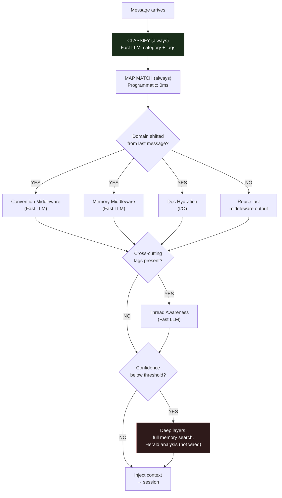
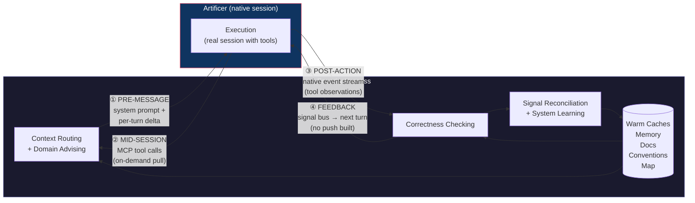
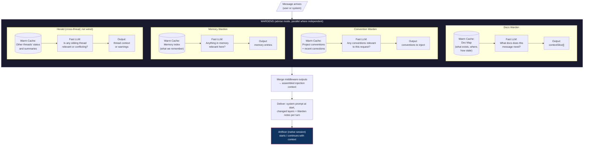
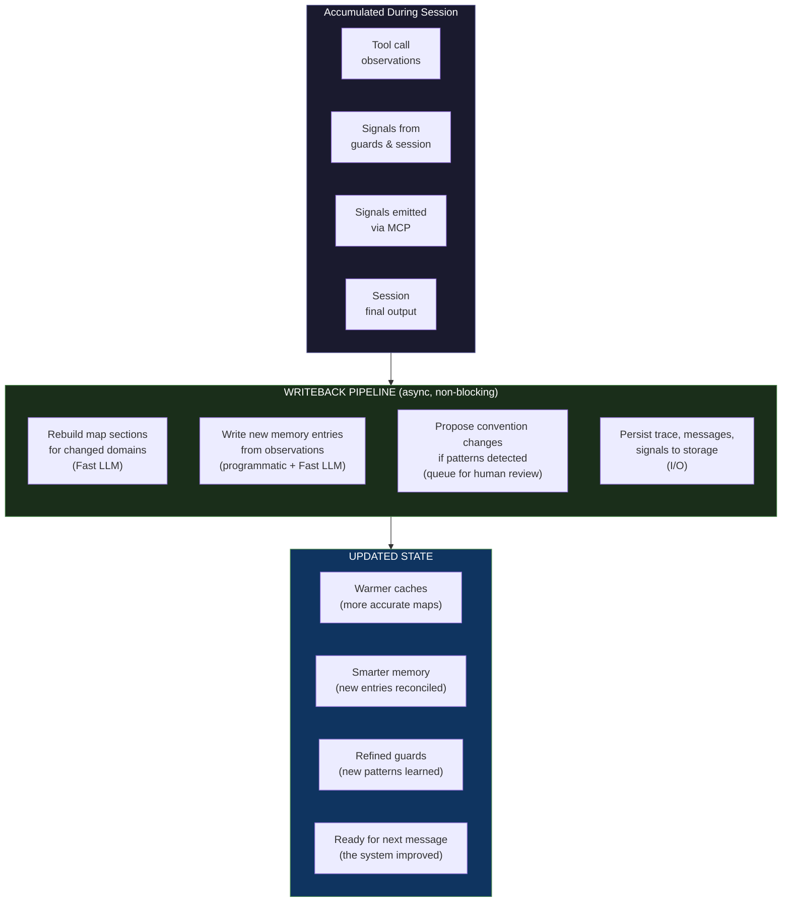
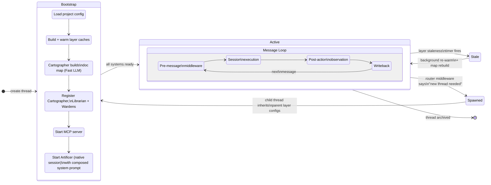

# Harness data flow and loops: Warden knowledge (Foundry)

<!-- Region `flow-architecture`; concepts: flow-loops. Generated by ~/.foundry/evals/warden-regions/foundry/assemble.py from the three-run consensus. The membership, parts 1–2, the glossary and the bypass lines were written by an LLM (v1). Parts 3–4 are placed verbatim from the sources named on each unit. Edit the sources, not this file. -->

**Routing:** Is this about how data moves through the Foundry harness: the four channels (pre-message system prompt and per-turn delta, mid-session MCP pull, post-action native event stream, feedback on a later turn), progressive depth and middleware tiers, the thread-state layer vs the session store, the delivery ledger (standing parts, deltas, compaction, no retraction, wrapsThread), the writeback loop, thread bootstrap and staleness, failure modes, or what is built vs designed; or about adding a Claude Code hook, MCP push or .foundry-context.md?

## Contents

- [Glossary](#glossary)
- [1. What this Warden covers](#1-what-this-warden-covers)
- [2. The domain](#2-the-domain)
- [3. Everything that exists here, by class](#3-everything-that-exists-here-by-class)
  - [Class `flow-loops`](#class-flow-loops-the-harness-data-flow-what-foundry-is-the-four-channels-and-loops-pre-message-mcp-pull-post-action-writeback-progressive-depth-thread-state-failure-modes)
- [4. The specifics, in full](#4-the-specifics-in-full)
  - [4a. Doc sections](#4a-doc-sections)
    - `docs/FLOW.md`: (preface); Why This Exists; The Core Model; Design Principles; Progressive Depth — Tiered Frequency Model; The Four Communication Channels; Loop 1: Pre-Message — Context Routing + Domain Advising; Loop 4: Writeback — Signal Reconciliation + System Learning; Thread Lifecycle; Complete Decision Reference; Failure Modes; What Exists vs What Needs Building
    - `docs/SYSTEM.md`: Architecture Overview
    - `CLAUDE.md`: Communication Channels
  - [4b. Code entries](#4b-code-entries)

## Glossary

**adviseTimeoutMs**  
Advise deadline; a Warden that times out is skipped.

**--append-system-prompt-file**  
How a Claude session starts with every standing part as its system prompt; Codex gets them in its first message.

**Artificer**  
The executor: a native Claude Code or Codex session run through agent-session under the harness.

**Delivery ledger**  
The Librarian's record of part hashes the session holds; passed as SessionDelivery.held, updated by commitDelivery.

**Feedback channel**  
Guard findings become signals that reach the session on a later turn; no MCP push is built.

**flow-loops**  
This class: the harness data flow, channels, loops, progressive depth, thread-state and failure modes.

**foundry MCP server**  
Seven tools: foundry_device, foundry_query, foundry_conventions, foundry_memory, foundry_access, foundry_threads, foundry_signal.

**Four communication channels**  
Pre-message, mid-session MCP, post-action native event stream, and feedback on a later turn.

**guardTriggers**  
A Warden's trigger list; it guards once per turn when one names a call of the turn.

**Horizon alignment**  
The goal: the agent's output converging on the project's standards, not more autonomy.

**Layer staleness timer**  
lastWarmed + staleness marks a layer stale, triggering re-warm and map rebuild.

**Mid-session MCP pull**  
The running session pulls missing context through the foundry MCP server's tools.

**Middleware tiers**  
Always, on domain shift, on cross-cutting signals, on low confidence.

**Post-action channel**  
Tool calls observed on the native event stream; the structural tool gate answers permission requests.

**Pre-message channel**  
System prompt at session start plus changed layers and Warden notes with each user message.

**Progressive depth**  
Escalate from cheap always-on layers to deeper middleware only when something triggers.

**providers/session-delivery.ts**  
The provider code deciding which parts to send a native session each turn.

**Re-alignment tax**  
The recurring cost of steering agents back to the project's standards, which Foundry exists to remove.

**Session store**  
Append-only event log of a session; thread-state is a materialized view derivable from it.

**session_compacted**  
Compaction event that clears the ledger; conversation-only parts are re-sent.

**Standing part**  
A warm layer or the executor's instructions labelled ## Context: <id>, held by the session at its current hash.

**Thread-state layer**  
Compact always-warm thread summary (domain, recent activity, flags); Librarian is its sole writer.

**Thread.fromSession**  
Store replay to rebuild a thread; design only, not built.

**Warden notes**  
'The <domain> Warden chimed in:' points appended after the user's message; NO_COMMENT adds nothing.

**Warm cache**  
A compact structured index (e.g. the ~500-token doc map) a middleware LLM compares the message against.

**wrapsThread**  
Decides whether a thread is wrapped; an unwrapped thread gets the user's message as typed.

**Writeback pipeline**  
Loop 4: map rebuilds, memory entries, convention proposals, persistence; not built as a whole.

## 1. What this Warden covers

Foundry's harness architecture from FLOW.md: what Foundry is, the four channels between the harness and the Artificer, the loops that run before and after each message, how context reaches a native session each turn, and how the system degrades and learns.

## 2. The domain

Foundry wraps an Artificer (a native Claude Code or Codex session) and talks to it through four channels: pre-message (standing parts in the system prompt at session start, then changed layers and Warden notes with each user message, decided by `providers/session-delivery.ts`), mid-session (the session pulls via the foundry MCP server's seven tools), post-action (tool calls observed on the native event stream; the structural tool gate answers permission requests) and feedback (guard findings become signals that reach the session on a later turn at best; no push is built). There is no `.foundry-context.md` and no Claude Code hook: middleware runs in Foundry's own harness. Decisions run on Claude Haiku 5.5 through the subscription; the executor runs whatever the native CLI runs.

Progressive depth keeps cost down: classification and map match always run, convention/memory/doc middleware only on a domain shift, thread awareness on cross-cutting tags, deep layers on low confidence; each Warden guards at most once per turn when its `guardTriggers` name a call. The thread-state layer (compact, always warm, written only by the Librarian) makes every predicate a cache read; the session store is the append-only event log it is derived from (`Thread.fromSession` replay is design only). Delivery holds every standing part at its current hash: a changed layer goes once as a delta, `SessionDelivery.held` carries the ledger, `commitDelivery` records what was sent, compaction clears the ledger, nothing is retracted, and an unwrapped thread receives nothing. Writeback (Loop 4) is mostly unbuilt; convention promotion always goes through human review.

This region is the map; many members point into neighbours that hold the machinery. The agents filling each role are in `flow-roles`; the session adapters and what a native session receives in code are in `native-sessions`; the MCP server and tool gate are in `tool-gate-mcp`; middleware chain, `useWhen`, retry and `BoundedSet` are in `core-agents`; context layers and the stack in `context-memory`; TurnService in `threads-journal`; primed decision sessions in `decision-hosts`; the ACP agent in `acp`. Not here: Warden generation and chime format (`chorus`), when Wardens are asked (`warden-triggers`), and the feedback lifecycle (`feedback`).

## 3. Everything that exists here, by class

Find the problem in plain words, then point at the exact thing. Each class opens with job tables where a class has confusable siblings (which to use when; *Said as* gives the plain words for that job), then one table of every member: **Problem** is the job in the user's or agent's words (match on these); **Use** is the exact member, its kind and `where`, then when to choose it; **Read** is the doc § that describes it (code members) or the code it is about (doc members); **Signs you're bypassing it** is the hand-rolled code an agent writes when it rebuilds the primitive, plus the errors it throws. Quote Use and Read in a pointer ("look over here: createLock, packages/db/src/lock/createLock.ts, CONCURRENCY.md § Distributed Lock"). Code members come from the catalog, described from the code; doc members are named in the doc sections in part 4. *Also here, by name* lists the parts of a larger system.

### Class `flow-loops`: The harness data flow: what Foundry is, the four channels and loops (pre-message, MCP pull, post-action, writeback), progressive depth, thread-state, failure modes

**Job: the running session pulls something from Foundry mid-turn** (foundry_query vs foundry_conventions vs foundry_memory vs foundry_threads vs foundry_signal vs foundry_device vs foundry_access) — docs/FLOW.md § What Exists vs What Needs Building (MCP server); packages/foundry/src/mcp/server.ts

*Said as:* "the agent needs more context mid-task", "which MCP tool does the session call", "let the agent look it up itself", "report something back to Foundry"

| Member | Use when | Not when (use instead) |
|---|---|---|
| **foundry_query (tool-gate-mcp)** | free-topic search over current context layers | a domain's parts (use foundry_conventions) |
| **foundry_conventions (tool-gate-mcp)** | a domain's reviewer instructions and knowledge | retained records (use foundry_memory) |
| **foundry_memory (tool-gate-mcp)** | search or fetch retained memory records | context layers (use foundry_query) |
| **foundry_threads (tool-gate-mcp)** | summarize other live threads in the project | this thread's layers (use foundry_query) |
| **foundry_signal (tool-gate-mcp)** | report an observation as a signal | on the read-only native grant (disabled) |
| **foundry_device (tool-gate-mcp)** | the enrolled device and bound checkout | other threads (use foundry_threads) |
| **foundry_access (kingdom)** | Kingdom integrations through Signets | no Kingdom access tool configured |

**Job: send a native session only what it lacks, and record it** (providers/session-delivery.ts vs SessionDelivery.held vs commitDelivery vs DeliveryRecord.session / InjectionArtifact.sessionDelivery) — docs/FLOW.md § Loop 1 › Delivery: what a native session receives each turn

*Said as:* "only send the changed layers this turn", "track what the session already holds", "what did we actually deliver on this turn"

| Member | Use when | Not when (use instead) |
|---|---|---|
| **providers/session-delivery.ts (session-delivery)** | deciding which parts to send | recording them (use commitDelivery) |
| **session-delivery (native-sessions)** | docs don't distinguish it from providers/session-delivery.ts | see FLOW.md § Delivery |
| **SessionDelivery.held (session-delivery)** | passing the held-hash ledger executor → provider | showing a turn's delivery (use DeliveryRecord.session / InjectionArtifact.sessionDelivery) |
| **commitDelivery (session-delivery)** | recording exactly what the report says was sent | choosing what to send (use providers/session-delivery.ts) |
| **DeliveryRecord.session / InjectionArtifact.sessionDelivery (session-delivery)** | showing what a turn delivered | what the executor handed the provider (providerMessages) |

**Job: know what the thread already knows** (Thread-state layer vs Session store vs thread-state layer vs Thread.fromSession) — docs/FLOW.md § Progressive Depth › Session Store vs Thread-State Layer

*Said as:* "what domain is this thread in right now", "rebuild the thread after a restart", "keep a running summary of the thread"

| Member | Use when | Not when (use instead) |
|---|---|---|
| **Thread-state layer (context-memory)** | 0ms predicate reads of the compact current state | full history (session store) |
| **Session store vs thread-state layer** | deciding append-only log vs derivable view | a live predicate read (use Thread-state layer) |
| **Thread.fromSession (threads)** | design only; not built | anything today |

**Job: measure harness overhead** (scripts/measure-decisions.ts vs measure-decisions vs scripts/measure-warm-cache.ts) — docs/FLOW.md § The Four Communication Channels; § Loop 1 › Delivery (Measured)

*Said as:* "how slow is the pre-message step", "measure cache tokens across turns"

| Member | Use when | Not when (use instead) |
|---|---|---|
| **scripts/measure-decisions.ts (decision-hosts)** | pre-message decision latency | cache tokens (use scripts/measure-warm-cache.ts) |
| **measure-decisions (decision-hosts)** | same script; docs don't distinguish | see FLOW.md § Four Communication Channels |
| **scripts/measure-warm-cache.ts (models-providers)** | cache tokens written delivering an instruction stack | latency (use scripts/measure-decisions.ts) |

| Problem | Use | Read | Signs you're bypassing it |
|---|---|---|---|
| the worker is a real Claude Code session; run the executor as the native CLI, not an API loop; standing context in the system prompt, changes per turn | **Artificer is a native session** · pattern docs/FLOW.md; providers/native-launch.ts, providers/session-delivery.ts — run the Artificer as a native Claude Code or Codex session via agent-session, with standing context in the system prompt and per-turn deltas | part 4 | — |
| how does Foundry talk to the running session; which channel carries this to the agent; the paths between harness and executor | **Four communication channels** · pattern docs/FLOW.md § The Four Communication Channels — No MCP push is built; findings reach the session on a later turn at best. | code `Harness`, `Signal`, `Librarian` | — |
| event log versus the compact current summary; where do I append events versus read state; is the summary derivable from the log | **Session store vs thread-state layer** · pattern docs/FLOW.md § Progressive Depth — Tiered Frequency Model — keep an append-only event log and a derivable materialized view as separate structures | code `Thread`, `Librarian`, `Herald`, `Message` | — |
| learn from the session after it finishes; rebuild maps and write memory after the turn; post-session processing into the corpus | **Writeback pipeline** · pattern docs/FLOW.md, Loop 4 — Not built as a whole; the Librarian classifies fluid outputs. | part 4 | — |
| only the Librarian writes thread state; let the guard update the thread summary itself | **Sole writer to thread-state** · rule docs/FLOW.md § Progressive Depth — Tiered Frequency Model — Applies to anything updating thread state. | code `Thread`, `Librarian`, `Herald`, `Message` | a Warden, guard or middleware writing thread-state directly, or parallel last-write-wins updates (docs/FLOW.md § Progressive Depth › One writer, many readers) |


## 4. The specifics, in full

### 4a. Doc sections

Each unit is the doc section verbatim, with its headings shifted down two levels. A source line above it gives the path, the section and the doc's H1.

<!-- unit doc:docs/FLOW.md#preface -->
**Source:** `docs/FLOW.md` § (preface) (in "Foundry Harness — Data Flow & Request Lifecycle")

### Foundry Harness — Data Flow & Request Lifecycle

> Northstar document. This is how data and requests move through the Foundry harness.
> Every design decision traces back to two constraints: **token budget** and **latency**.
> Every architectural choice answers one question: **how does the system get smarter after each interaction?**
>
> **How it is built today (2026-10-12).** This document mixes the design with what exists; [What exists vs what needs building](#what-exists-vs-what-needs-building) is the ledger. In short: the Artificer is a native Claude Code or Codex session run through agent-session. Standing context reaches it through the system prompt (`--append-system-prompt-file`, `packages/foundry/src/providers/native-launch.ts:144`) plus per-turn deltas (`providers/session-delivery.ts`; see [Delivery](#delivery-what-a-native-session-receives-each-turn)). Foundry observes tool calls on the native event stream, not through Claude Code hooks, and its structural tool gate (`packages/foundry/src/turns/tool-gate.ts`) answers the CLI's permission requests. Wardens are a chorus: their advice is appended to the user's message ("The <domain> Warden chimed in:"), advice runs under a deadline (`adviseTimeoutMs`) and a Warden that times out is skipped, and only structural rules deny. (Exception being fixed: the expert-cache warm before a turn has no deadline yet.) There is no `.foundry-context.md`, no PostToolUse hook, and no MCP push. The Herald exists as code but is not wired.

---

<!-- unit doc:docs/FLOW.md#why-this-exists -->
**Source:** `docs/FLOW.md` § Why This Exists (in "Foundry Harness — Data Flow & Request Lifecycle")

#### Why This Exists

Every time an AI agent starts a task, it re-learns what you already taught it. Your conventions, your architecture decisions, your taste — none of it persists reliably. You correct the same mistake on Tuesday that you corrected on Monday.

This is the **re-alignment tax**: the continuous cost of steering AI agents back to what "good" means in your specific context. The tax scales with team size, codebase complexity, and agent autonomy. Today, teams pay it through hand-maintained CLAUDE.md files, scattered system prompts, and vibes.

Three layers exist in AI-assisted work:
- **Model** — frozen weights. You can't change them. Gains are plateauing.
- **Harness** — the tool that wields the model. General-purpose. Doesn't know your org.
- **Corpus** — the context that shapes output. This is the only layer where teams have direct control AND where improvements compound.

Foundry treats corpus as the parameters to optimize. The mechanism is signal infrastructure: **capture** every interaction, **classify** it (correction, convention, taste, ADR, security), **route** it to durable forms, **verify** the change improves output, **prevent regression**. One interaction produces many downstream artifacts — a correction becomes a memory entry, a convention proposal, a guard pattern, a fixture candidate. The system gets smarter after every interaction, not just when someone edits a config.

The goal is not more autonomy. It's **horizon alignment** — making the agent's output converge toward the project's standards, conventions, and accumulated taste. Autonomy without alignment is just faster drift.

---

<!-- unit doc:docs/FLOW.md#the-core-model -->
**Source:** `docs/FLOW.md` § The Core Model (in "Foundry Harness — Data Flow & Request Lifecycle")

#### The Core Model

Foundry is a nervous system wrapped around an **Artificer** — a native Claude Code (or, as a setting, Codex) session running as the executor under the harness.

Claude Code does what it's already good at — tool use, file access, codebase reasoning. Foundry adds what it doesn't have: persistent memory, project conventions, multi-thread awareness, correctness checking, and an observation loop that makes everything smarter over time.

<!-- unit doc:docs/FLOW.md#design-principles -->
**Source:** `docs/FLOW.md` § Design Principles (in "Foundry Harness — Data Flow & Request Lifecycle")

#### Design Principles

1. **Don't reinvent Claude Code.** It already has tool use, file discovery, and codebase reasoning. Wrap it, don't replace it.
2. **Middleware = LLM-backed decision slices.** Each middleware consumes a warm cache + the message and produces a decision. That's an LLM call, not a boolean check. The warm cache is the *input* to the call, not a substitute for it.
3. **Cheap models for decisions, capable models for work.** Context routing, domain advising, and correctness checking all use Claude Haiku 5.5 through the subscription. The executor session uses whatever the native CLI is running (Opus 5.5 or Fable 5.1 for heavy work).
4. **Pull over push.** Don't frontload every possible context. Inject what the middleware predicts is needed, let the session pull the rest via MCP.
5. **Progressive depth, not blanket evaluation.** Basic layers run every message. Deeper layers run only when something changes — domain shift, confidence drop, new trigger. Most steady-state messages hit only classification + map match. The system escalates to deeper middleware and guards based on what the basic layers detect.
6. **Backpropagation is the whole point.** Every execution updates caches, memory, and maps. The system improves after every interaction, not just when someone edits a config.
7. **Grep is always available.** When a summary says "this might be relevant" but isn't sure, programmatic search resolves it without an LLM call.

---

<!-- unit doc:docs/FLOW.md#progressive-depth-tiered-frequency-model -->
**Source:** `docs/FLOW.md` § Progressive Depth — Tiered Frequency Model (in "Foundry Harness — Data Flow & Request Lifecycle")

#### Progressive Depth — Tiered Frequency Model

Not every layer runs on every message. Not every guard runs on every tool call. The system escalates from cheap/fast basics to expensive/deep analysis only when something triggers it.



##### Middleware tiers

| Tier | What runs | Trigger | Steady-state frequency |
|------|-----------|---------|----------------------|
| **Always** | Classification + map match | Every message | Every message |
| **On domain shift** | Convention, memory, doc hydration middleware | Classification output differs from last N messages | ~20% of messages in a focused session |
| **On cross-cutting signals** | Thread awareness middleware | Classification tags indicate multi-domain or shared-resource work | ~5% of messages |
| **On low confidence** | Deep memory search, Herald analysis (not wired), full map rebuild | Basic layers return low-confidence or empty results | ~2% of messages |

##### Guard tiers

Every guard fires at most once per turn, over the turn's whole tool activity; a Warden is asked when one of its `guardTriggers` names a call of the turn.

| Guard | Asked when the turn has | Skips |
|-------|---------|-------|
| Convention Guard | a file write or edit | Turns of reads, bash commands, grep only |
| Security Guard | a code write or command | Turns of reads or non-code edits only |
| Architecture Advisor | a file creation or cross-module import | Turns of edits within one module |
| Memory Advisor | any guardable call. Designed as a programmatic pattern match; today an LLM call, because no `guardFn` is supplied | Turns with no guardable call |

##### The thread-state layer makes this work

The tiered model requires every middleware predicate to answer "should I run?" That question requires knowing what the thread already knows — current domain, what's in context, recent activity. If each middleware independently reconstructs this from dispatch logs, you've defeated the purpose of tiering.

The solution: one of the warm caches IS the thread summary. A thread-state layer (~200-500 tokens, always warm) that the writeback loop keeps current:

```
Thread State Layer:
{
  "domain": "auth",
  "recentActivity": ["edited auth/middleware.ts", "read auth/service.ts"],
  "inContext": ["auth-conventions", "security-patterns"],
  "lastClassification": { "category": "feature", "tags": ["security", "api"] },
  "messageCount": 12,
  "compactionState": "none"
}
```

Every predicate becomes a cache read:
- **"Domain shifted?"** → `threadState.domain !== currentClassification.category`
- **"Need thread awareness?"** → check `recentActivity` for cross-module patterns
- **"Convention guard relevant?"** → tool call touches files outside `threadState.domain`

No LLM calls, no dispatch log scanning. The awareness layer IS the state. This is why awareness layers must be first-class primitives — they're not a dashboard feature, they're the mechanism that makes the entire tiered system efficient.

##### One writer, many readers

Multiple Wardens and guards (and, once wired, the Herald) run in parallel — all producing signals. But only **one entity writes the thread-state layer**: the Librarian.

```
Parallel agents (readers + signal emitters):
  Classification ──────→ { category: "feature", tags: ["security"] }
  Convention Warden ───→ "auth conventions applied"
  Security Warden ─────→ "clean"
  Architecture Warden ─→ "cross-module edit detected"
  Herald (not wired) ──→ "thread B editing same file"
  Tool observation ─────→ "edited auth/middleware.ts"
           │
           ▼
Librarian (sole writer):
  Consumes all signals → reconciles into one coherent state
  Writes → thread-state layer
```

Why sole writer matters:
- **Coherence** — the layer is always a consistent snapshot, never a race between parallel writers
- **Reconciliation** — when classification says "auth" but the Architecture Warden says "cross-module," the Librarian reconciles: `{ domain: "auth", flags: ["cross-module"] }`. That's a judgment call, not last-write-wins.
- **Predicates stay simple** — every Warden reads one coherent state

The Librarian is mostly a programmatic reducer: last classification wins for domain, append-only for activity, union for flags. It only needs a Fast LLM call when signals genuinely conflict and need reconciliation — which is rare in a focused session.

##### Session Store vs Thread-State Layer

These are two different data structures serving two different purposes. They are connected but not the same thing.

```
SESSION STORE (append-only event log, grows with session):
  [event] classified: category=auth, tags=[security, api]
  [event] dispatched: executor on auth/middleware.ts
  [event] tool_call: file_write auth/middleware.ts
  [event] sentinel: convention guard clean
  [event] sentinel: security guard flagged SQL injection
  [event] signal: correction emitted
  [event] classified: category=auth (same domain)
  [event] dispatched: executor on auth/service.ts
  ... (hundreds of events over a session)

THREAD-STATE LAYER (materialized view, always compact ~200-500 tokens):
  {
    "domain": "auth",
    "messageCount": 12,
    "inContext": ["auth-conventions", "security-patterns"],
    "flags": ["security-concern-active"],
    "compactionState": "none"
  }
```

| | Session Store | Thread-State Layer |
|---|---|---|
| **Pattern** | Append-only log | Materialized view |
| **Size** | Grows with session | Fixed ~200-500 tokens |
| **Writer** | Everyone appends events | Librarian only (rewrite) |
| **Readers** | Replay/restart (`Thread.fromSession()` is design only; not built) | Middleware predicates (0ms reads) |
| **Persistence** | Must survive crashes | Reconstructable from store |
| **Compaction** | Can be trimmed/archived | Always current, never compacted |

**The Librarian connects them.** It reads from the Session Store (the raw event stream) and rewrites the Thread-State Layer (the compact view). Each reconciliation is itself an event appended to the store — so the store contains the full history of how the thread-state evolved.

**The Thread-State Layer is derivable.** If you lose it, the Librarian replays the Session Store and rebuilds it. But you'd never want to — it's always warm, always current. That's the whole point.

**Thread restart = store replay (design only; `Thread.fromSession` is not built).** `Thread.fromSession(store, sessionId)` would replay the store to reconstruct warm caches, thread-state, and dispatch history. Same hydration pattern as layers, applied to the whole thread. User closes terminal, comes back tomorrow → thread resumes, not cold-starts.

##### Why this works

Most consecutive messages in the same thread are about the same topic. If messages 5 through 12 are all about auth middleware, the convention/memory/doc middleware output from message 5 is still valid at message 12. Re-running it is waste.

The classification tier is always cheap (~200ms, one Fast LLM call). It's the gatekeeper — but it doesn't decide alone. It compares its output against the thread-state layer (0ms read) to determine whether downstream middleware needs to fire.

**Cost impact:** A 50-message session where 80% of messages reuse cached middleware output runs ~10 middleware stacks instead of 50. At Flash rates, that's $0.04 instead of $0.20. Already cheap, now cheaper.

---

<!-- unit doc:docs/FLOW.md#the-four-communication-channels -->
**Source:** `docs/FLOW.md` § The Four Communication Channels (in "Foundry Harness — Data Flow & Request Lifecycle")

#### The Four Communication Channels

Every interaction between Foundry and the executor session flows through one of four channels:



| Channel | Flow roles | Direction | Mechanism | When | Latency |
|---------|-----------|-----------|-----------|------|---------|
| ① Pre-message | Context routing + domain advising | Foundry → Session | System prompt at session start (`--append-system-prompt-file`) plus changed layers and Warden notes with the user message (`providers/session-delivery.ts`) | Before session starts or on new message | Measure with `scripts/measure-decisions.ts`; the 2026-10-12 measurement was about 1.7 s median, warm |
| ② Mid-session | On-demand context (execution pulls) | Session → Foundry | MCP tools | Agent discovers a gap mid-work | ~200ms per query |
| ③ Post-action | Correctness checking | Session → Foundry | Tool calls observed on the native event stream; the tool gate answers permission requests before a call runs | After matching tool calls | Async capture |
| ④ Feedback | Correctness checking → execution | Foundry → Session | Signals reconciled by the Librarian; reach the session on a later turn at best. **No MCP push is built.** | When guards flag something | Next turn |

---

<!-- unit doc:docs/FLOW.md#loop-1-pre-message-context-routing-domain-advising -->
**Source:** `docs/FLOW.md` § Loop 1: Pre-Message — Context Routing + Domain Advising (in "Foundry Harness — Data Flow & Request Lifecycle")

#### Loop 1: Pre-Message — Context Routing + Domain Advising

When a message arrives, context routing and domain advising run to contextualize before the executor sees it. (The named Wardens in this diagram are the original design's examples; today's Wardens are a project's region Wardens, the hand-named roster having been retired 2026-10-17.)



##### Middleware execution model

Each middleware:
1. **Has a warm cache** — semi-static state that was pre-loaded (docs index, conventions, memory entries, thread summaries). These are the context layers from the existing system.
2. **Gets the message** — the user's request or system event.
3. **Makes an LLM call** — cheap/fast model compares the message against its warm cache to produce a decision. This IS the classification/routing work, distributed across middleware.
4. **Produces output** — a structured decision (which docs to load, which conventions apply, which memory is relevant, whether sibling threads matter).

Middleware can run in parallel when independent. Doc awareness and convention middleware don't depend on each other. Thread awareness might depend on classification output if you want to narrow the search.

##### What "warm cache" means concretely

A warm cache is **not** the full content of every doc or every memory entry. It's a **summarized, structured index** built by a fast LLM at bootstrap and refreshed on change:

```
Doc Map Cache (~500 tokens):
{
  "auth": { "layers": ["auth-conventions", "auth-api-docs"], "size": "9.2k tokens", "lastUpdated": "2h ago" },
  "testing": { "layers": ["test-patterns", "fixture-guide"], "size": "4.1k tokens", "lastUpdated": "1d ago" },
  "security": { "layers": ["security-patterns", "owasp-checklist"], "size": "6.3k tokens", "lastUpdated": "3h ago" }
}
```

The middleware LLM sees this compact index + the message and says "pull auth-conventions and security-patterns." It doesn't see 20k tokens of full docs — it sees 500 tokens of map and makes a routing decision.

When the router says "pull auth-api-docs," that layer gets hydrated (file I/O, not LLM) and delivered with the turn.

##### Delivery: what a native session receives each turn

**An unwrapped thread receives nothing from Foundry.** A fresh install configures one executor with no instructions and no layers, classifier, router or Wardens (`defaultAgents`, `viewer/config.ts`). Such a thread makes no Cartographer call and keeps thread-state off its stack, so the session gets the user's message as typed: no standing part, no per-turn text (`wrapsThread`, `agents/thread-runtime.ts`). The first configured layer or decision role wraps it from the next turn, and the parts below apply.

A wrapped thread's context has three parts, and each reaches a native session (Claude Code, Codex) differently:

| Part | Examples | Delivered |
|---|---|---|
| Stable | composed instructions (`instructions` layer), the executor's own prompt | once, in the session's base context; an edited instruction file is a new hash (below) |
| Slowly changing | Warden thread knowledge, memory; a post-hoc review may update them every cycle | in the base context when the session starts, then as a delta whenever a layer's hash changes |
| Per turn | Cartographer routing (the decoration) | every turn, with the user message |
| Warden notes | each Warden that chimed in: `The <domain> Warden chimed in:` and its points; a NO_COMMENT adds nothing | every turn, appended to the end of the user's message (`placement: "after-message"`) |
| Thread-state | the Librarian's layer (domain, recent activity, flags; not the ledger or timestamps) | every turn, with the per-turn text; never in the base (`perTurn`), so the system prompt stays byte-stable |

**The guarantee.** A session holds every standing part (each warm layer with its prompt, plus the executor's instructions as one `agent` part) at its current hash, and the latest version in its context is the current one. Each part is labelled `## Context: <id>`, in the system prompt and in a delta. The mechanics:

- **Session start.** On Claude the provider starts the session with every standing part as its system prompt (`--append-system-prompt`; from the next agent-session release, `--append-system-prompt-file`, a private file, so a base past Linux's 128 KiB argument limit still starts), which Claude re-sends and caches on every request. Codex has no system prompt, so its first delivered turn carries every part in its message, and so does a retry when that first send failed. The turn's report says `started`, and the delivery ledger is reset to what the session then holds.
- **Resume.** A session that resumed a native conversation may already hold older versions of some parts as messages. When that conversation is the one the thread's ledger describes (a relaunch in this process: a host launch change, a cwd move), the ledger is honored and only parts whose latest delivered version is not current are sent. A resume from another process (a daemon restart) has no such record: its first turn sends every part once, so the latest version in context is the current one.
- **Later turns.** The executor passes the ledger (`SessionDelivery.held`). The provider sends only the parts whose hash the session does not hold, each headed "current version; it replaces any earlier version", plus the per-turn text. The report lists what was `sent`, and `commitDelivery` records exactly that.
- **Compaction** (`session_compacted`) clears the ledger. What lived only in the conversation is sent again. A Claude system prompt survives compaction, so parts it holds at an unchanged hash are not re-sent. Without a system prompt, everything is sent again. A compaction while a turn runs leaves that turn's sent parts out of the ledger. The ledger is cleared even when no pre-message plan has succeeded yet, since a turn delivers without one.
- **Reset, resume, relaunch.** Any new native session process (a new thread, a daemon restart that resumes the binding, a host launch change) starts again from the current layers. It reports `started`, and the ledger follows.
- **One session per thread.** A thread that moves to another cwd (ACP `session/load`, a worktree switch) retires its session in the old cwd before one starts in the new; with unsettled work there, the move is refused and nothing is sent. Two processes never resume one conversation, and the ledger describes the one session that runs.
- **No retraction.** A layer that stops being included (a per-dispatch filter, a layer gone cold) stays in what the session already holds. In a message it lasts until compaction summarizes it; in the system prompt (the parts a Claude session started with) it lasts until the session restarts, because a system prompt survives compaction.
- **Layer change.** A changed layer (a settings edit, an edited CLAUDE.md, MEMORY.md or role file, a learned interpretation) is a new hash, and it is delivered once as a delta. Before each turn the executor re-warms every layer that went stale: a composed slot goes stale as soon as a file it read changes, any layer once its staleness window passes. A stale standing layer that has not re-warmed keeps its last content; it never drops out.

The provider (`providers/session-delivery.ts`) decides what to send, the Librarian's ledger is the record, and the turn's `DeliveryRecord.session` and `InjectionArtifact.sessionDelivery` show what was delivered. `providerMessages` stays what the executor handed the provider. Stateless API providers still receive every warm layer on every turn.

**Measured** (`scripts/measure-warm-cache.ts`: Claude subscription, 10 turns, a 49KB composed instruction stack, a learning update before turn 5). Re-sending everything every turn (the old delivery) wrote 194k to 215k cache tokens and reached the 160k compaction threshold by turn 7. Delivering once with deltas wrote 11k to 43k tokens, most of it on the first turn, and context grew about 1k tokens a turn.

---

<!-- unit doc:docs/FLOW.md#loop-4-writeback-signal-reconciliation-system-learning -->
**Source:** `docs/FLOW.md` § Loop 4: Writeback — Signal Reconciliation + System Learning (in "Foundry Harness — Data Flow & Request Lifecycle")

#### Loop 4: Writeback — Signal Reconciliation + System Learning

After the session completes (or periodically during long sessions), Foundry processes all accumulated signals and observations to improve its state. This is where the gradient gets applied to the corpus.



##### What writeback concretely updates

| What | How | Trigger |
|------|-----|---------|
| **Doc map** | If a layer's content changed (agent edited a file that's a layer source), rebuild that map section | File-change observation |
| **Memory entries** | New observations become memory entries: "auth module uses middleware pattern X" | Guards + session signals |
| **Convention proposals** | If the same correction appears 3+ times, propose it as a formal convention | Signal frequency threshold |
| **Guard caches** | New security patterns, new architecture boundaries discovered during session | Guard findings + session observations |
| **Thread summaries** | Update this thread's summary so other threads' middleware can see what happened | Session completion |

##### Why writeback matters

Without writeback, every session starts from the same baseline. With writeback:
- The doc map gets more accurate (middleware makes better frontloading decisions)
- Memory accumulates (the MCP returns richer results)
- Guards learn new patterns (fewer false negatives over time)

This is the gradient descent on corpus from the vision doc — every execution is a training step.

---

<!-- unit doc:docs/FLOW.md#thread-lifecycle -->
**Source:** `docs/FLOW.md` § Thread Lifecycle (in "Foundry Harness — Data Flow & Request Lifecycle")

#### Thread Lifecycle

How a Foundry thread (wrapping an Artificer) moves through its lifecycle.



##### Cold start vs steady state

**Cold start (~2-5s):**
- Build all layer caches (parallel I/O)
- Build doc map (one Fast LLM call)
- Start MCP server
- Start Artificer (native session through agent-session) with the composed system prompt
- First message has full middleware overhead

**Steady state (pre-message overhead: about 1.7 s median warm in the 2026-10-12 measurement; measure with `scripts/measure-decisions.ts`):**
- Caches are warm, map is built
- Middleware runs against warm caches (parallel Fast LLM calls)
- Session is already running
- MCP server is ready for pulls
- Guards are watching the tool stream

---

<!-- unit doc:docs/FLOW.md#complete-decision-reference -->
**Source:** `docs/FLOW.md` § Complete Decision Reference (in "Foundry Harness — Data Flow & Request Lifecycle")

#### Complete Decision Reference

Every branching point in the system, who decides, and how. (Named Wardens are the original design's examples; today each is a project's region Warden.)

| Decision | Flow role | Agent | Model | Input | Speed |
|----------|----------|-------|-------|-------|-------|
| What context slices does this message need? | Context routing | Cartographer | Fast LLM | Message + topology map | ~200ms |
| Which docs to hydrate? | Domain advising | Docs Warden | Fast LLM | Message + doc map cache | ~200ms |
| Which conventions apply? | Domain advising | Convention Warden | Fast LLM | Message + convention cache | ~200ms |
| Any relevant memory? | Domain advising | Memory Warden | Fast LLM | Message + memory index | ~200ms |
| Sibling threads relevant? | Domain advising | Herald (not wired) | Fast LLM | Message + thread summaries | — |
| Session needs context mid-work? | Execution (MCP) | Cartographer | Fast LLM | Query + map | ~200ms |
| Does this edit violate conventions? | Correctness checking | Convention Warden | Fast LLM | Observation + convention cache | ~200ms |
| Security concern in this change? | Correctness checking | Security Warden | Fast LLM | Observation + security cache | ~200ms |
| Does this respect architecture? | Correctness checking | Architecture Warden | Fast LLM | Observation + architecture cache | ~200ms |
| Seen this pattern fail before? | Correctness checking | Memory Warden | Fast LLM today (programmatic by design) | Observation + failure mode index | ~200ms |
| Which guards fire on this tool call? | Correctness checking | Librarian | Programmatic | Tool call type | 0ms |
| Push finding or defer? | Correctness checking | Librarian | Not built (everything defers) | Finding severity | — |
| Reconcile signals into thread state | Signal reconciliation | Librarian | Programmatic (rarely Fast LLM) | All signals | ~0ms |
| Layer stale? | System learning | Staleness timer | Programmatic | `lastWarmed + staleness` | 0ms |
| Convention promotion? | System learning | Librarian → human review | Human | Signal frequency + confidence | Async |

---

<!-- unit doc:docs/FLOW.md#failure-modes -->
**Source:** `docs/FLOW.md` § Failure Modes (in "Foundry Harness — Data Flow & Request Lifecycle")

#### Failure Modes

| Flow role | Failure | Impact | Recovery |
|-----------|---------|--------|----------|
| Context routing | Classification is wrong | Wrong layers frontloaded | Session's own reasoning + MCP correct for it; writeback captures the miss for next time |
| Domain advising | Advise LLM call fails | Missing context injection for that domain | Session proceeds with partial context; MCP available for on-demand pulls; retry in background |
| Domain advising | Layer fails to warm | Domain has empty cache | Domain knows its cache is cold and says so; session relies on MCP + native tools |
| Execution | Artificer (native session) crashes | Work interrupted | Foundry has full observation log; can restart session with context rebuilt from Session Store |
| Execution (MCP) | MCP server unavailable | Session can't pull on-demand context | Session falls back to the native CLI's tools (grep, file read); degraded but functional |
| Correctness checking | Guard LLM call fails | Missed finding for one observation | Other guards still running; that guard retries on next observation; signal emitted so writeback knows |
| Signal reconciliation | Fast LLM unavailable | Reconciliation and advising stall | Fall back to programmatic heuristics (keyword match against map, default routing); degrade gracefully |
| System learning | Token budget exceeded | Can't fit all matched layers | Drop the lowest-priority layers; map always survives; MCP fills gaps on demand |
| System learning | Memory backend down | No persistent memory | Thread-local observations still available; file-based caches still warm; memory writes queue for retry |

---

<!-- unit doc:docs/FLOW.md#what-exists-vs-what-needs-building -->
**Source:** `docs/FLOW.md` § What Exists vs What Needs Building (in "Foundry Harness — Data Flow & Request Lifecycle")

#### What Exists vs What Needs Building

##### Built
- Context layers with warm/stale lifecycle; context stack with budget-aware assembly; **ContextStackView** for middleware (`ctx.stack.hasLayer()`, `ctx.stack.getContent()`).
- Middleware chain with tiered execution (`useWhen()`, `packages/core/src/middleware.ts:68`) and composable **retry middleware** (`packages/core/src/retry.ts`).
- **Message idempotency** — `BoundedSet` dedup at harness ingress (`packages/core/src/harness.ts`).
- Signal bus with typed pub/sub; trace system with full span tree; session manager with thread spawning and blueprints.
- **Native sessions** — the Artificer is a persistent native Claude Code or Codex session run through `@inixiative/agent-session` (`providers/session-adapter.ts`). Standing context goes in the system prompt, changes as per-turn deltas ([Delivery](#delivery-what-a-native-session-receives-each-turn)).
- **Turn service** — per-thread queue, `queued` turn status, stop (`turns/turn-service.ts`).
- **Tool gate** — structural `toolRules` decide each tool request through core's `permissionLevel` (`turns/tool-gate.ts`); asks go to the ActionQueue; Claude permission prompts and Codex approvals both route to it.
- **MCP server** — seven tools (`foundry_device`, `foundry_query`, `foundry_conventions`, `foundry_memory`, `foundry_access`, `foundry_threads`, `foundry_signal`). `packages/foundry/src/mcp/server.ts`
- **ACP agent** — `packages/acp` (foundry-acp) lets ACP hosts drive Foundry threads ([FOUNDRY-ACP.md](reference/FOUNDRY-ACP.md)).
- **Librarian** — sole writer to the thread-state layer. `packages/foundry/src/agents/librarian.ts`
- **Thread-state layer** — compact materialized view, updated by the Librarian.
- **Warden framework** — shared advise + guard pattern (`agents/domain-librarian.ts`, `DomainLibrarian`), instantiated from settings; instructions and domain knowledge composed by the composition view ([usage-and-context.md](usage-and-context.md)). Decisions run Claude Haiku 5.5 on agent-session primed sessions (`providers/primed-decisions.ts`).
- **Guard trigger-gating** — a turn's tool observations are held on its dispatch and reach `FlowOrchestrator.postAction` once when the turn's tool activity ends; it fires each Warden whose triggers name a call of the turn (`guard: per-turn`; `per-call` restores a guard per call).
- **Handoff brief** — a native subagent's `task_started` fires `FlowOrchestrator.brief` on the root thread (`subagent-spawn`); the brief is journalled on the parent and rides with its next turn.
- **Cartographer** — context routing with keyword fallback. `packages/foundry/src/agents/cartographer.ts`

##### Not built
- **Herald wiring** — `agents/herald.ts` exists; nothing constructs it at runtime.
- **Programmatic memory guard** — no `guardFn` is supplied, so the memory guard is an LLM call.
- **Push of critical findings** into a running session.
- **`Thread.fromSession`** store replay.
- **Writeback pipeline** — post-execution signal processing into the corpus pipeline (Oracle `docs/VISION.md` §7): map rebuilds, memory entries, convention proposals queued for review. `CorpusCompiler.ingestFromSignalBus` (`agents/corpus-compiler.ts:146`) and `recompileOn` (`agents/domain-librarian.ts:628`) exist with no caller.
- **Feedback lifecycle, beyond its first slice** — Oracle recurrence and committed rungs (design in Oracle `docs/foundry/FEEDBACK-LOOP.md`; what is built: [FEEDBACK-LOOP.md](FEEDBACK-LOOP.md)). The first slice (capture, tuning, routing, role-file changes, the Feedback view) is built in `packages/foundry/src/feedback/`.

---

<!-- unit doc:docs/SYSTEM.md#architecture-overview -->
**Source:** `docs/SYSTEM.md` § Architecture Overview (in "Foundry System Documentation")

#### Architecture Overview

Foundry is a **context management and orchestration layer** for AI agents. It manages what agents know, how they're composed, how they're evaluated, and how the system improves over time.

```
┌─────────────────────────────────────────────────────────────────────┐
│                            FOUNDRY                                    │
│                                                                       │
│  ┌───────────────┐  ┌──────────┐  ┌──────────┐  ┌───────────────┐  │
│  │ Agents        │  │ Providers│  │ Adapters │  │ Eval / Improve│  │
│  │               │  │          │  │          │  │               │  │
│  │ Context Stack │  │ Anthropic│  │ File     │  │ PR Fixtures   │  │
│  │ Thread        │  │ OpenAI   │  │ SQLite   │  │ Diff Scoring  │  │
│  │ Harness       │  │ Gemini   │  │ Postgres │  │ LLM Scoring   │  │
│  │ Planner       │  │          │  │ Redis    │  │ Regression    │  │
│  │ Herald        │  │ Runtime  │  │ HTTP     │  │ Trends        │  │
│  │ ActiveMemory  │  │ Adapters │  │ Markdown │  │               │  │
│  │ CorpusCompiler│  │          │  │          │  │               │  │
│  │ TokenTracker  │  │ Streaming│  │          │  │               │  │
│  │ Trace/Session │  │          │  │          │  │               │  │
│  └───────────────┘  └──────────┘  └──────────┘  └───────────────┘  │
│                                                                       │
│  ┌───────────────────────────────────────────────────────────────┐    │
│  │                    Viewer / Control Surface                    │    │
│  │  Thread Tree │ Conversation + Layer Bands │ Detail Drawer     │    │
│  │  Settings │ Analytics │ AI Assist │ Hotkeys │ Command Palette │    │
│  └───────────────────────────────────────────────────────────────┘    │
└─────────────────────────────────────────────────────────────────────┘
```

##### Module Dependency Graph (Three-System Split)

```
┌── System 1: Core Agent Infrastructure ──┐
│  agents/ (core, zero deps)               │
│    ↓                                     │
│  providers/ (LLM + runtime adapters)     │
│    ↓                                     │
│  adapters/ (memory backends)             │
└──────────────────────────────────────────┘
          ↓
┌── System 2: Evaluation ─────────────────┐
│  eval/ (fixtures, scoring, improvement)  │
└──────────────────────────────────────────┘
          ↓
┌── System 3: Control Surface ────────────┐
│  viewer/ (UI, analytics, settings,       │
│           AI assist)                     │
└──────────────────────────────────────────┘
```

**No circular dependencies.** Each module only imports from modules above it.

---

<!-- unit doc:CLAUDE.md#communication-channels -->
**Source:** `CLAUDE.md` § Communication Channels (in "Foundry")

#### Communication Channels

1. **Pre-message** (Foundry -> Session): standing context in the system prompt at session start (`--append-system-prompt-file`, a private file agent-session removes when the session ends), then changed layers and Warden notes with each user message (`providers/session-delivery.ts`)
2. **Mid-session** (Session -> Foundry): the `foundry` MCP server's seven tools when the agent discovers a gap
3. **Post-action** (Session -> Foundry): tool calls observed on the native event stream; the structural tool gate (`turns/tool-gate.ts`) answers permission requests before a call runs
4. **Feedback** (Foundry -> Session): guard findings become signals and reach the session on a later turn at best. No push path is built.

There is no `.foundry-context.md` and no Claude Code hook: middleware runs in Foundry's own harness, never in vendor hooks.

### 4b. Code entries

From the catalog (extracted from the code through the repo's Atlas map, described by a model). Each line: **name** `where` [kind] the job it does. Use: canonical usage.
