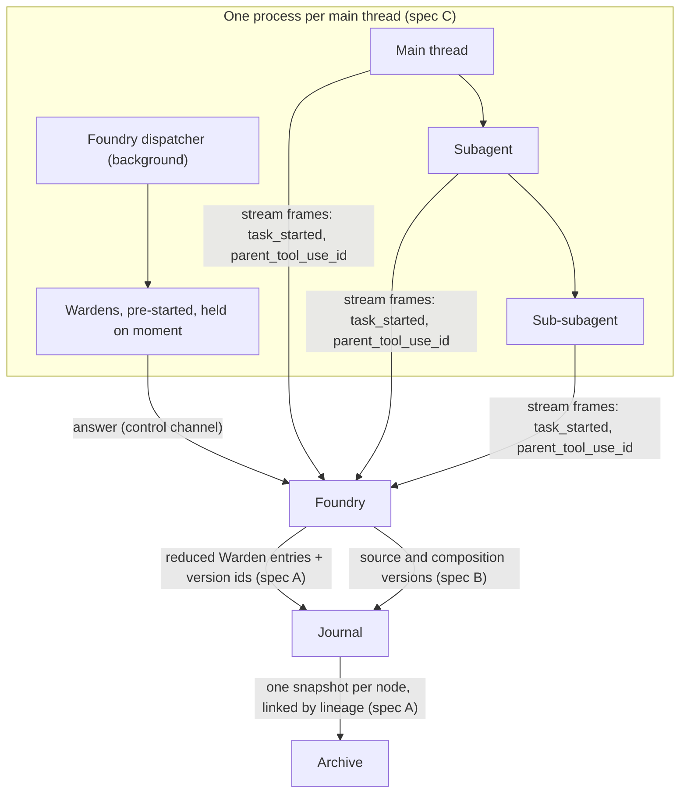

# Journal and thread tree: Warden knowledge (Foundry)

<!-- Region `journal-thread-tree`; concepts: journal, thread-tree. Generated by ~/.foundry/evals/warden-regions/foundry/assemble.py from the three-run consensus. The membership, parts 1–2, the glossary and the bypass lines were written by an LLM (v1). Parts 3–4 are placed verbatim from the sources named on each unit. Edit the sources, not this file. -->

**Routing:** Is this about Foundry's local record of a thread: the journal (LocalSessionStore, phase rows in session_phase, appendPhase, encodeRecord / decodeRecord, contentHash, referencedHashes, the content store, ImageAttachmentStore, imageMediaType, openTurnDetail) or the thread tree (SessionBackedProvider.observeSubagents, SubagentRecorder observed child threads, handoff / handoff-return rows, middleware-reduced rows, reduceMiddleware, compactClosedTurns, pruneRawMiddleware, journal.rawMiddlewareDays, Archive lineage, tree(rootSessionId), the Archive claim lease)? Plain jobs: 'save this turn locally', 'store this big blob in the journal', 'keep the pasted image', 'track the subagents it spawned', 'shrink the Warden rows after the turn', 'clean up old raw rows', 'archive the whole tree as one thing'.

## Contents

- [Glossary](#glossary)
- [1. What this Warden covers](#1-what-this-warden-covers)
- [2. The domain](#2-the-domain)
- [3. Everything that exists here, by class](#3-everything-that-exists-here-by-class)
  - [Class `journal`](#class-journal-the-local-journal-localsessionstore-phase-rows-content-addressed-records-image-attachments)
  - [Class `thread-tree`](#class-thread-tree-a-thread-is-a-tree-native-subagents-as-observed-child-threads-handoff-rows-reduced-middleware-entries-stitching-into-archive)
- [4. The specifics, in full](#4-the-specifics-in-full)
  - [4a. Doc sections](#4a-doc-sections)
    - `docs/THREAD-TREE.md`: (preface); A.1 Spec; A.2 What exists, and what this changes; A.3 Record shapes; A.4 Who writes what, and when; A.6 Original intent; A.7 Open questions; A.8 As built (2026-10-15)
  - [4b. Code entries](#4b-code-entries)

## Glossary

**Archive claim lease**  
Foundry's 10-minute lease (renewed every 2) on native sessions so the collector skips them; fulfilled after capture, lapses to raw capture.

**Archive lineage**  
kind, parentSessionId, rootSessionId, parentEntryId, toolUseId, depth linking a node's Archive session to its parent.

**compactClosedTurns**  
On start, reduces closed turns (interrupted included) whose middleware rows are newer than their reduced rows.

**content store**  
session_content / session_content_ref: sha256-addressed text referenced by journal records, kept once.

**contentHash**  
The sha256 hex hash that identifies stored journal content.

**encodeRecord / decodeRecord**  
Write a journal record with its bulk stored by hash reference (never refusing for size), and read it back with references restored.

**handoff / handoff-return**  
Parent journal rows for a subagent spawn (task hash and excerpt) and its result (outcome, excerpt, usage).

**ImageAttachmentStore**  
Stores message image bytes once each by content hash under the config directory.

**imageMediaType**  
Detects an image's real type (png, jpeg, gif, webp) from its byte signature, ignoring claimed headers.

**journal**  
Class: the local journal, LocalSessionStore, phase rows, content-addressed records and image attachments.

**journal.rawMiddlewareDays**  
Setting (default 30) after which raw advice/guard/route rows of reduced turns are pruned.

**LocalSessionStore**  
The local journal: phase rows per turn, committing a completed response with its artifact.

**LocalSessionStore.appendPhase**  
Appends an immutable phase row; edits outside any turn go on the item's origin thread with turnId null.

**middleware-reduced**  
Phase row appended at turn end per middleware call: state versions and result only, about 0.5-1 KB.

**observed child thread**  
A native subagent run recorded as a child thread; never dispatched to, no runtime, no Wardens.

**openTurnDetail**  
Viewer action opening any owned turn's detail through the journal route, loaded or not.

**phase row**  
One immutable, checksummed session_phase row of a turn (route, advice, guard-*, handoff, middleware-reduced, ...).

**pruneRawMiddleware**  
Deletes raw middleware rows of reduced closed turns past the window, then sweeps unreferenced content; on start and every 6 hours.

**Reduced middleware entry (mw:<callId>)**  
The Archive entry shape of one middleware call: role, trigger, wraps, decision, result, state, timing, usage.

**reduceMiddleware**  
Turns one turn's raw middleware rows into reduced entries for the archive snapshot.

**referencedHashes**  
Lists the content hashes a stored JSON record references directly.

**SessionBackedProvider.observeSubagents**  
Hands subagent events carrying parentToolUseId to subagent observers instead of dropping them.

**SubagentRecorder**  
Turns native subagent events into child threads with ThreadMeta parentThreadId, parentTurnId, depth and spawn.

**thread tree node**  
One conversation (main thread or subagent at any depth), archived as its own Archive session; middleware calls are not nodes.

**thread-tree**  
Class: a thread is a tree; native subagents as observed child threads, handoff rows, reduced middleware entries, stitching into Archive.

**tree(rootSessionId)**  
Archive read returning the root and every descendant as one unit, ordered by parentEntryId.

**Turn-end compaction**  
completeTurn / failTurn append middleware-reduced rows in the transaction that seals the turn; raw rows are never rewritten.

## 1. What this Warden covers

How Foundry keeps a thread's record: the local journal that commits each turn as immutable phase rows with bulk content stored once by hash, and the thread tree (THREAD-TREE spec A) that records native subagents as observed child threads, compacts each middleware call into a small reduced entry when a turn ends, and stitches every node into Archive as linked snapshots.

## 2. The domain

The journal is LocalSessionStore: checksummed, immutable phase rows per turn (route, advice, guard-*, handoff, middleware-reduced, feedback-*), a completed response committed together with its artifact, and appendPhase for facts outside a turn (turnId null on the origin thread). Anything written to it goes through encodeRecord, which spills bulk into the sha256-addressed content store instead of refusing for size, and comes back through decodeRecord with references restored (contentHash names content, referencedHashes lists what a record points at). Image bytes go once each by hash to ImageAttachmentStore, typed from their bytes by imageMediaType; records hold only the image identity.

A thread is the root of a tree whose nodes are conversations: the main thread and subagents at any depth. The provider hands subagent events (parentToolUseId) to SessionBackedProvider.observeSubagents, and SubagentRecorder makes each run an observed child thread (ThreadMeta parentThreadId, parentTurnId, depth, spawn) with handoff / handoff-return rows on the parent; observed children are never dispatched to and carry no runtime or Wardens. A middleware call (a Warden's advice, guard or review, the Cartographer's route) is not a node: when a turn ends, completeTurn / failTurn append one middleware-reduced row per call (reduceMiddleware: state and result, about 0.5-1 KB, never the message it received), raw rows are never rewritten, compactClosedTurns catches up closed and interrupted turns on start, and pruneRawMiddleware deletes raw rows of reduced turns past journal.rawMiddlewareDays (default 30). Archive gets only reduced entries: one snapshot per node linked by lineage (parentSessionId, rootSessionId, parentEntryId), read as one with tree(rootSessionId), with a renewable claim lease keeping the collector off Foundry-driven native sessions.

Not here: the thread object, the turn path, ids and the Postgres Message / ThreadState rows are the `threads` region; the composition version ids a reduced entry carries, thread-knowledge revisions and recompose are `audit-log`; the in-session Warden tree (setup turn, foundry-root / dispatcher generations, recycle, orphans, close) is `in-session-wardens`; Archive's own collector, server and archive commands are `archive`; the delivery ledger is `native-sessions`; showing phase rows in the turn inspector is `viewer-inspector`; the feedback lifecycle that writes feedback-* rows is `feedback`; journalling pre-filter skips is `warden-prefilter-evals`.

## 3. Everything that exists here, by class

Find the problem in plain words, then point at the exact thing. Each class opens with job tables where a class has confusable siblings (which to use when; *Said as* gives the plain words for that job), then one table of every member: **Problem** is the job in the user's or agent's words (match on these); **Use** is the exact member, its kind and `where`, then when to choose it; **Read** is the doc § that describes it (code members) or the code it is about (doc members); **Signs you're bypassing it** is the hand-rolled code an agent writes when it rebuilds the primitive, plus the errors it throws. Quote Use and Read in a pointer ("look over here: createLock, packages/db/src/lock/createLock.ts, CONCURRENCY.md § Distributed Lock"). Code members come from the catalog, described from the code; doc members are named in the doc sections in part 4. *Also here, by name* lists the parts of a larger system.

### Class `journal`: The local journal: LocalSessionStore, phase rows, content-addressed records, image attachments

**Job: write and read journal records with their bulk stored by hash** (encodeRecord vs decodeRecord vs contentHash vs referencedHashes) — catalog job and choose lines (packages/foundry/src/persistence/journal-content.ts)

*Said as:* "store this big payload in the journal", "read the record back with its content", "don't refuse a huge record", "which content does this row point at"

| Member | Use when | Not when (use instead) |
|---|---|---|
| **encodeRecord** | serializing anything written to the journal | reading it back (use decodeRecord) |
| **decodeRecord** | parsing a stored record with references restored | plain JSON.parse, which leaves refs unresolved |
| **contentHash** | the sha256 that identifies stored content | listing a record's refs (use referencedHashes) |
| **referencedHashes** | listing the hashes a stored record references | restoring the content (use decodeRecord) |

**Job: keep a message's images** (ImageAttachmentStore vs imageMediaType vs encodeRecord) — catalog choose lines (packages/foundry/src/persistence/image-attachments.ts)

*Said as:* "save the pasted screenshot", "what type is this image really", "store the image once"

| Member | Use when | Not when (use instead) |
|---|---|---|
| **ImageAttachmentStore** | image bytes, once each by hash | journal content refs (encodeRecord) |
| **imageMediaType** | the real type from byte signature | trusting the claimed header |
| **encodeRecord** | the record holding the image identity | the bytes themselves (use ImageAttachmentStore) |

**Job: read or check a journaled turn** (LocalSessionStore vs openTurnDetail vs isOpenTurn (threads-journal)) — catalog job and choose lines

*Said as:* "is this turn still running", "open that turn's details", "journal the completed response"

| Member | Use when | Not when (use instead) |
|---|---|---|
| **LocalSessionStore** | journaling turns and committing a response with its artifact | UI detail view (openTurnDetail) |
| **openTurnDetail** | opening any owned turn in the viewer detail, loaded or not | you have a trace id (loadTraceDetail) |

| Problem | Use | Read | Signs you're bypassing it |
|---|---|---|---|
| hash this text for the content store; the sha256 that names stored content | **contentHash** · primitive `packages/foundry/src/persistence/journal-content.ts#contentHash` — compute the sha256 hex hash that identifies stored journal content | — | — |
| read the journal record back with its content; I'll just JSON parse the stored row; restore the referenced blobs when loading | **decodeRecord** · primitive `packages/foundry/src/persistence/journal-content.ts#decodeRecord` — Reads what encodeRecord wrote; plain JSON.parse leaves the references unresolved. | — | JSON.parse of a stored journal record, leaving content references unresolved (catalog choose line) |
| store this big payload in the journal; don't refuse a huge record, spill it; I'll JSON stringify the record into the row; write the bulk once by hash | **encodeRecord** · primitive `packages/foundry/src/persistence/journal-content.ts#encodeRecord` — Use instead of JSON.stringify for anything written to the journal; pair with decodeRecord. | — | JSON.stringify of a journal record, or a size check that refuses or truncates a large record (catalog choose line ("use instead of JSON.stringify for anything written to the journal")) |
| save the pasted screenshot once; store message images on disk by hash; I'll base64 the image into the journal record | **ImageAttachmentStore** · primitive `packages/foundry/src/persistence/image-attachments.ts#ImageAttachmentStore` — Journal records hold only the image identity; use this for the image bytes, not journal content refs. | — | base64 image bytes written into a journal record or the content store, or images saved under ad-hoc file names (catalog choose line ("journal records hold only the image identity")) |
| what type is this image really; don't trust the content type header; sniff the image's bytes for its format | **imageMediaType** · primitive `packages/foundry/src/persistence/image-attachments.ts#imageMediaType` — detect an image's real type from its byte signature, ignoring claimed headers | — | trusting the client's Content-Type or file extension for an image's type (catalog job line ("ignoring claimed headers")) |
| save this turn locally; journal the completed response with its artifact; the local record of every turn; I'll write my own sqlite table for turns | **LocalSessionStore** · primitive `packages/foundry/src/persistence/local-session-store.ts#LocalSessionStore` — journal turns locally, committing a completed response and its artifact together | docs/FEEDBACK-LOOP.md § Lifecycle; docs/THREAD-TREE.md § A.5 Test cases | a separate sqlite table, JSON file or log for turns beside the journal, or a response and its artifact written in separate steps (catalog: LocalSessionStore ("journal turns locally, committing a completed response and its artifact together")) |
| open that turn's details in the viewer; show the turn even if it isn't loaded; click a turn to see everything about it | **openTurnDetail** · primitive `packages/foundry/src/viewer/ui/store.js#openTurnDetail` — loadTraceDetail needs a trace id and the active thread | — | — |
| which stored content does this row point at; list the blobs a record references; find what content is still referenced | **referencedHashes** · primitive `packages/foundry/src/persistence/journal-content.ts#referencedHashes` — list the content hashes a stored JSON record references directly | — | — |
| how long to keep raw Warden rows; change the raw middleware retention window | **journal.rawMiddlewareDays** · primitive .foundry/settings.json — Set the retention days for raw middleware journal rows. | part 4 | — |
| append the feedback fact to the thread's journal; record an undo made outside any turn; I'll write the change to a separate log; add an immutable row for this lifecycle step | **LocalSessionStore.appendPhase** · primitive packages/foundry/src/persistence/local-session-store.ts — Edits outside any turn are journalled on the item's origin thread with turnId null. | part 4 | a separate log for edits made outside a turn, rather than appending on the item's origin thread with turnId null (docs/FEEDBACK-LOOP.md § Data model (Edits made outside any turn)) |
| how to record a turn the user cancelled; cancelled isn't the same as interrupted | **Cancelled turn journalled failed with cancelled: true** · rule docs/reference/FOUNDRY-ACP.md §2.2 — Journal a cancelled turn as failed with cancelled: true; keep interrupted for restart with unknown outcome. | part 4 | journalling a user cancel as interrupted (docs/reference/FOUNDRY-ACP.md § 2.2 (Stop)) |
| every feedback step is a journal row; I'll add a feedback memory kind; no parallel store for feedback facts | **Lifecycle facts are journal phase records** · rule docs/FEEDBACK-LOOP.md, Data model; pf:persistence/local-session-store.ts — Any new feedback lifecycle fact. | part 4 | a new file or table for routes, tune answers or applied changes instead of a feedback-* session_phase row on the thread (docs/FEEDBACK-LOOP.md § Data model: journal phases, no parallel store) |

- *Also here, by name:* CONTENT_REF_MIN (`packages/foundry/src/persistence/journal-content.ts`); IMAGES_PER_MESSAGE (`packages/foundry/src/persistence/image-attachments.ts`); IMAGE_MAX_BYTES (`packages/foundry/src/persistence/image-attachments.ts`); ImageAttachmentError (`packages/foundry/src/persistence/image-attachments.ts`); JOURNAL_SPILL_KEY (`packages/foundry/src/persistence/local-session-store.ts`); JSON_REF_DEPTH (`packages/foundry/src/persistence/journal-content.ts`); SUMMARY_META_KEYS (`packages/foundry/src/persistence/local-session-store.ts`); chunkText (`packages/foundry/src/persistence/journal-content.ts`); isChunksRef (`packages/foundry/src/persistence/journal-content.ts`); isContentRef (`packages/foundry/src/persistence/journal-content.ts`); isJsonRef (`packages/foundry/src/persistence/journal-content.ts`)

### Class `thread-tree`: A thread is a tree: native subagents as observed child threads, handoff rows, reduced middleware entries, stitching into Archive

**Job: shrink middleware rows once a turn is over** (Turn-end compaction vs compactClosedTurns vs reduceMiddleware vs pruneRawMiddleware) — docs/THREAD-TREE.md § A.4, § A.8 Compaction and retention

*Said as:* "the Warden rows are too big for Archive", "keep just the state and result", "clean up old raw guard rows", "a turn crashed before it was compacted"

| Member | Use when | Not when (use instead) |
|---|---|---|
| **Turn-end compaction** | completeTurn / failTurn append middleware-reduced rows | turns left unreduced at start (compactClosedTurns) |
| **compactClosedTurns** | on start, reducing closed turns incl. interrupted | the turn is still open (wait for it to end) |
| **reduceMiddleware** | turning one turn's raw rows into reduced entries | deleting rows (pruneRawMiddleware) |
| **pruneRawMiddleware** | deleting raw rows of reduced closed turns past the window | any turn without reduced rows |
| **journal.rawMiddlewareDays** | setting the prune window (default 30) | changing what Archive gets (always reduced) |

**Job: record native subagents as part of the thread** (SubagentRecorder vs SessionBackedProvider.observeSubagents vs handoff / handoff-return journal rows) — docs/THREAD-TREE.md § A.8 Observed subagents

*Said as:* "track the subagents it spawned", "show subagents under their parent", "don't drop the subagent events"

| Member | Use when | Not when (use instead) |
|---|---|---|
| **SessionBackedProvider.observeSubagents** | handing parentToolUseId events to observers | making the child thread (SubagentRecorder) |
| **SubagentRecorder** | each subagent run becomes a child thread | separate subagent tracking |
| **handoff / handoff-return journal rows** | the parent's record of spawn and result | the child's own activity (its observed turn) |

**Job: stitch a thread tree into Archive** (Archive lineage vs tree(rootSessionId) vs Linked snapshots plus a tree read vs Archive claim lease) — docs/THREAD-TREE.md § A.3, § A.4, § A.7

*Said as:* "archive the whole tree as one thing", "link the child session to its parent", "stop the collector archiving it twice"

| Member | Use when | Not when (use instead) |
|---|---|---|
| **Archive lineage (archive)** | linking a node's session to its parent and root | reading the tree (tree(rootSessionId)) |
| **tree(rootSessionId) (archive)** | reading root and descendants as one unit | one giant snapshot |
| **Linked snapshots plus a tree read** | one snapshot per node, read as one | a stitched tree snapshot (hits the 50,000-entry cap) |
| **Archive claim lease** | keeping the collector off Foundry-driven native sessions | a permanent lock (leases lapse to raw capture) |

| Problem | Use | Read | Signs you're bypassing it |
|---|---|---|---|
| keep just the Warden's state and result; turn the raw guard rows into small entries; shrink a turn's middleware rows for Archive | **reduceMiddleware** · primitive `packages/foundry/src/archives/reduced-middleware.ts#reduceMiddleware` — turn one turn's raw middleware rows into reduced entries for the archive snapshot | — | — |
| track the subagents it spawned; each subagent should be its own child thread; I'll keep a separate table of subagent runs; show subagents under their parent | **SubagentRecorder** · primitive `packages/foundry/src/turns/subagents.ts#SubagentRecorder` — This is how subagents become child threads; do not build separate subagent tracking. | docs/THREAD-TREE.md § A.8 As built (2026-10-15) | a separate subagent map or table keyed by native task id, or subagent runs kept as plain events on the parent, instead of child threads with parentThreadId / parentTurnId (catalog choose line ("do not build separate subagent tracking"); docs/THREAD-TREE.md § A.8 As built) |
| stop the collector archiving it twice; claim the native session while the thread is live; fall back to raw capture if we crash | **Archive claim lease** · pattern docs/THREAD-TREE.md A.8 Claims (Archive 0.20.0) — Proceed unclaimed when Archive routes return 404. | part 4 | a permanent lock or exclusion list keeping the collector off Foundry's sessions, or capture failing when Archive answers 404 on the claim routes (docs/THREAD-TREE.md § A.4 (Claim, Collector); § A.8 As built › Claims) |
| record when the parent spawned a subagent; log what the subagent handed back; journal the spawn and its result on the parent | **handoff / handoff-return journal rows** · pattern docs/THREAD-TREE.md A.8 — Journal a parent's spawn as handoff and the result as handoff-return rows. | part 4 | — |
| archive the whole tree as one thing; one snapshot per subagent, linked together; I'll stitch everything into one big snapshot | **Linked snapshots plus a tree read** · pattern docs/THREAD-TREE.md A.7 Q1 — Instead of one tree snapshot, which rewrites everything on each change and hits the 50,000-entry cap. | part 4 | one big stitched snapshot for the whole tree, rewritten on every child change (docs/THREAD-TREE.md § A.7 question 1) |
| compact middleware calls when the turn ends; keep the result but drop the input | **middleware-reduced rows** · pattern docs/THREAD-TREE.md — Compact each middleware call at turn close into a row of state versions and result, never input. | part 4 | — |
| record subagents under their parent thread; track the task tool's child sessions | **Subagents as observed child threads** · pattern turns/subagents.ts — In claude-in-session runtime, each subagent turn is guarded once when it ends. | part 4 | — |
| a thread is a tree of conversations; subagents at any depth are their own sessions; each conversation node archives separately | **Thread tree nodes** · pattern docs/THREAD-TREE.md § A.1 Spec — Subagents and children are nodes; middleware calls are not. | code `Cartographer`, `snapshot` | — |
| compact the Warden rows when the turn ends; append small rows instead of rewriting the big ones; the raw advice rows are too big for Archive | **Turn-end compaction** · pattern docs/THREAD-TREE.md § a-4 — append immutable `middleware-reduced` rows per middleware call when a turn ends, never rewriting raw rows | part 4 | an UPDATE that rewrites or trims raw advice/guard rows in place (docs/THREAD-TREE.md § A.1 Spec, § A.4 ("raw rows are never rewritten")) |
| a turn crashed before it was compacted; on start, reduce turns that were missed; catch up interrupted turns' middleware rows | **compactClosedTurns** · primitive compactClosedTurns — Reduce closed turns, including interrupted ones, whose middleware rows are newer than their reduced rows. | part 4 | a start-up catch-up that reduces only completed turns, skipping interrupted ones or late guard outcomes (docs/THREAD-TREE.md § A.8 As built › Compaction and retention) |
| clean up old raw guard rows; delete raw middleware rows after a month; I'll write a cron to delete old phase rows | **pruneRawMiddleware** · primitive pruneRawMiddleware — Delete old raw middleware rows of reduced closed turns and sweep unreferenced journal content. | part 4 | a hand-written cleanup job deleting old phase rows or content without checking that a reduced row exists (docs/THREAD-TREE.md § A.8 Compaction and retention) |
| don't drop the subagent events; pass subagent frames to whoever is watching; the provider is filtering out child events | **SessionBackedProvider.observeSubagents** · primitive SessionBackedProvider.observeSubagents — Hand subagent events carrying parentToolUseId to subagent observers instead of dropping them. | part 4 | a provider that filters out events carrying parentToolUseId, or parses task_started frames itself (docs/THREAD-TREE.md § A.8 As built) |
| Archive must be upgraded before shipping lineage; the old receiver rejects the new lineage fields | **Archive 0.20.0 release order** · rule docs/THREAD-TREE.md A.8 — A 0.19 receiver refuses lineage rootSessionId and parentEntryId. | part 4 | — |
| don't ship the Warden's full input to Archive; Archive only gets the small middleware entries | **Archive receives only reduced entries** · rule docs/THREAD-TREE.md A.8 Capture — Send Archive reduced mw:/middleware: entries only, never raw middleware rows. | part 4 | capture code that decodes phase rows whole and sends Warden inputs (segments, request.messages) to Archive (docs/THREAD-TREE.md § A.8 As built › Capture) |
| a guard on a subagent's tool goes in the subagent; record the child's Warden in the child's snapshot | **Child Wardens attach to the child's snapshot** · rule docs/THREAD-TREE.md A.5 test 6 — Applies at any depth of the thread tree. | part 4 | — |
| don't compact while the turn is still open; write reduced rows only once the turn closes | **Compaction only after the turn ends** · rule docs/THREAD-TREE.md A.5 test 4 — Applies to all middleware rows. | part 4 | writing middleware-reduced rows while the turn is still open, or outside the transaction that seals it (docs/THREAD-TREE.md § A.4 Who writes what, and when) |
| the native session is archived twice; the collector should skip what Foundry archives | **Foundry does not double-archive native sessions** · rule docs/THREAD-TREE.md A.5 test 8, A.7 Q2 — Lapsed lease falls back to raw collector capture, tagged superseded-by after Foundry writes. | part 4 | — |
| Archive shouldn't guess the subagent's parent; Foundry links the tree from the stream frames | **Foundry writes the tree links** · rule docs/THREAD-TREE.md § A.1 Spec — Applies to native subagent capture. | code `Cartographer`, `snapshot` | Archive-side code inferring a subagent's parent from the transcript or spawnDepth (docs/THREAD-TREE.md § A.1 Spec) |
| recapturing an unchanged node should be a no-op; same digest when nothing changed | **Idempotent capture** · rule docs/THREAD-TREE.md A.5 test 9 — Applies to every node capture. | part 4 | — |
| a Warden call isn't its own session; I'll archive each Warden call as a child; store the call's result, not the message it got | **Middleware calls are reduced entries, not nodes** · rule docs/THREAD-TREE.md § A.1 Spec — Applies to Wardens, the Cartographer and tool-gate decisions. | code `Cartographer`, `snapshot` | a Warden or Cartographer call archived as its own child session, or its received message copied into the entry (docs/THREAD-TREE.md § A.1 Spec) |
| don't send turns to an observed subagent; observed children get no Wardens or runtime | **Observed subagents are never dispatched to** · rule docs/THREAD-TREE.md A.8 — Applies to native subagent children. | part 4 | attaching a runtime or Wardens to an observed child, or sending it a turn (docs/THREAD-TREE.md § A.8 As built) |
| use the thread id as the node's session id; keep the native task id as a reference only | **One id scheme for nodes** · rule docs/THREAD-TREE.md § a-3 — Applies to observed native children too. | part 4 | a native task_id or agent-<id> used as a node's sessionId (docs/THREAD-TREE.md § A.3 Record shapes) |
| log the Warden even when it stays silent; skip writing a row when it has no comment | **Record NO_COMMENT Warden calls** · rule docs/THREAD-TREE.md A.5 test 3 — Exposure counts (FEEDBACK-LOOP L5) need the denominator. | part 4 | skipping the journal write when a Warden stays silent (docs/THREAD-TREE.md § A.5 test 3) |
| reduced entries hold no messages or instructions; keep each middleware entry under two kilobytes | **Reduced middleware entry shape** · rule docs/THREAD-TREE.md A.5 test 2 — Applies to every middleware call after the turn ends. | part 4 | — |
| pinning the root keeps its subagents; pruning a child leaves a lineage stub | **Retention keeps tree lineage** · rule docs/THREAD-TREE.md A.5 test 11 — Applies to thread-tree retention. | part 4 | retention that prunes a child node's session on its own, breaking the tree's lineage (docs/THREAD-TREE.md § A.4 (Read: "Retention treats the tree as one unit")) |

- *Also here, by name:* RAW_MIDDLEWARE_PHASES (`packages/foundry/src/archives/reduced-middleware.ts`); REDUCED_PHASE (`packages/foundry/src/archives/reduced-middleware.ts`)

## 4. The specifics, in full

### 4a. Doc sections

Each unit is the doc section verbatim, with its headings shifted down two levels. A source line above it gives the path, the section and the doc's H1.

<!-- unit doc:docs/THREAD-TREE.md#preface -->
**Source:** `docs/THREAD-TREE.md` § (preface) (in "Thread tree: stitching, composition audit, start-up")

### Thread tree: stitching, composition audit, start-up

> **APPROVED by Aron (2026-10-14), with the answers recorded under each spec's open questions.** B is built (#72); A is built (§A.8). C is built for Claude behind `subscriptionOnly.decisionRuntime: 'claude-in-session'`, **off by default** until Aron has seen the numbers (§C.9). Each part ships as its own PR. Queue items 2, 7 and 8 on `COORDINATION.md` (2026-10-13).

**Cited designs.** `SUBAGENTS.md` and the FEEDBACK-LOOP L-sections cited below are design docs in Oracle (`docs/foundry/reference/SUBAGENTS.md`, `docs/foundry/FEEDBACK-LOOP.md`).

**Basis.** Foundry `origin/main` `0025354`; agent-session `feat/claude-subagent-prestart` (`fbb2cda`, PR #13); Archive `origin/main` `83bced1` (0.17.0); template `main`; Claude Code 2.1.296; codex-cli 0.155.1. Path prefixes are the same as [reference/SUBAGENTS.md](reference/SUBAGENTS.md): `pf/` = `packages/foundry/src`, `pc/` = `packages/core/src`, `as/` = agent-session `src`, `ar/` = Archive `src`, `tp/` = template. Anything not checked in code or run live is marked **[unverified]**.

**How the three fit together.**



- **Spec C** puts the whole tree (main thread, subagents at any depth, every Warden) in one native process per main thread.
- **Spec A** says what Foundry writes to Archive for that tree, and that a Warden call is a small entry, not a copy of its input.
- **Spec B** is what makes the small entry enough. A call records the *versions* of its instructions and domain knowledge, and the audit trail can recompose the exact text from them.

---

### A. Thread-tree stitching into Archive

<!-- unit doc:docs/THREAD-TREE.md#a-1-spec -->
**Source:** `docs/THREAD-TREE.md` § A.1 Spec (in "Thread tree: stitching, composition audit, start-up")

#### A.1 Spec

A Foundry thread is the root of a tree. Each **node** is one conversation: the main thread, or a subagent at any depth (native Claude `Agent`/`Task`, a Codex sub-agent, or a Foundry child thread from [SUBAGENTS.md](reference/SUBAGENTS.md) §3). Each node archives as **its own Archive session**, linked to its parent. A **middleware call** (a Warden's advice, guard or review, the Cartographer's route) is not a node. It is a **reduced entry inside the node it wrapped**: its state and its result, never the message it was sent.

**Foundry writes the links.** The native stream carries the whole tree, so Archive never has to guess: a subagent's `task_started` frame carries `task_id`, `tool_use_id`, `spawn_depth` and `subagent_type`, and the assistant frame that issued the spawn carries the spawner's `parent_tool_use_id` (verified live, §C.2). Today agent-session's main-session path drops those frames, so carrying them through is a prerequisite (A.2). During a turn, the journal keeps the full phase rows the viewer and the replay need. When the turn ends, Foundry **compacts**: it appends one new, immutable `middleware-reduced` row per middleware call of that turn. Raw rows are never rewritten. On start, it compacts any earlier turn left without reduced rows. Archive capture sends the reduced rows, never the raw ones, and the raw rows age out under a local retention setting.

**Why it matters.** Locally the content store already keeps each distinct composed text once (`pf/persistence/journal-content.ts`), so the saving is in **Archive**. Capture decodes phase rows whole today, so every Warden call's full input is re-sent and stored in every revision.

"Stitched into one artifact" means Archive **reads** the tree as one artifact (`tree <rootSessionId>`, with retention keeping the tree as one unit). It does not mean one giant snapshot (see A.6, question 1).

<!-- unit doc:docs/THREAD-TREE.md#a-2-what-exists-and-what-this-changes -->
**Source:** `docs/THREAD-TREE.md` § A.2 What exists, and what this changes (in "Thread tree: stitching, composition audit, start-up")

#### A.2 What exists, and what this changes

| Today | Where | This spec |
|---|---|---|
| Archive's lineage: `{kind: subagent\|fork, parentSessionId, agentType?, agentName?, description?, toolUseId?, depth?}`, stored only in the snapshot JSON. | `ar/index.ts:44-52` | Adds `rootSessionId` and `parentEntryId`. |
| The collector sets `parentSessionId` to the **root** session even for a sub-subagent; `meta.json` only gives `spawnDepth`. | `ar/import.ts:158-168` | Foundry-written nodes carry the real parent. |
| Lineage and runtime are computed but not emitted: 81a317c holds them until receivers run ≥0.14.0. | `ar` 81a317c | Prerequisite: lift the hold (COORDINATION item 2), and do it once, together with this spec's own schema additions. |
| A Codex sub-agent rollout replays the parent's history, which is then archived and searchable under the child too. | `ar/import.ts:130-132` | Foundry-written Codex children hold only their own items. |
| Foundry captures one snapshot per journal thread. Phase rows go in whole, "request context included". | `pf/archives/capture.ts:165-173` | Phase rows become reduced entries. |
| Advice and guard rows carry `segments.{instructions, domainKnowledge, threadKnowledge}` as full text, plus `request.messages`, the exact provider input. | `pf/agents/flow-orchestrator.ts:636-698` | After compaction the journal keeps version ids (spec B) and hashes. The full text stays in the content store only while something references it. |
| SUBAGENTS.md proposes `handoff` / `handoff-return` phase rows and `ThreadMeta.{parentTurnId, spawn, depth}`. | Oracle `docs/foundry/reference/SUBAGENTS.md` §4 | Reused unchanged. This spec only says how they reach Archive. |
| **Prerequisite.** agent-session's main-session path ignores `task_started` and `parent_tool_use_id`: only `as/claude-subagents.ts:1049` reads task frames. Codex collab items become `unsupported` (`as/codex-session.ts:1803`). | agent-session | SUBAGENTS.md §8 step 1, plus Codex `collabAgentToolCall` support, land first. |
| **Prerequisite.** FEEDBACK-LOOP L5 exposure and L6 `exposedAtTurn` search the segment text in advice and guard rows (`pf/feedback/service.ts:280, 605`, `phasesContaining`). | Foundry | Spec A can't ship without spec B. One cut moves `FeedbackService` to version-based exposure (B test 3) and rewrites FEEDBACK-LOOP L5, L6 and L-data. |
| Archive RETENTION.md §3.3 proposes `lineage {kind: subagent \| handoff \| fork, parentKey, …}`. The shipped schema uses `parentSessionId`. | `archive/docs/RETENTION.md` | Amend RETENTION to the shape below. Keep the shipped `parentSessionId` (receivers ≥0.14 already parse it); `handoff` is A.7 question 6. |

<!-- unit doc:docs/THREAD-TREE.md#a-3-record-shapes -->
**Source:** `docs/THREAD-TREE.md` § A.3 Record shapes (in "Thread tree: stitching, composition audit, start-up")

#### A.3 Record shapes

**Lineage** (Archive, additive to `archiveLineageSchema`):

```ts
lineage: {
  kind: 'subagent' | 'fork';
  parentSessionId: string;     // the parent NODE's Archive sessionId (not always the root)
  rootSessionId: string;       // new: the main thread's sessionId; equal to sessionId on the root itself
  parentEntryId?: string;      // new: the parent's entry that spawned it (its tool-call entry id)
  toolUseId?: string;          // native tool_use id of the spawn
  agentType?: string;  agentName?: string;  description?: string;
  depth?: number;              // 1 = child of the root
}
```

**One id scheme.** Every node is a Foundry thread, observed native children included (SUBAGENTS.md §4.1), and its `sessionId` is its thread id. The native ids (`task_id`, Claude's `agent-<id>`, the Codex child thread id) go in `spawn.nativeTaskId` and in the snapshot's `references`, which is how the collector recognises a transcript Foundry has claimed. Archive keys stay `sha256([sourceId, source, sessionId])` (`ar/index.ts:106-111`), so a parent's key is computed from `parentSessionId`.

**Reduced middleware entry** (one Archive entry, inside the node it wrapped):

```ts
{
  id: `mw:${callId}`,
  turnId,                                    // the node's turn
  kind: 'event',                             // A.6 question 3: or a new 'middleware' kind
  sourceRef: `middleware:${callId}`,
  timestamp,                                 // when it settled
  model, effort,                             // what served it
  text: JSON.stringify({
    role: 'warden:conventions',              // or 'cartographer'
    trigger: 'user-message' | 'agent-action' | 'subagent-spawn' | …,  // TriggerPoint (pf/agents/warden-triggers.ts); new charter triggers join it
    wraps: 'turn:<id> for a message or a turn\'s actions, a tool call id (guard: per-call), handoff:<child> for a brief',
    decision: ContributionDecision,          // pf/agents/flow-orchestrator.ts:69-81, incl. 'omitted'
    result: 'the text it chimed in with' | null,
    reason?: 'cold-cache' | 'deadline-queued' | ...,
    state: {
      charter: 'charter-1a2b3c4d5e6f',                         // WARDEN_CHARTER_VERSION
      instructions: 'cv_…', domainKnowledge: 'cv_…',          // composition version ids (spec B)
      threadKnowledge: { revision: 7, hash: 'sha256…' },       // raw text in the content store
      threadKnowledgeAfter?: { revision: 8, hash: 'sha256…' }, // a review that wrote a new revision
    },
    timing: { startedAt, elapsedMs },
    usage?: { input, output, cacheRead, cacheWrite },
    cites?: ['fb_…'],                        // feedback ids it cited (FEEDBACK-LOOP L5)
  }),
}
```

The entry is about 0.5–1 KB whatever the size of the Warden's context. The message it received is **not** in it. That message is the node's own entry named by `wraps`, plus the composed context, which spec B can recompose from the version ids.

**A tool-gate decision** (structural allow/deny) gets the same reduced shape, with `role: 'gate'`. Its `result` is the outcome, and its `state` is the rule id and the rule's settings revision.

<!-- unit doc:docs/THREAD-TREE.md#a-4-who-writes-what-and-when -->
**Source:** `docs/THREAD-TREE.md` § A.4 Who writes what, and when (in "Thread tree: stitching, composition audit, start-up")

#### A.4 Who writes what, and when

| When | Who | What |
|---|---|---|
| During a turn | Foundry, as today | Full phase rows in `session_phase` (`pf/persistence/local-session-store.ts`). They feed the live viewer (`flow:<thread>`) and the per-turn detail. No change. |
| A native spawn is seen (`task_started`) | Foundry | Starts an observed child node in the journal: SUBAGENTS.md §4.1 `ThreadMeta` with `parentThreadId`, `parentTurnId`, `spawn.{via, toolCallId, nativeTaskId}`, `depth`, plus the `handoff` row (§4.2). Parent attribution: the spawn's `tool_use` sits in an assistant frame whose `parent_tool_use_id` is the spawner's own spawn (null = the main thread). |
| The turn ends (`completed`, `failed`) | Foundry, in the same journal transaction that seals the turn | **Compaction.** It appends one `middleware-reduced` phase row per middleware call of the turn, holding the A.3 shape. Existing rows are immutable and their checksums still verify (`pf/persistence/local-session-store.ts:1054`). The thread-knowledge text a reduced row names stays in the content store. |
| Foundry starts | Foundry | Writes reduced rows for any turn that has none, `interrupted` turns included. The raw rows stay, because an interrupted outcome still has to be checked. This is the "or at the start of each request" half. |
| Raw rows older than `journal.rawMiddlewareDays` (default 30) | Foundry retention | Deletes raw `advice` / `guard-*` / `route` rows that already have a reduced row, and releases the content they alone referenced. Deleting is retention; it is not a rewrite. |
| After compaction | `ArchiveCapture` (`pf/archives/capture.ts`) | One snapshot per node: its messages, tools and native evidence as today, plus reduced entries in place of raw middleware rows, plus `lineage`. The root's snapshot carries `rootSessionId = sessionId`. A child changing never re-captures its parent. |
| Claim | Foundry → Archive | Foundry claims each session in its tree as a **lease**, not a permanent lock: `{sessionIds (native ids), claimant: foundry sourceId, expiresAt}`. Foundry renews the lease while the thread is live (lease 10 min, renewed every 2 min). When Foundry has written the stitched snapshot covering a native session, it marks that session's claim `fulfilled` (it names the Foundry archive key). |
| Collector | Archive | Skips a claimed native transcript only while its lease is live, or once the claim is `fulfilled`. If a lease lapses without being fulfilled (Foundry crashed mid-thread), the collector captures the raw session as a fallback: "Archive keeps every session" is a standing rule. If Foundry later fulfils that claim, the fallback archive is tagged `superseded-by:<foundry key>` and kept; retention may prune it. Without a claim, every in-session Warden (spec C) would also be archived as a full `subagents/agent-*.jsonl` session, input included. |
| Read | Archive | `tree(rootSessionId)` returns the root and every descendant, ordered by `parentEntryId`. Retention treats the tree as one unit, as RETENTION.md §4 already proposes. |

<!-- unit doc:docs/THREAD-TREE.md#a-6-original-intent -->
**Source:** `docs/THREAD-TREE.md` § A.6 Original intent (in "Thread tree: stitching, composition audit, start-up")

#### A.6 Original intent

Aron, 2026-10-12: *"The Warden's input and output are obviously stored... If we could compact some of that at the end of each request or at the start of each request, just the right thing: it doesn't need the message it received. It needs its state and its result, sort of a reduced version, and that needs to be part of the thread. It needs to be stitched into the thread for recording purposes so you can track it. Subagents also need to be stitched. I mean they're their own threads but they need to be tied somehow. Again this is a tree. This can go fairly deep. Subagents can spawn subagents and they can all have middleware around them."*

Also: *"I think the Foundry needs to tie those things together somehow. If it's doing the thing, the Foundry should be injecting that into the archive somehow or working with Archive to provide that."* And from 2026-10-12, 00:24: *"I want to be able to see the sub-agents and their runs and all this stuff. All this stuff needs to be interrogatable."*

<!-- unit doc:docs/THREAD-TREE.md#a-7-open-questions -->
**Source:** `docs/THREAD-TREE.md` § A.7 Open questions (in "Thread tree: stitching, composition audit, start-up")

#### A.7 Open questions

1. **"One artifact": one stitched snapshot, or linked snapshots read as one?** I recommend linked snapshots plus a `tree` read. Archive stores a full new revision on every change: superseded revisions are already about 90% of storage (RETENTION.md). One tree snapshot would re-write the whole tree whenever any node changed. It would also hit the 50,000-entry snapshot cap on long threads.
2. **DECIDED (Aron, 2026-10-14): Foundry records.** *"If Foundry is handling it, it should do it, because it does all this compositional stuff."* Foundry claims a thread and every session in its tree with a **lease** (coordinator, 2026-10-14: a lease, not a permanent lock). Archive's collector skips a claimed session only while the lease is live or once the claim is fulfilled. A lapsed claim falls back to raw capture (A.4, test 8a). Foundry writes the stitched version using Archive's primitives. The original question: who archives a Foundry-driven native session? I recommended Foundry alone, with the collector skipping any session Foundry has claimed. Foundry would claim by session id, or by Foundry running natives under its own `CLAUDE_CONFIG_DIR` per integration, which Kingdom's subscription pools already require. The alternative is that both write and Archive links them, but then every in-session Warden is archived in full.
3. **A new entry kind `middleware`**, or `event` with a `middleware:` sourceRef? A new kind is cleaner to filter and search. It is one more strict-schema change that receivers must take first.
4. **DECIDED (Aron, 2026-10-14): a setting, default 30 days.** `journal.rawMiddlewareDays` controls how long the journal keeps raw middleware rows. Archive gets only reduced entries from the start.
5. **Gate decisions:** reduce them like Warden calls (proposed), or keep them full? They are small already.
6. **Lineage `kind: 'handoff'`** (RETENTION.md §3.3): is it needed for Foundry child threads (`foundry_delegate`), or is `subagent` with `spawn.via` enough?

---

<!-- unit doc:docs/THREAD-TREE.md#a-8-as-built-2026-10-15 -->
**Source:** `docs/THREAD-TREE.md` § A.8 As built (2026-10-15) (in "Thread tree: stitching, composition audit, start-up")

#### A.8 As built (2026-10-15)

**Observed subagents** (agent-session 0.6.5 passes subagent frames through):
- Every subagent event carries `parentToolUseId`, plus a `subagent` lifecycle, and sits outside every admission. The executor's provider hands these events to its subagent observers (`SessionBackedProvider.observeSubagents`) instead of dropping them.
- `SubagentRecorder` (`pf/turns/subagents.ts`) makes each run a child thread. Its `ThreadMeta` carries `parentThreadId`, `parentTurnId`, `depth` and `spawn {via, toolCallId, nativeTaskId, agentType, handoffId, observed}`.
- The parent is the real one: the subagent that issued the spawn (found by `parentTaskId`, or by the spawning call seen in that subagent's stream), else the main thread.
- The parent journals a `handoff` row (the task's hash and excerpt, `composition: null`, `observed: true`) and a `handoff-return` row (outcome, the answer's excerpt, usage).
- The child holds its own activity as an observed turn: the task as the user message, its native events, and its answer.
- A Codex child turn ends on its lifecycle update, and a later child turn opens a new turn.
- Observed children appear in the viewer, under their parent. They are never dispatched to, and carry no runtime and no Wardens.

**Compaction and retention:**
- `completeTurn` and `failTurn` append one `middleware-reduced` row per middleware call of the turn: route, each advice participant, and each guard outcome with its request's versions. Each row has the A.3 shape.
- Raw rows are immutable, and their checksums still verify.
- On start, `compactClosedTurns` reduces every closed turn that has middleware rows newer than its reduced rows, `interrupted` turns included. That covers a late guard outcome too.
- `journal.rawMiddlewareDays` (default 30, a setting) controls `pruneRawMiddleware`. It deletes raw rows of closed, reduced turns once they are older than the window, then sweeps journal content nothing references. It runs on start and every 6 hours.
- Exposure (FEEDBACK-LOOP L5) is still counted after pruning: from the raw row while it exists, then from the reduced row's versions.
- Gate rows stay raw: they are small and carry no composed input.

**Capture:**
- Archive gets reduced entries (`mw:<call id>`, `middleware:<call id>`, with model and effort) and never the raw middleware rows.
- A child thread's snapshot carries `lineage {kind: subagent, parentSessionId, rootSessionId, parentEntryId: phase:<handoff id>, toolUseId, agentType, description, depth}`.

**Claims** (Archive 0.20.0, Archive #16):
- Capture holds a lease on the native sessions behind a thread before writing it: the executor's Claude session id or Codex thread id, plus an observed Codex child's own thread. The lease runs 10 minutes and is renewed every 2 minutes while the thread has an open turn.
- After writing, capture fulfils the claim with the archive it wrote, so the collector leaves those transcripts alone.
- A crash lets the lease lapse, and the collector then captures the raw transcript (Archive #16 tests the lapse).
- An Archive without the claim routes answers 404, and capture goes on unclaimed.

**Release order:**
- Archive 0.20.0 must be published and blessed, and Kingdom and every hosted Archive must run it, before this ships.
- Lineage `rootSessionId` and `parentEntryId` are refused by a 0.19 receiver's strict schema.

### B. Audit for composed instructions

### 4b. Code entries

From the catalog (extracted from the code through the repo's Atlas map, described by a model). Each line: **name** `where` [kind] the job it does. Use: canonical usage.

#### Class `journal`
- **contentHash** `packages/foundry/src/persistence/journal-content.ts#contentHash` [primitive] compute the sha256 hex hash that identifies stored journal content Use: const hash = contentHash(text)
- **decodeRecord** `packages/foundry/src/persistence/journal-content.ts#decodeRecord` [primitive] parse a stored journal record, restoring all content it references Use: const record = decodeRecord<T>(text, contentStore)
- **encodeRecord** `packages/foundry/src/persistence/journal-content.ts#encodeRecord` [primitive] serialize a journal record with its bulk stored by hash reference, never refusing for size Use: const text = encodeRecord(value, contentStore, { bytes, spillKey })
- **ImageAttachmentStore** `packages/foundry/src/persistence/image-attachments.ts#ImageAttachmentStore` [primitive] store message images once each by content hash under the config directory Use: new ImageAttachmentStore(`${configDir}/attachments/images`)
- **imageMediaType** `packages/foundry/src/persistence/image-attachments.ts#imageMediaType` [primitive] detect an image's real type from its byte signature, ignoring claimed headers Use: const type = imageMediaType(bytes) // png|jpeg|gif|webp|null
- **LocalSessionStore** `packages/foundry/src/persistence/local-session-store.ts#LocalSessionStore` [primitive] journal turns locally, committing a completed response and its artifact together Use: new LocalSessionStore(db) // real instance in tests
- **openTurnDetail** `packages/foundry/src/viewer/ui/store.js#openTurnDetail` [primitive] open any owned turn in the detail view through the journal route, loaded or not Use: await openTurnDetail(threadId, turnId)
- **referencedHashes** `packages/foundry/src/persistence/journal-content.ts#referencedHashes` [primitive] list the content hashes a stored JSON record references directly Use: const hashes = referencedHashes(storedJson)

#### Class `thread-tree`
- **reduceMiddleware** `packages/foundry/src/archives/reduced-middleware.ts#reduceMiddleware` [primitive] turn one turn's raw middleware rows into reduced entries for the archive snapshot Use: reduceMiddleware(rows, keep)
- **SubagentRecorder** `packages/foundry/src/turns/subagents.ts#SubagentRecorder` [primitive] record each native subagent run as a child thread linked to its parent turn Use: new SubagentRecorder(...) fed native subagent events
