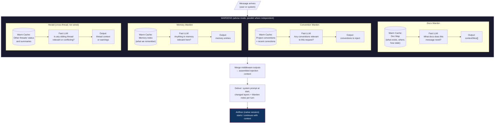

# Session context delivery: Warden knowledge (Foundry)

<!-- Region `session-delivery`; concepts: session-delivery. Generated by ~/.foundry/evals/warden-regions/foundry/assemble.py from the three-run consensus. The membership, parts 1–2, the glossary and the bypass lines were written by an LLM (v1). Parts 3–4 are placed verbatim from the sources named on each unit. Edit the sources, not this file. -->

**Routing:** Is this about what a native Claude Code or Codex session receives at start and on each turn, and the evidence of it: baseContextOf and the system prompt (--append-system-prompt; Codex's first message), sessionTurn and per-turn deltas, standing parts labelled `## Context: <id>`, the Librarian's delivery ledger (SessionDelivery.held, commitDelivery), compaction re-send (session_compacted), resume and relaunch, wrapsThread, DeliveryRecord.session, or native output and delivery evidence (projectNative, servedModel, verifyExpertDelivery, evidenceDigest)? Plain jobs: 'send the context again every turn', 'only send the layers that changed', 'the session compacted, do we resend everything', 'which model actually answered', 'check the expert got what we said it got'.

## Contents

- [Glossary](#glossary)
- [1. What this Warden covers](#1-what-this-warden-covers)
- [2. The domain](#2-the-domain)
- [3. Everything that exists here, by class](#3-everything-that-exists-here-by-class)
  - [Class `session-delivery`](#class-session-delivery-what-a-native-session-receives-each-turn-standing-parts-in-the-system-prompt-per-turn-deltas-the-delivery-ledger-and-delivery-evidence)
- [4. The specifics, in full](#4-the-specifics-in-full)
  - [4a. Doc sections](#4a-doc-sections)
    - `docs/FLOW.md`: Loop 1: Pre-Message — Context Routing + Domain Advising
  - [4b. Code entries](#4b-code-entries)

## Glossary

**--append-system-prompt**  
How a Claude session starts with its standing parts; it survives compaction and is re-sent and cached every request.

**baseContextOf**  
Builds the system prompt a session starts with: every standing part, labelled, in order.

**commitDelivery**  
Records into the ledger exactly the parts the turn report says were sent.

**configuredModel**  
Reads only a native configuration's model; not proof of what served.

**delivery ledger**  
The Librarian's record of which part hashes a session holds; the delivery's source of truth.

**DeliveryRecord.session**  
The turn's record of what was actually delivered to the session, with InjectionArtifact.sessionDelivery.

**evidenceDigest**  
Portable SHA-256 of text for public evidence in Bun and the browser; integrity join only, not a signature.

**NativeEvidence**  
Metadata-only record of a native session's output, produced by projectNative; raw envelopes are dropped.

**No retraction**  
A dropped layer stays in the session until compaction (message) or restart (system prompt).

**per-turn text**  
Cartographer routing, Warden notes (placement after-message) and thread-state, sent every turn and never in the base.

**projectNative**  
The single translation boundary from raw native output to NativeEvidence.

**providerMessages**  
What the executor handed the provider; not what the session received.

**servedModel**  
Which model actually served a completion: native configuration first, else the provider's model.

**session-delivery**  
Class: what a native session receives each turn: standing parts in the system prompt, per-turn deltas, the delivery ledger and delivery evidence.

**session_compacted**  
Native compaction event; it clears the delivery ledger so conversation-only parts are sent again.

**SessionDelivery.held**  
The ledger of held part hashes the executor passes to the provider each turn.

**sessionTurn**  
Builds one later turn: unheld parts as deltas plus the per-turn text.

**standing part**  
A warm layer or the executor's instructions held in the session at its current hash, labelled `## Context: <id>`.

**standingParts / layerPart**  
Core helpers that build the labelled standing parts from the stack and its layers.

**started**  
Turn report status of a new native process; the ledger is reset to what that session then holds.

**verifyExpertDelivery**  
The single contract that checks a context delivery against its evidence for inspection, runner and audit.

**wrapsThread**  
Whether a thread gets any Foundry context; fresh installs are unwrapped and send the message as typed.

## 1. What this Warden covers

Exactly what context a wrapped native session is handed at start and on each later turn (standing parts once, changed parts as deltas, per-turn text), how the delivery ledger tracks what the session holds across compaction, resume and relaunch, and the evidence that records what was delivered and what served it.

## 2. The domain

A wrapped thread's context reaches a native session in parts. baseContextOf builds the starting system prompt from every standing part (each warm layer, plus the executor's instructions as one `agent` part), labelled `## Context: <id>`; Claude takes it as its system prompt, while Codex has no system prompt, so its first delivered turn carries every part. sessionTurn builds each later turn: only the parts whose hash the session does not hold (the executor passes the Librarian's ledger as `SessionDelivery.held`), each headed as the current version, plus per-turn text (Cartographer routing, Warden notes after the message, thread-state). commitDelivery records exactly what the turn report says was `sent`. session_compacted clears the ledger, so conversation-only parts are re-sent; a Claude system prompt survives compaction. Any new process (new thread, daemon restart, launch change) starts from current layers; a resume from another process sends every part once. There is no retraction, and one thread has one session. An unwrapped thread (wrapsThread false: a fresh install with no layers or decision roles) receives nothing from Foundry. Stateless API providers still get every warm layer every turn; native sessions never do.

Evidence sits beside delivery: DeliveryRecord.session and InjectionArtifact.sessionDelivery show what a turn delivered (providerMessages is what the executor handed the provider, not what was delivered). projectNative is the single translation of raw native output into NativeEvidence, servedModel reports the model that actually served a result (configuredModel only reads a native configuration), verifyExpertDelivery is the one delivery validation contract for inspection, runner and audit, and evidenceDigest is the portable SHA-256 for public evidence, an integrity join and not a signature.

Not here: the session process itself, its adapters, launch argv, MCP wiring and agent-session transports are `native-sessions`; how layers are built, warmed and go stale is `context-memory`; what the Cartographer, Librarian and Wardens decide to say is `flow-roles` and `chorus`; token counts, cache telemetry and the compaction window are `models-providers`; the turn inspector that displays delivery evidence is `viewer-inspector`.

## 3. Everything that exists here, by class

Find the problem in plain words, then point at the exact thing. Each class opens with job tables where a class has confusable siblings (which to use when; *Said as* gives the plain words for that job), then one table of every member: **Problem** is the job in the user's or agent's words (match on these); **Use** is the exact member, its kind and `where`, then when to choose it; **Read** is the doc § that describes it (code members) or the code it is about (doc members); **Signs you're bypassing it** is the hand-rolled code an agent writes when it rebuilds the primitive, plus the errors it throws. Quote Use and Read in a pointer ("look over here: createLock, packages/db/src/lock/createLock.ts, CONCURRENCY.md § Distributed Lock"). Code members come from the catalog, described from the code; doc members are named in the doc sections in part 4. *Also here, by name* lists the parts of a larger system.

### Class `session-delivery`: What a native session receives each turn: standing parts in the system prompt, per-turn deltas, the delivery ledger and delivery evidence

**Job: hand a native session its context** (baseContextOf vs sessionTurn vs re-sending every layer) — docs/FLOW.md § Delivery: what a native session receives each turn

*Said as:* "what goes in the system prompt at session start", "only send the layers that changed", "I'll prepend all the context to every message"

| Member | Use when | Not when (use instead) |
|---|---|---|
| **baseContextOf** | session start: every standing part as the system prompt | a later turn (use sessionTurn) |
| **sessionTurn** | each later turn: unheld parts as deltas plus per-turn text | starting a session (use baseContextOf) |
| *re-send every layer each turn* | only stateless API providers, which get every warm layer every turn | a native session: measured 194k-215k cache writes (use sessionTurn) |

**Job: record and check what a native session did and was given** (projectNative vs servedModel vs verifyExpertDelivery vs evidenceDigest) — catalog: packages/foundry/src/providers/native-evidence.ts; packages/core/src/native-evidence.ts, delivery-evidence.ts

*Said as:* "which model actually answered", "check the delivery matches what we recorded", "keep the raw native output out of the record", "hash this for public evidence"

| Member | Use when | Not when (use instead) |
|---|---|---|
| **projectNative** | translate raw native output into NativeEvidence | you only need the serving model (use servedModel) |
| **servedModel** | report the model that actually served a result | reading only the native configuration (configuredModel) |
| **verifyExpertDelivery** | validate a context delivery against its evidence | just hashing text (use evidenceDigest) |
| **evidenceDigest** | portable SHA-256 for public evidence, Bun and browser | internal hashing (computeHash) or a signature |

| Problem | Use | Read | Signs you're bypassing it |
|---|---|---|---|
| what goes in the system prompt when the session starts; put every layer in the session's opening prompt; I'll prepend all the context to the first message | **baseContextOf** · primitive `packages/foundry/src/providers/session-delivery.ts#baseContextOf` — Session start; sessionTurn builds each later turn. | — | concatenating every layer into the first user message by hand, or building a second system prompt outside the provider (docs/FLOW.md § Loop 1 › Delivery: what a native session receives each turn (Session start)) |
| hash this text for the public evidence record; a digest that works in the browser and Bun; fingerprint the delivered context for later joining | **evidenceDigest** · primitive `packages/core/src/delivery-evidence.ts#evidenceDigest` — Integrity join only, not a signature or native delivery acknowledgment; computeHash serves ordinary internal hashing. | — | node crypto createHash for public evidence that must also hash in the browser, or treating the digest as a signature (catalog: evidenceDigest ("Integrity join only, not a signature")) |
| turn the raw CLI output into our evidence shape; drop unknown fields from the native frames; I'll pass the raw native events along | **projectNative** · primitive `packages/foundry/src/providers/native-evidence.ts#projectNative` — The single translation boundary; do not pass raw native envelopes onward. | — | passing raw native envelopes onward, or reading native frame fields directly in consumers (catalog: projectNative ("The single translation boundary; do not pass raw native envelopes onward")) |
| which model actually answered this call; report the real serving model, not the requested one; show what model the native session used | **servedModel** · primitive `packages/core/src/native-evidence.ts#servedModel` — Use for what actually served a result; configuredModel only reads a native configuration. | — | reporting the requested or provider model as the one that served a result (catalog: servedModel ("configuredModel only reads a native configuration")) |
| only send the layers that changed this turn; build the message for the next turn with deltas; I'll re-send all the context every turn | **sessionTurn** · primitive `packages/foundry/src/providers/session-delivery.ts#sessionTurn` — Per turn; baseContextOf gives the opening system prompt. | — | re-sending every warm layer on every turn, or keeping a private 'already sent' set instead of the delivery ledger (docs/FLOW.md § Delivery ("Re-sending everything every turn (the old delivery) wrote 194k to 215k cache tokens")) |
| check the delivered context matches its evidence; I'll write a delivery check for the audit view; prove the expert got what we said it got | **verifyExpertDelivery** · primitive `packages/core/src/delivery-evidence.ts#verifyExpertDelivery` — The single validation contract; do not write separate delivery checks in inspection or the audit. | — | a separate delivery check written inside inspection, the runner or the audit (catalog: verifyExpertDelivery ("do not write separate delivery checks in inspection or the audit")) |
| what happens to delivered context after compaction; re-send the parts lost when the conversation compacted; the session compacted, do we resend everything | **Compaction clears the delivery ledger** · pattern docs/FLOW.md, Delivery: Compaction (session_compacted) — Claude system prompt survives compaction; without a system prompt everything is re-sent. | part 4 | keeping the ledger across session_compacted, so parts that lived only in the conversation are never sent again (docs/FLOW.md § Loop 1 › Delivery › Compaction) |
| send stable context once, changes as deltas; what goes in the base and what goes every turn; stop re-sending every layer each turn | **Native session context delivery by part** · pattern docs/FLOW.md, Delivery: what a native session receives each turn — Stateless API providers instead receive every warm layer on every turn. | part 4 | re-sending every warm layer on every turn to a native session (the old delivery that hit the compaction threshold by turn 7) (docs/FLOW.md § Loop 1 › Delivery; Measured (scripts/measure-warm-cache.ts)) |
| send only the changed context with each editor turn; a pre-message failure shouldn't fail the turn | **Pre-turn injection delta delivery** · pattern pf/agents/flow-orchestrator.ts; pf/providers/session-delivery.ts — A pre-message failure is non-fatal. | part 4 | — |
| record exactly what was sent this turn; update the ledger from the turn report; mark the parts as delivered after the send | **commitDelivery** · primitive Librarian ledger, docs/FLOW.md Delivery — record exactly the parts the turn report says were sent into the delivery ledger | part 4 | marking parts delivered from what was planned rather than from the parts the turn report says were sent (docs/FLOW.md § Loop 1 › Delivery › Later turns) |
| show what the session actually received this turn; which parts were delivered on that turn; inspect delivery evidence for a turn | **DeliveryRecord.session / InjectionArtifact.sessionDelivery** · primitive docs/FLOW.md, Delivery — providerMessages remains what the executor handed the provider, not what was delivered. | part 4 | reading providerMessages as what the session received on a turn (docs/FLOW.md § Loop 1 › Delivery ("providerMessages stays what the executor handed the provider")) |
| decide what context to send this turn; pick the parts the session doesn't hold yet; the code that chooses the delta | **providers/session-delivery.ts** · primitive providers/session-delivery.ts — decide which context parts to send a native session from its delivery ledger | part 4 | — |
| pass the hashes the session already holds; hand the ledger to the provider; which part versions does the session have | **SessionDelivery.held** · primitive providers/session-delivery.ts — pass the delivery ledger of held part hashes from the executor to the provider | part 4 | — |
| does this thread get any Foundry context; is the thread wrapped or bare; decide whether to add standing parts | **wrapsThread** · primitive agents/thread-runtime.ts — Fresh installs are unwrapped; layers and decision roles are opt-in. | part 4 | — |
| removing a layer doesn't remove it from the session; it stays until compaction or restart | **No retraction of delivered layers** · rule docs/FLOW.md, Delivery — System-prompt parts last until session restart; message parts until compaction. | part 4 | code assuming that dropping a layer from the stack removes it from the running session's context (docs/FLOW.md § Loop 1 › Delivery › No retraction) |
| moving the thread's cwd retires the old session; never resume one conversation from two processes | **One session per thread** · rule docs/FLOW.md, Delivery — Two processes never resume one conversation. | part 4 | starting a session in a new cwd while the old one still runs, or resuming one conversation from two processes (docs/FLOW.md § Loop 1 › Delivery › One session per thread) |
| the session must have the latest version of each layer; guarantee current context in every wrapped session | **Session holds every standing part at current hash** · rule docs/FLOW.md, Delivery: The guarantee — Applies to every wrapped native session (Claude Code, Codex). | part 4 | dropping a stale standing layer from delivery until it re-warms, or sending an edited layer without a new hash (docs/FLOW.md § Loop 1 › Delivery › The guarantee; Layer change) |
| one Claude process per thread; strip API keys from the native session | **Sessions: one native session per thread** · rule .foundry/sessions.json — Hold one native session per thread, mapped thread→native id; strip API keys; apiTokens is the only paid path. | part 4 | — |
| a fresh install sends the message as typed; no layers means nothing gets added | **Unwrapped thread receives nothing from Foundry** · rule docs/FLOW.md, Delivery; wrapsThread in agents/thread-runtime.ts — Applies to fresh installs using the default single executor with no instructions, layers, classifier, router or Wardens. | part 4 | adding thread-state, a Cartographer call or any standing part to a thread with no layers or decision roles (docs/FLOW.md § Loop 1 › Delivery (An unwrapped thread receives nothing); wrapsThread in agents/thread-runtime.ts) |

- *Also here, by name:* assemblyDigest (`packages/core/src/delivery-evidence.ts`); boundaryReceipt (`packages/core/src/delivery-evidence.ts`); configuredModel (`packages/core/src/native-evidence.ts`); freezeEvidence (`packages/core/src/native-evidence.ts`); layerPart (`packages/core/src/session-delivery.ts`); sameNativeOwner (`packages/core/src/native-evidence.ts`); standingPart (`packages/core/src/session-delivery.ts`); standingParts (`packages/core/src/session-delivery.ts`)

## 4. The specifics, in full

### 4a. Doc sections

Each unit is the doc section verbatim, with its headings shifted down two levels. A source line above it gives the path, the section and the doc's H1.

<!-- unit doc:docs/FLOW.md#loop-1-pre-message-context-routing-domain-advising -->
**Source:** `docs/FLOW.md` § Loop 1: Pre-Message — Context Routing + Domain Advising (in "Foundry Harness — Data Flow & Request Lifecycle")

#### Loop 1: Pre-Message — Context Routing + Domain Advising

When a message arrives, context routing and domain advising run to contextualize before the executor sees it. (The named Wardens in this diagram are the original design's examples; today's Wardens are a project's region Wardens, the hand-named roster having been retired 2026-10-17.)



##### Middleware execution model

Each middleware:
1. **Has a warm cache** — semi-static state that was pre-loaded (docs index, conventions, memory entries, thread summaries). These are the context layers from the existing system.
2. **Gets the message** — the user's request or system event.
3. **Makes an LLM call** — cheap/fast model compares the message against its warm cache to produce a decision. This IS the classification/routing work, distributed across middleware.
4. **Produces output** — a structured decision (which docs to load, which conventions apply, which memory is relevant, whether sibling threads matter).

Middleware can run in parallel when independent. Doc awareness and convention middleware don't depend on each other. Thread awareness might depend on classification output if you want to narrow the search.

##### What "warm cache" means concretely

A warm cache is **not** the full content of every doc or every memory entry. It's a **summarized, structured index** built by a fast LLM at bootstrap and refreshed on change:

```
Doc Map Cache (~500 tokens):
{
  "auth": { "layers": ["auth-conventions", "auth-api-docs"], "size": "9.2k tokens", "lastUpdated": "2h ago" },
  "testing": { "layers": ["test-patterns", "fixture-guide"], "size": "4.1k tokens", "lastUpdated": "1d ago" },
  "security": { "layers": ["security-patterns", "owasp-checklist"], "size": "6.3k tokens", "lastUpdated": "3h ago" }
}
```

The middleware LLM sees this compact index + the message and says "pull auth-conventions and security-patterns." It doesn't see 20k tokens of full docs — it sees 500 tokens of map and makes a routing decision.

When the router says "pull auth-api-docs," that layer gets hydrated (file I/O, not LLM) and delivered with the turn.

##### Delivery: what a native session receives each turn

**An unwrapped thread receives nothing from Foundry.** A fresh install configures one executor with no instructions and no layers, classifier, router or Wardens (`defaultAgents`, `viewer/config.ts`). Such a thread makes no Cartographer call and keeps thread-state off its stack, so the session gets the user's message as typed: no standing part, no per-turn text (`wrapsThread`, `agents/thread-runtime.ts`). The first configured layer or decision role wraps it from the next turn, and the parts below apply.

A wrapped thread's context has three parts, and each reaches a native session (Claude Code, Codex) differently:

| Part | Examples | Delivered |
|---|---|---|
| Stable | composed instructions (`instructions` layer), the executor's own prompt | once, in the session's base context; an edited instruction file is a new hash (below) |
| Slowly changing | Warden thread knowledge, memory; a post-hoc review may update them every cycle | in the base context when the session starts, then as a delta whenever a layer's hash changes |
| Per turn | Cartographer routing (the decoration) | every turn, with the user message |
| Warden notes | each Warden that chimed in: `The <domain> Warden chimed in:` and its points; a NO_COMMENT adds nothing | every turn, appended to the end of the user's message (`placement: "after-message"`) |
| Thread-state | the Librarian's layer (domain, recent activity, flags; not the ledger or timestamps) | every turn, with the per-turn text; never in the base (`perTurn`), so the system prompt stays byte-stable |

**The guarantee.** A session holds every standing part (each warm layer with its prompt, plus the executor's instructions as one `agent` part) at its current hash, and the latest version in its context is the current one. Each part is labelled `## Context: <id>`, in the system prompt and in a delta. The mechanics:

- **Session start.** On Claude the provider starts the session with every standing part as its system prompt (`--append-system-prompt`; from the next agent-session release, `--append-system-prompt-file`, a private file, so a base past Linux's 128 KiB argument limit still starts), which Claude re-sends and caches on every request. Codex has no system prompt, so its first delivered turn carries every part in its message, and so does a retry when that first send failed. The turn's report says `started`, and the delivery ledger is reset to what the session then holds.
- **Resume.** A session that resumed a native conversation may already hold older versions of some parts as messages. When that conversation is the one the thread's ledger describes (a relaunch in this process: a host launch change, a cwd move), the ledger is honored and only parts whose latest delivered version is not current are sent. A resume from another process (a daemon restart) has no such record: its first turn sends every part once, so the latest version in context is the current one.
- **Later turns.** The executor passes the ledger (`SessionDelivery.held`). The provider sends only the parts whose hash the session does not hold, each headed "current version; it replaces any earlier version", plus the per-turn text. The report lists what was `sent`, and `commitDelivery` records exactly that.
- **Compaction** (`session_compacted`) clears the ledger. What lived only in the conversation is sent again. A Claude system prompt survives compaction, so parts it holds at an unchanged hash are not re-sent. Without a system prompt, everything is sent again. A compaction while a turn runs leaves that turn's sent parts out of the ledger. The ledger is cleared even when no pre-message plan has succeeded yet, since a turn delivers without one.
- **Reset, resume, relaunch.** Any new native session process (a new thread, a daemon restart that resumes the binding, a host launch change) starts again from the current layers. It reports `started`, and the ledger follows.
- **One session per thread.** A thread that moves to another cwd (ACP `session/load`, a worktree switch) retires its session in the old cwd before one starts in the new; with unsettled work there, the move is refused and nothing is sent. Two processes never resume one conversation, and the ledger describes the one session that runs.
- **No retraction.** A layer that stops being included (a per-dispatch filter, a layer gone cold) stays in what the session already holds. In a message it lasts until compaction summarizes it; in the system prompt (the parts a Claude session started with) it lasts until the session restarts, because a system prompt survives compaction.
- **Layer change.** A changed layer (a settings edit, an edited CLAUDE.md, MEMORY.md or role file, a learned interpretation) is a new hash, and it is delivered once as a delta. Before each turn the executor re-warms every layer that went stale: a composed slot goes stale as soon as a file it read changes, any layer once its staleness window passes. A stale standing layer that has not re-warmed keeps its last content; it never drops out.

The provider (`providers/session-delivery.ts`) decides what to send, the Librarian's ledger is the record, and the turn's `DeliveryRecord.session` and `InjectionArtifact.sessionDelivery` show what was delivered. `providerMessages` stays what the executor handed the provider. Stateless API providers still receive every warm layer on every turn.

**Measured** (`scripts/measure-warm-cache.ts`: Claude subscription, 10 turns, a 49KB composed instruction stack, a learning update before turn 5). Re-sending everything every turn (the old delivery) wrote 194k to 215k cache tokens and reached the 160k compaction threshold by turn 7. Delivering once with deltas wrote 11k to 43k tokens, most of it on the first turn, and context grew about 1k tokens a turn.

---

### 4b. Code entries

From the catalog (extracted from the code through the repo's Atlas map, described by a model). Each line: **name** `where` [kind] the job it does. Use: canonical usage.

#### Class `session-delivery`
- **baseContextOf** `packages/foundry/src/providers/session-delivery.ts#baseContextOf` [primitive] produce the system prompt a session starts with: every standing part labelled, in order Use: baseContextOf(delivery)
- **evidenceDigest** `packages/core/src/delivery-evidence.ts#evidenceDigest` [primitive] compute a portable SHA-256 digest of text for public evidence in Bun and the browser Use: import { evidenceDigest } from '@foundry/core'; evidenceDigest(text)
- **projectNative** `packages/foundry/src/providers/native-evidence.ts#projectNative` [primitive] translate raw native session output into NativeEvidence, dropping unknown fields and raw envelopes Use: projectNative(value, owner)
- **servedModel** `packages/core/src/native-evidence.ts#servedModel` [primitive] report which model served a completion: native configuration first, else the provider's model Use: servedModel(completionResult)
- **sessionTurn** `packages/foundry/src/providers/session-delivery.ts#sessionTurn` [primitive] build the text for one session turn from a delivery and messages Use: sessionTurn(delivery, messages, session)
- **verifyExpertDelivery** `packages/core/src/delivery-evidence.ts#verifyExpertDelivery` [primitive] validate that an expert's context delivery matches its evidence, for inspection, runner and audit Use: verifyExpertDelivery(input, delivery, domain, ...)
