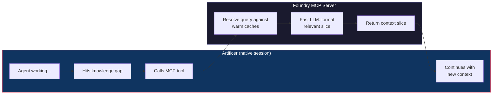

# Structural tool gate and MCP bridge: Warden knowledge (Foundry)

<!-- Region `tool-gate-mcp`; concepts: tool-gate, mcp-bridge. Generated by ~/.foundry/evals/warden-regions/foundry/assemble.py from the three-run consensus. The membership, parts 1–2, the glossary and the bypass lines were written by an LLM (v1). Parts 3–4 are placed verbatim from the sources named on each unit. Edit the sources, not this file. -->

**Routing:** Is this about allowing, asking or denying a native Claude Code / Codex tool call by the user's structural rules (the toolRules setting, protectedPaths, classifyTool, structuralLevel, permissionLevel, rulesFor, createToolGate, lateBoundToolGate, UNBOUND_GATE, the SessionBackedProvider gate, gate-request / gate-outcome phases, deny is final in bypassPermissions), or about the foundry MCP server a native session pulls context from mid-session (createFoundryMcp, foundry_query / foundry_conventions / foundry_memory / foundry_threads / foundry_signal / foundry_device, createLiveBridge, nativeBridgeSource, runProxy, the stdio and SSE transports, the fixture bridge's fixture_read / fixture_write / fixture_command)?

## Contents

- [Glossary](#glossary)
- [1. What this Warden covers](#1-what-this-warden-covers)
- [2. The domain](#2-the-domain)
- [3. Everything that exists here, by class](#3-everything-that-exists-here-by-class)
  - [Class `tool-gate`](#class-tool-gate-the-users-structural-tool-rules-the-only-thing-in-foundry-that-can-deny-a-native-tool-call)
  - [Class `mcp-bridge`](#class-mcp-bridge-the-foundry-mcp-server-the-mid-session-pull-bridge-its-tools-the-loopback-proxy-live-authority-fixture-bridge)
- [4. The specifics, in full](#4-the-specifics-in-full)
  - [4a. Doc sections](#4a-doc-sections)
    - `docs/reference/FOUNDRY-ACP.md`: 5. Middleware on the ACP path
    - `docs/FLOW.md`: Loop 2: Mid-Session Bridge (MCP)
    - `docs/isolated-fixture-transport.md`: (preface)
  - [4b. Code entries](#4b-code-entries)

## Glossary

**ASK_TIMEOUT_MS**  
How long the gate waits on a user ask.

**bindLiveAuthority**  
Binds the bridge to the live runtime's authority (packages/foundry/src/mcp/authority.ts).

**capability**  
What a tool call touches, e.g. exec:shell, file:write, net:api; rules are keyed by capability.

**classifyTool**  
Maps a native tool call (name, input, path) to a capability and paths.

**createLiveBridge**  
Starts a thread's live loopback MCP bridge so native sessions reach Foundry mid-session.

**createToolGate**  
Builds a thread's gate: structural rules first, then ask the user through ActionQueue.

**fixture bridge**  
Isolated-fixture MCP surface: only fixture_read, fixture_write, fixture_command, each with an invocation UUID.

**foundry MCP server**  
The MCP server named foundry in a native session, scoped to the calling thread's project.

**Foundry: guard**  
How a Warden finding on a tool call shows in a host: a comment that never blocks.

**foundry_conventions**  
MCP tool: a domain's reviewer instructions, domain knowledge and thread-private knowledge.

**foundry_device**  
MCP tool: this session's enrolled device and bound checkout only.

**foundry_memory**  
MCP tool: search or fetch the thread's retained memory records with provenance.

**foundry_query**  
MCP tool: search the thread's current context layers for a topic.

**foundry_signal**  
MCP tool: report an observation; disabled on the read-only native grant.

**foundry_threads**  
MCP tool: summaries of other live threads in the same project.

**gate-request / gate-outcome**  
Journal phase rows recording each gate request and its result in session_phase.

**lateBoundToolGate**  
Gate resolver handed to a provider before the viewer exists; fails closed.

**mcp-bridge**  
The foundry MCP server a native session calls mid-session, its tools, loopback proxy, live authority and fixture bridge.

**onToolRequest**  
agent-session's HarnessSession callback: (call) => allow | {deny: reason} | {ask}.

**permissionLevel**  
Core lookup of the level a policy gives a capability, without prompting (packages/core/src/capability.ts).

**pre-use stage**  
Claude's PreToolUse callback over the control protocol, run before every tool call in every mode; Codex has none.

**protectedPaths**  
Paths whose writes are classified with file:write and checked by the gate; project and global lists add up.

**runProxy**  
The stdio proxy that forwards a host's MCP calls to the loopback bridge.

**structuralLevel**  
Strictest rule level (allow / prompt / deny) for a tool call, with no model call.

**tool-gate**  
The user's structural tool rules: the only thing in Foundry that can deny a native tool call.

**toolRules**  
Settings key holding structural allow / prompt / deny rules per capability, plus protectedPaths; global and per project.

**UNBOUND_GATE**  
The gate used before binding; denies everything.

## 1. What this Warden covers

The two seams between a running native session and Foundry: the structural tool gate, the only thing in Foundry that can deny a native tool call (by the user's configured rules, with no model call), and the foundry MCP bridge, through which the session pulls context back from Foundry mid-session.

## 2. The domain

The tool gate is structural and model-free. agent-session normalises each runtime's approval channel into `HarnessSession.onToolRequest`, and `SessionBackedProvider` routes every request to the thread's gate. `classifyTool` maps the call to a capability (`Bash` → `exec:shell`; `Write`/`Edit` + path → `file:write` with `protectedPaths`; `mcp__*` → `net:api`), `rulesFor` merges global and project `toolRules` (project capabilities win, protected paths add up), and `structuralLevel` finds the strictest level through core `permissionLevel`. `createToolGate` wraps that with the ask path: anything to ask becomes an `ActionQueue.prompt`; `lateBoundToolGate` hands a provider a resolver before the viewer exists and fails closed (`UNBOUND_GATE` denies everything); `enforces` tells whether a rule set can deny or ask at all. A structural deny is final in every mode including `bypassPermissions`; a structural prompt always asks and is never answered by an "always" policy; Codex has no pre-use stage, so a Codex thread with deny/prompt rules refuses to start. Requests and outcomes are journalled as `gate-request` / `gate-outcome` phase rows. Wardens are a chorus, not a gate: their findings on a tool call are comments ("Foundry: guard") and never become ask or deny.

The MCP bridge is Loop 2 of FLOW.md: the native session has an MCP server, `foundry`, scoped to the calling thread's project, with `foundry_device`, `foundry_query`, `foundry_conventions`, `foundry_memory`, `foundry_access` (when Kingdom access is configured), `foundry_threads` and `foundry_signal`. Build it with `createFoundryMcp` (the bridge with its authority; `createFoundryMcpServer` only returns the McpServer). `createLiveBridge` starts the per-thread loopback bridge, `nativeBridgeSource` gives one stable source per live runtime, `runProxy` is the stdio proxy a host launches to reach it, and `startStdioTransport` / `createSseTransport` choose subprocess vs embedded-in-HTTP. `fixtureBridgeSource` is the isolated-fixture variant: exactly three fixture tools, per-call invocation UUIDs, authorised structurally in the Lab broker with no model-based guard.

Not here: the generic agent tool layer, `ToolRegistry` and `CapabilityGate` (`tools`); `ActionQueue` and prompts themselves (`core-agents`); Warden guards on tool calls and the chime (`warden-triggers`); `SessionBackedProvider` and native launch (`native-sessions`); the `foundry_access` Kingdom tool (`kingdom`); what context is frontloaded vs pulled (`flow-architecture`); the isolated fixture transport and `controlledFixtureSpawn` (`native-sessions`, `testing-vcr`); the viewer's prompt cards and `prompts` stream (`viewer`, `viewer-inspector`).

## 3. Everything that exists here, by class

Find the problem in plain words, then point at the exact thing. Each class opens with job tables where a class has confusable siblings (which to use when; *Said as* gives the plain words for that job), then one table of every member: **Problem** is the job in the user's or agent's words (match on these); **Use** is the exact member, its kind and `where`, then when to choose it; **Read** is the doc § that describes it (code members) or the code it is about (doc members); **Signs you're bypassing it** is the hand-rolled code an agent writes when it rebuilds the primitive, plus the errors it throws. Quote Use and Read in a pointer ("look over here: createLock, packages/db/src/lock/createLock.ts, CONCURRENCY.md § Distributed Lock"). Code members come from the catalog, described from the code; doc members are named in the doc sections in part 4. *Also here, by name* lists the parts of a larger system.

### Class `tool-gate`: The user's structural tool rules: the only thing in Foundry that can deny a native tool call

**Job: decide whether a native tool call may run** (createToolGate vs structuralLevel vs permissionLevel vs CapabilityGate) — docs/reference/FOUNDRY-ACP.md § 5.2 Tools: structural gate, chorus Wardens

*Said as:* "should this tool call be allowed", "block the agent from writing that path", "check the user's rules before the edit runs", "ask me before it runs a shell command"

| Member | Use when | Not when (use instead) |
|---|---|---|
| **createToolGate** | a thread's full gate: structural rules, then ask the user | a pure rule check with no ask (use structuralLevel) |
| **structuralLevel** | the strictest rule level for one call, no model call | you need the ask path (use createToolGate) |
| **permissionLevel** | the level a policy gives one capability; what the gate calls | you want gate behaviour with prompting (use CapabilityGate (tools)) |
| **CapabilityGate (tools)** | Foundry's own agent tools gated by capability | native Claude Code / Codex tool calls (use createToolGate) |
| *a Warden or LLM check* | never: Wardens only comment | always (use the structural gate) |

**Job: prepare the inputs of a structural check** (classifyTool vs rulesFor vs enforces) — catalog packages/foundry/src/turns/tool-gate.ts; FOUNDRY-ACP.md § 5.2

*Said as:* "what does this tool call touch", "merge the project rules with the global ones", "do these rules ever block anything"

| Member | Use when | Not when (use instead) |
|---|---|---|
| **classifyTool** | map a call to its capability and paths | merging rules (use rulesFor) |
| **rulesFor** | merge global and project rules; protected paths add up | testing whether rules can deny (use enforces) |
| **enforces** | can these rules deny or ask at all (allow-only ignored) | the level for one call (use structuralLevel) |

**Job: hand a provider its thread's gate** (createToolGate vs lateBoundToolGate) — catalog packages/foundry/src/turns/tool-gate.ts

*Said as:* "the gate isn't ready yet at startup", "wire the gate into the provider"

| Member | Use when | Not when (use instead) |
|---|---|---|
| **createToolGate** | the gate's dependencies exist now | the viewer is not up yet (use lateBoundToolGate) |
| **lateBoundToolGate** | the gate source comes later; fails closed till then | you can build the gate directly (use createToolGate) |

| Problem | Use | Read | Signs you're bypassing it |
|---|---|---|---|
| what does this tool call actually touch; I'll switch on the tool name to tell shell from file writes; treat an edit to that path as a file write; map the bash call to a capability | **classifyTool** · primitive `packages/foundry/src/turns/tool-gate.ts#classifyTool` — work out which capability and paths a native tool call touches | — | a hand-written switch on tool name (Bash, Write, Edit, mcp__*) to decide what a tool call touches (docs/reference/FOUNDRY-ACP.md § 5.2 Decision step 1) |
| check the user's rules first, then ask them; build the gate that approves or denies tool calls; ask me before the agent runs that; I'll write an approval callback for native tool requests | **createToolGate** · primitive `packages/foundry/src/turns/tool-gate.ts#createToolGate` — lateBoundToolGate when the gate is not available yet; UNBOUND_GATE denies everything. | — | — |
| do these rules ever block or ask anything; skip the gate when every rule is allow | **enforces** · primitive `packages/foundry/src/turns/tool-gate.ts#enforces` — tell whether tool rules can actually deny or ask, ignoring allow-only rules | docs/kingdom-access.md § Configure a project grant; docs/native-authentication.md § Credential delivery and renewal | — |
| the gate isn't available yet when the provider starts; deny tool calls until the gate is wired; I'll default to allowing until the viewer is up | **lateBoundToolGate** · primitive `packages/foundry/src/turns/tool-gate.ts#lateBoundToolGate` — createToolGate builds the gate itself; use this when the gate source is not up yet. | — | a provider that allows tool calls while the gate is not wired yet (fail-open default) instead of failing closed (docs/reference/FOUNDRY-ACP.md § 5.2 (the gate is bound lazily and fails closed before it exists)) |
| what level does the policy give this capability; look up allow or deny without prompting; read the policy level for exec shell | **permissionLevel** · primitive `packages/core/src/capability.ts#permissionLevel` — CapabilityGate.check when you want gate behavior; permissionLevel is what the structural tool gate calls directly. | docs/reference/FOUNDRY-ACP.md § 5. Middleware on the ACP path; docs/reference/FOUNDRY-ACP.md § 2. The three projects | — |
| merge the project tool rules with the global ones; project rules should win but protected paths stack; I'll combine the two rule lists myself | **rulesFor** · primitive `packages/foundry/src/turns/tool-gate.ts#rulesFor` — merge global and project tool rules: project capabilities win, protected paths add up | — | hand-merging global and project tool rules, letting the project list replace protected paths instead of adding to them (docs/reference/FOUNDRY-ACP.md § 5.2 As built (project capabilities override global; protected paths add up)) |
| is this call allowed by the rules, no model; find the strictest rule that matches this call; a pure rule check before the tool runs; I'll ask a quick model whether this edit is safe | **structuralLevel** · primitive `packages/foundry/src/turns/tool-gate.ts#structuralLevel` — createToolGate wraps this plus user asks; call this alone for a pure rule check. | — | calling a model or a guard to decide whether a tool call is allowed; the structural check makes no model call (target < 100 ms) (docs/reference/FOUNDRY-ACP.md § 5.2, § 5.4 Latency) |
| watch tool calls and answer permission requests; see the tool call from the event stream, not a hook | **Post-action observation and tool gate** · pattern turns/tool-gate.ts — Observe tool calls on the native event stream and answer permission requests before a call runs. | part 4 | — |
| turn tool calls into capabilities before applying rules; rules are by capability, not by tool name; classify the call before checking the rules | **Tool capability classification** · pattern pf/turns/tool-gate.ts — Map native tool calls to capabilities before applying rules. | part 4 | — |
| the lab session may only read, write, run fixtures; give each fixture call its own invocation id; I'll add another tool to the fixture bridge | **Fixture bridge tool surface** · primitive fixtureBridgeSource — expose only fixture_read, fixture_write and fixture_command with per-call invocation UUIDs | part 4 | adding tools or extra arguments to the fixture bridge, or giving a fixture session the generic native bridge (docs/isolated-fixture-transport.md § (preface)) |
| record each approval request and what happened; journal the gate's decision as a phase row; where do denied tool calls get logged | **gate-request / gate-outcome phases** · primitive thread-runtime.ts:331; session_phase table — Journal tool gate requests and outcomes as phase rows. | part 4 | — |
| route the session's permission request to the thread's gate; the native session asked to use a tool; I'll have the Warden deny the tool call; answer Codex's approval request | **SessionBackedProvider gate** · primitive SessionBackedProvider; pf/turns/tool-gate.ts — Structural gate decides; Wardens only comment. | part 4 | turning a Warden finding into ask/deny, or adding an LLM check per tool call to decide allow/deny, instead of the structural gate (docs/reference/FOUNDRY-ACP.md § 5.2 (Wardens are a chorus, not a gate)) |
| block this command before it runs; deny the tool call outright; I'll have the Warden refuse the write; only the user's tool rules can say no | **Structural tool gate** · primitive turns/tool-gate.ts — Wardens in guard mode never deny; use the tool gate to block. | part 4 | blocking a tool call from a Warden finding or a Claude Code PreToolUse hook instead of the user's structural tool rules (docs/FLOW.md § Loop 3: Post-Action) |
| let the user deny shell commands in settings; protect these paths from agent writes; configure allow, prompt or deny per capability; add a setting that blocks writes to the env file | **toolRules setting** · primitive settings toolRules — Configure structural allow/prompt/deny rules per capability, with protected paths. | part 4 | — |
| decide each tool call by the user's rules; send an ask to the action queue; structural permission check per tool call | **toolRules via permissionLevel** · primitive turns/tool-gate.ts — decide each tool request structurally using core's permissionLevel; asks go to the ActionQueue | part 4 | — |
| a Warden finding never stops the edit; the guard shouldn't deny the write | **A guard never blocks a tool call** · rule docs/FLOW.md, Loop 3; CLAUDE.md "Wardens are a chorus" — Applies to all Warden guard findings, including critical ones. | part 4 | a Warden guard that returns deny, holds the permission request, or cancels a tool call (docs/FLOW.md § Loop 3; CLAUDE.md) |
| the redirect gate shouldn't block Foundry's dispatcher; don't disallow the Task tool while Wardens run | **Dispatcher subtree exempt from subagents.native redirect/observe** · rule SUBAGENTS.md §3(c); docs/THREAD-TREE.md C.3 — under subagents.native = redirect or observe. Do not use --disallowedTools Task for redirect while in-session Wardens run. | part 4 | `--disallowedTools Task` used for redirect while in-session Wardens run (docs/THREAD-TREE.md C.3; SUBAGENTS.md §3(c)) |
| the main agent tried to spawn a Warden itself; deny Warden agent spawns outside the dispatcher | **foundry-* spawns only under the dispatcher** · rule docs/THREAD-TREE.md C.3 Launch settings — in-session runtime; the main agent's own subagents pass through to the tool gate untouched. | part 4 | — |
| fixture calls are authorised by rules, never a model; don't put an LLM check in the lab broker | **No model-based guard on fixture bridge** · rule docs/isolated-fixture-transport.md — Applies to the fixture Lab broker. | part 4 | a model or Warden deciding whether a fixture tool call may run in the Lab broker (docs/isolated-fixture-transport.md § (preface)) |
| only the user's rules block tool calls; let the Warden block this command | **Only structural rules can deny** · rule docs/reference/FOUNDRY-ACP.md §0 decision 4 — Use instead of Warden blocking or Foundry-only stricter modes. | part 4 | blocking a tool call from anything but the user's structural toolRules (docs/reference/FOUNDRY-ACP.md § 0 decision 4) |
| only the user's rules can block a tool call; let the Warden deny this edit | **Only structural rules deny** · rule docs/FLOW.md; packages/foundry/src/turns/tool-gate.ts — Only structural tool-gate rules deny a tool call; Wardens advise and never deny. | part 4 | a Warden or guard returning deny or ask on a tool call (docs/FLOW.md (preface); packages/foundry/src/turns/tool-gate.ts) |
| a deny must hold even in bypass mode; always-allow must not answer a prompt rule; the user said never, so it never runs; I'll let bypass permissions skip the deny rule | **Structural deny is final** · rule docs/reference/FOUNDRY-ACP.md §5.2 — Codex threads with deny/prompt rules refuse to start (no pre-use stage). | part 4 | letting bypassPermissions or an 'always allow' policy override a configured deny or prompt rule, or starting a Codex thread that has deny/prompt rules (docs/reference/FOUNDRY-ACP.md § 5.2 Tools: structural gate, chorus Wardens (As built)) |
| see the agent's tool calls without a hook; watch tool calls from the session's event stream; I'll add a post-tool hook to capture edits | **Tool calls observed on native event stream** · rule docs/FLOW.md — Foundry observes tool calls on the native event stream, not Claude Code hooks; there is no PostToolUse hook, MCP push or .foundry-context.md. | part 4 | — |
| I'll add a PreToolUse hook to block this; who decides a native tool call | **Tool gate decides native tool calls** · rule turns/tool-gate.ts — Applies to every tool call in a native session. | part 4 | a vendor PreToolUse hook or per-adapter allow/deny check for native tool calls (docs/SYSTEM.md § 2. Providers › Native sessions) |

- *Also here, by name:* ASK_TIMEOUT_MS (`packages/foundry/src/turns/tool-gate.ts`); UNBOUND_GATE (`packages/foundry/src/turns/tool-gate.ts`)

### Class `mcp-bridge`: The foundry MCP server: the mid-session pull bridge, its tools, the loopback proxy, live authority, fixture bridge

**Job: stand up the foundry MCP server a native session pulls from** (createFoundryMcp vs createFoundryMcpServer vs createLiveBridge) — docs/FLOW.md § Loop 2: Mid-Session Bridge (MCP); catalog packages/foundry/src/mcp

*Said as:* "give the session a way to ask Foundry for context", "expose Foundry's tools over MCP", "the agent needs to pull conventions mid-session"

| Member | Use when | Not when (use instead) |
|---|---|---|
| **createFoundryMcp** | the bridge with its authority and tools | only the McpServer object (use createFoundryMcpServer) |
| **createFoundryMcpServer** | compatibility wrapper returning just the McpServer | new code (use createFoundryMcp) |
| **createLiveBridge** | start a thread's live loopback bridge for native sessions | building the server object itself (use createFoundryMcp) |

**Job: choose what a session's bridge serves** (nativeBridgeSource vs fixtureBridgeSource) — docs/isolated-fixture-transport.md § (preface); catalog packages/foundry/src/mcp

*Said as:* "which bridge does this session get", "the lab session should only touch fixtures"

| Member | Use when | Not when (use instead) |
|---|---|---|
| **nativeBridgeSource** | real Claude Code / Codex sessions; one source per live runtime | isolated fixtures (use fixtureBridgeSource) |
| **fixtureBridgeSource** | isolated Lab session: only the three fixture tools | real sessions (use nativeBridgeSource) |

**Job: carry MCP calls between a host and the bridge** (startStdioTransport vs createSseTransport vs runProxy) — catalog packages/foundry/src/mcp/server.ts, proxy.ts

*Said as:* "run the MCP server as a subprocess", "serve MCP from inside the HTTP server", "forward the host's MCP calls to Foundry"

| Member | Use when | Not when (use instead) |
|---|---|---|
| **startStdioTransport** | the server runs as a standalone stdio subprocess | embedded in an HTTP server (use createSseTransport) |
| **createSseTransport** | the server lives inside an HTTP response | a standalone subprocess (use startStdioTransport) |
| **runProxy** | a host's stdio MCP must reach the loopback bridge | serving the bridge itself (use createLiveBridge) |

| Problem | Use | Read | Signs you're bypassing it |
|---|---|---|---|
| give the native session tools to ask Foundry; build the foundry MCP server for this thread; expose query, memory and conventions over MCP; I'll add an MCP server so the agent can pull context | **createFoundryMcp** · primitive `packages/foundry/src/mcp/server.ts#createFoundryMcp` — need the bridge with its authority: createFoundryMcp; only the McpServer: createFoundryMcpServer. | — | — |
| I just need the bare MCP server object; the old wrapper that returns only the server; existing callers of the compatibility server builder | **createFoundryMcpServer** · primitive `packages/foundry/src/mcp/server.ts#createFoundryMcpServer` — compatibility wrapper; use createFoundryMcp for the full bridge. | — | new callers using the compatibility wrapper instead of createFoundryMcp, losing the bridge's authority (catalog packages/foundry/src/mcp/server.ts#createFoundryMcpServer) |
| let a running session reach Foundry mid-session; start the loopback bridge for this thread; I'll open a local port the session can call; connect the native session back to the live thread | **createLiveBridge** · primitive `packages/foundry/src/mcp/transport.ts#createLiveBridge` — start the live loopback bridge for a thread so native sessions reach Foundry mid-session | — | — |
| serve MCP from inside the HTTP server; stream MCP over server-sent events in a response; embed the MCP endpoint in the viewer server | **createSseTransport** · primitive `packages/foundry/src/mcp/server.ts#createSseTransport` — embedded in an HTTP server: SSE; standalone subprocess: startStdioTransport. | — | — |
| the isolated lab session needs its own bridge; serve only the fixture tools to the test session; authorise fixture calls in the lab broker; a bridge for the controlled fixture run | **fixtureBridgeSource** · primitive `packages/foundry/src/mcp/fixture-bridge.ts#fixtureBridgeSource` — isolated fixture transport only; real sessions use nativeBridgeSource. | docs/isolated-fixture-transport.md § (preface) | — |
| one bridge source per live runtime; the bridge real Claude Code sessions use; I'll build a new bridge for each session; keep the same bridge across warm reuse | **nativeBridgeSource** · primitive `packages/foundry/src/mcp/native-bridge.ts#nativeBridgeSource` — native Claude Code/Codex sessions: nativeBridgeSource; isolated fixtures: fixtureBridgeSource. | — | — |
| forward the host's MCP calls to the loopback bridge; the stdio command the host launches for foundry; I'll write a little stdio relay to the daemon | **runProxy** · primitive `packages/foundry/src/mcp/proxy.ts#runProxy` — run the stdio proxy that forwards a host's MCP calls to the loopback bridge | — | — |
| run the MCP server as a standalone subprocess; talk MCP over stdin and stdout; launch the foundry server as a child process | **startStdioTransport** · primitive `packages/foundry/src/mcp/server.ts#startStdioTransport` — standalone subprocess: stdio; embedded in HTTP server: createSseTransport. | — | — |
| let the session fetch more context when it needs it; the agent pulls docs mid-turn through tools | **foundry MCP server mid-session bridge** · pattern docs/ (seven tools) — Pull over push; no push path to the session is built. | part 4 | — |
| let the agent fetch context it's missing mid-task; I'll pause the session to inject more context; pull over push for extra context | **Mid-session MCP pull** · pattern docs/FLOW.md, Loop 2; packages/foundry/src/mcp/server.ts — Use instead of pausing the Artificer to inject context. | part 4 | pausing or interrupting the Artificer to inject context mid-turn instead of letting it pull through the foundry MCP tools (docs/FLOW.md § The Four Communication Channels; Design Principles 4 (pull over push)) |
| pass the editor's MCP servers to the agent; Paseo injects its own tool servers | **Client MCP servers via thread launch** · primitive pf/providers/thread-launch.ts — SSE servers are dropped. A change relaunches the idle executor session on the next turn. | part 4 | — |
| read a Kingdom integration from inside the session; use the project's authorized integrations via Signets; call a connected service through Kingdom | **foundry_access** · primitive native bridge tool — Native sessions; kingdom_request for the API-backed tool loop. | part 4 | — |
| get a domain's reviewer instructions mid-task; fetch the conventions for this area; what knowledge does this Warden hold | **foundry_conventions** · primitive packages/foundry/src/mcp/server.ts — Use foundry_query for free-topic search across layers. | part 4 | — |
| tell the agent which machine it's on; which checkout is this session running in; I'll guess the project from the absolute path; report the active device to the native session | **foundry_device** · primitive MCP tool on native bridge — Reports checkout as session-bound, not Git verification; arguments cannot select another project. | part 4 | an agent inferring device or checkout from an absolute path, or a tool argument selecting another project (docs/DEVICE-PROJECT-IDENTITY.md § Native surface, § Native device context) |
| look up something we remembered before; fetch a memory record with its provenance; search retained memory records | **foundry_memory** · primitive packages/foundry/src/mcp/server.ts — Use foundry_query for context layers rather than memory records. | part 4 | — |
| search the loaded context for a topic; find something in the thread's current layers; the agent searches its own context mid-task | **foundry_query** · primitive packages/foundry/src/mcp/server.ts — Use foundry_conventions for a domain's parts; foundry_memory for retained records. | part 4 | — |
| let the agent report an observation; emit a signal from inside the session; send a correction back to Foundry | **foundry_signal** · primitive packages/foundry/src/mcp/server.ts — Disabled on the read-only native grant until signal writes are journaled with call provenance. | part 4 | — |
| what are the other threads working on; summarize sibling threads in this project; check if another thread touches this | **foundry_threads** · primitive packages/foundry/src/mcp/server.ts — summarize other live threads in the same project | part 4 | — |
| hold a Warden until there's something to answer; the Warden answers through Foundry's own tool; ask Foundry which Wardens to start next; I'll use SendMessage to give the Warden input | **moment / answer / next** · primitive Foundry's SDK MCP server (docs/THREAD-TREE.md C.5) — Foundry's own harness channel, used instead of vendor hook files, which are not agnostic. | part 4 | a later main-model turn using SendMessage to hand a Warden input, or a hook file to collect its answer (docs/THREAD-TREE.md C.2 Q2; C.5) |
| the MCP tool only sees this thread's project; don't leak another project's context through MCP | **MCP tools scoped to calling thread's project** · rule docs/FLOW.md, MCP Tool Surface — Applies to all seven foundry tools. | part 4 | — |
| take the project id from the tool args; which thread made this read | **Native pinned-bridge ownership** · rule docs/kingdom-access.md — Native foundry_access reads. | part 4 | taking projectId or threadId from foundry_access tool arguments (docs/kingdom-access.md § Use from a native session) |
| no pushing notes into a running turn; let the session ask for more through tools | **Pull over push** · rule CLAUDE.md, Design Principles — Inject predicted context and let the session pull the rest via MCP. | part 4 | — |
| setup stalls thirty seconds on the MCP connect; answer Foundry's MCP connect right away | **SDK MCP server answers connect before initialize returns** · rule docs/THREAD-TREE.md C.9 Launch — avoids a 30 s retry stall. | part 4 | an extra `--mcp-config` for Foundry's server, or a connect left unanswered (30 s retry stall) (docs/THREAD-TREE.md C.9 Launch) |

- *Also here, by name:* bindLiveAuthority (`packages/foundry/src/mcp/authority.ts`); guardedFetch (`packages/foundry/src/mcp/proxy.ts`); readLaunchFile (`packages/foundry/src/mcp/proxy.ts`)

## 4. The specifics, in full

### 4a. Doc sections

Each unit is the doc section verbatim, with its headings shifted down two levels. A source line above it gives the path, the section and the doc's H1.

<!-- unit doc:docs/reference/FOUNDRY-ACP.md#5-middleware-on-the-acp-path -->
**Source:** `docs/reference/FOUNDRY-ACP.md` § 5. Middleware on the ACP path (in "Headless Foundry over ACP")

#### 5. Middleware on the ACP path

Nothing is ACP-specific: every point applies equally to viewer turns, because the turn path is shared.

##### 5.1 Pre-turn injection

Unchanged. `flow.prepare` starts early, in parallel with classify and route (`thread-runtime.ts:905-915`); `preMessage` → `hydrateDelta` follows (`pf/agents/flow-orchestrator.ts:441,846`); the native session holds the standing layers in its base context, and each turn carries the decoration plus only the layers whose hash changed, as `# System Context` text (FLOW.md "Delivery", `pf/providers/session-delivery.ts`); `commitDelivery` records what the provider reports it delivered; a pre-message failure is non-fatal.

**Host instruction wrappers (slice 2).** T3 wraps prompts for ACP agents as `<t3_code_instructions>…</t3_code_instructions>\n\n<user_request>…</user_request>` (`t3:packages/provider-core/src/server/orchestrationInstructions.ts:93`). The prompt reaches the native agent verbatim. Before feedback capture and classification, known wrappers are stripped into turn metadata, so a host's instructions never count as Aron's words.

##### 5.2 Tools: structural gate, chorus Wardens (slice 2)

**Where the request comes from.** agent-session normalises each runtime's native approval channel into one callback:

| Transport | Approval channel today | Change |
|---|---|---|
| `claude-cli` | `approvals: 'mode'`, runs `bypassPermissions` (`as/claude-code-session.ts:84-85,320`; `as/transport.ts:75,87`) | Wire `--permission-prompt-tool stdio` (the `can_use_tool` control request) **[unverified wire detail; one VCR cassette]**, run the host's mode, declare `approvals: 'callback'`. Fallback: the `claude-agent-sdk` transport, which already has `canUseTool` (`as/claude-agent-sdk-session.ts:37-47,280-283`). |
| `codex-app-server` | `approvals: 'refuse'`; every server request gets -32601 | Answer `item/*/requestApproval` (COMPARISON adopt #3). |

**Contract (agent-session).** `HarnessSession.onToolRequest(gate: (call) => Promise<'allow' | {deny: reason} | {ask}>)`.

**Decision (Foundry).** `SessionBackedProvider` routes the request to the thread's gate:
1. **Structural (always, ~0 ms, no model call).** Classify the call into a capability (`Bash` → `exec:shell`; `Write`/`Edit` + path → `file:write` with `protectedPaths`; `mcp__*` → `net:api`), then core `permissionLevel` (`pf/turns/tool-gate.ts:7,92`) against the user's configured structural rules. `deny` is final and its reason reaches the model through the native deny message. Anything the native mode would ask about becomes `ActionQueue.prompt`.
2. **Wardens are a chorus, not a gate.** A Warden finding on a tool call is a comment: it is journalled and shown in the host as a "Foundry: guard" think item. It never turns into `ask` or `deny`. Wardens on this path run with a deadline; on timeout the call proceeds without them. The memory "programmatic" guard does not run here (it is an LLM call per tool today, `thread-runtime.ts:178,820`).

**As built (slice 2).**
- agent-session 0.6.0: `HarnessSession.onToolRequest(gate)`. Claude (`toolGate: true`) launches with `--permission-prompt-tool stdio` and registers a PreToolUse callback over the control protocol: the `pre-use` stage runs before every tool call in every mode (verified on CLI 2.1.296: a deny holds under `bypassPermissions`); `can_use_tool` is the `permission` stage. Codex app-server answers `item/commandExecution|fileChange/requestApproval` (approvals routed to the user reviewer). Gate failures and unparseable callbacks deny.
- Foundry: `toolRules` in settings (project capabilities override global; protected paths add up) through core `permissionLevel`; `pf/turns/tool-gate.ts`. `deny` is final in every mode; a structural `prompt` asks in every mode and is never answered by an "always" policy; a native ask becomes an `ActionQueue` prompt. Codex has no pre-use stage, so a Codex thread with deny/prompt rules refuses to start. The gate is bound lazily and fails closed before it exists.
- Wardens stay the post-action chorus: their findings are journalled as `notes` on `guard-outcome` rows and shown in hosts as "Foundry: guard" comments. Nothing in that path blocks.

**Escalation.** One prompt shows in two places and the first responder wins: the viewer's `prompts` stream (`pf/viewer/data-streams.ts:152-165`), and foundry-acp's `session/request_permission` with `allow_once`, `allow_always`, `reject_once`, `reject_always`. The answer goes to `POST /api/prompts/:id/resolve` (`pf/viewer/routes/control.ts:737`). `allow_always`/`reject_always` install a thread-scoped `ActionQueue.addPolicy` (`pc/action-prompt.ts:118`).

**Journal.** `gate-request` and `gate-outcome` join the phase union (`thread-runtime.ts:331`), written through the same `session_phase` table.

##### 5.3 Post-turn learning, the journal and Oracle evidence

Unchanged: `tool_observation` → `postAction` guards (`thread-runtime.ts:1089-1270`), the `dispatch` signal → Warden review and learning, phase rows, the `InjectionArtifact`, delivery evidence, Archive capture.

New for evidence: the `acp:<client>` thread tag travels with the thread into Archive capture, so Oracle can split recurrence by host, and sessions in Zed, Paseo and T3 stop being "outside Foundry" (FEEDBACK-LOOP H4).

##### 5.4 Latency

Warm decisions take 1.1–4.3 s, median ~1.7 s; a cold role 5–7 s; a 10 s safety deadline per decision (`docs/subscription-decisions.md:120-122`). The ACP path adds no budget of its own: the "Foundry: context" item opens the moment the turn is accepted, the structural gate makes no model call (target < 100 ms), and guards and learning stay off the critical path.

---

<!-- unit doc:docs/FLOW.md#loop-2-mid-session-bridge-mcp -->
**Source:** `docs/FLOW.md` § Loop 2: Mid-Session Bridge (MCP) (in "Foundry Harness — Data Flow & Request Lifecycle")

#### Loop 2: Mid-Session Bridge (MCP)

The Artificer (native session) has an MCP server, `foundry`, that connects it back to Foundry (`packages/foundry/src/mcp/server.ts:305-650`). When the agent discovers it needs context that wasn't frontloaded, it pulls.



##### MCP Tool Surface

Seven tools, each scoped to the calling thread's project:

```
foundry_device()
  → this session's enrolled device and bound checkout; nothing else is disclosed

foundry_query(topic, detail?)
  → search the thread's current context layers for a topic

foundry_conventions(domain)
  → a domain's three parts: reviewer instructions, configured domain knowledge,
    generated thread-private knowledge

foundry_memory(query | id)
  → search the thread's retained memory records, or get one by id, with provenance

foundry_access(action: "integrations" | "describe" | "read", ...)
  → read project-authorized Kingdom integrations through their Signets
    (registered only when a Kingdom access tool is configured)

foundry_threads()
  → summaries of other live threads in the same project

foundry_signal(kind, content)
  → report an observation; disabled on the read-only native grant until signal
    writes are journaled with call provenance
```

##### Why MCP solves mid-session injection

The old problem: Foundry can't pause a running Artificer to inject context.

The MCP solution: Foundry doesn't need to. The Artificer asks for what it needs, when it needs it. The agent is already good at recognizing knowledge gaps ("I need to check the auth conventions") — MCP gives it a way to resolve those gaps without grepping through files and hoping.

The MCP tools show up in the Artificer's session as available tools alongside file read/write, bash, etc. The agent uses them naturally as part of its reasoning.

---

<!-- unit doc:docs/isolated-fixture-transport.md#preface -->
**Source:** `docs/isolated-fixture-transport.md` § (preface) (in "Isolated fixture transport: controlled source, live boundary unresolved")

### Isolated fixture transport: controlled source, live boundary unresolved

The fixture bridge exposes exactly `fixture_read`, `fixture_write` and `fixture_command`. Each call gets an invocation UUID and retains the SDK request identity, original admission owner and truthful dispatch status on success or refusal. Unknown tools, extra arguments, invalid paths, missing/stale admissions, replayed authorization and expired grants execute nothing. The owner wires `fixtureBridgeSource(...).authorize` into the Lab broker's structural guard; no model-based guard runs there. Only the trusted Lab owner can seal or close the broker.

The immutable policy digest binds version, arm, thread/project/generation, fixture inventory, pinned image, bounds, deadline and operation surface. A source can acquire one native process. It creates an empty private working directory and owns the transport lifetime. Pending tool work prevents successor admission; late results cannot become successor data. A local deadline or uncertain cleanup retains ownership and closes admission. Native terminal evidence and broker invocation records remain distinct; a registered admission window is not a fabricated native tool-call correlation.

The Claude adapter has an explicitly named `controlledFixtureSpawn` test seam. It uses the real session protocol with a controlled process, checks exact restricted argv, labels completion evidence `controlled-fixture`, and refuses persisted fixture resumes. Its binding namespace contains the policy digest and lease ID. Warm reuse compares immutable policy identity and the actual bridge source. Auxiliary text-only sessions, Codex sessions and the generic native bridge path refuse fixture leases.

**There is no live fixture spawn path in this slice.** A normal adapter refuses a fixture lease before authentication or process construction. `withIsolatedFixture` is argv validation, not containment proof. It uses restricted mode, no built-in tools, strict owned MCP, disabled skills/browser, no session persistence and explicit settings, but does not claim those settings eliminate managed execution. Existing interactive and text-only launch behavior is otherwise unchanged. This intermediate guard must remain until a stronger runtime boundary is implemented and tested.

### 4b. Code entries

From the catalog (extracted from the code through the repo's Atlas map, described by a model). Each line: **name** `where` [kind] the job it does. Use: canonical usage.

#### Class `tool-gate`
- **classifyTool** `packages/foundry/src/turns/tool-gate.ts#classifyTool` [primitive] work out which capability and paths a native tool call touches Use: const { capability } = classifyTool({ toolName, toolInput, blockedPath })
- **createToolGate** `packages/foundry/src/turns/tool-gate.ts#createToolGate` [primitive] build a thread's tool gate: structural rules first, then ask the user Use: const gate = createToolGate(deps)
- **enforces** `packages/foundry/src/turns/tool-gate.ts#enforces` [primitive] tell whether tool rules can actually deny or ask, ignoring allow-only rules Use: if (enforces(rules)) ...
- **lateBoundToolGate** `packages/foundry/src/turns/tool-gate.ts#lateBoundToolGate` [primitive] give a provider a thread gate resolver that fails closed until the viewer exists Use: lateBoundToolGate(() => viewer?.toolGateFor)
- **permissionLevel** `packages/core/src/capability.ts#permissionLevel` [primitive] look up the level a policy gives a capability without prompting Use: permissionLevel(policy, capability, ctx?)
- **rulesFor** `packages/foundry/src/turns/tool-gate.ts#rulesFor` [primitive] merge global and project tool rules: project capabilities win, protected paths add up Use: const rules = rulesFor(globalRules, projectRules)
- **structuralLevel** `packages/foundry/src/turns/tool-gate.ts#structuralLevel` [primitive] find the strictest rule level that applies to a tool call, with no model call Use: const { level } = structuralLevel(rules, request)

#### Class `mcp-bridge`
- **createFoundryMcp** `packages/foundry/src/mcp/server.ts#createFoundryMcp` [primitive] build the foundry MCP bridge exposing device, query, conventions, memory, threads and signal tools Use: createFoundryMcp({ thread, sessionManager, ... })
- **createFoundryMcpServer** `packages/foundry/src/mcp/server.ts#createFoundryMcpServer` [primitive] build the foundry MCP bridge and return only its McpServer Use: createFoundryMcpServer(config)
- **createLiveBridge** `packages/foundry/src/mcp/transport.ts#createLiveBridge` [primitive] start the live loopback bridge for a thread so native sessions reach Foundry mid-session Use: await createLiveBridge({ serverName, ... })
- **createSseTransport** `packages/foundry/src/mcp/server.ts#createSseTransport` [primitive] create an SSE transport for the MCP server inside an HTTP response Use: createSseTransport(res)
- **fixtureBridgeSource** `packages/foundry/src/mcp/fixture-bridge.ts#fixtureBridgeSource` [primitive] serve the fixed fixture_read, fixture_write and fixture_command tools to an isolated Lab session Use: fixtureBridgeSource({ thread, runtime, invoke, journal })
- **nativeBridgeSource** `packages/foundry/src/mcp/native-bridge.ts#nativeBridgeSource` [primitive] provide one stable bridge source per live runtime for native sessions Use: nativeBridgeSource(thread, runtime, tools)
- **runProxy** `packages/foundry/src/mcp/proxy.ts#runProxy` [primitive] run the stdio proxy that forwards a host's MCP calls to the loopback bridge Use: await runProxy(launchPath, options)
- **startStdioTransport** `packages/foundry/src/mcp/server.ts#startStdioTransport` [primitive] run the MCP server over stdio as a standalone subprocess Use: await startStdioTransport(server)
