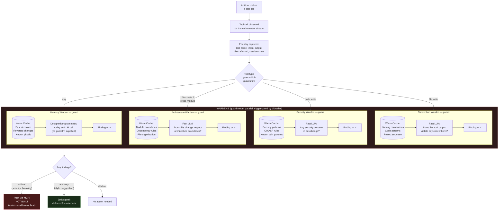

# When Wardens are asked: Warden knowledge (Foundry)

<!-- Region `warden-triggers`; concepts: warden-triggers. Generated by ~/.foundry/evals/warden-regions/foundry/assemble.py from the three-run consensus. The membership, parts 1–2, the glossary and the bypass lines were written by an LLM (v1). Parts 3–4 are placed verbatim from the sources named on each unit. Edit the sources, not this file. -->

**Routing:** Is this about the moments a Warden is asked and what happens there: the user-message, agent-action, subagent-spawn and consumed trigger points, the one guard per turn (FlowOrchestrator.postAction, guardTriggers, guard: "per-call"), the subagent handoff brief (FlowOrchestrator.brief, queueNotes), consumed work items (workItemOf, consumedMatcher, chorus.consumed), the advise deadline, guard findings as signals, or load (subscriptionOnly.maxConcurrent, excluded / not-admitted)? Plain jobs: ask the Wardens when the agent reads a ticket, check the turn's edits, brief a subagent, keep a guard from blocking.

## Contents

- [Glossary](#glossary)
- [1. What this Warden covers](#1-what-this-warden-covers)
- [2. The domain](#2-the-domain)
- [3. Everything that exists here, by class](#3-everything-that-exists-here-by-class)
  - [Class `warden-triggers`](#class-warden-triggers-when-a-warden-is-asked-and-what-it-does-there-user-message-advice-one-guard-per-turn-over-agent-action-subagent-spawn-handoff-briefs-consumed-work-items-review-how-a-chime-reaches-the-thread)
- [4. The specifics, in full](#4-the-specifics-in-full)
  - [4a. Doc sections](#4a-doc-sections)
    - `docs/FLOW.md`: The Core Model › When a Warden weighs in: the charter, trigger points and NO_COMMENT; The Core Model › Why correctness checking matters more as sessions grow; Loop 3: Post-Action — Correctness Checking
  - [4b. Code entries](#4b-code-entries)

## Glossary

**advise deadline**  
Advice is bounded by a deadline; a Warden that times out is skipped and the turn proceeds.

**agent-action**  
Guard trigger, once per turn when tool activity ends, over the turn's writes, edits and commands in order.

**agent-question / hand-back**  
Next trigger points, not built: answer on the user's behalf; review the final message before it lands.

**consumed**  
Advice trigger when the main thread takes in a work item (ticket, spec, Linear issue, Notion page); off unless `chorus.consumed.enabled`.

**consumedMatcher**  
Builds the matcher for which reads and fetches count as consumed work items, from settings.

**DEFAULT_CONSUMED_MAX_CHARS**  
12,000: a work item longer than this is clipped with a marker.

**DEFAULT_CONSUMED_PATHS**  
Default work-item globs: tickets, specs, `*.spec.md`, `SPEC*.md`, `docs/design/**`.

**excluded / not-admitted**  
A Warden the queue never admitted in time: `excluded` for advice, `not-admitted` for guard.

**FlowOrchestrator.brief**  
Asks the chorus once over a subagent's task text (`handoffText`) at spawn.

**FlowOrchestrator.consume**  
Asks the chorus once per consumed work item through the advice protocol.

**FlowOrchestrator.postAction**  
Runs the turn's one guard over its guardable calls, not awaited; the chorus never holds the hand-back.

**guard-request / guard-outcome**  
Journal rows wrapping a turn's guard: one request per asked Warden, one outcome, `wraps: turn:<id>`.

**guard: "per-call"**  
Setting that restores a guard per tool call; the default is one guard per turn.

**guardFn**  
A programmatic guard the Memory Warden was designed to use; none is supplied, so it runs the LLM guard.

**guardTriggers**  
The tool names whose calls make a Warden's guard fire for the turn.

**handoff brief**  
Notes from the subagent-spawn trigger, delivered as "The <domain> Warden chimed in on the handoff to <description>:".

**post-work review**  
After the work, every Warden reviews it under the same charter and writes its thread knowledge.

**queueNotes**  
Queues Warden notes to ride the parent's next user message.

**structural tool gate**  
`turns/tool-gate.ts`, answers the CLI's permission request; the only thing that denies a tool call.

**subagent-spawn**  
Brief trigger when the agent hands a task to a subagent; uses the advice protocol over the task text.

**subscriptionOnly.maxConcurrent**  
Decision queue size (default 16), sized for the chorus instead of asking fewer Wardens.

**trigger point**  
A named moment a Warden is asked: `user-message`, `consumed`, `agent-action`, `subagent-spawn`.

**user-message**  
Advice trigger on every user message: what does the user usually add here, in your domain?

**warden-triggers**  
This region's class: when a Warden is asked and what it does there.

**workItemOf**  
Returns the work item a tool call took in, or undefined; matches `chorus.consumed` tools and paths.

## 1. What this Warden covers

When a Warden is asked and what it does at each moment: advice on the user's message or a consumed work item, one non-blocking guard per turn over the turn's writes and commands, a brief at a subagent handoff, and the post-work review; and how what it says reaches the thread.

## 2. The domain

Every Warden the chorus holds is asked at each named trigger point that reaches it. `user-message` (advice) asks what the user usually adds. `consumed` (advice, opt-in with `chorus.consumed`) fires when the main thread reads a ticket or spec file or fetches a Linear issue or Notion page: `consumedMatcher` builds the matcher from settings and `workItemOf` extracts the item from a tool call, and `FlowOrchestrator.consume` asks the chorus once per item. `agent-action` (guard) fires once per turn when tool activity ends: the runtime holds the turn's guardable calls (those a Warden's `guardTriggers` name; reads never enter) observed on the native event stream, and `FlowOrchestrator.postAction` runs one guard over them, not awaited; `guard: "per-call"` restores per-call guards. `subagent-spawn` asks the chorus once over the task text (`FlowOrchestrator.brief`); notes are queued (`queueNotes`) and ride the parent's next user message, because no push path reaches a running turn. After the work, every Warden runs its post-work review.

The same Wardens advise and guard; there is no separate guard agent. Advice is bounded by a deadline (a Warden that times out is skipped); the guard is async and never blocks or denies a tool call: findings are advisory signals to the Librarian, and only the structural tool gate denies. Load is handled by sizing the decision queue (`subscriptionOnly.maxConcurrent`) and priming every role, never by asking fewer Wardens; the only gate is the opt-in pre-filter.

Neighbours: the `chorus` region holds which Wardens exist, the chorus settings and how a chime is worded and placed; the `classify` region holds the charter, stages and pointer parsing a Warden answers under; the `warden-prefilter-evals` region holds the pre-filter, probes and the charter eval; the `tool-gate-mcp` region holds the structural tool gate and the MCP pull bridge; the `in-session-wardens` region holds how a trigger reaches held in-session spares; the `threads-journal` region holds the subagent child threads and handoff rows. Not here: which login and host a guard call runs on (`decision-hosts`), and the general flow channels and design rules (`flow-architecture`, `conventions`).

## 3. Everything that exists here, by class

Find the problem in plain words, then point at the exact thing. Each class opens with job tables where a class has confusable siblings (which to use when; *Said as* gives the plain words for that job), then one table of every member: **Problem** is the job in the user's or agent's words (match on these); **Use** is the exact member, its kind and `where`, then when to choose it; **Read** is the doc § that describes it (code members) or the code it is about (doc members); **Signs you're bypassing it** is the hand-rolled code an agent writes when it rebuilds the primitive, plus the errors it throws. Quote Use and Read in a pointer ("look over here: createLock, packages/db/src/lock/createLock.ts, CONCURRENCY.md § Distributed Lock"). Code members come from the catalog, described from the code; doc members are named in the doc sections in part 4. *Also here, by name* lists the parts of a larger system.

### Class `warden-triggers`: When a Warden is asked and what it does there: user-message advice, one guard per turn over agent-action, subagent-spawn handoff briefs, consumed work items, review; how a chime reaches the thread

**Job: notice the agent taking in a ticket or spec so the Wardens get asked** (workItemOf vs consumedMatcher vs user-message trigger) — docs/FLOW.md § The Core Model › The consumed trigger

*Said as:* "ask the Wardens when the agent reads a ticket", "does this read count as a work item", "the spec was pasted into the message"

| Member | Use when | Not when (use instead) |
|---|---|---|
| **consumedMatcher** | build the matcher once from chorus.consumed settings | testing one tool call (use workItemOf) |
| **workItemOf** | extract the work item a tool call took in, or undefined | you need the matcher itself (use consumedMatcher) |
| **user-message trigger (warden-triggers)** | the ticket was pasted into the user's message | the agent read or fetched it (use workItemOf) |

**Job: check or stop what the agent did with its tools** (FlowOrchestrator.postAction vs Structural tool gate vs Guard findings are signals) — docs/FLOW.md § Loop 3: Post-Action — Correctness Checking

*Said as:* "check the agent's edits this turn", "stop this tool call from running", "what happens to a guard finding"

| Member | Use when | Not when (use instead) |
|---|---|---|
| **FlowOrchestrator.postAction (flow-roles)** | one advisory guard over the turn's guardable calls when tool activity ends | the call must be denied before it runs (use Structural tool gate) |
| **Structural tool gate (tool-gate-mcp)** | answer the CLI's permission request; the only thing that denies | you want a Warden's opinion (use FlowOrchestrator.postAction) |
| **Guard findings are signals (core-agents)** | where findings go: signals to the Librarian for writeback | you want it in the session now (no push path is built) |
| **guard setting (per-call) (warden-triggers)** | a guard per tool call is explicitly wanted | the default one guard per turn will do |

**Job: cope with asking every Warden at every moment** (Warden pre-filter vs subscriptionOnly.maxConcurrent vs Prime every role, don't ask fewer) — docs/FLOW.md § The Core Model › Trigger points; Load

*Said as:* "too many Wardens are slowing the turn", "skip Wardens that clearly don't apply", "Wardens are timing out under load"

| Member | Use when | Not when (use instead) |
|---|---|---|
| **subscriptionOnly.maxConcurrent (decision-hosts)** | size the decision queue for the chorus | you want fewer Wardens asked (use Warden pre-filter) |
| **Warden pre-filter (warden-prefilter-evals)** | skip a Warden on a local model's confident no, failing open | no local model clears the bar (off by default) |
| **Prime every role, don't ask fewer (decision-hosts)** | the rule: load is handled by sizing and priming | never drop Wardens by hand |

| Problem | Use | Read | Signs you're bypassing it |
|---|---|---|---|
| which reads and fetches count as a work item; build the ticket matcher from the project's settings; I'll hard-code the ticket folders and Linear tool names | **consumedMatcher** · primitive `packages/foundry/src/agents/work-items.ts#consumedMatcher` — build a matcher for which file reads count as consumed work items, from settings | — | a hard-coded list of ticket globs or MCP tool names instead of building the matcher from `chorus.consumed` (docs/FLOW.md § The consumed trigger; usage-and-context.md § Work items and reception) |
| did this tool call just read a ticket; pull the spec text out of the read call; I'll check if the fetched page is a Linear issue; ask the Wardens when the agent opens a spec | **workItemOf** · primitive `packages/foundry/src/agents/work-items.ts#workItemOf` — extract the work item a tool call took in, or undefined when it is not one | docs/FLOW.md § The Core Model › When a Warden weighs in: the charter, trigger points and NO_COMMENT | matching Linear/Notion tool names or ticket file paths by hand in the orchestrator to decide whether to ask the Wardens (docs/FLOW.md § The Core Model › The consumed trigger) |
| how the Warden's note is worded in the message; the handoff note rides the parent's next message | **Chime delivery format** · pattern CLAUDE.md, Config — Append Warden advice to the user's message as a named chime, handoff briefs riding with the parent's next message. | part 4 | — |
| only check the turn when it wrote a file; ask each Warden at most once per turn; skip the guard on read-only turns | **Guard tiers via guardTriggers** · pattern docs/FLOW.md § Progressive Depth — Tiered Frequency Model — ask a Warden at most once per turn, only when its guardTriggers name a call of the turn | code `Thread`, `Librarian`, `Herald`, `Message` | — |
| only guard Wardens whose tools were used this turn; a turn of reads shouldn't wake the guard; run the convention guard once over the fifteen writes | **Per-turn trigger-gated guard** · pattern docs/FLOW.md, Same Wardens two modes — Memory Warden is asked whenever the turn had any guardable call. | part 4 | asking every Warden's guard on every tool call, reads included, rather than once per turn for Wardens whose triggers matched (docs/FLOW.md § Same Wardens, two modes) |
| the Warden that advises also checks the work; no separate checker agent for after the edits; I'll create a guard agent next to each Warden | **Same Wardens advise and guard** · pattern docs/FLOW.md, Same Wardens, two modes — Advise runs before session with deadline; guard runs async after matching tool calls. | part 4 | a separate guard agent type or a second Warden instance for post-action checks (docs/FLOW.md § Same Wardens, two modes) |
| the named moments a Warden gets asked; when do Wardens get consulted at all | **Trigger points** · pattern docs/FLOW.md § The Core Model — ask Wardens at named points: user-message, consumed, agent-action, subagent-spawn | part 4 | — |
| show the Warden's note at the end of the message; the Warden chimed in line after the user's text; I'll inject the Warden advice into the system prompt | **Warden chiming in** · pattern docs/usage-and-context.md, Chiming in — Use after-message placement, not context; routing stays in per-turn context and layer contributions only add context. | part 4 | injecting Warden advice into a context layer or the system prompt instead of appending it after the user's message (docs/usage-and-context.md § Chiming in) |
| append the Wardens' advice to the user's message; skip a Warden that takes too long to advise; the Warden chimed in note on the message | **Warden chorus advice** · pattern docs/FLOW.md — append Warden advice to the user's message ('The <domain> Warden chimed in:'), skipping Wardens that exceed adviseTimeoutMs | part 4 | — |
| Foundry adds the Warden's note, not the model; keep silent Wardens invisible to the main thread; I'll let the main model read the Warden results | **Warden output appended by Foundry** · pattern docs/THREAD-TREE.md C.8 question 4 — in-session or not; keeps Warden output controlled, instead of letting the main model see it another way. | part 4 | letting the main model read Warden results from task notifications instead of Foundry's own chimed-in append (docs/THREAD-TREE.md C.8 question 4) |
| ask every Warden at each moment unless filtered; the guard runs once per turn over everything | **Warden trigger points** · pattern docs/FLOW.md — agent-action runs once per turn over all tool activity by default. | part 4 | — |
| guard the turn's edits and commands once; check what the agent did this turn | **agent-action trigger** · primitive trigger point (guard) — guard the turn once, over its writes, edits and commands, for Wardens whose guardTriggers match | part 4 | — |
| ask Wardens when the agent reads a ticket; turn on Warden notes for specs and Linear issues | **chorus.consumed** · primitive .foundry/project.json or machine settings, `chorus.consumed` — Off unless enabled; each key the machine gives wins over the repository's. | part 4 | — |
| the agent fetched a Notion page, ask the Wardens; Warden pointers when a spec file is read | **consumed trigger / chorus.consumed** · primitive agents/work-items.ts (workItemOf); FlowOrchestrator.consume — user-message covers a ticket pasted in the message; subagent reads are not asked. | part 4 | — |
| brief the parent when a subagent starts; write a handoff note when a native subagent spawns; the brief rides with the parent's next turn | **FlowOrchestrator.brief** · primitive turns/subagents.ts; FlowOrchestrator — Notes ride the parent's next user message; the running subagent is not changed. | part 4 | — |
| go back to a guard on every tool call; restore per-call guarding | **guard setting (per-call)** · primitive settings guard — Default is one guard per turn. | part 4 | — |
| make the memory guard pattern-match for free; give the memory Warden a check without a model call; skip the LLM call for known failure patterns | **guardFn (Memory Warden)** · primitive agents/domain-librarian.ts — Without guardFn the Memory Warden runs the LLM guard. | part 4 | — |
| fire the turn's one guard without blocking the hand-back; run the guard after the turn's tools finish | **postAction** · primitive runtime dispatch hook — fire the turn's single guard over its guardable calls without holding the hand-back | part 4 | — |
| a guard that pattern-matches instead of calling a model; make the memory guard free, no LLM call | **programmaticGuard** · primitive agents/thread-runtime.ts:196 — mark a domain's guard as programmatic pattern matching instead of an LLM call (not built) | part 4 | — |
| hold Warden notes for the next user message; the handoff notes should arrive next turn; I'll push the notes into the running subagent | **queueNotes** · primitive FlowOrchestrator — queue Warden notes to ride the next user message | part 4 | — |
| the generic prompt every region Warden starts from; default instructions and guard tools for region Wardens | **REGION_WARDEN_INSTRUCTIONS / REGION_GUARD_TRIGGERS** · primitive agents/region-roster.ts — Composition defaults to instructions: {general: []}; a composition.roles.<region id> entry wins field by field. | part 4 | — |
| ask every Warden on each user message; what does the user usually add here | **user-message trigger** · primitive trigger point (advice) — consumed: for work items read rather than typed. | part 4 | — |
| a slow Warden shouldn't hold up the message; skip the Warden that timed out and go on | **Advise deadline** · rule docs/FLOW.md, Same Wardens two modes — Applies to pre-message advise mode only; guard is non-blocking async. | part 4 | waiting on a slow Warden's advice with no deadline, holding the user's turn (docs/FLOW.md § Same Wardens, two modes) |
| show guard findings in the editor as a note; a guard finding should not stop the call | **Guard findings as comments, never blocks** · rule docs/reference/FOUNDRY-ACP.md §4.3 — Surface guard findings as a Foundry: guard think item that comments and never blocks. | part 4 | — |
| guard once at turn end, not per tool; I'll call the guard after every edit | **One guard per turn** · rule docs/FLOW.md § The Core Model — Applies to guards; reads never enter the moment. | part 4 | calling a Warden's guard inside each tool-call handler, or awaiting the guard before the turn hands back (docs/FLOW.md § The Core Model › One guard per turn) |
| a dropped guard must not count as passing; report a shed guard as unchecked | **Shed guards are unchecked, never all-clear** · rule docs/subscription-decisions.md § Scheduling — queue shedding | code `Cartographer` | — |
| put the Warden notes after the user's text; a no-comment Warden adds nothing to the turn | **Warden notes delivered after the message** · rule docs/FLOW.md, Delivery table — Applies to Warden notes; thread-state uses perTurn instead. | part 4 | Warden notes placed in the system prompt or before the user's message instead of appended after it (docs/FLOW.md § Loop 1 › Delivery table (placement: after-message)) |
| turn the Warden finding into an ask; Wardens comment on tool calls, use rules to block | **Wardens are a chorus, not a gate** · rule docs/reference/FOUNDRY-ACP.md §5.2 — Use toolRules instead for anything that must block. | part 4 | a Warden finding turned into ask or deny on a tool call, or waiting on Wardens with no deadline (docs/reference/FOUNDRY-ACP.md § 5.2) |
| wait for the Wardens before running the turn; a Warden timeout shouldn't stall the turn | **Wardens comment and never block** · rule docs/reference/FOUNDRY-ACP.md §0 decision 4 — Denial belongs to structural tool rules, never Wardens. | part 4 | — |

- *Also here, by name:* DEFAULT_CONSUMED_MAX_CHARS (`packages/foundry/src/agents/work-items.ts`); DEFAULT_CONSUMED_PATHS (`packages/foundry/src/agents/work-items.ts`)

## 4. The specifics, in full

### 4a. Doc sections

Each unit is the doc section verbatim, with its headings shifted down two levels. A source line above it gives the path, the section and the doc's H1.

<!-- unit doc:docs/FLOW.md#the-core-model/when-a-warden-weighs-in-the-charter-trigger-points-and-no-comment -->
**Source:** `docs/FLOW.md` § The Core Model › When a Warden weighs in: the charter, trigger points and NO_COMMENT (in "Foundry Harness — Data Flow & Request Lifecycle")

##### When a Warden weighs in: the charter, trigger points and NO_COMMENT

**The Warden charter** (`WARDEN_CHARTER`, `classify/charters/point.warden.ts` in `@inixiative/foundry/classify`) is how every Warden works. It is one fixed meta-instruction set, part of Foundry, never settings, and never edited per project. It heads the system message of every Warden call, above that Warden's own composed instructions. It sets scope discipline (your region only), `NO_COMMENT` as the default answer, and the pointer shapes below. Its wording is iterated against real sessions with the charter eval (below), never hand-tuned per Warden. One wording ships: the classifier charter region Wardens run under ([usage-and-context.md](usage-and-context.md#chorus-projectsidchorus)). The hand-named roster's advise-style charter ("Name the rule, then say what to do instead") was retired with the roster on 2026-10-17 (Aron: "We're just doing the region wardens"): region Wardens anticipated 23% of corrections to the roster's 3% (finding `2026-10-15-region-wardens-vs-roster`), and two charters with opposite rules invited confusion.

**The charter points; the main thread decides** (Aron, 2026-10-17: "All they're trying to do is point… The wardens do not make any sort of decision"). Its first principle: an instruction to build something new is a reason to look. Whatever the moment says to build, even "write a new X" or "don't use X", the Warden matches the job against its region and points at the system that does it; if none does, `NO_COMMENT`. Why: over-specified tickets ("add a table", "write a lock") contradict systems that already exist, and an agent that follows them literally builds a parallel one; "don't use X" still points, because X is the comparison the main thread needs ("what is the material difference"). A Warden judges only whether the moment touches its region and which system is most likely. Its answer is `NO_COMMENT` or a pointer in one of four shapes, at most three names, each remark one snippet (advice) or one advisory finding (guard), in order:

- **ranked** (pointer `one`): `Look over here: <name> (<where>) — <why it is the likely one>`, then up to two `Less likely: <name> (<where>) — <what tells it apart>`;
- **all of these** (pointer `all`, Aron 2026-10-18: "A and B and A are always options"): `All of these: Each applies; read every one.`, then two or three `<name> (<where>) — <the part of the moment it touches>`, when the moment touches several systems at once;
- **choose one** (pointer `any`, on by default): `Choose one: Related systems; pick the one whose job matches.`, then two or three `<name> (<where>) — <its distinguishing job>`, sent when close siblings can't be told apart (sibling confusion was 22% in the probe evals, Oracle `docs/WARDEN-EXPERIMENTS.md`): a set that holds the right one beats a confident wrong pick, and it scores on the pointer ladder's candidates rung;
- **class**: `Look over here: <the class> (<where>)`, a ranked pointer at the class level.

Turning `any` off (`pointer: { any: false }` on a stage) removes the choose-one paragraph from the charter as well as making the parser refuse that shape, so a Warden is never invited to answer in a shape that is then counted as malformed. `parseWardenPointer` reads the remarks into `{ shape, pointer, where, why, level, candidates, unparsed }`, counting what fits no line. No field says whether to use anything; the guard protocol (`GUARD_RESPONSE_PROTOCOL`) is advisory-only with no suggested fix, and its validator refuses a `critical` severity or a `suggestion`. Every advice trigger's `NO_COMMENT` bar is the same: the moment touches nothing in the region, whatever it says to build or not to use.

**Stages** (`@inixiative/foundry/classify`, Aron 2026-10-18: "it's the same thing in Oracle as it is in Foundry"). A Warden's answer is one classification run of at most three stages, the same code live, in Foundry's evals and in Oracle's experiments. Each stage names who answers (`model`, `effort`; omitted, the decision model's), the region doc it reads (`doc`, default `knowledge.md`), its outcomes (`binary` yes / NO_COMMENT, or `ternary` with unsure), its `reason` (`none`, the live default; `inline`, the why with every decision; `followup`, "why?" asked on the same session after a yes or unsure, never after a no, and carried to the next stage like an inline why), its `task` (`recognise`, which only names the regions the moment is in, one `<region id>: <why>` line each, under the recognise charter; or `point`, under the Warden charter) and, but for the last, which outcomes it `escalate`s. The default is one stage, today's Warden. The charter is chosen by task and role and stays Foundry's, with the sections the stage's modes add (`classify/charters/<prompt>/modes/<mode>/`: additive by default, an `overrides` dagger only where a mode must replace a section it contradicts); the response protocol is generated from the stage (`responseProtocol`: the default is exactly the advice and guard protocols above), and every answer is read strictly under it (`readStageAnswer`): a malformed answer is counted on the stage's trace, never guessed. An escalated outcome reaches the next stage as an "An earlier stage" section carrying its tag and why; an unsure is to be treated as no until the stage's own doc shows otherwise. Each stage gets its share of the trigger's deadline (`deadline`, default an even split), capped by what the run has left; the last stage gets all that is left. The guard has no trigger deadline today, so a staged guard's stages each run on their provider's own call timeout. A later stage that times out, fails or answers out of shape leaves the previous stage's outcome, with the fallback journalled; a final unsure, and a recogniser's yes, reach the thread as nothing. Only a pointing stage's yes is delivered. Each later stage keeps its own primed session (`<thread>:aux:domain:<d>:stage:<n>`) and, on another model or effort, its own decision host; in-session Wardens hold one subagent per Warden, so a stage on a second model there is not built. A project sets its stages per role (`chorus.wardens.stages`; [usage-and-context.md](usage-and-context.md#chorus-projectsidchorus)); Heralds have the socket (`chorus.heralds`, region `role: "herald"`) and are not built.

**The reception charter** (`CHORUS_RECEPTION`) is the main thread's counterpart, fixed in Foundry: a thread whose project runs a chorus holds it once as the standing layer `chorus-reception` (`chorus.reception: false` leaves it out, e.g. for an Oracle baseline; a thread with no Wardens never gets it). It says a chime is a pointer to verify, not advice; follow a ranked pointer's top first; read every member of an all-of set; pick from a choose-one set and say which and why in the plan; set a wrong chime aside in one line; silence is not evidence that nothing exists. It also carries the acknowledgement rule (Aron, 2026-10-17): a pointer at a system the instruction, ticket or spec contradicts needs the instruction to name that system and say to replace or bypass it; otherwise the main thread asks one short question naming it and its doc section before building ("This doesn't match what we have (X, doc §); confirm?"); when acknowledged, it proceeds and uses the system as the comparison, stating the material difference in its plan. The chime text itself stays a pointer. The inixiative org states the same rule in `~/code/inixiative/CLAUDE.md`, which the ladder's `org` node composes. Whether the main thread follows it is measured by Oracle's replays (the Reception and Early conflict detection gauges), not here.

**Trigger points.** A Warden is asked at a named trigger point. Every Warden the point reaches is asked unless the **pre-filter**, when turned on, rules it out: one local decision-model call per trigger scores, per Warden, whether the moment is about its domain, and a Warden is skipped only on a confident no ([subscription decisions, Warden pre-filter](subscription-decisions.md#warden-pre-filter)). It fails open: an unsure score, a failed call or a missing model asks the Warden. It is not a keyword or path filter, which would fail silently; every skip is journalled with its score, so a Warden that should have spoken is auditable. It is off by default (`prefilter.enabled` in settings; no local model clears the bar yet), and when on it runs before advice, before the turn's guard, before a handoff brief and before the post-work review. Deciding what to say stays the Warden's job under the charter.

| Trigger point | Phase | Who is asked | The charter asks |
|---|---|---|---|
| `user-message` | advice | every Warden, on every user message | what does the user usually add here, in your domain, so they need not say it perfectly every time? |
| `consumed` | advice | every Warden, when the main thread takes in a work item (`chorus.consumed`, off by default) | what in your domain will this work touch, whatever it says to build? |
| `agent-action` | guard | once per turn, when the turn's tool activity ends: every Warden whose `guardTriggers` name a call of the turn, over the whole turn's writes, edits and commands in order | does what the agent did this turn go against your domain? |
| `subagent-spawn` | brief (advice protocol) | every Warden, when the agent hands a task to a subagent | what must the subagent know, from your domain, that the task text leaves out? |

**One guard per turn** (Aron, 2026-10-15). Tool calls are journalled as they happen (the native journal, the review's per-dispatch tool bucket); the guard is not asked per call. The runtime holds the turn's guardable calls (those some Warden's `guardTriggers` name; reads never enter the moment) on the live dispatch and, when the executor's dispatch returns, fires one `postAction` over them, not awaited: the chorus never holds the hand-back, and its outcome reconciles the turn's pending guard entry. One `guard-request` row per asked Warden and one `guard-outcome` row wrap the turn (`wraps: turn:<id>`, `activity.calls` in order). `guard: "per-call"` in settings restores a guard per tool call. An observed subagent's turn is guarded the same way when its turn ends (`subagent_turn`), on the subagent's node, in the in-session runtime. A call with no live dispatch to belong to is guarded on its own, visibly uncorrelated.

**The handoff brief.** `task_started` (agent-session 0.6.6) makes the child an observed thread (`turns/subagents.ts`); the recorder's `onSpawn` fires `subagent_spawn` on the root thread, and `FlowOrchestrator.brief` asks the chorus once over the task text (`handoffText`). Each Warden's decision is journalled on the parent node as an `advice` row with `trigger: subagent-spawn` wrapping `handoff:<child>`; what they said is queued (`queueNotes`) and rides with the parent's next user message as "The <domain> Warden chimed in on the handoff to <description>:" notes. The subagent itself is not changed: the harness has already composed what it received, and no push path reaches a running turn.

**The `consumed` trigger** (Aron, 2026-10-17). When the main thread reads a ticket or spec file, or fetches a Linear issue or document or a Notion page, the item is a moment: `workItemOf` (`agents/work-items.ts`) matches the call against the project's `chorus.consumed` (`tools`, globs on the tool name, case-insensitive; `paths`, globs on a read file's project-relative path, prose files only by default; `maxChars`, default 12,000, the item clipped with a marker), and `FlowOrchestrator.consume` asks the chorus once through the advice protocol, the same `_between` path as the brief. A file's text is the file on disk (an observation's output may be a bounded summary); it is asked once per path and content, so chunked reads of one file are one item. A fetch's text is the call's output, asked once per tool and id. The decision is journalled as an `advice` row with `trigger: consumed` wrapping `<tool>:<path or id>` (silence included), and what Wardens said rides with the next turn as "The <domain> Warden chimed in on the work item <name>:" notes. Subagents' reads are not asked: their notes would reach the parent, never the subagent doing the work. A Codex main thread reads files through shell commands, so its file work items don't fire; fetches do. Settings changes reach new threads. **What it adds, plainly:** no push path reaches a running turn, so a ticket read and built in the same turn gets its pointer when the turn ends, the same moment the per-turn guard fires over the writes. The trigger adds a new moment for turns that take a work item in without writing: plan-first turns, turns that end in a question, read-only turns. A ticket pasted into the message is covered by `user-message`. An in-turn path (the `foundry` MCP pull channel is the natural base) is deferred.

After the work, every Warden reviews it (post-work review) under the same charter. Next trigger points, each with its own input, protocol text and NO_COMMENT default: `agent-question` (answer on the user's behalf when confident and backed by a recorded ruling), `hand-back` (process Wardens review the final message before it lands, one extra pass at most).

**NO_COMMENT is the expected answer** in every phase protocol (advice, guard, review): exactly `NO_COMMENT`, nothing else. It adds nothing to the thread: no note, no "Domain decisions" line, nothing in the shared thread state. It is still journalled as the Warden's decision (`no-comment`), so the silence rate is measurable. Any other answer outside the protocol (an empty contribution, extra fields, prose around JSON, NO_COMMENT with anything else) is an error, never a comment.

**Load.** Asking every Warden is handled by sizing the decision queue for the chorus (`subscriptionOnly.maxConcurrent`, default 16) and keeping every role primed (two primed keys per Warden, advice and review, sized at startup from the largest chorus), not by asking fewer. A decision's queue wait is bounded by its caller's deadline; once started it gets its full run budget, so no running decision is cut short. Measured 2026-10-12 with 25 Wardens (the since-retired roster): about 50 decision processes and 10 GB resident, plan latency 2.5–10 s once warm, and the first one or two turns after a start time out while 51 keys prime. A Warden the queue never admitted in time is recorded as `excluded` (advice) or `not-admitted` (guard): it did not run, and the turn goes on without it. The pre-filter is the one gate, off by default: domain-agnostic, measured on labelled moments (`scripts/evals/warden-prefilter.ts measure`), failing open.

**The charter eval** is a dev diagnostic; the test is the Oracle replay (Oracle `docs/ORACLE-TEST.md`, entry point `docs/PROCEED.md`). The charter eval (`scripts/evals/warden-charter.ts`, scoring in foundry-core `feedback/warden-probes.ts` so Oracle scores the same way) runs a classify configuration (`--classify <run.json>`: the stages a project's settings take, plus eval-only `sections` per stage, the charter's and the region line's language by name, `debug` for two more readings per call, and `members` for a grouped recogniser whose yeses fan out to its member regions) over probes built from real sessions (`scripts/evals/warden-probes.ts`). Its ground truth is the user's own correction: `--sessions` runs the Prospector (`foundry repeats`' collector and classifier) over a project's sessions and prompt history, and each probe keeps the user's ask (the `user-message` trigger), the agent's turn when recorded (`agent-action`), the correction the judge sees, and a train/test period by date for backtests. Wardens are composed exactly as a live thread composes them (the daemon's settings and composition view, bound to the probe's project: its region Wardens, or `--regions <dir>`); a Warden whose knowledge composes empty is cold and left out. Each probe is one turn per trigger point, with every Warden asked at once. `--label-targets` (Opus) labels what each correction pushed toward: the existing rule, primitive, system or pattern, with its concept cluster, and writes the distinct targets (the catalog's checklist: a target the catalog lacks is a gap). With a target, the judge matches on the target, not on wording. The primary measure is **anticipated**: the share of real corrections some Warden said first, at either trigger. `--knowledge <dir>` scores another knowledge set against the same probes, and `--rejudge <run>` re-judges a run's remarks without asking Wardens again. It also reports wrong remarks (per probe and per trigger), silence precision (NO_COMMENT when nothing of the Warden's applied), speak precision (a remark matched the user's later real correction, judged by Opus), scope violations, owner recall when probes name owning domains, and per-turn calls and latency at chorus scale. Runs labelled `charter-roster` predate 2026-10-17 and scored the retired roster charter. Probes hold session text and are never committed.

<!-- unit doc:docs/FLOW.md#the-core-model/why-correctness-checking-matters-more-as-sessions-grow -->
**Source:** `docs/FLOW.md` § The Core Model › Why correctness checking matters more as sessions grow (in "Foundry Harness — Data Flow & Request Lifecycle")

##### Why correctness checking matters more as sessions grow

As context fills, agents become more random — instruction-following decays, earlier context gets diluted, the model starts drifting from conventions it was following at message 5. The guard-mode agents don't degrade with session length because they compare tool outputs against their own warm caches, which are stable and compact regardless of how large the session context has grown. At message 50, the security check compares against the same patterns it had at message 1.

The guards are the mechanism that keeps the session aligned as context pressure mounts. This is the "horizon alignment over autonomy" principle in practice — not making the agent more autonomous, but keeping it aligned with project standards even as its context degrades.

When debugging:
- Wrong conventions injected? → **Convention domain** (bad cache or wrong match)
- Security issue slipped through? → **Security domain** (missed it or wasn't triggered)
- Incoherent thread state? → **Reconciliation** (bad signal merge)
- Duplicate work across threads? → **Cross-thread awareness** (didn't detect convergence)

---

<!-- unit doc:docs/FLOW.md#loop-3-post-action-correctness-checking -->
**Source:** `docs/FLOW.md` § Loop 3: Post-Action — Correctness Checking (in "Foundry Harness — Data Flow & Request Lifecycle")

#### Loop 3: Post-Action — Correctness Checking

Foundry observes the Artificer's tool calls on the native event stream (agent-session's normalized events; no Claude Code hook is involved), holds the turn's guardable calls, and when the turn's tool activity ends runs one correctness check over them through `FlowOrchestrator.postAction` (`agents/flow-orchestrator.ts`) — not a check per call. Guards are trigger-gated per domain: a Warden is asked when a call of the turn matches its triggers, and it sees the whole turn. Separately, the structural tool gate (`turns/tool-gate.ts`) answers the CLI's permission request before a call runs; that is the only thing that denies.

##### Same Wardens, two modes

There's no separate "guard" agent type. The same Wardens that advise pre-message also guard post-action. The Librarian coordinates both modes — deciding what to fire and when.

| | Advise mode (pre-message) | Guard mode (post-action) |
|---|---|---|
| **Runs when** | Before session starts (tiered by domain shift) | After matching tool calls (trigger-gated by Librarian) |
| **Input** | User message + warm cache | Tool call observation + warm cache |
| **Output** | Context to inject | Finding (or all-clear) |
| **Urgency** | Bounded by a deadline: a Warden that times out is skipped and the turn proceeds | Non-blocking (async) |
| **Gating** | Classification domain shift | Tool call type (file-write, code-write, etc.) |

Guard mode fires once per turn and is trigger-gated: a turn of reads doesn't fire the Convention Warden's guard, a turn of only bash commands doesn't fire the Security Warden. A turn that makes 50 tool calls, 15 of them file writes, runs the convention guard once, over those 15 writes in order, not 15 times. The Memory Warden is asked whenever the turn had any guardable call. It was designed as free programmatic pattern matching; today it runs the LLM guard, because nothing supplies its `guardFn`.

**Why the guard layer matters:** As a session grows and the context window fills, agents become more random. The guard-mode Wardens don't degrade with session length because they compare tool outputs against their own warm caches — stable, compact, independent of the session's growing context. At message 50, the Security Warden is comparing against the same security patterns it had at message 1. The guards are the mechanism that keeps the session aligned as context pressure mounts.

When a Warden in guard mode finds something:

- **Critical findings** (security, breaking changes) → designed to push immediately into the session. **Not built:** there is no push path; a critical finding is a signal like any other.
- **All findings today** → emitted as signals to the Librarian. The session doesn't see them immediately; they feed into writeback and inform later advise-mode decisions.
- A guard never blocks a tool call. Only the structural tool rules deny (CLAUDE.md, "Wardens are a chorus").

##### The Memory Warden is special

Unlike the other Wardens, the Memory Warden is designed not to need an LLM call in guard mode: **programmatic pattern matching** against known failure modes. (Not built yet: with no `guardFn`, it runs the LLM guard.)

- "The last time someone edited this file and used that pattern, it was reverted in PR #847"
- "This function signature was changed 3 times in the last month — it's unstable"
- "A similar approach was tried in thread-feature-auth and abandoned"

The design is grep + structured memory, not LLM reasoning: fast and free.

---

### 4b. Code entries

From the catalog (extracted from the code through the repo's Atlas map, described by a model). Each line: **name** `where` [kind] the job it does. Use: canonical usage.

#### Class `warden-triggers`
- **consumedMatcher** `packages/foundry/src/agents/work-items.ts#consumedMatcher` [primitive] build a matcher for which file reads count as consumed work items, from settings Use: consumedMatcher(settings.consumed)
- **workItemOf** `packages/foundry/src/agents/work-items.ts#workItemOf` [primitive] extract the work item a tool call took in, or undefined when it is not one Use: workItemOf(observation, matcher, root)
