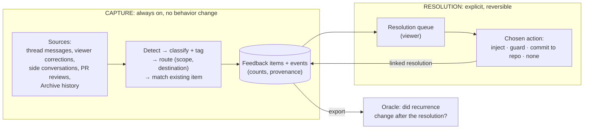
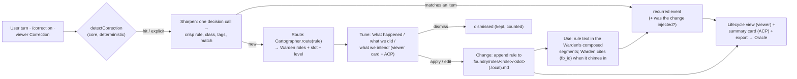

# Feedback loop

**Status: hypotheses, not a settled design. The [Lifecycle](#lifecycle-proposal-2026-10-12-awaiting-arons-yes) section is a PROPOSAL awaiting Aron.** This document covers journey goal 8 in the [system map](SYSTEM-MAP.md) ("process feedback captured into a middleware layer") and the measuring half of goal 9. Treat what follows as working hypotheses and the experiments that would test them, not as decisions.

Code references point at `origin/main` as of 2026-09-30:

| Repo | Commit |
|---|---|
| Foundry | `bc53278` |
| Oracle | `b961afd` |
| Archive | `ab3f173` |
| agent-session | `320eee1` |

A `path:line` with no prefix is in Foundry. References into other repos carry the repo name as a prefix, for example `oracle:src/cli.ts:218`.

## The point

Models get better, but they don't change how they behave. Aron gives the same process feedback over and over, for example "merge it yourself" or "use the primitive that already exists". The thesis is that we can make that change last without retraining.

Today `~/code/inixiative/FEEDBACK-LOG.md` does this by hand: 24 tagged rules with repeat counts. Rule 1 has recurred about 28 times even though it is written into `CLAUDE.md`.

**The metric is recurrence**: how often the same feedback comes back.

### Capture and resolution are separate

Capturing feedback is cheap and safe. Deciding what to do about it is neither:

- **Resolutions are not obvious.** A captured correction often doesn't say what should change, or where.
- **Automatic action can make things worse.** Examples:
  - a misread rule injected into every session
  - an over-broad guard that blocks good work
  - two rules that contradict each other
  - a "fix" for one project that leaks into another context

So the loop has two halves:

- **Capture** is always on and has no side effects on behavior. It detects feedback, tags it, routes it, dedupes it, counts recurrences and stores provenance. Nothing it does changes what an agent sees.
- **Resolution** is any change to behavior: injecting a rule, guarding against it, escalating it, or committing it to a repo. Every resolution is a separate, explicit, reversible step. **Nothing resolves automatically.** Whether some resolutions should later become automatic is itself a hypothesis to test (section 5).



## Lifecycle: PROPOSAL (2026-10-12, awaiting Aron's yes)

This section turns sections 1–3 into one lifecycle that the user can see. Where it differs from the hypotheses below, it replaces them. Those places are marked "superseded by Lifecycle".

> Aron (2026-10-12): "The feedback works when it's sharp. … In the beginning as you get feedback, there should be a phase where it's trying to tune it with you. It can pop up even as the main thread is working: 'This is what happened,' 'This is what we did,' or 'This is what we're intending on doing here.' Maybe blocking, maybe not blocking. … As things get dialed in, see: your feedback, then what warden or wardens did this get routed to? What was the change to their instructions and/or domain knowledge? How are we using that? The life cycle needs to be there in front of the user so that they feel like they're getting value off of it."

The chorus is why the change lands on a Warden and not on the main thread. Each Warden stays small and sharp because it holds only its own domain. So a piece of feedback becomes one crisp line in the instructions or domain knowledge of the one or two Wardens it belongs to. It never becomes another paragraph in the main thread's instructions.

Code references in this section are to Foundry `origin/main` `a83756e` and Oracle `origin/main` `6656362`. `pf:` means `packages/foundry/src/`, `pc:` means `packages/core/src/`, and `pa:` means `packages/acp/src/`.



### L1. Capture: detect, then sharpen

**Detect.** Detection already exists. It is the **Prospector**, Oracle's session miner: `CORRECTIVE_OPENERS` and `extractUnits` (`oracle:src/session-miner.ts:223-282`), `scrubSecrets` (`:95`), `PROSPECTOR_CLASSIFY_PROMPT` and `classifyCorrections` (`:434-480`). The repeat-report work is moving its deterministic detection, its classify prompt and its secret scrubbing into foundry-core as data and pure functions, and it owns that module. Live capture, `foundry repeats` and `oracle mine` then import the one detector, and it gets polished in one place. The detector adds explicit markers ("from now on", "always", "never", "remember") and repeat markers ("again", "I thought we", "once and for all") to the miner's openers, and returns `{ hit, kind: interrupt | opener | explicit | repeat, phrase, score }`. Its inputs:

- **Typed turns.** In `TurnService.accept` (`pf:turns/turn-service.ts:183`), after durable acceptance (`:206`), the capture reads `payload`. That text has already had host wrappers stripped by `splitHostInstructions` (`:187-189`), so a host's instructions never count as the user's words. Non-blocking capture is fire-and-forget at this point, the same way `ThreadNamer` hangs off `:690` (`pf:agents/thread-namer.ts:84`). The previous assistant message comes from the local journal.
- **Explicit corrections.** These come from `/correction` over ACP (`pa:agent.ts:427-447`) and the viewer's Correction form (`pf:viewer/ui/detail-drawer.js:856-880`). Both post to `POST /api/threads/:threadId/interventions` (`pf:viewer/routes/runtime.ts:287`). That route calls the capture directly with `origin: "intervention"` and skips the prefilter. `InterventionLog.intervene` still emits its `correction` signal, which is audit-only (`pc:adapters/file-memory.ts:75`).

**Sharpen.** A detector hit becomes a feedback item only after the Prospector's classify call, extended once for every caller. It runs in `pf:feedback/capture.ts` on the decision provider (`flowLlm`, `pf:start.ts:770`, Haiku 5.5) at review priority, like the namer. A second small call matches the item against open items.

- **Inputs:** the user text, the previous assistant message (bounded), and the open items in scope (statement + id only).
- **Output:** the shared classify contract `{ isCorrection, category: approach|scope|convention|fact|other, statement, sharp }`. The Prospector's categories become the item's class. The match call adds `match: {itemId, confidence} | null`.

"Sharp" is checked twice:

- **The model** must write `statement` as one imperative rule, at most 160 characters, that says when it applies: "When X, do Y", "Never X", or "Always X". If it cannot, it returns `sharp: false`.
- **A deterministic lint** rejects a statement that is too long, has more than one sentence, uses hedges ("try to", "be careful", "maybe", "consider"), or merely restates the request.

An item that is not sharp is never applied. Its tuning card asks the user for the rule in their own words (an `input` prompt). It does not guess.

**Dedupe.** `match` with confidence ≥ 0.7 makes this capture a `recurred` event on the existing item and never a new item. Lower confidence creates a new item that carries `candidateDuplicateOf` (open question 4, below).

### L2. Tuning: the user sees what happened, what we did, what we intend

Each new item, and each recurrence of an applied item, produces one tuning prompt on the existing `ActionQueue` (`pc:action-prompt.ts:83`). The prompt reaches the viewer through the `prompts` stream (`pf:viewer/data-streams.ts:152-165`, card at `pf:viewer/ui/conversation.js:695`) and reaches ACP hosts through `pa:agent.ts`. The first answer wins, as with tool-gate asks. The prompt's `message` has three parts:

- **What happened:** the quote, plus one line on the assistant turn it reacted to.
- **What we did:** "Captured as rule *fb_x*: «statement» (process · tags). Routed to: convention Warden (instructions)."
- **What we intend:** "Append to the convention Warden's instructions at *project personal* (`<repo>/.foundry/roles/librarian-convention/instructions.local.md`)." For a recurrence of an applied rule it says: "This rule was in the Warden's context on that turn and the mistake recurred. Sharpen it, move it to the main thread, or escalate to a guard?"

`kind: "choice"`, options `apply` · `edit` (opens an input with the statement, role(s), slot and level prefilled) · `reroute` · `dismiss` · `later`. `meta.feedback = { itemId, blocking }`.

**Blocking is a setting, with a per-item override:**

| `feedback.tuning` | Behavior |
|---|---|
| `"ask"` (default) | The prompt is raised. The turn does not wait for it. On `apply`, the change takes effect from the next turn on. |
| `"block"` | Capture runs in `TurnService.run` before `harness.send` (`pf:turns/turn-service.ts:664`). The turn waits for the answer, up to `feedback.blockTimeoutMs` (default 120 s, then `later`). An `apply` invalidates the role's composed layers, so the Warden already has the rule on *this* turn. |
| `"tell"` | Dialed-in mode. A sharp, matched-routing item with confidence ≥ `feedback.tellConfidence` is applied directly. A non-blocking card then shows what was done, with an **Undo**. Anything less sharp falls back to `ask`. This is the first automatic resolution, so it is gated on H3 (below). The viewer shows the revert/edit rate so the user can decide when to switch. |
| `"off"` | Capture and the lifecycle view still run. No prompts are raised and nothing is applied. |

`feedback.tuning.blockOn: ("repeat" \| "explicit")[]` (default `[]`) escalates single items to blocking. An example is "how many times do I have to say this", detector kind `repeat`. Projects override this with `projects[id].feedback`, the same way `toolRules` does (`pf:viewer/server.ts:524-530`).

**ACP.** Today `permission()` forwards only tool-gate approvals (`pa:agent.ts:344-349`). That stays unchanged for those. Feedback prompts are added:

- **Blocking:** `session/request_permission` with a synthetic `tool_call` (kind `think`, title "Foundry: feedback"). The options use the ACP kinds with feedback names: `allow_once` "Apply", `reject_once` "Not a rule", `allow_always` "Apply and stop asking for this project" (sets `tuning: "tell"` for the project). `_meta.foundry = { promptId, feedbackItemId }`.
- **Non-blocking:** a `tool_call` card only, with `status: "pending"`, the same kind of card as the Warden guard comments (`pa:guard.ts`). It changes to `completed` or `failed` when someone answers in the viewer or through `/feedback`. Non-blocking prompts never open a permission dialog, because some hosts treat an open dialog as a stalled session.
- **Commands:** a `/feedback` command next to `/correction` (`pa:agent.ts:82`). `/feedback` lists recent items. `/feedback apply|dismiss <id>` and `/feedback edit <id> <rule>` resolve one.

### L3. Routing to Wardens (the Cartographer)

Routing reuses `Cartographer.route` (`pf:agents/cartographer.ts:377`), with the sharpened statement as the message. It does not add a router. `RouteResult.domains` maps to Warden roles, because each Warden is a `DomainLibrarian` per domain built from settings (`pf:agents/configured-experts.ts`).

- **Several domains** means the rule goes to each matching Warden. Aron: "what warden or wardens".
- **No domain**, or `source: "keyword-fallback"`, routes the rule to role `main` (the thread's own instructions slot). The card says that routing was weak.
- **Subagent roles** (`subagent-<kind>`, SUBAGENTS.md §5) are routing targets on the same footing as Wardens. They enter the topology map as soon as they exist.

**Slot.** `fact` goes to `domainKnowledge`. `approach`, `scope`, `convention` and `other` go to `instructions`.

**Level** comes from the composition view's ladder (CLAUDE.md, "One composition view"). The sharpener suggests a level and the user decides in the card:

| Level | File (composition-view preset) | Written by this lifecycle | Default for |
|---|---|---|---|
| computer | `~/.foundry/roles/<role>/<slot>.md` | yes | other |
| org | `<org dir>/.foundry/roles/<role>/<slot>.md` (in git) | no, it needs a PR (L4) | — |
| org personal | `<org dir>/.foundry/roles/<role>/<slot>.local.md` | yes | approach, scope |
| project | `<repo>/.foundry/roles/<role>/<slot>.md` (in git) | no, it needs a PR (L4) | — |
| project personal | `<repo>/.foundry/roles/<role>/<slot>.local.md` | yes | convention, fact |

The org dir is the owner's directory that the composer already walks, for example `~/code/inixiative`.

### L4. The change, with provenance

`apply` appends one line to the chosen file: `- <statement> (fb_<id>)`. If the file is new, a heading for the role and slot goes first. The id stays in the text for two reasons. It is how use and citation are measured (L5), and it is how a person reading the file finds where a rule came from (`foundry feedback show fb_<id>`).

- **Personal levels only, written directly.** Before writing into a repo checkout, the writer requires `git check-ignore` to report the path as ignored. If it is not, it adds the pattern to that repo's `.git/info/exclude`, which is local and never committed. It never touches a tracked file in a shared checkout.
- **Committed levels (org, project):** these produce a `repo` change. It is a patch that the user opens as a PR from a worktree, which is the existing "commit to the repo" destination in section 3. That arrives in the next slice. The card offers committed levels only once that exists.
- **Recorded.** Every write journals a `feedback-apply` phase (L-data) carrying `{ path, level, role, slot, line, beforeHash, afterHash }`.
- **Undo and revert** remove exactly that line and journal `feedback-revert`. `edit` after an apply is a revert plus a new apply, linked by `changeId`.
- **Taking effect.** After a write, `invalidateComposition()` (`pf:agents/role-layers.ts`, composition view) marks every live `role:<role>:<slot>` layer stale, so they do not wait out the 60 s staleness. For role `main`, the thread's `instructions` stack layer is also invalidated (`thread.stack.getLayer('instructions')?.invalidate()`). Composed layers re-read on the next prepare, and a primed decision session re-primes when its composed hash changes.
- **Not a write path:** Warden *thread knowledge* (`domain-librarian.ts` `review`, `:884`). It is thread-private, generated per thread, and rewritten each review. Feedback is cross-thread, so it goes into the configured slots. The review keeps doing what it does.

### L5. Use: was the change in front of the Warden, and did it act on it?

This needs no new recording on the turn path. Every advice call already journals the exact composed `segments.instructions` and `segments.domainKnowledge` of each participant, together with its `decision` (`pf:agents/thread-runtime.ts:981-993`, `ContributionDecision` at `pf:agents/flow-orchestrator.ts:69-81`). Guard calls journal the same fields on `guard-request` rows. Two counts are derived from that:

- **Exposure:** an `advice` or `guard-request` row after the apply whose participant composition held `(fb_<id>)`. The row names its composition versions (`request.versions`, docs/THREAD-TREE.md spec B), and a version holds the marker when one of its parts' text does (`LocalSessionStore.compositionsHolding`). Rows that still carry segment text match on the text too. This is the denominator: the rule was in front of the Warden on that turn. Each `feedback-apply` / `feedback-revert` record names the file version it produced (`sourceVersionId`; actor: the feedback item).
- **Citation:** that participant contributed (`decision: "contribute"`), and its snippets or guard notes contain `fb_<id>`. One response-protocol line is added to advise and guard: "When a numbered rule (fb_…) drives what you say, cite its id." This is the "this Warden chimed in with…" evidence, and the lifecycle view links the turn.

A rule that has many exposures and no citations is dead weight in that Warden's context. The view flags it for a retire decision (section 3, "Supersede, revoke, retire").

### L6. Recurrence

- **In Foundry, live.** A capture whose `match` points at an applied item journals `feedback-capture` with `recurred: true` and `{ exposedAtTurn: boolean }`, meaning whether the previous turn's segments for the routed Warden contained the rule. A recurrence while the rule was exposed is the important failure: text did not change behavior (H2). It raises a tuning prompt that offers sharpen, reroute, move to main, or guard.
- **In Oracle** (next slice unless cheap). `foundry feedback export` writes items, events and changes to disk as JSON. Oracle reads the export to compute recurrences per 100 exposed turns, before and after each change, using `trends` (`oracle:src/store.ts:271-315`). `oracle mine` switches to `detectCorrection` and to the same export shape, so mined corrections join items by `match` instead of sitting in `.oracle/corrections.jsonl`, which only its own dedupe reads (`oracle:src/cli.ts:213-226`, `oracle:src/session-miner.ts:495-518`). Phases also reach Archive through capture (`pf:archives/capture.ts:163`), so a hosted Oracle can read them there.

### L7. The visible lifecycle view: the Feedback view

> Aron (2026-10-12): "You should be able to see your feedback cycle as one of the things in Foundry. Here's all the feedback you've left, where it is in the cycle, what it's polished, how confident we are that it's working, or whether it needs to go back to the drawing board, or whether it doesn't need attention."

- **Where it lives.** **Feedback** is a center view beside Chat and Graph (`pf:viewer/ui/feedback.js`). It is a first-class place, not something buried in a thread. A data stream feeds it: `feedback` for everything, `feedback:<projectId>` for one project. The stream sends a snapshot `{ items }`, then an append `{ item }` whenever an item changes. It also re-sends an applied item's counts after each journalled turn. The same data is at `GET /api/feedback?projectId=&attention=`, sorted.
- **Each item shows:**
  - The original text, with a link to its turn.
  - Its **stage**: captured → routed → tuned → applied → in use → holding, or recurred, or dismissed. Routing comes before the tuning answer in Foundry, because the prompt has to say where the rule would go.
  - The polished rule (`statement`, plus any edit).
  - The routed Warden(s) and the change made, with provenance: the file, the exact line, the rung, when it was applied, and undo.
  - Its uses, linked to the turns.
  - The evidence (next bullet).
- **Confidence that the rule works.** In this slice, confidence is **exposure-based**, and the UI labels it that way. With no recurrence since the change, confidence is `exposures / (exposures + 3)`. With r recurrences since the change, it is `0.25 / r`. An item that is not applied has none. Oracle's recurrence measurement (L6) replaces this formula when it is wired in.
- **Status (`attention`):**
  - `needs attention`: the rule recurred after it was applied, so it goes back to the drawing board. This also covers a correction with no crisp rule yet, because the person has to write it.
  - `in progress`: captured, routed, tuned, applied or in use.
  - `healthy`: the rule is holding (at least 3 exposures and no recurrence since the change), or it was dismissed. A dismissed item needs no attention.
- **Order and filters.** Everything is listed, needs-attention first, then in progress, then healthy, and newest first within each group. The filters are all, needs attention, in progress and healthy, each with a count.
- **The tuning card** in Chat shows the same three lines (what happened, what we did, what we intend). Edit lets the person rewrite the rule and pick the rung before it is applied.
- **ACP hosts.** `/feedback` replies with one summary line ("N need attention, M in progress, K healthy"), then the items that need attention, each with its stage, routed Wardens, confidence and the reason. `/feedback all` lists everything. Each tuning prompt is a "Foundry: feedback" card that settles when it is answered.
- **Not in this slice:** chips on conversation messages ("feedback captured → convention Warden", "convention Warden used fb_x"), and the first-citation card. Both need citation (open question 6).

### L-data. Data model: journal phases, no parallel store

Every lifecycle fact is an immutable phase record in the local journal: `session_phase` through `LocalSessionStore.appendPhase` (`pf:persistence/local-session-store.ts:524`). It is attached to the thread where it happened. That journal already reaches Archive (`archiveRecords`, `:814`; `pf:archives/capture.ts:163`). An item's current state is a fold over its records. This **supersedes §1.4 and §6** (feedback as audit-only memory records). There is no second store and no `feedback_item` memory kind. `PhaseRecordInput.phase` (`pf:agents/thread-runtime.ts:327-340`) gains:

```ts
type FeedbackPhase = 'feedback-capture' | 'feedback-route' | 'feedback-tune' | 'feedback-apply' | 'feedback-revert';

interface FeedbackCaptureRecord {      // phase: feedback-capture (turnId = the user turn)
  itemId: string;                      // newId('fb'); a recurrence carries the matched item's id
  recurred: boolean;
  exposedAtTurn?: boolean;             // recurrence only: was the rule in the routed Warden's segments last turn
  origin: 'detected' | 'intervention' | 'seed' | 'mined';
  detection?: { kind: 'interrupt' | 'opener' | 'explicit' | 'repeat'; phrase: string; score: number };
  quote: string; before: string;       // bounded, scrubbed
  statement: string; sharp: boolean;
  category: 'approach' | 'scope' | 'convention' | 'fact' | 'other';   // the Prospector's
  tags: string[];                      // FEEDBACK-LOG tags + process
  match: { itemId: string; confidence: number } | null;
  candidateDuplicateOf?: string;
  classifier: { providerId: string; requestHash: string };
}
interface FeedbackRouteRecord {        // phase: feedback-route
  itemId: string;
  roles: string[];                     // Warden/agent ids, or 'main'
  slot: 'instructions' | 'domainKnowledge';
  level: 'computer' | 'org' | 'org-personal' | 'project' | 'project-personal';
  route: { domains: string[]; source: 'model' | 'keyword-fallback' | 'empty-map'; confidence: number };
}
interface FeedbackTuneRecord {         // phase: feedback-tune
  itemId: string; promptId: string;
  mode: 'ask' | 'block' | 'tell';
  shown: { happened: string; did: string; intend: string };
  answer: 'apply' | 'edit' | 'reroute' | 'dismiss' | 'later' | 'timeout' | 'undo';
  by: 'human' | 'policy' | 'timeout';
  surface?: 'viewer' | `acp:${string}`;
  edited?: { statement?: string; roles?: string[]; slot?: string; level?: string };
}
interface FeedbackApplyRecord {        // phase: feedback-apply / feedback-revert
  itemId: string; changeId: string;    // a revert names the changeId it undoes
  role: string; slot: string; level: string;
  path: string; line: string;          // the exact line added or removed
  beforeHash: string; afterHash: string;
}
```

- **Index.** `FeedbackLifecycle` (`pf:feedback/lifecycle.ts`) folds these. On start it is rebuilt from one new store query, `feedbackPhases({ projectId? })`, which reads `session_phase WHERE phase LIKE 'feedback-%'` joined to the thread's project. After that it updates on each append. Uses (L5) are counted with a second query (`phasesContaining`) over `advice` and `guard-request` rows stored after the change's `appliedAt` whose record contains `(fb_<id>)`.
- **Edits made outside any turn** (a viewer edit, an undo from the panel) are journalled on the item's origin thread with `turnId: null`. `appendPhase` already allows that.
- **Kingdom stores nothing.** Sharing an item set across Foundries stays open (open question 5, below).

### L-slice. What the first slice builds (2026-10-12)

The first slice is on `feat/feedback-lifecycle`.

**Built:**

- Capture through foundry-core's detector and classify contract, with one item per rule.
- Matching and recurrence.
- Cartographer routing to Warden roles, falling back to `main`.
- The tuning prompt: `ask` by default, `block`, or `blockOn`. A blocking hold runs while the turn is still queued. A stop withdraws it, and `blockTimeoutMs` bounds it.
- Answers validated through `POST /api/feedback/:id/answer`. An edit replaces the rule's lines.
- `POST /api/feedback/:id/tune` raises a prompt again. `undo` reverts a change.
- Personal-rung role files, invalidated through `invalidateComposition()`.
- Exposure counting, from composed segments only.
- The Feedback view (L7), the `feedback` stream, and the ACP card, ask and `/feedback`.

The rungs follow the thread. The project rung is the configured project directory when the thread's cwd is inside it; otherwise it is the cwd's repository. The org rung is the directory above the project. The composer walks from the filesystem root to the cwd, so those personal files are read from worktrees beneath the project too.

**Next slice:**

- Oracle recurrence wiring: `foundry feedback export`, plus `oracle mine` on the shared detector.
- Committed rungs as PRs.
- `reroute` as an answer. Today, an edit with `roles` reroutes.
- `tell` and the ACP `allow_always` answer (open question 2).
- The advise and guard citation line (open question 6).
- Exposure for rules routed to `main`. The executor's input is not a participant row, so for now those rules never reach "holding".
- Conversation chips.

An item without a crisp rule gets a `choice` prompt, and its Edit carries the rule, rather than an `input` prompt.

### L-tests. Test cases

Tests follow the repo conventions: `bun test`, cassette replays for the decision calls, browser tests for the viewer, plus one live cassette.

1. **Detect → sharpen → item.** "No, merge it yourself once green, I told you" after an agent turn that asked to merge. Expect a `feedback-capture` with detection kind `repeat`, a sharp statement, category `approach`, and `match: null`.
2. **Not sharp.** "hmm that feels off" gives `sharp: false`. The tuning prompt is an `input` asking for the rule. No route and no apply until the user answers.
3. **Lint.** "Try to be more careful with tests" is rejected even when the model returns `sharp: true`.
4. **Host wrapper.** A T3-wrapped prompt whose `<t3_code_instructions>` contains "never" does not trigger capture. Only the `<user_request>` body is read.
5. **Routing.** A statement about naming routes to the convention Warden's `instructions`. A fact ("Signets hold no secrets") routes to `domainKnowledge`. An unroutable statement goes to `main`, and the card says routing was weak.
6. **Non-blocking (`ask`).** The turn completes while the prompt is pending. `apply` after the turn writes the line. The next turn's `advice` row for that Warden has `(fb_id)` in `segments.instructions`.
7. **Blocking (`block`).** The turn does not reach `harness.send` until the prompt resolves. After `apply`, *that* turn's advice segments contain the rule. On timeout the turn proceeds and the item is `later`.
8. **ACP.** In blocking mode `request_permission` arrives with "Apply" / "Not a rule" and `_meta.foundry.feedbackItemId`, and the answer resolves the prompt. In non-blocking mode only a `tool_call` card arrives, and an answer in the viewer settles it. `/feedback apply <id>` works.
9. **Gitignore guard.** Applying to `project-personal` in a repo where `.local.md` is not ignored adds the pattern to `.git/info/exclude`. `git status` stays clean. A tracked target path is refused.
10. **Undo.** It removes exactly the added line, even after other lines were appended. It journals `feedback-revert`, and later advice segments no longer contain the rule.
11. **Recurrence while exposed.** A rule is applied and exposed, and the same correction comes back. Expect `recurred: true, exposedAtTurn: true`, a tuning prompt that offers sharpen, reroute or guard, and ↻1 in the view.
12. **Citation.** A Warden's advice snippet contains `fb_id`. The view counts one citation and links the turn. The ACP host gets the "used" card once.
13. **Fold and restart.** Restart the daemon: `FeedbackLifecycle` rebuilds identical state from the journal, and the stream snapshot matches.
14. **Archive.** An archived thread carries its `feedback-*` phases.
15. **Live cassette.** A real Claude Haiku sharpening call plus the Cartographer route for case 1.

### L-build. Build order

The detector, from the repeat-report work, must land first. The composition view (role × slot × ladder) must be on main before step 4.

1. Add `FeedbackPhase` to `PhaseRecordInput`, and add `feedbackPhases()` to the store. Build `FeedbackLifecycle` (`pf:feedback/lifecycle.ts`) as a fold, with its tests.
2. Capture: `pf:feedback/capture.ts`, with the hook in `TurnService.accept` and in the interventions route, the sharpener prompt and parser, and the lint.
3. Routing: `pf:feedback/routing.ts` over `Cartographer.route`, plus the slot and level defaults.
4. Apply: `pf:feedback/apply.ts`, covering the role-file append, the gitignore guard, undo, and layer invalidation.
5. Tuning: `pf:feedback/tuning.ts`, covering ActionQueue prompts, the `feedback` settings (`ask`, `block`, `tell` gated off), and the blocking hook in `TurnService.run`.
6. Viewer: the `feedback:<projectId>` stream, `feedback.js` panel, message chips, and PromptCard sections for happened/did/intend.
7. ACP: widen `permission()` for blocking feedback prompts, add the non-blocking card and `/feedback`.
8. Use: the citation line in the advise/guard protocol, plus exposure and citation counting.
9. Next slice: `foundry feedback export|import`, the Oracle reader, `oracle mine` on the shared detector, committed-level changes as PRs, and `tell` once H3 has data.

### L-open. Open questions for Aron

1. **Default tuning mode.** `ask` (non-blocking) by default, with `block` for repeat markers as an opt-in. Or should repeat markers ("again", "how many times") block by default?
2. **`tell` (auto-apply with undo).** This is the first automatic resolution, which this doc has held back (H3). Should it ship off by default and be switched on per project once the revert/edit rate is low, or should the threshold be automatic?
3. **Default levels.** Approach and scope feedback goes to org personal, conventions and facts to project personal, and other feedback to computer. Should process feedback default to computer instead, so that it follows you across orgs?
4. **Committed levels.** Should org and project changes be offered as a PR from the card in the next slice, or are personal levels enough until the evidence says a rule should be committed?
5. **Delete versus dismiss.** On rules you said: "If you delete a rule you should delete all the historical alerts of that rule too … we can have a disabled flag". The journal is immutable, so this proposes **dismiss** (disabled, kept, still counted) plus **revert** for a change. A true delete would need a journal tombstone. Is dismiss enough?
6. **Citation protocol.** Is one line in the advise and guard protocols ("cite fb_ ids that drive what you say") acceptable, given the cost to every Warden's context?
7. **When the rule goes to the main thread.** When routing is weak, or a rule keeps recurring while exposed, should it ever go into the main thread's instructions, or always to a Warden? The chorus argument says main is the last resort.

## 1. Capture (always on)

### 1.1 Detect

**What exists:**

- **Viewer correction form.** The "Correction" form in the trace drawer (`viewer/ui/detail-drawer.js:613-639`) posts to `POST /api/threads/:threadId/interventions` (`viewer/routes/runtime.ts`). That emits a `correction` signal on that thread's bus (`packages/core/src/intervention.ts`). The log is kept in memory only.
- **User messages** enter at `POST /api/messages/send` (`viewer/routes/runtime.ts:514-560`). Nothing inspects them for feedback.
- **`oracle mine`** detects corrections in Claude Code transcripts. It uses an interrupt marker or an opener regex (`oracle:src/session-miner.ts:216-272`) and appends results to `.oracle/corrections.jsonl` (`oracle:src/cli.ts:218-225`). It has three gaps:
  - no dedupe
  - no Codex or Archive input
  - nothing reads the file it writes

**What's missing:**

- Live detection.
- Explicit phrases such as "remember this", "from now on", "always" and "never".
- Repeat markers such as "again", "I thought we…" and "once and for all". These are the strongest sign that something already failed, and the opener regex misses most of Aron's process feedback.

**Since 2026-10-12:** the Prospector's detection lives in foundry-core (`packages/core/src/feedback/correction.ts`): the prefilter patterns as data, `extractCorrections` over harness-agnostic turns, `scrubSecrets`, and one batch classify contract (`isCorrection`, `category`, `statements`, `sharp`). `oracle mine`, live capture and `foundry repeats` share it. `foundry repeats` is the backfill: it reads Archive first, then the Claude Code and Codex files and Claude Code's prompt history; classifies candidates in batches on the decision model; groups and sharpens them on a stronger model; and lists the rules given more than once.

**Smallest change:** a new `FeedbackCapture` piece (`agents/feedback-capture.ts`).

- It reads accepted user turns and operator corrections, after the turn is accepted and off the critical path.
- A deterministic prefilter runs first. The prefilter regex lives in foundry-core as data, so Oracle's backfill uses the same filter.
- Also fix the InterventionLog binding so a correction lands on its own thread's bus.

### 1.2 Classify, tag, route

**What exists:**

- `SignalKind` already names `correction | convention | taste | ci_rule | adr | security` (`packages/core/src/signal.ts:5-12`).
- FEEDBACK-LOG uses 12 tags, and its rows also use `process`, which is missing from that list.
- Decision roles already run on warm subscription sessions (`providers/decision-priority.ts:3`).

**Smallest change:** one decision call per candidate message.

- **Inputs:** the user message, the previous assistant turn (bounded like `domain-librarian.ts:213-218`), and the existing feedback items in scope.
- **Output:** `{ feedback: none|process|convention|taste|fact, explicit, match, statement, tags, scope, destination, confidence }`.
- **What the outputs mean:** the classifier only *suggests* `scope` and `destination`. They are labels for the resolution queue, not actions.
- **Why this can't reuse a Warden:** a Warden's advise output is fixed at `{layers, snippets, confidence}` (`domain-librarian.ts:624-625`), and its learning review writes free text that stays private to the thread (`domain-librarian.ts:234-310`). Neither returns a structured item, so this one prompt and parser are new.

### 1.3 Dedupe and count

**What exists:**

- `CorpusCompiler` dedupes only exact strings (`agents/corpus-compiler.ts:137-145`).
- Oracle's `gaps` and `suggestions` count exact strings (`oracle:src/store.ts:323-411`).
- Nothing counts the same feedback recurring.

**Smallest change:**

- The classifier's `match` field *is* the dedupe. A match appends a `recurred` event to the existing item; no match creates a new item with a `captured` event.
- Counts are derived from events, so every count links to the messages behind it.
- The viewer gets a manual merge action for duplicates.

### 1.4 Store with provenance, without injecting (superseded by Lifecycle L-data: journal phases, not memory records)

**What exists:**

- Foundry memory already stores scoped records (`thread | project | global`, `packages/core/src/tools.ts:303-324`).
- Memory also separates **pinned** kinds, which are injected every turn, from **audit-only** kinds, which are retained but never injected (`packages/core/src/adapters/file-memory.ts:46-56`).
- ~~`correction` is a pinned kind, so every correction is injected into its thread every turn.~~ Fixed 2026-10-11: `correction` is audit-only, like the advisory `guard_finding` (#53). Applying a correction is an explicit resolution.

**Smallest change:**

- Store feedback items as `feedback_item` and events as `feedback_event`. Both are audit-only kinds: searchable through `foundry_memory`, never injected.
- Capture then changes no behavior by construction.

## 2. Routing: scope and destination

A captured item carries two routing labels. Capture only suggests them; the resolution queue is where they get decided.

**Scope** is a hierarchy. Each level has its own set of feedback, and a narrower level can override a wider one:

```
global
  └─ context (personal · inixiative · UserEvidence)
       └─ project (a repo within that context)
```

- Foundry memory already has `project` and `global` visibility, and publishing from one to the other is explicit through `FileMemory.publish` (`file-memory.ts:456-469`). Nothing calls `publish` today.
- **The context level is missing.** The likely key is the Kingdom owner that a project's integrations already bind to (`viewer/config.ts:407-436`).
- Without a context level, a rule like "merge it yourself" either leaks into UserEvidence projects or has to be copied into every inixiative project.

**Destination** is where a resolution would live:

| Destination | Reaches | Review path |
|---|---|---|
| Foundry memory (pinned `rule` record) | Foundry sessions in that scope | Viewer; undo is a click |
| Committed to the repo (`CLAUDE.md`/`AGENTS.md`, docs, lint/CI rule) | Every session and every teammate, including sessions outside Foundry | A PR; undo is a revert |
| Tracked only | Nobody | Nothing changes; the item keeps counting |

Some feedback belongs in the repo, for example a project convention that CI could enforce. Some is personal or about process and belongs in memory. Which destination fits which kind of feedback is an open question (section 6).

## 3. Resolution (separate, explicit, reversible; the tuning card in Lifecycle L2 is its first surface)

Resolution starts from a queue in the viewer. The queue shows items ranked by recurrence, along with their routing labels and the messages behind them. A person, or later possibly an agent with a person approving, chooses an action. Each action is recorded as a `resolution` linked to the item and can be undone.

**What exists for each possible action:**

- **Inject.**
  - A pinned memory record of kind `rule` would be injected on every turn in its scope (`file-memory.ts:181-200`).
  - Each turn's `SourceSelectionReport` records which records were injected (`packages/core/src/context-layer.ts:45-62`). That gives an exposure count for measurement.
- **Guard.**
  - A configured Warden that owns a `rules` layer guards tool calls against that layer (`agents/configured-experts.ts:23-60`, `domain-librarian.ts:873-930`).
  - Guards don't see the assistant's reply (`domain-librarian.ts:647-651`), although the post-turn review slot does (`domain-librarian.ts:161-184`).
- **Commit to the repo.** A PR against the project's own `CLAUDE.md`, docs or CI. Foundry records the link and never edits a shared checkout.
- **Supersede, revoke, retire.** A reversal supersedes the old rule. A wrong rule is revoked. A rule whose need disappeared, because the code is gone or a check enforces it now, is retired. All of these are explicit. `DocState` in `CorpusCompiler` (`corpus-compiler.ts:45-50`) describes the same lifecycle, but nothing calls it.

**Not wired:**

- `RuleCompiler.recompileOn` (`domain-librarian.ts:465-494`) is never read.
- `CorpusCompiler.ingestFromSignalBus` (`corpus-compiler.ts:148-163`) would ingest every signal and would be a parallel store.
- Both are candidates for deletion. Wiring either one would build automatic resolution.

## 4. Measurement: what Oracle would measure

Measurement turns the hypotheses below into evidence. It reads Foundry's exported items, events and resolutions (`foundry feedback export`), using the same on-disk interchange as `SubjectArtifact` (`oracle:src/artifacts.ts:26-47`).

- **Recurrence rate, with no model calls.** For each item, count recurrences per 100 turns in scope, before and after a resolution. For an injected rule, "after" counts only turns where the rule was actually injected.
  - Guard catches are counted separately.
  - Oracle's `trends` (`oracle:src/store.ts:271-315`) can fit the slope.
- **Feedback probes, a new fixture kind that can't be avoided.**
  - Each event carries the assistant turn that drew the feedback and the turns before it.
  - A probe replays that prefix with and without a candidate resolution. An LLM judge scores the reply against the item's statement.
  - Two existing Oracle pieces carry over unchanged: the training/held-out split, with `family = itemId` (`oracle:src/experiments/schedule.ts:44-62,98-113`), and the shared-fixture-only `compare`, whose `incomparable` verdict also carries over (`oracle:src/store.ts:186-263`).
  - Probes are blocked until Oracle runs on subscription capacity (system map goal 9; today `oracle:src/providers.ts:167-190` requires API keys).
- **Attribution by model and effort.** "This keeps recurring" means different things on different models and reasoning-effort levels. Archive snapshots don't record either one today (`archive:src/index.ts:6-35`, a strict schema). Archive should carry **model and effort level per session and per turn**, so Oracle can split recurrence by model and effort. The Archive owner (inixiative-88) is being asked to add this. Foundry's capture would then fill those fields (`archives/capture.ts:6-49`).

## 5. Hypotheses to test

| # | Hypothesis | Experiment that decides it |
|---|---|---|
| H1 | Injecting a rule as text lowers its recurrence | Before/after recurrence rate on injected turns; probes with the rule on vs off, on held-out events |
| H2 | Text alone stops working for some kinds of feedback (FEEDBACK-LOG rule 1 suggests so); a guard or a repo check does better | For items that still recur while injected, compare guard and structural resolutions against injection |
| H3 | Some resolutions are safe to apply automatically (for example explicit "remember this", project scope, memory destination) | Run manual resolution first. Measure how often a person reverts or edits a proposed resolution, and automate only the classes with a near-zero revert rate |
| H4 | Committing to the repo lasts longer than Foundry memory | Compare recurrence for items resolved into `CLAUDE.md`/CI with items resolved into memory, including sessions run outside Foundry |
| H5 | Recurrence depends on model and effort | Split recurrence by the model and effort recorded in Archive |
| H6 | Automatic escalation (for example, two recurrences turn an injected rule into a guarded one) helps more than it hurts | Only after H2. Escalate a test set by hand and measure false-positive guard findings against recurrence prevented |

## 6. Data model (superseded by Lifecycle L-data)

Capture and resolution use separate records. All of them are audit-only memory records, so none of them is ever injected.

```ts
interface FeedbackItem {            // kind: "feedback_item"
  id: string;                       // newId("fb")
  statement: string;                // what the feedback says, one line
  tags: FeedbackTag[];              // FEEDBACK-LOG's 12 + process; closed enum in foundry-core
  class: "process" | "convention" | "taste" | "fact";
  scope: { level: "global" | "context" | "project"; contextId?: string; projectId?: string };
  destination?: "memory" | "repo" | "none";   // suggested until resolved
  origin: "explicit" | "inferred" | "intervention" | "side-conversation" | "review" | "seed" | "mined";
  seedCount?: number;               // FEEDBACK-LOG count with no event evidence
  status: "open" | "resolved" | "superseded" | "dismissed";
}

interface FeedbackEvent {           // kind: "feedback_event"
  id: string; itemId: string | null;
  type: "captured" | "recurred" | "caught" | "merged" | "edited";
  at: number;
  ref: { threadId?: string; turnId?: string; messageId?: string; projectId?: string;
         archive?: { archiveId: string; revision: number; entryId: string }; github?: string };
  model?: string; effort?: string;  // from the session, when Archive carries it
  quote?: string; before?: string;  // bounded and scrubbed; material for probes
  injected?: string[];              // resolution ids active in this turn
  classifier?: { providerId: string; confidence: number; requestHash: string };
}

interface FeedbackResolution {      // kind: "feedback_resolution"
  id: string; itemId: string;
  action: "inject" | "guard" | "repo" | "none";
  target: string;                   // rule record id, Warden id, or PR URL
  scope: FeedbackItem["scope"];
  decidedBy: string; at: number;
  status: "active" | "reverted" | "superseded" | "retired";
}
```

**Where each record lives:**

- **Items, events and resolutions:** Foundry memory (`.foundry/memory`, `start.ts:312`), since Foundry owns context and middleware.
- **Session evidence:** stays in Archive. Foundry adds `feedback:<id>` to `thread.meta.tags`, which capture already copies (`archives/capture.ts:46`).
- **Oracle:** reads the export.
- **Kingdom:** stores nothing.
- **Sharing across Foundries:** an open question. One option is the context's Archive. The Archive branch `feat/actors-references` adds tag definitions and references, and `archive:tickets/ARC-008-retrospective-proof.md` already asks for "find and cite actual corrections".

## 7. Seeding

1. **Import FEEDBACK-LOG.** `foundry feedback import FEEDBACK-LOG.md` creates one item per row, with `origin: "seed"`, `seedCount` and its tags. Rows already marked Done are imported with a `repo` or `none` resolution that points at where they were done. **Import creates no injections.**
2. **Backfill.** Run the matcher over Sept 11–30 Archive history (Claude Code and Codex) to turn the hand counts into cited `recurred` events. This also gives the "before" rate.
3. **Reconcile with CLAUDE.md.** Rules in `~/code/inixiative/CLAUDE.md` that match an item are recorded as existing `repo` resolutions. That is what they are, and it lets H4 be measured from day one.

## 8. Side conversations (idea)

Sometimes Aron wants to give feedback about a thread, or discuss how something should work, without putting that into the thread's own context. A side conversation would be a fork-like thread that **refers to** the current thread without being part of it. Anything said there is captured with `origin: "side-conversation"` and a reference to the parent thread and turn.

What Foundry already has:

- **Parent links.** `ThreadMeta.parentThreadId` (`packages/core/src/thread.ts:30-31`, set at `:175`) links a child thread to its parent.
- **A fork route.** `POST /api/threads/:id/fork` (`viewer/routes/runtime.ts:851-930`) creates a child thread in the same project, with its own stack and memory scope, and copies messages. It returns 501 when the local session store is active (`runtime.ts:865`), and that is the normal path.
- **A side chat.** The Foundry "self-chat" (`viewer/foundry-self-chat.ts:12-18`, `viewer/routes/control.ts:511-545`) is a single long-lived side chat about the Foundry install. It has a `focus` of project, layer, agent or source, but not a thread or turn.

**Smallest version:** add a `thread`/`turn` focus to the side chat, or a "discuss" fork that holds a reference instead of copying messages. Either way, messages there go through capture like any other. Which shape is right is open.

## 9. Open questions

Each answer below is the leaning to test, not a decision.

1. **Which resolutions, if any, should ever be automatic?** Leaning: none until H3 has data.
2. **Which destination fits which kind of feedback?** Leaning: conventions CI can check go to the repo; personal and process feedback goes to memory. Test it with H4.
3. **How should contexts be keyed, and can a project override its context?** Leaning: by the Kingdom owner, with the narrower scope winning.
4. **What counts as "the same" feedback?** Leaning: the same intent at classifier confidence ≥ 0.7. Below that, create a linked candidate duplicate. Over-merging hides failures.
5. **How do feedback sets sync across several Foundries?** Leaning: keep them local until a second Foundry exists, then sync through the context's Archive.
6. **What shape should a side conversation take?** A thread-focused side chat, or a fork that holds only a reference.
7. **Should `RuleCompiler` and `CorpusCompiler` be deleted?** Leaning: yes. Neither has a caller, and both point toward automatic resolution.

## 10. Phases

**Phase 1: capture and visibility. Resolution stays manual.**

- `FeedbackCapture` runs the prefilter and the classifier call, and stores items and events as audit-only records with provenance and routing labels.
- Viewer:
  - a chip on the message: "feedback captured" or "↻ recurred ×3"
  - a project **Feedback** panel showing each item's count, the messages behind it, and its tags, scope and destination labels
  - edit, merge and dismiss actions
- Fixes:
  - InterventionLog uses the right thread's bus.
  - ~~Corrections and guard findings stop being pinned.~~ Done.
- `foundry feedback import` seeds the FEEDBACK-LOG rows.
- Any resolution is done by hand (a pinned record, or a PR) and recorded as a `resolution`, so the before/after counts start accumulating.

**Phase 2:**

- context scope
- Archive backfill
- `feedback:` tags in Archive
- `foundry feedback export`
- side conversations

**Phase 3:**

- a resolution queue with one-click inject/guard/PR actions
- a `rules` Warden that cites rule ids
- recurrence reports in Oracle

Every resolution is still explicit.

**Phase 4:**

- Oracle probes, held-out splits and attribution by model and effort
- automating only the resolution classes the evidence supports (H3, H6)

## Findings to fix regardless

- ~~**Guard findings are pinned.**~~ Fixed in #53: advisory findings are `guard_finding`, an audit-only kind.
- ~~**Corrections are pinned.**~~ Fixed 2026-10-11: `correction` is audit-only.
- ~~**Viewer corrections go to the wrong thread.**~~ Fixed in #53: corrections post to `/api/threads/:threadId/interventions` and land on that thread's bus.
- **`oracle mine` writes duplicates nobody reads.** It appends the same corrections on every run, and nothing reads `corrections.jsonl` (`oracle:src/cli.ts:218-225`).
- **Session-mined fixtures overwrite each other.** Fixtures from different sessions get the same name, `session__<repo>__<n>.json` (`oracle:src/session-miner.ts:351-358`, `oracle:src/fixture-store.ts:97-100`).
- **Imported sessions have no `turnId`.** Archive's Claude and Codex importers never set it, so references into mined history have to use `(archiveId, revision, entryId)`.
