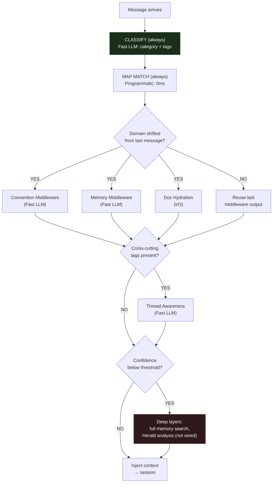
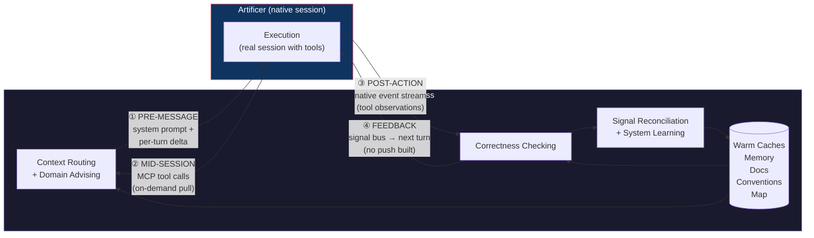
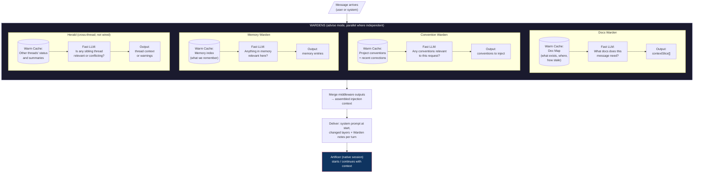
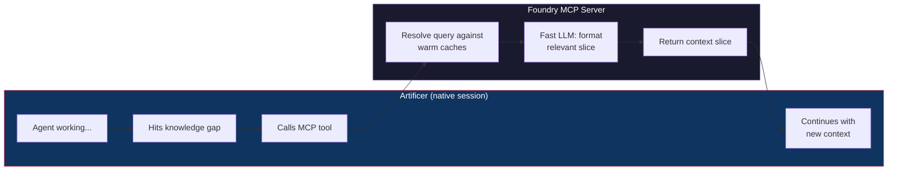
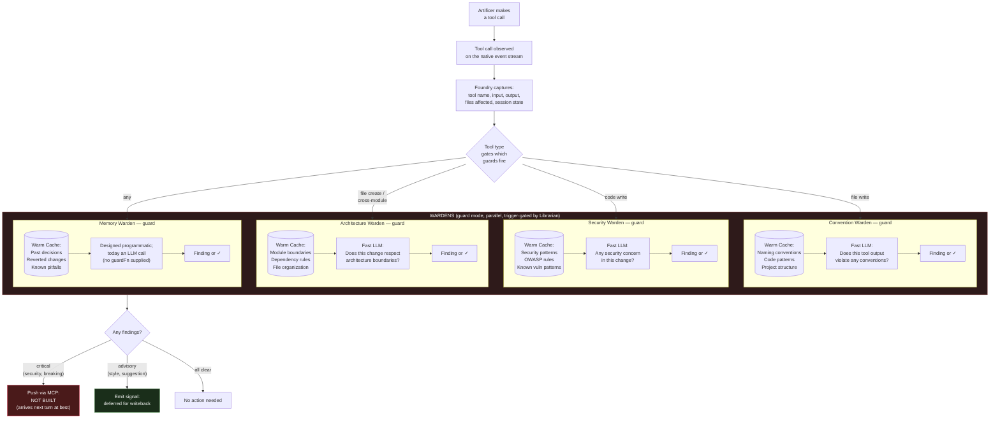
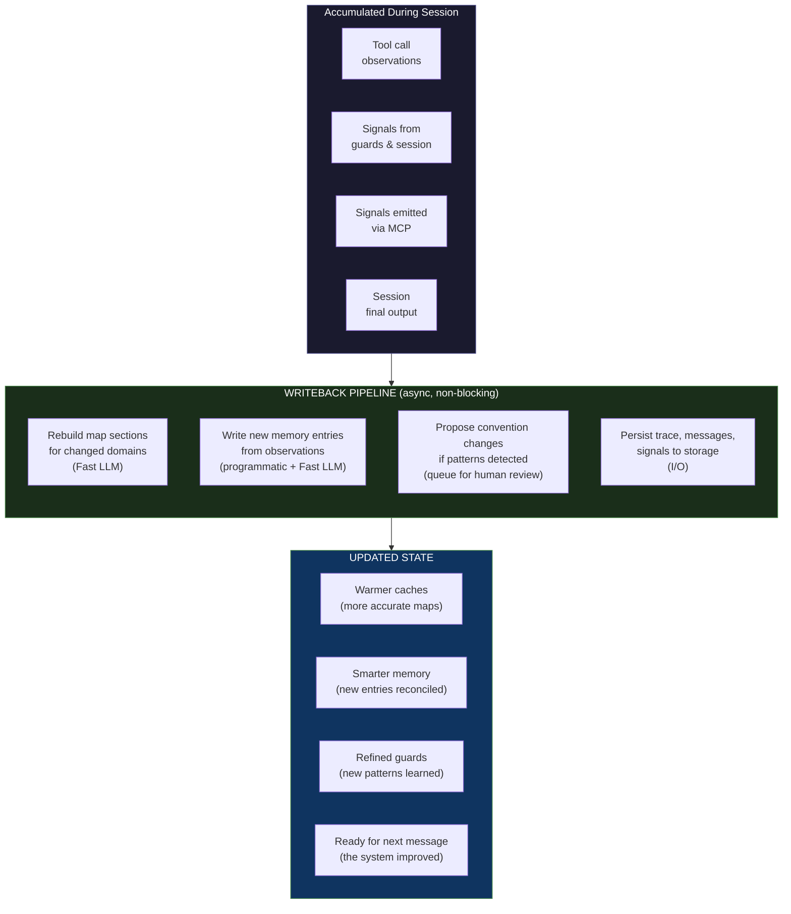
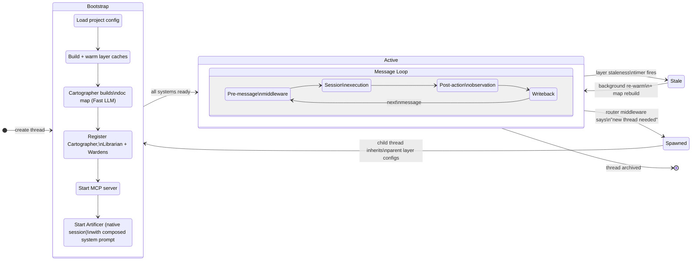

# Foundry Harness — Data Flow & Request Lifecycle

> Northstar document. This is how data and requests move through the Foundry harness.
> Every design decision traces back to two constraints: **token budget** and **latency**.
> Every architectural choice answers one question: **how does the system get smarter after each interaction?**
>
> **How it is built today (2026-10-12).** This document mixes the design with what exists; [What exists vs what needs building](#what-exists-vs-what-needs-building) is the ledger. In short: the Artificer is a native Claude Code or Codex session run through agent-session. Standing context reaches it through the system prompt (`--append-system-prompt-file`, `packages/foundry/src/providers/native-launch.ts:144`) plus per-turn deltas (`providers/session-delivery.ts`; see [Delivery](#delivery-what-a-native-session-receives-each-turn)). Foundry observes tool calls on the native event stream, not through Claude Code hooks, and its structural tool gate (`packages/foundry/src/turns/tool-gate.ts`) answers the CLI's permission requests. Wardens are a chorus: their advice is appended to the user's message ("The <domain> Warden chimed in:"), advice runs under a deadline (`adviseTimeoutMs`) and a Warden that times out is skipped, and only structural rules deny. (Exception being fixed: the expert-cache warm before a turn has no deadline yet.) There is no `.foundry-context.md`, no PostToolUse hook, and no MCP push. The Herald exists as code but is not wired.

---

## Why This Exists

Every time an AI agent starts a task, it re-learns what you already taught it. Your conventions, your architecture decisions, your taste — none of it persists reliably. You correct the same mistake on Tuesday that you corrected on Monday.

This is the **re-alignment tax**: the continuous cost of steering AI agents back to what "good" means in your specific context. The tax scales with team size, codebase complexity, and agent autonomy. Today, teams pay it through hand-maintained CLAUDE.md files, scattered system prompts, and vibes.

Three layers exist in AI-assisted work:
- **Model** — frozen weights. You can't change them. Gains are plateauing.
- **Harness** — the tool that wields the model. General-purpose. Doesn't know your org.
- **Corpus** — the context that shapes output. This is the only layer where teams have direct control AND where improvements compound.

Foundry treats corpus as the parameters to optimize. The mechanism is signal infrastructure: **capture** every interaction, **classify** it (correction, convention, taste, ADR, security), **route** it to durable forms, **verify** the change improves output, **prevent regression**. One interaction produces many downstream artifacts — a correction becomes a memory entry, a convention proposal, a guard pattern, a fixture candidate. The system gets smarter after every interaction, not just when someone edits a config.

The goal is not more autonomy. It's **horizon alignment** — making the agent's output converge toward the project's standards, conventions, and accumulated taste. Autonomy without alignment is just faster drift.

---

## The Core Model

Foundry is a nervous system wrapped around an **Artificer** — a native Claude Code (or, as a setting, Codex) session running as the executor under the harness.

Claude Code does what it's already good at — tool use, file access, codebase reasoning. Foundry adds what it doesn't have: persistent memory, project conventions, multi-thread awareness, correctness checking, and an observation loop that makes everything smarter over time.

### The five roles in the flow

The harness has five roles, defined by *where they show up* in the message lifecycle. Each role can be one agent or many — that's an implementation decision, not an architecture one.

```
MESSAGE ARRIVES (user or system)
       │
       ▼
┌─ 1. CONTEXT ROUTING ─────────────────────────────────────────────┐
│                                                                    │
│  Read the topology map. Decide what context slices this message    │
│  needs. Route, never modify. See the whole project so the          │
│  executor doesn't have to.                                         │
│                                                                    │
│  → "This message needs auth-conventions and security-patterns"     │
└────────────────────────────────────────────────────────────────────┘
       │
       ▼
┌─ 2. DOMAIN ADVISING ─────────────────────────────────────────────┐
│                                                                    │
│  Each domain checks its warm cache against the message.            │
│  Docs: which docs to hydrate. Conventions: which rules apply.      │
│  Security: any security context. Memory: have we seen this before. │
│  Cross-thread: any sibling threads relevant or conflicting.        │
│                                                                    │
│  → merged into the turn (system prompt + per-turn delta)           │
└────────────────────────────────────────────────────────────────────┘
       │
       ▼
┌─ 3. EXECUTION ───────────────────────────────────────────────────┐
│                                                                    │
│  The real agent does the real work. Full tool access, real          │
│  codebase reasoning. This is the expensive model.                  │
│                                                                    │
│  If it discovers a gap mid-work → pulls from context routing       │
│  and domain advisors via MCP bridge (on demand).                   │
└────────────────────────────────────────────────────────────────────┘
       │
       ▼
┌─ 4. CORRECTNESS CHECKING ────────────────────────────────────────┐
│                                                                    │
│  When the turn's tool activity ends, domain agents guard it once,  │
│  over every write, edit and command of the turn, in order.         │
│  Trigger-gated: a Warden is asked when one of its guardTriggers    │
│  names a call of the turn; memory on any activity (see Guard tiers)│
│                                                                    │
│  Findings → signals for reconciliation; the session sees them on   │
│  a later turn at best (no push path is built).                     │
└────────────────────────────────────────────────────────────────────┘
       │
       ▼
┌─ 5. SIGNAL RECONCILIATION & SYSTEM LEARNING ─────────────────────┐
│                                                                    │
│  Consume ALL signals from every role. Classify by type             │
│  (correction, convention, taste, ADR, security). Reconcile         │
│  into the thread-state layer (one coherent view, one writer).      │
│                                                                    │
│  Post-execution: map rebuilds, memory entries, convention          │
│  proposals → feeds the corpus pipeline.                            │
│                                                                    │
│  Every execution is a training step. This is the gradient.         │
└────────────────────────────────────────────────────────────────────┘
```

### Roles → agents (current naming)

These are the agents we've named so far. Each implements one or more roles. The roles are the architecture; the agents are one way to fill them.

| Role | Agent(s) | Notes |
|------|----------|-------|
| **Context routing** | Cartographer | Reads everything, owns the topology map, routes slices. |
| **Domain advising** | Wardens (formerly called Domain Librarians) — Docs Warden, Convention Warden, Security Warden, Architecture Warden, Memory Warden | Each maintains a warm cache for its domain. Advise mode: "what context does this message need from my domain?" |
| **Domain advising** (cross-thread) | Herald | Design: watch all threads, detect convergence, divergence, resource conflicts. **Not wired**: the class exists (`agents/herald.ts`) but no runtime constructs it (`viewer/config.ts:301`). |
| **Execution** | Artificer (the native Claude Code or Codex session running under the harness) | The real work. Full tool access, capable model. |
| **Correctness checking** | Wardens (guard mode) | Same agents as advising, different mode. Guard mode, once per turn: "did what the agent did this turn violate anything in my domain?" |
| **Signal reconciliation** | Librarian (singular — distinct from the plural Wardens) | Sole writer to thread-state. Classifies signals, reconciles, trigger-gates guards, feeds writeback. |

A role can compose many subagents — the Librarian might delegate security checking to three specialized subagents, the Cartographer might have a doc-map builder and a dependency-graph builder underneath. The flow doesn't change. What matters is that after a tool call, *something* checks conventions, *something* checks security, and the results flow into *one* reconciliation point.

### Wardens — the shared pattern

Each Warden maintains knowledge, advises when asked, and guards when triggered:

| Domain | Warm Cache | Advise (on message) | Guard (once per turn, over its tool calls) |
|--------|-----------|--------------------|--------------------|
| **Docs** | Doc map + full content | "Which docs does this message need?" | "Did this edit invalidate any docs?" |
| **Convention** | Naming/pattern rules | "Which conventions apply here?" | "Does this edit violate conventions?" |
| **Security** | Security patterns, OWASP | "Any security context to inject?" | "Does this change introduce a vuln?" |
| **Architecture** | Module boundaries, deps | "Cross-module work?" | "Does this respect boundaries?" |
| **Memory** | Past decisions, failures | "Have we seen this before?" | "This pattern failed last time" |

Memory is meant to be special in guard mode: **programmatic pattern matching** against known failure modes (grep + structured memory, not LLM reasoning), so it could run on every tool call for free. **Not built:** the memory domain sets `programmaticGuard: true` (`agents/thread-runtime.ts:196`) but nothing supplies a `guardFn`, so `DomainLibrarian.guard` falls through to the LLM guard (`agents/domain-librarian.ts:1259-1271`). Every guard is an LLM call today.

### When a Warden weighs in: the charter, trigger points and NO_COMMENT

**The Warden charter** (`agents/warden-charter.ts`) is how every Warden works. It is one fixed meta-instruction set, part of Foundry, never settings, and never edited per project. It heads the system message of every Warden call, above that Warden's own composed instructions. It sets scope discipline (a point is yours only when you can name the rule, fact or `fb_` item in your instructions or knowledge that it touches), `NO_COMMENT` as the default answer, what each moment asks, and how to speak: at most three short points, each citing its `fb_` id or rule. Its wording is iterated against real sessions with the charter eval (below), never hand-tuned per Warden. Two wordings ship, selected by what a project's chorus is built from: this one for the hand-named roster, and the **classifier charter** (`WARDEN_CHARTER_CLASSIFY`) for a chorus of region Wardens ([usage-and-context.md](usage-and-context.md#chorus-projectsidchorus)).

**The classifier charter points; the main thread decides** (Aron, 2026-10-17: "All they're trying to do is point… The wardens do not make any sort of decision"). Its first principle: an instruction to build something new is a reason to look. Whatever the moment says to build, even "write a new X" or "don't use X", the Warden matches the job against its region and points at the system that does it; if none does, `NO_COMMENT`. Why: over-specified tickets ("add a table", "write a lock") contradict systems that already exist, and an agent that follows them literally builds a parallel one; "don't use X" still points, because X is the comparison the main thread needs ("what is the material difference"). A Warden judges only whether the moment touches its region and which system is most likely. Its answer is `NO_COMMENT` or a pointer in one of three shapes, at most three names, each remark one snippet (advice) or one advisory finding (guard), in order:

- **ranked**: `Look over here: <name> (<where>) — <why it is the likely one>`, then up to two `Less likely: <name> (<where>) — <what tells it apart>`;
- **choose one**: `Choose one: Related systems; pick the one whose job matches.`, then two or three `<name> (<where>) — <its distinguishing job>`, sent when close siblings can't be told apart (sibling confusion was 22% in the probe evals, Oracle `docs/WARDEN-EXPERIMENTS.md`): a set that holds the right one beats a confident wrong pick, and it scores on the pointer ladder's candidates rung;
- **class**: `Look over here: <the class> (<where>)`.

`parseWardenPointer` reads the remarks into `{ shape, pointer, where, why, level, candidates, unparsed }`, counting what fits no line. No field says whether to use anything; the classifier's guard protocol (`CLASSIFY_GUARD_RESPONSE_PROTOCOL`) is advisory-only with no suggested fix, and its validator refuses a `critical` severity or a `suggestion`. Under the classifier every advice trigger's `NO_COMMENT` bar is the same: the moment touches nothing in the region, whatever it says to build or not to use.

**The reception charter** (`CHORUS_RECEPTION`) is the main thread's counterpart, fixed in Foundry: a region-chorus thread holds it once as the standing layer `chorus-reception` (`chorus.reception: false` leaves it out, e.g. for an Oracle baseline; roster threads never get it, their Wardens advise). It says a chime is a pointer to verify, not advice; follow a ranked pointer's top first; pick from a choose-one set and say which and why in the plan; set a wrong chime aside in one line; silence is not evidence that nothing exists. It also carries the acknowledgement rule (Aron, 2026-10-17): a pointer at a system the instruction, ticket or spec contradicts needs the instruction to name that system and say to replace or bypass it; otherwise the main thread asks one short question naming it and its doc section before building ("This doesn't match what we have (X, doc §); confirm?"); when acknowledged, it proceeds and uses the system as the comparison, stating the material difference in its plan. The chime text itself stays a pointer. The inixiative org states the same rule in `~/code/inixiative/CLAUDE.md`, which the ladder's `org` node composes. Whether the main thread follows it is measured by Oracle's replays (the Reception and Early conflict detection gauges), not here.

**Trigger points.** A Warden is asked at a named trigger point. Every Warden the point reaches is asked unless the **pre-filter**, when turned on, rules it out: one local decision-model call per trigger scores, per Warden, whether the moment is about its domain, and a Warden is skipped only on a confident no ([subscription decisions, Warden pre-filter](subscription-decisions.md#warden-pre-filter)). It fails open: an unsure score, a failed call or a missing model asks the Warden. It is not a keyword or path filter, which would fail silently; every skip is journalled with its score, so a Warden that should have spoken is auditable. It is off by default (`prefilter.enabled` in settings; no local model clears the bar yet), and when on it runs before advice, before the turn's guard, before a handoff brief and before the post-work review. Deciding what to say stays the Warden's job under the charter.

| Trigger point | Phase | Who is asked | The charter asks |
|---|---|---|---|
| `user-message` | advice | every Warden, on every user message | what does the user usually add here, in your domain, so they need not say it perfectly every time? |
| `consumed` | advice | every Warden, when the main thread takes in a work item (`chorus.consumed`, off by default) | what in your domain will this work touch, whatever it says to build? |
| `agent-action` | guard | once per turn, when the turn's tool activity ends: every Warden whose `guardTriggers` name a call of the turn, over the whole turn's writes, edits and commands in order | does what the agent did this turn go against your domain? |
| `subagent-spawn` | brief (advice protocol) | every Warden, when the agent hands a task to a subagent | what must the subagent know, from your domain, that the task text leaves out? |

**One guard per turn** (Aron, 2026-10-15). Tool calls are journalled as they happen (the native journal, the review's per-dispatch tool bucket); the guard is not asked per call. The runtime holds the turn's guardable calls (those some Warden's `guardTriggers` name; reads never enter the moment) on the live dispatch and, when the executor's dispatch returns, fires one `postAction` over them, not awaited: the chorus never holds the hand-back, and its outcome reconciles the turn's pending guard entry. One `guard-request` row per asked Warden and one `guard-outcome` row wrap the turn (`wraps: turn:<id>`, `activity.calls` in order). `guard: "per-call"` in settings restores a guard per tool call. An observed subagent's turn is guarded the same way when its turn ends (`subagent_turn`), on the subagent's node, in the in-session runtime. A call with no live dispatch to belong to is guarded on its own, visibly uncorrelated.

**The handoff brief.** `task_started` (agent-session 0.6.6) makes the child an observed thread (`turns/subagents.ts`); the recorder's `onSpawn` fires `subagent_spawn` on the root thread, and `FlowOrchestrator.brief` asks the roster once over the task text (`handoffText`). Each Warden's decision is journalled on the parent node as an `advice` row with `trigger: subagent-spawn` wrapping `handoff:<child>`; what they said is queued (`queueNotes`) and rides with the parent's next user message as "The <domain> Warden chimed in on the handoff to <description>:" notes. The subagent itself is not changed: the harness has already composed what it received, and no push path reaches a running turn.

**The `consumed` trigger** (Aron, 2026-10-17). When the main thread reads a ticket or spec file, or fetches a Linear issue or document or a Notion page, the item is a moment: `workItemOf` (`agents/work-items.ts`) matches the call against the project's `chorus.consumed` (`tools`, globs on the tool name, case-insensitive; `paths`, globs on a read file's project-relative path, prose files only by default; `maxChars`, default 12,000, the item clipped with a marker), and `FlowOrchestrator.consume` asks the roster once through the advice protocol, the same `_between` path as the brief. A file's text is the file on disk (an observation's output may be a bounded summary); it is asked once per path and content, so chunked reads of one file are one item. A fetch's text is the call's output, asked once per tool and id. The decision is journalled as an `advice` row with `trigger: consumed` wrapping `<tool>:<path or id>` (silence included), and what Wardens said rides with the next turn as "The <domain> Warden chimed in on the work item <name>:" notes. Subagents' reads are not asked: their notes would reach the parent, never the subagent doing the work. **What it adds, plainly:** no push path reaches a running turn, so a ticket read and built in the same turn gets its pointer when the turn ends, the same moment the per-turn guard fires over the writes. The trigger adds a new moment for turns that take a work item in without writing: plan-first turns, turns that end in a question, read-only turns. A ticket pasted into the message is covered by `user-message`. An in-turn path (the `foundry` MCP pull channel is the natural base) is deferred.

After the work, every Warden reviews it (post-work review) under the same charter. Next trigger points, each with its own input, protocol text and NO_COMMENT default: `agent-question` (answer on the user's behalf when confident and backed by a recorded ruling), `hand-back` (process Wardens review the final message before it lands, one extra pass at most).

**NO_COMMENT is the expected answer** in every phase protocol (advice, guard, review): exactly `NO_COMMENT`, nothing else. It adds nothing to the thread: no note, no "Domain decisions" line, nothing in the shared thread state. It is still journalled as the Warden's decision (`no-comment`), so the silence rate is measurable. Any other answer outside the protocol (an empty contribution, extra fields, prose around JSON, NO_COMMENT with anything else) is an error, never a comment.

**Load.** Asking every Warden is handled by sizing the decision queue for the roster (`subscriptionOnly.maxConcurrent`, default 16) and keeping every role primed (two primed keys per Warden, advice and review, sized at startup from the roster), not by asking fewer. A decision's queue wait is bounded by its caller's deadline; once started it gets its full run budget, so no running decision is cut short. Measured 2026-10-12 with 25 Wardens: about 50 decision processes and 10 GB resident, plan latency 2.5–10 s once warm, and the first one or two turns after a start time out while 51 keys prime. A Warden the queue never admitted in time is recorded as `excluded` (advice) or `not-admitted` (guard): it did not run, and the turn goes on without it. The pre-filter is the one gate, off by default: domain-agnostic, measured on labelled moments (`scripts/evals/warden-prefilter.ts measure`), failing open.

**The charter eval** is a dev diagnostic; the test is the Oracle replay (Oracle `docs/ORACLE-TEST.md`, entry point `docs/PROCEED.md`). The charter eval (`scripts/evals/warden-charter.ts`, scoring in foundry-core `feedback/warden-probes.ts` so Oracle scores the same way) runs a charter wording over probes built from real sessions (`scripts/evals/warden-probes.ts`). Its ground truth is the user's own correction: `--sessions` runs the Prospector (`foundry repeats`' collector and classifier) over a project's sessions and prompt history, and each probe keeps the user's ask (the `user-message` trigger), the agent's turn when recorded (`agent-action`), the correction the judge sees, and a train/test period by date for backtests. Wardens are composed exactly as a live thread composes them (the daemon's settings and composition view, bound to the probe's project); a Warden whose knowledge composes empty is cold and left out. Each probe is one turn per trigger point, with every Warden asked at once. `--label-targets` (Opus) labels what each correction pushed toward: the existing rule, primitive, system or pattern, with its concept cluster, and writes the distinct targets (the catalog's checklist: a target the catalog lacks is a gap). With a target, the judge matches on the target, not on wording. The primary measure is **anticipated**: the share of real corrections some Warden said first, at either trigger. `--knowledge <dir>` scores another knowledge set against the same probes, and `--rejudge <run>` re-judges a run's remarks without asking Wardens again. It also reports wrong remarks (per probe and per trigger), silence precision (NO_COMMENT when nothing of the Warden's applied), speak precision (a remark matched the user's later real correction, judged by Opus), scope violations, owner recall when probes name owning domains, and per-turn calls and latency at roster scale. Probes hold session text and are never committed.

### Why correctness checking matters more as sessions grow

As context fills, agents become more random — instruction-following decays, earlier context gets diluted, the model starts drifting from conventions it was following at message 5. The guard-mode agents don't degrade with session length because they compare tool outputs against their own warm caches, which are stable and compact regardless of how large the session context has grown. At message 50, the security check compares against the same patterns it had at message 1.

The guards are the mechanism that keeps the session aligned as context pressure mounts. This is the "horizon alignment over autonomy" principle in practice — not making the agent more autonomous, but keeping it aligned with project standards even as its context degrades.

When debugging:
- Wrong conventions injected? → **Convention domain** (bad cache or wrong match)
- Security issue slipped through? → **Security domain** (missed it or wasn't triggered)
- Incoherent thread state? → **Reconciliation** (bad signal merge)
- Duplicate work across threads? → **Cross-thread awareness** (didn't detect convergence)

---

## Design Principles

1. **Don't reinvent Claude Code.** It already has tool use, file discovery, and codebase reasoning. Wrap it, don't replace it.
2. **Middleware = LLM-backed decision slices.** Each middleware consumes a warm cache + the message and produces a decision. That's an LLM call, not a boolean check. The warm cache is the *input* to the call, not a substitute for it.
3. **Cheap models for decisions, capable models for work.** Context routing, domain advising, and correctness checking all use Claude Haiku 5.5 through the subscription. The executor session uses whatever the native CLI is running (Opus 5.5 or Fable 5.1 for heavy work).
4. **Pull over push.** Don't frontload every possible context. Inject what the middleware predicts is needed, let the session pull the rest via MCP.
5. **Progressive depth, not blanket evaluation.** Basic layers run every message. Deeper layers run only when something changes — domain shift, confidence drop, new trigger. Most steady-state messages hit only classification + map match. The system escalates to deeper middleware and guards based on what the basic layers detect.
6. **Backpropagation is the whole point.** Every execution updates caches, memory, and maps. The system improves after every interaction, not just when someone edits a config.
7. **Grep is always available.** When a summary says "this might be relevant" but isn't sure, programmatic search resolves it without an LLM call.

---

## Model Routing

| Flow role | Model Tier | Examples | Why |
|-----------|-----------|----------|-----|
| Context routing | Fast/Cheap | Claude Haiku 5.5 (subscription); configurable | Map lookup + routing decision |
| Domain advising | Fast/Cheap | Claude Haiku 5.5 (subscription); configurable | Small context, structured output |
| Execution | Capable | Whatever the native CLI runs (Opus 5.5, Fable 5.1) | The real work |
| On-demand context (MCP) | Fast/Cheap | Claude Haiku 5.5 (subscription); configurable | Cache lookup + formatting |
| Correctness checking | Fast/Cheap | Claude Haiku 5.5 (subscription); configurable | Narrow slice, yes/no + reasoning |
| Signal reconciliation | Mostly programmatic | (rarely) Claude Haiku 5.5 | Reducer logic, LLM only on genuine conflicts |
| Map building/rebuild | Fast/Cheap | Claude Haiku 5.5 (subscription); configurable | Summarization task |

---

## Progressive Depth — Tiered Frequency Model

Not every layer runs on every message. Not every guard runs on every tool call. The system escalates from cheap/fast basics to expensive/deep analysis only when something triggers it.



### Middleware tiers

| Tier | What runs | Trigger | Steady-state frequency |
|------|-----------|---------|----------------------|
| **Always** | Classification + map match | Every message | Every message |
| **On domain shift** | Convention, memory, doc hydration middleware | Classification output differs from last N messages | ~20% of messages in a focused session |
| **On cross-cutting signals** | Thread awareness middleware | Classification tags indicate multi-domain or shared-resource work | ~5% of messages |
| **On low confidence** | Deep memory search, Herald analysis (not wired), full map rebuild | Basic layers return low-confidence or empty results | ~2% of messages |

### Guard tiers

Every guard fires at most once per turn, over the turn's whole tool activity; a Warden is asked when one of its `guardTriggers` names a call of the turn.

| Guard | Asked when the turn has | Skips |
|-------|---------|-------|
| Convention Guard | a file write or edit | Turns of reads, bash commands, grep only |
| Security Guard | a code write or command | Turns of reads or non-code edits only |
| Architecture Advisor | a file creation or cross-module import | Turns of edits within one module |
| Memory Advisor | any guardable call. Designed as a programmatic pattern match; today an LLM call, because no `guardFn` is supplied | Turns with no guardable call |

### The thread-state layer makes this work

The tiered model requires every middleware predicate to answer "should I run?" That question requires knowing what the thread already knows — current domain, what's in context, recent activity. If each middleware independently reconstructs this from dispatch logs, you've defeated the purpose of tiering.

The solution: one of the warm caches IS the thread summary. A thread-state layer (~200-500 tokens, always warm) that the writeback loop keeps current:

```
Thread State Layer:
{
  "domain": "auth",
  "recentActivity": ["edited auth/middleware.ts", "read auth/service.ts"],
  "inContext": ["auth-conventions", "security-patterns"],
  "lastClassification": { "category": "feature", "tags": ["security", "api"] },
  "messageCount": 12,
  "compactionState": "none"
}
```

Every predicate becomes a cache read:
- **"Domain shifted?"** → `threadState.domain !== currentClassification.category`
- **"Need thread awareness?"** → check `recentActivity` for cross-module patterns
- **"Convention guard relevant?"** → tool call touches files outside `threadState.domain`

No LLM calls, no dispatch log scanning. The awareness layer IS the state. This is why awareness layers must be first-class primitives — they're not a dashboard feature, they're the mechanism that makes the entire tiered system efficient.

### One writer, many readers

Multiple Wardens and guards (and, once wired, the Herald) run in parallel — all producing signals. But only **one entity writes the thread-state layer**: the Librarian.

```
Parallel agents (readers + signal emitters):
  Classification ──────→ { category: "feature", tags: ["security"] }
  Convention Warden ───→ "auth conventions applied"
  Security Warden ─────→ "clean"
  Architecture Warden ─→ "cross-module edit detected"
  Herald (not wired) ──→ "thread B editing same file"
  Tool observation ─────→ "edited auth/middleware.ts"
           │
           ▼
Librarian (sole writer):
  Consumes all signals → reconciles into one coherent state
  Writes → thread-state layer
```

Why sole writer matters:
- **Coherence** — the layer is always a consistent snapshot, never a race between parallel writers
- **Reconciliation** — when classification says "auth" but the Architecture Warden says "cross-module," the Librarian reconciles: `{ domain: "auth", flags: ["cross-module"] }`. That's a judgment call, not last-write-wins.
- **Predicates stay simple** — every Warden reads one coherent state

The Librarian is mostly a programmatic reducer: last classification wins for domain, append-only for activity, union for flags. It only needs a Fast LLM call when signals genuinely conflict and need reconciliation — which is rare in a focused session.

### Session Store vs Thread-State Layer

These are two different data structures serving two different purposes. They are connected but not the same thing.

```
SESSION STORE (append-only event log, grows with session):
  [event] classified: category=auth, tags=[security, api]
  [event] dispatched: executor on auth/middleware.ts
  [event] tool_call: file_write auth/middleware.ts
  [event] sentinel: convention guard clean
  [event] sentinel: security guard flagged SQL injection
  [event] signal: correction emitted
  [event] classified: category=auth (same domain)
  [event] dispatched: executor on auth/service.ts
  ... (hundreds of events over a session)

THREAD-STATE LAYER (materialized view, always compact ~200-500 tokens):
  {
    "domain": "auth",
    "messageCount": 12,
    "inContext": ["auth-conventions", "security-patterns"],
    "flags": ["security-concern-active"],
    "compactionState": "none"
  }
```

| | Session Store | Thread-State Layer |
|---|---|---|
| **Pattern** | Append-only log | Materialized view |
| **Size** | Grows with session | Fixed ~200-500 tokens |
| **Writer** | Everyone appends events | Librarian only (rewrite) |
| **Readers** | Replay/restart (`Thread.fromSession()` is design only; not built) | Middleware predicates (0ms reads) |
| **Persistence** | Must survive crashes | Reconstructable from store |
| **Compaction** | Can be trimmed/archived | Always current, never compacted |

**The Librarian connects them.** It reads from the Session Store (the raw event stream) and rewrites the Thread-State Layer (the compact view). Each reconciliation is itself an event appended to the store — so the store contains the full history of how the thread-state evolved.

**The Thread-State Layer is derivable.** If you lose it, the Librarian replays the Session Store and rebuilds it. But you'd never want to — it's always warm, always current. That's the whole point.

**Thread restart = store replay (design only; `Thread.fromSession` is not built).** `Thread.fromSession(store, sessionId)` would replay the store to reconstruct warm caches, thread-state, and dispatch history. Same hydration pattern as layers, applied to the whole thread. User closes terminal, comes back tomorrow → thread resumes, not cold-starts.

### Why this works

Most consecutive messages in the same thread are about the same topic. If messages 5 through 12 are all about auth middleware, the convention/memory/doc middleware output from message 5 is still valid at message 12. Re-running it is waste.

The classification tier is always cheap (~200ms, one Fast LLM call). It's the gatekeeper — but it doesn't decide alone. It compares its output against the thread-state layer (0ms read) to determine whether downstream middleware needs to fire.

**Cost impact:** A 50-message session where 80% of messages reuse cached middleware output runs ~10 middleware stacks instead of 50. At Flash rates, that's $0.04 instead of $0.20. Already cheap, now cheaper.

---

## The Four Communication Channels

Every interaction between Foundry and the executor session flows through one of four channels:



| Channel | Flow roles | Direction | Mechanism | When | Latency |
|---------|-----------|-----------|-----------|------|---------|
| ① Pre-message | Context routing + domain advising | Foundry → Session | System prompt at session start (`--append-system-prompt-file`) plus changed layers and Warden notes with the user message (`providers/session-delivery.ts`) | Before session starts or on new message | Measure with `scripts/measure-decisions.ts`; the 2026-10-12 measurement was about 1.7 s median, warm |
| ② Mid-session | On-demand context (execution pulls) | Session → Foundry | MCP tools | Agent discovers a gap mid-work | ~200ms per query |
| ③ Post-action | Correctness checking | Session → Foundry | Tool calls observed on the native event stream; the tool gate answers permission requests before a call runs | After matching tool calls | Async capture |
| ④ Feedback | Correctness checking → execution | Foundry → Session | Signals reconciled by the Librarian; reach the session on a later turn at best. **No MCP push is built.** | When guards flag something | Next turn |

---

## Loop 1: Pre-Message — Context Routing + Domain Advising

When a message arrives, context routing and domain advising run to contextualize before the executor sees it.



### Middleware execution model

Each middleware:
1. **Has a warm cache** — semi-static state that was pre-loaded (docs index, conventions, memory entries, thread summaries). These are the context layers from the existing system.
2. **Gets the message** — the user's request or system event.
3. **Makes an LLM call** — cheap/fast model compares the message against its warm cache to produce a decision. This IS the classification/routing work, distributed across middleware.
4. **Produces output** — a structured decision (which docs to load, which conventions apply, which memory is relevant, whether sibling threads matter).

Middleware can run in parallel when independent. Doc awareness and convention middleware don't depend on each other. Thread awareness might depend on classification output if you want to narrow the search.

### What "warm cache" means concretely

A warm cache is **not** the full content of every doc or every memory entry. It's a **summarized, structured index** built by a fast LLM at bootstrap and refreshed on change:

```
Doc Map Cache (~500 tokens):
{
  "auth": { "layers": ["auth-conventions", "auth-api-docs"], "size": "9.2k tokens", "lastUpdated": "2h ago" },
  "testing": { "layers": ["test-patterns", "fixture-guide"], "size": "4.1k tokens", "lastUpdated": "1d ago" },
  "security": { "layers": ["security-patterns", "owasp-checklist"], "size": "6.3k tokens", "lastUpdated": "3h ago" }
}
```

The middleware LLM sees this compact index + the message and says "pull auth-conventions and security-patterns." It doesn't see 20k tokens of full docs — it sees 500 tokens of map and makes a routing decision.

When the router says "pull auth-api-docs," that layer gets hydrated (file I/O, not LLM) and delivered with the turn.

### Delivery: what a native session receives each turn

**An unwrapped thread receives nothing from Foundry.** A fresh install configures one executor with no instructions and no layers, classifier, router or Wardens (`defaultAgents`, `viewer/config.ts`). Such a thread makes no Cartographer call and keeps thread-state off its stack, so the session gets the user's message as typed: no standing part, no per-turn text (`wrapsThread`, `agents/thread-runtime.ts`). The first configured layer or decision role wraps it from the next turn, and the parts below apply.

A wrapped thread's context has three parts, and each reaches a native session (Claude Code, Codex) differently:

| Part | Examples | Delivered |
|---|---|---|
| Stable | composed instructions (`instructions` layer), the executor's own prompt | once, in the session's base context; an edited instruction file is a new hash (below) |
| Slowly changing | Warden thread knowledge, memory; a post-hoc review may update them every cycle | in the base context when the session starts, then as a delta whenever a layer's hash changes |
| Per turn | Cartographer routing (the decoration) | every turn, with the user message |
| Warden notes | each Warden that chimed in: `The <domain> Warden chimed in:` and its points; a NO_COMMENT adds nothing | every turn, appended to the end of the user's message (`placement: "after-message"`) |
| Thread-state | the Librarian's layer (domain, recent activity, flags; not the ledger or timestamps) | every turn, with the per-turn text; never in the base (`perTurn`), so the system prompt stays byte-stable |

**The guarantee.** A session holds every standing part (each warm layer with its prompt, plus the executor's instructions as one `agent` part) at its current hash, and the latest version in its context is the current one. Each part is labelled `## Context: <id>`, in the system prompt and in a delta. The mechanics:

- **Session start.** On Claude the provider starts the session with every standing part as its system prompt (`--append-system-prompt`; from the next agent-session release, `--append-system-prompt-file`, a private file, so a base past Linux's 128 KiB argument limit still starts), which Claude re-sends and caches on every request. Codex has no system prompt, so its first delivered turn carries every part in its message, and so does a retry when that first send failed. The turn's report says `started`, and the delivery ledger is reset to what the session then holds.
- **Resume.** A session that resumed a native conversation may already hold older versions of some parts as messages. When that conversation is the one the thread's ledger describes (a relaunch in this process: a host launch change, a cwd move), the ledger is honored and only parts whose latest delivered version is not current are sent. A resume from another process (a daemon restart) has no such record: its first turn sends every part once, so the latest version in context is the current one.
- **Later turns.** The executor passes the ledger (`SessionDelivery.held`). The provider sends only the parts whose hash the session does not hold, each headed "current version; it replaces any earlier version", plus the per-turn text. The report lists what was `sent`, and `commitDelivery` records exactly that.
- **Compaction** (`session_compacted`) clears the ledger. What lived only in the conversation is sent again. A Claude system prompt survives compaction, so parts it holds at an unchanged hash are not re-sent. Without a system prompt, everything is sent again. A compaction while a turn runs leaves that turn's sent parts out of the ledger. The ledger is cleared even when no pre-message plan has succeeded yet, since a turn delivers without one.
- **Reset, resume, relaunch.** Any new native session process (a new thread, a daemon restart that resumes the binding, a host launch change) starts again from the current layers. It reports `started`, and the ledger follows.
- **One session per thread.** A thread that moves to another cwd (ACP `session/load`, a worktree switch) retires its session in the old cwd before one starts in the new; with unsettled work there, the move is refused and nothing is sent. Two processes never resume one conversation, and the ledger describes the one session that runs.
- **No retraction.** A layer that stops being included (a per-dispatch filter, a layer gone cold) stays in what the session already holds. In a message it lasts until compaction summarizes it; in the system prompt (the parts a Claude session started with) it lasts until the session restarts, because a system prompt survives compaction.
- **Layer change.** A changed layer (a settings edit, an edited CLAUDE.md, MEMORY.md or role file, a learned interpretation) is a new hash, and it is delivered once as a delta. Before each turn the executor re-warms every layer that went stale: a composed slot goes stale as soon as a file it read changes, any layer once its staleness window passes. A stale standing layer that has not re-warmed keeps its last content; it never drops out.

The provider (`providers/session-delivery.ts`) decides what to send, the Librarian's ledger is the record, and the turn's `DeliveryRecord.session` and `InjectionArtifact.sessionDelivery` show what was delivered. `providerMessages` stays what the executor handed the provider. Stateless API providers still receive every warm layer on every turn.

**Measured** (`scripts/measure-warm-cache.ts`: Claude subscription, 10 turns, a 49KB composed instruction stack, a learning update before turn 5). Re-sending everything every turn (the old delivery) wrote 194k to 215k cache tokens and reached the 160k compaction threshold by turn 7. Delivering once with deltas wrote 11k to 43k tokens, most of it on the first turn, and context grew about 1k tokens a turn.

---

## Loop 2: Mid-Session Bridge (MCP)

The Artificer (native session) has an MCP server, `foundry`, that connects it back to Foundry (`packages/foundry/src/mcp/server.ts:305-650`). When the agent discovers it needs context that wasn't frontloaded, it pulls.



### MCP Tool Surface

Seven tools, each scoped to the calling thread's project:

```
foundry_device()
  → this session's enrolled device and bound checkout; nothing else is disclosed

foundry_query(topic, detail?)
  → search the thread's current context layers for a topic

foundry_conventions(domain)
  → a domain's three parts: reviewer instructions, configured domain knowledge,
    generated thread-private knowledge

foundry_memory(query | id)
  → search the thread's retained memory records, or get one by id, with provenance

foundry_access(action: "integrations" | "describe" | "read", ...)
  → read project-authorized Kingdom integrations through their Signets
    (registered only when a Kingdom access tool is configured)

foundry_threads()
  → summaries of other live threads in the same project

foundry_signal(kind, content)
  → report an observation; disabled on the read-only native grant until signal
    writes are journaled with call provenance
```

### Why MCP solves mid-session injection

The old problem: Foundry can't pause a running Artificer to inject context.

The MCP solution: Foundry doesn't need to. The Artificer asks for what it needs, when it needs it. The agent is already good at recognizing knowledge gaps ("I need to check the auth conventions") — MCP gives it a way to resolve those gaps without grepping through files and hoping.

The MCP tools show up in the Artificer's session as available tools alongside file read/write, bash, etc. The agent uses them naturally as part of its reasoning.

---

## Loop 3: Post-Action — Correctness Checking

Foundry observes the Artificer's tool calls on the native event stream (agent-session's normalized events; no Claude Code hook is involved), holds the turn's guardable calls, and when the turn's tool activity ends runs one correctness check over them through `FlowOrchestrator.postAction` (`agents/flow-orchestrator.ts`) — not a check per call. Guards are trigger-gated per domain: a Warden is asked when a call of the turn matches its triggers, and it sees the whole turn. Separately, the structural tool gate (`turns/tool-gate.ts`) answers the CLI's permission request before a call runs; that is the only thing that denies.



### Same Wardens, two modes

There's no separate "guard" agent type. The same Wardens that advise pre-message also guard post-action. The Librarian coordinates both modes — deciding what to fire and when.

| | Advise mode (pre-message) | Guard mode (post-action) |
|---|---|---|
| **Runs when** | Before session starts (tiered by domain shift) | After matching tool calls (trigger-gated by Librarian) |
| **Input** | User message + warm cache | Tool call observation + warm cache |
| **Output** | Context to inject | Finding (or all-clear) |
| **Urgency** | Bounded by a deadline: a Warden that times out is skipped and the turn proceeds | Non-blocking (async) |
| **Gating** | Classification domain shift | Tool call type (file-write, code-write, etc.) |

Guard mode fires once per turn and is trigger-gated: a turn of reads doesn't fire the Convention Warden's guard, a turn of only bash commands doesn't fire the Security Warden. A turn that makes 50 tool calls, 15 of them file writes, runs the convention guard once, over those 15 writes in order, not 15 times. The Memory Warden is asked whenever the turn had any guardable call. It was designed as free programmatic pattern matching; today it runs the LLM guard, because nothing supplies its `guardFn`.

**Why the guard layer matters:** As a session grows and the context window fills, agents become more random. The guard-mode Wardens don't degrade with session length because they compare tool outputs against their own warm caches — stable, compact, independent of the session's growing context. At message 50, the Security Warden is comparing against the same security patterns it had at message 1. The guards are the mechanism that keeps the session aligned as context pressure mounts.

When a Warden in guard mode finds something:

- **Critical findings** (security, breaking changes) → designed to push immediately into the session. **Not built:** there is no push path; a critical finding is a signal like any other.
- **All findings today** → emitted as signals to the Librarian. The session doesn't see them immediately; they feed into writeback and inform later advise-mode decisions.
- A guard never blocks a tool call. Only the structural tool rules deny (CLAUDE.md, "Wardens are a chorus").

### The Memory Warden is special

Unlike the other Wardens, the Memory Warden is designed not to need an LLM call in guard mode: **programmatic pattern matching** against known failure modes. (Not built yet: with no `guardFn`, it runs the LLM guard.)

- "The last time someone edited this file and used that pattern, it was reverted in PR #847"
- "This function signature was changed 3 times in the last month — it's unstable"
- "A similar approach was tried in thread-feature-auth and abandoned"

The design is grep + structured memory, not LLM reasoning: fast and free.

---

## Loop 4: Writeback — Signal Reconciliation + System Learning

After the session completes (or periodically during long sessions), Foundry processes all accumulated signals and observations to improve its state. This is where the gradient gets applied to the corpus.



### What writeback concretely updates

| What | How | Trigger |
|------|-----|---------|
| **Doc map** | If a layer's content changed (agent edited a file that's a layer source), rebuild that map section | File-change observation |
| **Memory entries** | New observations become memory entries: "auth module uses middleware pattern X" | Guards + session signals |
| **Convention proposals** | If the same correction appears 3+ times, propose it as a formal convention | Signal frequency threshold |
| **Guard caches** | New security patterns, new architecture boundaries discovered during session | Guard findings + session observations |
| **Thread summaries** | Update this thread's summary so other threads' middleware can see what happened | Session completion |

### Why writeback matters

Without writeback, every session starts from the same baseline. With writeback:
- The doc map gets more accurate (middleware makes better frontloading decisions)
- Memory accumulates (the MCP returns richer results)
- Guards learn new patterns (fewer false negatives over time)

This is the gradient descent on corpus from the vision doc — every execution is a training step.

---

## Thread Lifecycle

How a Foundry thread (wrapping an Artificer) moves through its lifecycle.



### Cold start vs steady state

**Cold start (~2-5s):**
- Build all layer caches (parallel I/O)
- Build doc map (one Fast LLM call)
- Start MCP server
- Start Artificer (native session through agent-session) with the composed system prompt
- First message has full middleware overhead

**Steady state (pre-message overhead: about 1.7 s median warm in the 2026-10-12 measurement; measure with `scripts/measure-decisions.ts`):**
- Caches are warm, map is built
- Middleware runs against warm caches (parallel Fast LLM calls)
- Session is already running
- MCP server is ready for pulls
- Guards are watching the tool stream

---

## Complete Decision Reference

Every branching point in the system, who decides, and how.

| Decision | Flow role | Agent | Model | Input | Speed |
|----------|----------|-------|-------|-------|-------|
| What context slices does this message need? | Context routing | Cartographer | Fast LLM | Message + topology map | ~200ms |
| Which docs to hydrate? | Domain advising | Docs Warden | Fast LLM | Message + doc map cache | ~200ms |
| Which conventions apply? | Domain advising | Convention Warden | Fast LLM | Message + convention cache | ~200ms |
| Any relevant memory? | Domain advising | Memory Warden | Fast LLM | Message + memory index | ~200ms |
| Sibling threads relevant? | Domain advising | Herald (not wired) | Fast LLM | Message + thread summaries | — |
| Session needs context mid-work? | Execution (MCP) | Cartographer | Fast LLM | Query + map | ~200ms |
| Does this edit violate conventions? | Correctness checking | Convention Warden | Fast LLM | Observation + convention cache | ~200ms |
| Security concern in this change? | Correctness checking | Security Warden | Fast LLM | Observation + security cache | ~200ms |
| Does this respect architecture? | Correctness checking | Architecture Warden | Fast LLM | Observation + architecture cache | ~200ms |
| Seen this pattern fail before? | Correctness checking | Memory Warden | Fast LLM today (programmatic by design) | Observation + failure mode index | ~200ms |
| Which guards fire on this tool call? | Correctness checking | Librarian | Programmatic | Tool call type | 0ms |
| Push finding or defer? | Correctness checking | Librarian | Not built (everything defers) | Finding severity | — |
| Reconcile signals into thread state | Signal reconciliation | Librarian | Programmatic (rarely Fast LLM) | All signals | ~0ms |
| Layer stale? | System learning | Staleness timer | Programmatic | `lastWarmed + staleness` | 0ms |
| Convention promotion? | System learning | Librarian → human review | Human | Signal frequency + confidence | Async |

---

## Failure Modes

| Flow role | Failure | Impact | Recovery |
|-----------|---------|--------|----------|
| Context routing | Classification is wrong | Wrong layers frontloaded | Session's own reasoning + MCP correct for it; writeback captures the miss for next time |
| Domain advising | Advise LLM call fails | Missing context injection for that domain | Session proceeds with partial context; MCP available for on-demand pulls; retry in background |
| Domain advising | Layer fails to warm | Domain has empty cache | Domain knows its cache is cold and says so; session relies on MCP + native tools |
| Execution | Artificer (native session) crashes | Work interrupted | Foundry has full observation log; can restart session with context rebuilt from Session Store |
| Execution (MCP) | MCP server unavailable | Session can't pull on-demand context | Session falls back to the native CLI's tools (grep, file read); degraded but functional |
| Correctness checking | Guard LLM call fails | Missed finding for one observation | Other guards still running; that guard retries on next observation; signal emitted so writeback knows |
| Signal reconciliation | Fast LLM unavailable | Reconciliation and advising stall | Fall back to programmatic heuristics (keyword match against map, default routing); degrade gracefully |
| System learning | Token budget exceeded | Can't fit all matched layers | Drop the lowest-priority layers; map always survives; MCP fills gaps on demand |
| System learning | Memory backend down | No persistent memory | Thread-local observations still available; file-based caches still warm; memory writes queue for retry |

---

## What Exists vs What Needs Building

### Built
- Context layers with warm/stale lifecycle; context stack with budget-aware assembly; **ContextStackView** for middleware (`ctx.stack.hasLayer()`, `ctx.stack.getContent()`).
- Middleware chain with tiered execution (`useWhen()`, `packages/core/src/middleware.ts:68`) and composable **retry middleware** (`packages/core/src/retry.ts`).
- **Message idempotency** — `BoundedSet` dedup at harness ingress (`packages/core/src/harness.ts`).
- Signal bus with typed pub/sub; trace system with full span tree; session manager with thread spawning and blueprints.
- **Native sessions** — the Artificer is a persistent native Claude Code or Codex session run through `@inixiative/agent-session` (`providers/session-adapter.ts`). Standing context goes in the system prompt, changes as per-turn deltas ([Delivery](#delivery-what-a-native-session-receives-each-turn)).
- **Turn service** — per-thread queue, `queued` turn status, stop (`turns/turn-service.ts`).
- **Tool gate** — structural `toolRules` decide each tool request through core's `permissionLevel` (`turns/tool-gate.ts`); asks go to the ActionQueue; Claude permission prompts and Codex approvals both route to it.
- **MCP server** — seven tools (`foundry_device`, `foundry_query`, `foundry_conventions`, `foundry_memory`, `foundry_access`, `foundry_threads`, `foundry_signal`). `packages/foundry/src/mcp/server.ts`
- **ACP agent** — `packages/acp` (foundry-acp) lets ACP hosts drive Foundry threads ([FOUNDRY-ACP.md](reference/FOUNDRY-ACP.md)).
- **Librarian** — sole writer to the thread-state layer. `packages/foundry/src/agents/librarian.ts`
- **Thread-state layer** — compact materialized view, updated by the Librarian.
- **Warden framework** — shared advise + guard pattern (`agents/domain-librarian.ts`, `DomainLibrarian`), instantiated from settings; instructions and domain knowledge composed by the composition view ([usage-and-context.md](usage-and-context.md)). Decisions run Claude Haiku 5.5 on agent-session primed sessions (`providers/primed-decisions.ts`).
- **Guard trigger-gating** — a turn's tool observations are held on its dispatch and reach `FlowOrchestrator.postAction` once when the turn's tool activity ends; it fires each Warden whose triggers name a call of the turn (`guard: per-turn`; `per-call` restores a guard per call).
- **Handoff brief** — a native subagent's `task_started` fires `FlowOrchestrator.brief` on the root thread (`subagent-spawn`); the brief is journalled on the parent and rides with its next turn.
- **Cartographer** — context routing with keyword fallback. `packages/foundry/src/agents/cartographer.ts`

### Not built
- **Herald wiring** — `agents/herald.ts` exists; nothing constructs it at runtime.
- **Programmatic memory guard** — no `guardFn` is supplied, so the memory guard is an LLM call.
- **Push of critical findings** into a running session.
- **`Thread.fromSession`** store replay.
- **Writeback pipeline** — post-execution signal processing into the corpus pipeline (Oracle `docs/VISION.md` §7): map rebuilds, memory entries, convention proposals queued for review. `CorpusCompiler.ingestFromSignalBus` (`agents/corpus-compiler.ts:146`) and `recompileOn` (`agents/domain-librarian.ts:628`) exist with no caller.
- **Feedback lifecycle, beyond its first slice** — Oracle recurrence and committed rungs (design in Oracle `docs/foundry/FEEDBACK-LOOP.md`; what is built: [FEEDBACK-LOOP.md](FEEDBACK-LOOP.md)). The first slice (capture, tuning, routing, role-file changes, the Feedback view) is built in `packages/foundry/src/feedback/`.

---

## How Writeback Connects to the Corpus Pipeline

The writeback pipeline (Loop 4) feeds into the three-stage corpus compilation pipeline described in the vision doc (Oracle `docs/VISION.md`):

```
Loop 4 outputs:                    Corpus pipeline:
                                   
  Memory entries ────────────────→ Fluid memory (raw signals)
  Convention proposals ──────────→ Fluid → Formal (after human review)
  Map rebuilds ──────────────────→ Compiled corpus (routing accuracy)
  Guard patterns learned ────────→ Fluid → Formal (Warden caches)
```

**Fluid** — raw signals, corrections, observations. High volume, unstructured. This is where writeback outputs land. The Librarian classifies them.

**Formal** — conventions docs, ADRs, skill definitions. Structured, versioned, attributed. Signals promoted here after batched human review (Oracle `docs/VISION.md` §8). Each entry traces back to the signal that created it.

**Compiled** — the effective context the session receives. Assembled from formal docs, deduplicated, optimized for token efficiency. Immutable snapshots with content hashes for reproducibility.

Every execution is a training step on the corpus. Writeback is the gradient. The corpus pipeline is where the gradient gets applied.

---

*This document is the logical skeleton for Foundry's harness architecture. Implementation PRs should reference specific sections. If a PR can't point to a section here, either the PR is wrong or this document needs updating first.*
