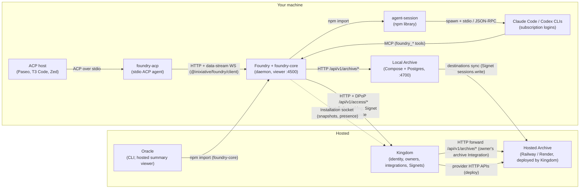

# System map

How the five apps fit together, what each one owns, where the code still crosses those lines, and how far the end-to-end journey works. Evidence is from `origin/main` of each repo on 2026-10-12: Foundry `569a881`, Kingdom `6542437a`, Oracle `6656362`, Archive `cdbb8ac`, agent-session `d03b443`, config `b4db22e`. `path:line` refers to that repo's `origin/main`.

## 1. Big picture

You work in **Foundry**, which runs on your own machine. Foundry is the harness: it wraps the native agent CLIs (Claude Code, Codex) with specialized contexts and middleware (Wardens and the other decision roles), so the main thread stays small and you stop repeating yourself. It is headless upward: **foundry-acp** speaks the Agent Client Protocol (ACP) to host apps (Paseo, T3 Code, Zed), and the viewer on :4500 is Foundry's own window onto the same threads. It runs agents through **agent-session**, which owns native sessions, transports, subscription pools, routing, limits and continuity. Foundry captures every session into the machine's local **Archive** (OSS capture, storage and search, on Postgres). The local Archive syncs onward to hosted Archives, which Kingdom deploys and reaches as an integration. **Kingdom** is the hosted connector. It owns identity, the owner classes (personal, organization, space, org-user, space-user), integrations with their credentials, and Signets as structural access gates. Foundries, Archives and Oracle connect through it. Foundry and Kingdom are many-to-many. **Oracle** is the closed evaluation product. It turns merged PRs and sessions into fixtures, scores and compares runs, and proposes context and middleware changes, with evidence that they help. Kingdom is a connector. Foundry and Oracle are capacities that connect through it.

### Access model: Credential, Token, Signet (Aron, 2026-10-07)

Each of these three does one job, and none stands in for another.

| Layer | Who gives it to whom | What it allows |
|---|---|---|
| **Credential** | The owner gives it to Kingdom, which stores it encrypted on the Integration. | Kingdom calling the provider (GitHub, an Archive server, Railway, a model API). It is never handed out. |
| **Token** | Kingdom gives it to a principal (user, org member, space member). | Calling Kingdom's own API with a role. Pure read/write on Kingdom itself. It never reaches an integration's resources. |
| **Signet** | The owner (grantor) grants it to a grantee on one Integration. The grantee is an actor (a person) or an integration (a paired Foundry, a local Archive). | Using that integration: resources, operations, lens (documents, fields), limits, expiry and revocation. Its access token or key enrollment is only how the grantee presents it. |

**Anything that uses an integration goes through a Signet.** Archive reads and writes are Signet operations on the `archive` integration (`documents.read`, `documents.search`, `sessions.write`; `kingdom/packages/access/src/catalog.ts:202-225`).

Foundry has no runtime key. It pairs as a Kingdom **Installation** (its own DPoP key): an owner approves the registration, Kingdom creates that owner's `foundry` Integration and the Signet it holds, and Foundry acts only by presenting that Signet and any later grants. The `foundry` catalog entry has `operations: []` (`catalog.ts:228-235`), so the pairing Signet itself grants no operation yet; reads go through other Signets the owner issues.

## 2. The apps

Versions: the `agentic` lane of the `@inixiative/config` train blesses the versions in `config/versions.json`; npm may already carry a newer one that is not blessed yet.

### agent-session (`inixiative/agent-session`, `@inixiative/agent-session` 0.6.0 on npm, 0.5.2 blessed, MIT)
- **Owns:** persistent native sessions (Claude CLI, Claude Agent SDK, Codex), the normalized event stream, primed decision sessions (`ClaudePrimedSessions`, `CodexPrimedSessions`), subscription pools, deterministic routing (`./routing`), limit polling, and continuity between accounts.
- **Transports:** `claude-cli`, `claude-agent-sdk` and `codex-app-server`; `acp` and `api` are stubs. Codex runs on app-server only: Codex CLI 0.155 dropped `codex mcp-server`, and the `codex-mcp` transport and `CodexMcpSession` are being deleted with no compatibility path (agent-session branch `fix/codex-app-server-default`; still in `src/transports.ts:38-92` on main `d03b443` until it lands).
- **Not its job:** context and middleware (Foundry), identity, ownership and credential policy (Kingdom decides which accounts may be used), evaluation (Oracle).
- **Interfaces:** npm library (`.` and `./routing`). It spawns the agent CLIs.
- **Release:** base of the `agentic` lane.

### Foundry, foundry-core, foundry-acp (`inixiative/foundry`)
Three packages: `@inixiative/foundry-core` 0.4.0 (MIT, `packages/core`), `@inixiative/foundry` 0.4.0 (BSL, `packages/foundry`), `@inixiative/foundry-acp` 0.1.0 (MIT, `packages/acp`, not yet on npm).
- **Owns:** the local harness. That covers threads, the turn service and per-thread queue (queued turns are their own status), context layers and the composition view, middleware (Wardens and the other decision roles on primed agent-session sessions), the structural tool gate (`packages/foundry/src/turns/tool-gate.ts`), the viewer and daemon, the MCP server for agents, the ACP agent for host apps, Kingdom pairing on the client side, and capture into the local Archive. It keeps no archive store of its own. It is subscription-only by default (`apiTokens` opt-in, `packages/foundry/src/start.ts:147`, `providers/subscription-policy.ts:121-132`).
- **Not its job:**
  - Session transports and pools (agent-session).
  - Identity, owners and Signet issuance (Kingdom).
  - Evaluation, fixtures and experiments (Oracle).
  - Archive storage internals (Archive).
  - Runner features the host apps already have: worktrees, diffs, checkpoints (CLAUDE.md, 2026-10-11).
  - Being hosted.
- **Interfaces:**
  - CLI: `start`, `setup`, `doctor`, `kingdom pair|status|disconnect`, `archive …`, `signet …`, `daemon:*`, `acp`.
  - HTTP and WebSocket viewer on `VIEWER_PORT || 4500` (`packages/foundry/src/start.ts:749`, `viewer/server.ts:619`); data streams carry a per-connection `seq` with resync by snapshot.
  - MCP server `foundry` with seven tools: `foundry_device`, `foundry_query`, `foundry_conventions`, `foundry_memory`, `foundry_access`, `foundry_threads`, `foundry_signal` (`packages/foundry/src/mcp/server.ts:305-650`).
  - ACP: the `foundry-acp` bin (`packages/acp/src/cli.ts`); spec in [FOUNDRY-ACP.md](reference/FOUNDRY-ACP.md).
  - npm subpaths of `@inixiative/foundry`: `./client` (daemon client for foundry-acp and other local drivers), `./runtime` (`KingdomInstallationConnection` plus a re-export of `@inixiative/signet`'s `SignetClient`), `./kingdom` (`KingdomAuthentication`, `KingdomAccessTool`), and `./adapters`, `./jobs`, `./providers`, `./tools`, `./viewer`.
- **Release:** `agentic` lane, npm.

### Oracle (`inixiative/oracle`, `@inixiative/oracle` 0.1.0, private)
- **Owns:** fixtures (merged PRs, mined sessions), corrections mined from transcripts (deduped), scoring, diagnosis, batch comparison (CI-gateable), experiments, and improvement proposals for corpus, context and middleware. It runs headless first, with a hosted summary viewer.
- **Not its job:**
  - Running native agents or holding subscription credentials. Execution should use Foundry and agent-session capacity.
  - Identity and authorization (Kingdom).
  - Its machinery living in Kingdom or Foundry.
- **Interfaces:**
  - CLI `oracle init|extract|mine|fixtures|run|capture|artifacts|score|list|compare|trends|gaps|suggestions` (`src/cli.ts:150-475`).
  - Hosted HTTP: `/api/batches`, `/api/cycles`, `/api/adaptive-cycles` (`src/hosted/server.ts:128-210`).
  - Artifact JSON in `.oracle/artifacts/` as the interchange format with Foundry.
- **Broken (open):** `oracle-worker` (`src/delegation/main.ts`) and the `./delegation` and `./runtime` exports are built on the deleted runtime-job protocol. `src/delegation/bootstrap.ts:57-66` imports `RuntimeJobRegistry`, `RuntimeJobWorker` and `KingdomRuntimeConnection` from `@inixiative/foundry/runtime`, which no longer exports them, so the worker cannot boot. The hosted viewer links Kingdom at `/dashboard?oracle=1` (`src/hosted/server.ts:71`), which Kingdom ignores. Whether to delete this subsystem or rebuild it on Installations and Signets is a decision for Aron.
- **Release:** private consumer on the `agentic` lane. It ships as a Docker image. It has no CI (there is no `.github/`).

### Archive (`inixiative/archive`, `@inixiative/archive` 0.13.0 on npm, 0.12.1 blessed, MIT)
- **Owns:** capturing Claude Code, Codex and ChatGPT-export histories into Postgres through Prisma (`prisma/schema.prisma:6-10`, with `vector` and `pg_trgm`), search, tags and integration references, retention settings, the standalone authenticated server (one image for Docker Compose, Railway and Render), destinations and sync, Kingdom pairing, and launchd/systemd collector agents.
- **Not its job:** multi-user sharing and accounts (Kingdom), deciding what to capture from a live Foundry thread (Foundry).
- **Interfaces:**
  - CLI `archive init|up|down|serve|pair|connect(setup)|agents|preview|search|routes|sync|import|list|collect|export|tag` (`src/cli.ts:114-399`).
  - HTTP `/health` and `/api/v1/archive/{info,ingest,head,read,list,search,tag,delete}`, `settings/{read,update}`, `tags/{list,define,remove}` and `destinations/{list,routes,sync,libraries,connect,remove}` (`src/server.ts:72-220`).
  - npm subpath exports.
- **Release:** `agentic` lane, npm and a published image.

### Kingdom (`inixiative/kingdom`, not published)
- **Owns:** accounts and identity, owners, integrations (credentials live on the integration), Signets as the only grant for using an integration, Installations (paired Foundries and Archives), hosted Archive deployment and browsing (Archive is an owner integration; shares are Signets), and the dashboard where Foundries, Archives and Oracle are connected.
- **Not its job:** Oracle experiment machinery, Foundry runtime machinery, agent-session capacity machinery, demos, and Archive storage internals.
- **Interfaces:**
  - HTTP `POST /api/v1/<module>/<action>`. This includes `access/*` (Installations, Signets, runs, tasks, `execute`, `verifyAuthority`, the inference gateway), `archive/*` (`ingest`, `list`, `read`, `search`, forwarded to the owner's Archive integration), `owner/*` (dashboard, hosting: `connectHosting`, `hostingWorkspaces`, `setupArchive`, `removeHostedArchive`) and `integration/*`.
  - WebSocket data streams (seq + resync) and the Installation socket.
  - No MCP.
- **Release:** a deployed app, a consumer of both lanes. It pins `@inixiative/foundry` 0.4.0, `@inixiative/archive` 0.12.1 and `@inixiative/signet` ^0.3.0 (`apps/api/package.json`). Foundry's hosted default API is `https://api.kingdom.inixiative.com` (`HOSTED_KINGDOM_URL`, `packages/foundry/src/providers/kingdom-pairing.ts:19`). The prod schema is applied with `db push`.

## 3. Boundaries still crossed

### Kingdom
- **Resolved:** bearer-token Signets are gone (2026-10-12, Aron: "Signets are their own authentication system"): no legacy `access` input, `proofRequired` flag or `owner/issueToken`. Every Signet is presented through an enrolled key with DPoP access tokens, and a Kingdom API token may enroll a key for its own user. The Connection term (`INTEGRATION_SECRETS`, `renewIntegrations`, Kingdom #114); the Oracle cycle, runtime-job and delegation machinery is gone (no `oracleCycle`, `runtimeJobs`, `runtimeOracle*` or `OracleCycles` left), as are the `RuntimeTribe*` models, `remoteRoutes.ts`, `connectionCheck`, `ARCHIVE_REMOTE_BINDINGS` and the sibling-checkout `foundrySource.ts` (Kingdom tests the published `@inixiative/foundry`). Duplicate Archive storage went in `59ee9b8a`.
- **Open:**
  - `oracle` is in the `Provider` enum (`packages/db/prisma/schema/integration.prisma:78-97`) but has no catalog entry; `foundry` has one with `operations: []`.
  - The inference gateway (`apps/api/src/modules/access/services/streamInference.ts`) proxies API-key calls to Anthropic and OpenAI. Its purpose under subscription-only execution needs a decision.

### Foundry
- **Oracle product material:** `PROPOSAL.md:60,319-358` (Oracle service and pricing), `LICENSE:35-38` ("Foundry Oracle — Proprietary"), `docs/THREE_SYSTEMS.md`, `docs/BOUNDARY-BENCHMARK.md`, `docs/DISTILLATION.md`. Code in the same area: `mcp/fixture-bridge.ts` and `providers/native-launch.ts:126` (`withIsolatedFixture`, used from `session-adapter.ts:642`). These look like eval-run infrastructure; confirm whether Oracle should own them.

### Oracle
- **Dead runtime protocol:** see Oracle above; `scripts/fixtures/{authority,delegation,project}-consumer.ts` also import the dead exports and Kingdom source (`KINGDOM_TEST_SOURCE`).
- **Needs Foundry to talk to Kingdom:** Oracle peer-depends on `@inixiative/foundry` for `SignetClient`, which now lives in `@inixiative/signet`; it can depend on that directly.
- **Paid API only:** `src/providers.ts` (Anthropic and Gemini with `ANTHROPIC_API_KEY` / `GEMINI_API_KEY`) is the only way `oracle run` executes. There is no subscription path.
- **Lab references:** "Lab owns experiment orchestration" (`docs/HOSTED-ORACLE.md:21`). The `.oracle/qa` records and the 09-10 machine handoff note were removed on 2026-10-12.

### agent-session
- **Evidence recorders:** `scripts/s0/*`, which re-record the `fixtures/s0` cassettes its tests replay. The S1 handoff notes were removed on 2026-10-12.

### Archive
- Clean: Kingdom forwarding uses `integration-id`, not a connection.

## 4. End-to-end journey

The acceptance bar is that an agent can drive every step for you. Most steps are scriptable: `bun run kingdom pair`, `bun run archive setup --yes`, `archive agents install`.

| # | Goal | Status | Owner of the gap |
|---|---|---|---|
| 1 | Run Foundry locally, from the viewer or an ACP host | works | — |
| 2 | Local Archive | works | — |
| 3 | Sign in to Kingdom with owners | works | — |
| 4 | Pair Foundry with Kingdom (many-to-many) | works | — |
| 5 | Hosted Archive set up from Kingdom | works | — |
| 6 | Provider connectors (Claude, Codex/OpenAI, Grok, Meta Muse, Gemini, …) | partial | agent-session, Kingdom, Archive |
| 7 | Middleware layers configurable, working, testable | partial | Foundry |
| 8 | Process feedback captured into a middleware layer | partial (first slice built) | Foundry, Oracle |
| 9 | Oracle verifies that layer changes improve outcomes | partial | Oracle, Foundry |

**1. Run Foundry locally: works.**
- `bun run start` serves the viewer on `VIEWER_PORT || 4500` (`packages/foundry/src/start.ts:749`).
- `bun run daemon:install|start` runs it under launchd from `.foundry/releases/<sha>` (`scripts/daemon/supervisor.ts:15`, `update.ts:46-48`).
- `foundry-acp` lets an ACP host (Paseo, T3 Code, Zed) drive Foundry threads; it starts the daemon when needed ([FOUNDRY-ACP.md](reference/FOUNDRY-ACP.md) §10).
- It is subscription-only by default, with `apiTokens` as the opt-in (`viewer/config.ts:79`).

**2. Local Archive: works.**
- One local Archive per machine runs in Docker Compose on Postgres (`archive up`, loopback :4700); `bun run archive setup` starts it. The viewer captures into it over HTTP and retries while it is down.
- `archive agents add-collector … && archive agents install` adds always-on capture of Claude Code and Codex history.
- `bun run archive …` passes every command except `setup` to the Archive CLI.

**3. Sign in to Kingdom with owners: works.**

**4. Pair Foundry with Kingdom: works (Installation pairing).**
- Foundry pairs as an Installation through `@inixiative/signet` `pairInstallation`: `providers/kingdom-pairing.ts`, `bun run kingdom pair`, Settings → Kingdom. A person approves the review code in Kingdom; Foundry collects the Signet of the owner's new `foundry` Integration.
- Many-to-many: `kingdomIntegrations` (`viewer/config.ts:145`) holds one entry per Kingdom + owner.
- Liveness and grants ride the Installation socket (`providers/kingdom-installation-connection.ts`): snapshots enroll later grants and drop revoked Signets; the viewer locks when no paired Kingdom lists this Foundry's Signet.

**5. Hosted Archive set up from Kingdom: works.**
- The owner connects Railway or Render as a hosting integration (`ownerConnectHosting`, `ownerHostingWorkspaces`; the token is checked through the provider's HTTP API), then sets up an Archive (`ownerSetupArchive`, `apps/web/app/components/owner/ArchiveHostingSetup.tsx`). Kingdom deploys the published Archive image (`apps/api/src/modules/archive/services/hosting/*`) and stores the server as the owner's `archive` Integration.
- The local Archive pairs with Kingdom like a Foundry does and syncs into the hosted library through a `sessions.write` Signet.
- Foundry holds no hosted destinations: `GET /api/archives/destinations` and `POST /api/archives/destinations/{connect,remove}` (`packages/foundry/src/archives/routes.ts:47-80`) manage the local Archive's destinations.

**6. Provider connectors: partial.**
- **Subscription (native):** Claude and Codex only.
  - agent-session: see its transports above.
  - Foundry: native runtimes are `'claude' | 'codex'` (`providers/native-authentication.ts:26`). All Claude for now (CLAUDE.md, 2026-10-11): Codex is a setting.
- **API key:** foundry-core registers `gemini`, `meta` (Muse Spark) and `xai` (Grok) (`packages/core/src/model-registry.ts`). They are used only with `apiTokens: true`.
- **Kingdom:** the only AI providers in the catalog are `anthropic` and `openai`, both API-key based (`catalog.ts:174-200`). There is no per-owner connector for subscription accounts.
- **Archive:** capture sources are `codex`, `claude-code` and a ChatGPT export.
- **Gap:**
  - agent-session: native transports for Gemini, Grok and Meta Muse where a CLI or ACP exists.
  - Kingdom: one provider integration per account, attached to an owner, that agent-session pools draw from.
  - Archive: capture sources for each new harness.

**7. Middleware layers configurable, working, testable: partial.**
- **Configuration:** layers, agents and the composition view live in `.foundry/settings.json`, globally and per project (example `examples/domain-team.settings.json`).
- **Execution:** decision roles run Claude Haiku 5.5 on agent-session primed sessions (`providers/primed-decisions.ts`). Wardens are fresh each call and advisory; only structural tool rules deny.
- **Testing:** there are unit tests, but you cannot test your own layer. There is no test or dry-run command. Inspection is limited to `GET /api/projects/:id/resolved/layers` (`viewer/routes/control.ts:488`), the resolved-agents route and `bun run doctor`.
- **Gap (Foundry):** a `layer test` command that runs a layer's decision role against recorded inputs with expected outcomes. The pattern already exists in `scripts/jev-catalog.ts --cases`.

**8. Process feedback captured into a middleware layer: partial (first slice built).** Spec: [FEEDBACK-LOOP.md](FEEDBACK-LOOP.md), Lifecycle.
- **Built** (569a881): every accepted turn runs foundry-core's correction detector (`packages/core/src/feedback/correction.ts`) through `packages/foundry/src/feedback/service.ts`. A detected rule is sharpened, shown to the user as a tuning prompt (ask by default; blocking is a setting), routed to Warden roles by the Cartographer (falling back to `main`), and written into personal-rung role files with provenance and undo. Exposure is counted from composed segments. The Feedback view, the `feedback` stream, `/api/feedback*` (`viewer/routes/runtime.ts:292-342`) and the ACP `/feedback` command show each item's stage.
- **Also:** `POST /api/threads/:threadId/interventions` (`viewer/routes/runtime.ts:358`) and the ACP `/correction` command record a correction against the last turn.
- **Not built:** Oracle recurrence wiring (`foundry feedback export`, `oracle mine` on the shared detector), committed rungs as PRs, and exposure for rules routed to `main`. `RuleCompiler`'s `recompileOn` (`agents/domain-librarian.ts:628`) and `CorpusCompiler.ingestFromSignalBus` (`agents/corpus-compiler.ts:146`) still have no caller.
- `oracle mine` extracts corrections from transcripts into `.oracle/corrections.jsonl` and dedupes them; nothing consumes them yet.

**9. Oracle verifies that layer changes improve outcomes: partial.**
- **What exists:** extract/mine → run/capture → score → `compare`, which exits non-zero on regression.
- **Blockers:**
  - `oracle run` executes only through paid API keys (`src/providers.ts`).
  - The worker and delegation path cannot boot (see Oracle above).
  - Foundry sessions reach Oracle only as manually captured diffs (`oracle capture`).
  - Oracle has no CI.
- **Gap:**
  - Oracle: run a baseline arm and a candidate-layer arm on subscription capacity through Foundry/agent-session, compare them, and attach the evidence to the layer proposal from goal 8.
  - Foundry: emit a `SubjectArtifact` per thread with the injected layer IDs and hash.

## 5. Goals per app

**Kingdom**
1. Add per-owner AI provider integrations (Claude, OpenAI/Codex, Grok, Gemini, Meta Muse) that feed subscription pools. Decide what the API-key inference gateway is for (goal 6).
2. Give `oracle` a catalog entry, and give the paired `foundry` Signet real operations.
3. `CONNECTION_SECRETS` and `renewConnections` became `INTEGRATION_SECRETS` and `renewIntegrations` (Kingdom #114); bearer-token Signets were removed on 2026-10-12.

**Foundry**
1. Add a `layer test` command with recorded cases (goal 7).
2. Finish the feedback lifecycle: Oracle recurrence, committed rungs, exposure for `main` (goal 8).
3. Emit Oracle artifacts per thread (goal 9).
4. Move Oracle material out: `PROPOSAL.md`, the Oracle LICENSE section, the Oracle-oriented docs, and the fixture bridge if Oracle owns it.

**agent-session**
1. Land Codex app-server as the only Codex transport (`fix/codex-app-server-default`).
2. Add native transports for Gemini (ACP), Grok and Meta Muse where they have CLIs, and let pools take accounts supplied by Kingdom (goal 6).

**Archive**
1. Add capture sources for each new harness (goal 6).

**Oracle**
1. Delete or rebuild the worker and delegation subsystem on Installations and Signets; depend on `@inixiative/signet` instead of Foundry.
2. Execute on subscription capacity through Foundry and agent-session instead of API keys (goal 9).
3. Run baseline versus candidate-layer experiments and attach the evidence to layer proposals. Measure recurrence for goal 8 on the shared detector.
4. Stop importing Kingdom source in its fixtures. Add CI.
