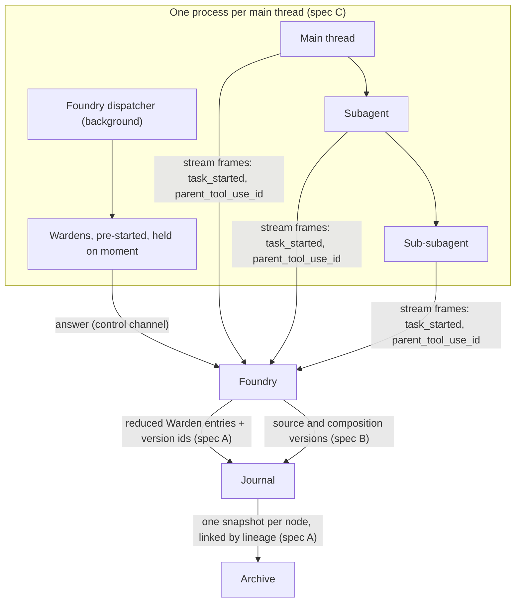

# Thread tree: stitching, composition audit, start-up

> **APPROVED by Aron (2026-10-14), with the answers recorded under each spec's open questions.** Build order: B, then A, then C. C waits for the pre-filter re-measurement of the side-session draft (#67). Each part ships as its own PR. Queue items 2, 7 and 8 on `COORDINATION.md` (2026-10-13).

**Basis.** Foundry `origin/main` `0025354`; agent-session `feat/claude-subagent-prestart` (`fbb2cda`, PR #13); Archive `origin/main` `83bced1` (0.17.0); template `main`; Claude Code 2.1.296; codex-cli 0.155.1. Path prefixes are the same as [reference/SUBAGENTS.md](reference/SUBAGENTS.md): `pf/` = `packages/foundry/src`, `pc/` = `packages/core/src`, `as/` = agent-session `src`, `ar/` = Archive `src`, `tp/` = template. Anything not checked in code or run live is marked **[unverified]**.

**How the three fit together.**



- **Spec C** puts the whole tree (main thread, subagents at any depth, every Warden) in one native process per main thread.
- **Spec A** says what Foundry writes to Archive for that tree, and that a Warden call is a small entry, not a copy of its input.
- **Spec B** is what makes the small entry enough. A call records the *versions* of its instructions and domain knowledge, and the audit trail can recompose the exact text from them.

---

# A. Thread-tree stitching into Archive

## A.1 Spec

A Foundry thread is the root of a tree. Each **node** is one conversation: the main thread, or a subagent at any depth (native Claude `Agent`/`Task`, a Codex sub-agent, or a Foundry child thread from [SUBAGENTS.md](reference/SUBAGENTS.md) §3). Each node archives as **its own Archive session**, linked to its parent. A **middleware call** (a Warden's advice, guard or review, the Cartographer's route) is not a node. It is a **reduced entry inside the node it wrapped**: its state and its result, never the message it was sent.

**Foundry writes the links.** The native stream carries the whole tree, so Archive never has to guess: a subagent's `task_started` frame carries `task_id`, `tool_use_id`, `spawn_depth` and `subagent_type`, and the assistant frame that issued the spawn carries the spawner's `parent_tool_use_id` (verified live, §C.2). Today agent-session's main-session path drops those frames, so carrying them through is a prerequisite (A.2). During a turn, the journal keeps the full phase rows the viewer and the replay need. When the turn ends, Foundry **compacts**: it appends one new, immutable `middleware-reduced` row per middleware call of that turn. Raw rows are never rewritten. On start, it compacts any earlier turn left without reduced rows. Archive capture sends the reduced rows, never the raw ones, and the raw rows age out under a local retention setting.

**Why it matters.** Locally the content store already keeps each distinct composed text once (`pf/persistence/journal-content.ts`), so the saving is in **Archive**. Capture decodes phase rows whole today, so every Warden call's full input is re-sent and stored in every revision.

"Stitched into one artifact" means Archive **reads** the tree as one artifact (`tree <rootSessionId>`, with retention keeping the tree as one unit). It does not mean one giant snapshot (see A.6, question 1).

## A.2 What exists, and what this changes

| Today | Where | This spec |
|---|---|---|
| Archive's lineage: `{kind: subagent\|fork, parentSessionId, agentType?, agentName?, description?, toolUseId?, depth?}`, stored only in the snapshot JSON. | `ar/index.ts:44-52` | Adds `rootSessionId` and `parentEntryId`. |
| The collector sets `parentSessionId` to the **root** session even for a sub-subagent; `meta.json` only gives `spawnDepth`. | `ar/import.ts:158-168` | Foundry-written nodes carry the real parent. |
| Lineage and runtime are computed but not emitted: 81a317c holds them until receivers run ≥0.14.0. | `ar` 81a317c | Prerequisite: lift the hold (COORDINATION item 2), and do it once, together with this spec's own schema additions. |
| A Codex sub-agent rollout replays the parent's history, which is then archived and searchable under the child too. | `ar/import.ts:130-132` | Foundry-written Codex children hold only their own items. |
| Foundry captures one snapshot per journal thread. Phase rows go in whole, "request context included". | `pf/archives/capture.ts:165-173` | Phase rows become reduced entries. |
| Advice and guard rows carry `segments.{instructions, domainKnowledge, threadKnowledge}` as full text, plus `request.messages`, the exact provider input. | `pf/agents/flow-orchestrator.ts:636-698` | After compaction the journal keeps version ids (spec B) and hashes. The full text stays in the content store only while something references it. |
| SUBAGENTS.md proposes `handoff` / `handoff-return` phase rows and `ThreadMeta.{parentTurnId, spawn, depth}`. | `docs/reference/SUBAGENTS.md` §4 | Reused unchanged. This spec only says how they reach Archive. |
| **Prerequisite.** agent-session's main-session path ignores `task_started` and `parent_tool_use_id`: only `as/claude-subagents.ts:1049` reads task frames. Codex collab items become `unsupported` (`as/codex-session.ts:1803`). | agent-session | SUBAGENTS.md §8 step 1, plus Codex `collabAgentToolCall` support, land first. |
| **Prerequisite.** FEEDBACK-LOOP L5 exposure and L6 `exposedAtTurn` search the segment text in advice and guard rows (`pf/feedback/service.ts:280, 605`, `phasesContaining`). | Foundry | Spec A can't ship without spec B. One cut moves `FeedbackService` to version-based exposure (B test 3) and rewrites FEEDBACK-LOOP L5, L6 and L-data. |
| Archive RETENTION.md §3.3 proposes `lineage {kind: subagent \| handoff \| fork, parentKey, …}`. The shipped schema uses `parentSessionId`. | `archive/docs/RETENTION.md` | Amend RETENTION to the shape below. Keep the shipped `parentSessionId` (receivers ≥0.14 already parse it); `handoff` is A.7 question 6. |

## A.3 Record shapes

**Lineage** (Archive, additive to `archiveLineageSchema`):

```ts
lineage: {
  kind: 'subagent' | 'fork';
  parentSessionId: string;     // the parent NODE's Archive sessionId (not always the root)
  rootSessionId: string;       // new: the main thread's sessionId; equal to sessionId on the root itself
  parentEntryId?: string;      // new: the parent's entry that spawned it (its tool-call entry id)
  toolUseId?: string;          // native tool_use id of the spawn
  agentType?: string;  agentName?: string;  description?: string;
  depth?: number;              // 1 = child of the root
}
```

**One id scheme.** Every node is a Foundry thread, observed native children included (SUBAGENTS.md §4.1), and its `sessionId` is its thread id. The native ids (`task_id`, Claude's `agent-<id>`, the Codex child thread id) go in `spawn.nativeTaskId` and in the snapshot's `references`, which is how the collector recognises a transcript Foundry has claimed. Archive keys stay `sha256([sourceId, source, sessionId])` (`ar/index.ts:106-111`), so a parent's key is computed from `parentSessionId`.

**Reduced middleware entry** (one Archive entry, inside the node it wrapped):

```ts
{
  id: `mw:${callId}`,
  turnId,                                    // the node's turn
  kind: 'event',                             // A.6 question 3: or a new 'middleware' kind
  sourceRef: `middleware:${callId}`,
  timestamp,                                 // when it settled
  model, effort,                             // what served it
  text: JSON.stringify({
    role: 'warden:conventions',              // or 'cartographer'
    trigger: 'user-message' | 'agent-action' | …,  // TriggerPoint (pf/agents/warden-triggers.ts); new charter triggers join it
    wraps: 'entryId of the message, tool call or spawn it was asked about',
    decision: ContributionDecision,          // pf/agents/flow-orchestrator.ts:69-81, incl. 'omitted'
    result: 'the text it chimed in with' | null,
    reason?: 'cold-cache' | 'deadline-queued' | ...,
    state: {
      charter: 'charter-1a2b3c4d5e6f',                         // WARDEN_CHARTER_VERSION
      instructions: 'cv_…', domainKnowledge: 'cv_…',          // composition version ids (spec B)
      threadKnowledge: { revision: 7, hash: 'sha256…' },       // raw text in the content store
      threadKnowledgeAfter?: { revision: 8, hash: 'sha256…' }, // a review that wrote a new revision
    },
    timing: { startedAt, elapsedMs },
    usage?: { input, output, cacheRead, cacheWrite },
    cites?: ['fb_…'],                        // feedback ids it cited (FEEDBACK-LOOP L5)
  }),
}
```

The entry is about 0.5–1 KB whatever the size of the Warden's context. The message it received is **not** in it. That message is the node's own entry named by `wraps`, plus the composed context, which spec B can recompose from the version ids.

**A tool-gate decision** (structural allow/deny) gets the same reduced shape, with `role: 'gate'`. Its `result` is the outcome, and its `state` is the rule id and the rule's settings revision.

## A.4 Who writes what, and when

| When | Who | What |
|---|---|---|
| During a turn | Foundry, as today | Full phase rows in `session_phase` (`pf/persistence/local-session-store.ts`). They feed the live viewer (`flow:<thread>`) and the per-turn detail. No change. |
| A native spawn is seen (`task_started`) | Foundry | Starts an observed child node in the journal: SUBAGENTS.md §4.1 `ThreadMeta` with `parentThreadId`, `parentTurnId`, `spawn.{via, toolCallId, nativeTaskId}`, `depth`, plus the `handoff` row (§4.2). Parent attribution: the spawn's `tool_use` sits in an assistant frame whose `parent_tool_use_id` is the spawner's own spawn (null = the main thread). |
| The turn ends (`completed`, `failed`) | Foundry, in the same journal transaction that seals the turn | **Compaction.** It appends one `middleware-reduced` phase row per middleware call of the turn, holding the A.3 shape. Existing rows are immutable and their checksums still verify (`pf/persistence/local-session-store.ts:1054`). The thread-knowledge text a reduced row names stays in the content store. |
| Foundry starts | Foundry | Writes reduced rows for any turn that has none, `interrupted` turns included. The raw rows stay, because an interrupted outcome still has to be checked. This is the "or at the start of each request" half. |
| Raw rows older than `journal.rawMiddlewareDays` (default 30) | Foundry retention | Deletes raw `advice` / `guard-*` / `route` rows that already have a reduced row, and releases the content they alone referenced. Deleting is retention; it is not a rewrite. |
| After compaction | `ArchiveCapture` (`pf/archives/capture.ts`) | One snapshot per node: its messages, tools and native evidence as today, plus reduced entries in place of raw middleware rows, plus `lineage`. The root's snapshot carries `rootSessionId = sessionId`. A child changing never re-captures its parent. |
| Collector | Archive | Sessions Foundry drives are Foundry's to write. The collector skips a native transcript Foundry has claimed (A.6 question 2). Otherwise every in-session Warden (spec C) would also be archived as a full `subagents/agent-*.jsonl` session, input included. |
| Read | Archive | `tree(rootSessionId)` returns the root and every descendant, ordered by `parentEntryId`. Retention treats the tree as one unit, as RETENTION.md §4 already proposes. |

## A.5 Test cases

Real `LocalSessionStore`, a real local Archive (Compose test DB), cassettes for the native stream. No mocks of Foundry internals.

1. **Depth.** Main thread → subagent A → sub-subagent B. Three snapshots. B's `parentSessionId` is A's, not the root's. All three carry the root's `rootSessionId`. `tree(root)` returns root, A, B in spawn order.
2. **Reduced entry.** A turn with 6 Wardens (4 `NO_COMMENT`, 2 contribute). After the turn ends, the node's snapshot has 6 `mw:` entries. None contains a `messages` key or any instructions or domain-knowledge text. Each is under 2 KB. The 2 contributions carry their result text.
3. **NO_COMMENT is recorded.** A `no-comment` entry is present with `result: null`. Oracle's exposure count (FEEDBACK-LOOP L5) needs the denominator.
4. **Compaction timing.**
   - Before the turn ends, there is no `middleware-reduced` row, and capture holds no `mw:` entry for the turn.
   - After it ends, there is one reduced row per call, every raw row still passes its checksum, and the turn detail route shows both.
   - After `rawMiddlewareDays`, the raw rows are gone, the reduced rows remain, and `session_content` no longer holds text that only they referenced.
5. **Restart.** Kill Foundry mid-turn. On start, the `interrupted` turn gets reduced rows before the first capture, and its raw rows are kept.
5a. **Feedback still counts.** On the FEEDBACK-LOOP L5 fixture, exposure and `exposedAtTurn` give the same answers after the raw rows are pruned as before (they come from versions, spec B test 3).
6. **A child's Wardens attach to the child.** A guard on sub-subagent B's tool call is an entry in B's snapshot, not A's or the root's.
7. **Codex child.** A Codex sub-agent (collab `spawnAgent`) archives with only its own items. Search for a phrase from the parent finds the parent only.
8. **Collector does not double-archive.** The collector watches the same `CLAUDE_CONFIG_DIR`, and the fixture is a Foundry thread with 1 real subagent and 5 in-session Wardens. Archive ends up with 2 sessions, both `source: foundry` (root and child) and both written by Foundry. It has 0 `claude-code` sessions for this thread and 0 Warden sessions.
9. **Idempotent.** Re-capturing an unchanged node returns `changed: false` (same digest).
10. **Recompose.** For a reduced entry, `recompose(state.instructions)` + `recompose(state.domainKnowledge)` + the stored thread knowledge reproduce the hashes the call recorded (spec B test 9).
11. **Retention.** Pinning the root keeps every descendant. Pruning a stale child keeps a stub with its lineage, so the tree does not break.

## A.6 Original intent

Aron, 2026-10-12: *"The Warden's input and output are obviously stored... If we could compact some of that at the end of each request or at the start of each request, just the right thing: it doesn't need the message it received. It needs its state and its result, sort of a reduced version, and that needs to be part of the thread. It needs to be stitched into the thread for recording purposes so you can track it. Subagents also need to be stitched. I mean they're their own threads but they need to be tied somehow. Again this is a tree. This can go fairly deep. Subagents can spawn subagents and they can all have middleware around them."*

Also: *"I think the Foundry needs to tie those things together somehow. If it's doing the thing, the Foundry should be injecting that into the archive somehow or working with Archive to provide that."* And from 2026-10-12, 00:24: *"I want to be able to see the sub-agents and their runs and all this stuff. All this stuff needs to be interrogatable."*

## A.7 Open questions

1. **"One artifact": one stitched snapshot, or linked snapshots read as one?** I recommend linked snapshots plus a `tree` read. Archive stores a full new revision on every change: superseded revisions are already about 90% of storage (RETENTION.md). One tree snapshot would re-write the whole tree whenever any node changed. It would also hit the 50,000-entry snapshot cap on long threads.
2. **DECIDED (Aron, 2026-10-14): Foundry records.** *"If Foundry is handling it, it should do it, because it does all this compositional stuff."* Foundry claims (locks) a thread and every session in its tree, and tags them, so Archive's collector skips them. Foundry writes the stitched version using Archive's primitives. The original question: who archives a Foundry-driven native session? I recommended Foundry alone, with the collector skipping any session Foundry has claimed. Foundry would claim by session id, or by Foundry running natives under its own `CLAUDE_CONFIG_DIR` per integration, which Kingdom's subscription pools already require. The alternative is that both write and Archive links them, but then every in-session Warden is archived in full.
3. **A new entry kind `middleware`**, or `event` with a `middleware:` sourceRef? A new kind is cleaner to filter and search. It is one more strict-schema change that receivers must take first.
4. **DECIDED (Aron, 2026-10-14): a setting, default 30 days.** `journal.rawMiddlewareDays` controls how long the journal keeps raw middleware rows. Archive gets only reduced entries from the start.
5. **Gate decisions:** reduce them like Warden calls (proposed), or keep them full? They are small already.
6. **Lineage `kind: 'handoff'`** (RETENTION.md §3.3): is it needed for Foundry child threads (`foundry_delegate`), or is `subagent` with `spawn.via` enough?

---

# B. Audit for composed instructions

## B.1 Spec

Every Warden call composes three slices: **instructions**, **domain knowledge** and **thread knowledge** (Aron, 2026-10-11). The first two move slowly, and so they get an **audit trail**, per source. A source is each ladder file (computer → org → org personal → project → project personal, role-specific files included), the settings prompt (`agents[role].prompt`), each `domainKnowledge` source, every line feedback wrote, and the Warden charter. Each change to a source writes one **source version** (before and after, actor, cause such as a feedback id). A slot's composed text is a **composition version**: an ordered list of the source versions it was built from, with the omitted sources and their reasons, deduplicated by hash, so it is written only when something in it changed. A Warden call then records only `{charter, instructions: cv, domainKnowledge: cv}` plus its thread knowledge. Thread knowledge changes every call and is stored **raw**, in the existing content-addressed store (`pf/persistence/journal-content.ts`). This is the template's email pattern carried over. A source version is an `AuditLog` row. A composition version is `AuditLog.componentVersions`. A Warden call's version pointers are `CommunicationLog.emailTemplateAuditLogId` plus `CommunicationComponentVersion`.

## B.2 The template pattern, and how it maps

The template keeps one version graph in its audit log:
- **A template or component version is an `AuditLog` row id** (uuidv7, so time-ordered). There is no counter and no content hash (`tp/packages/db/prisma/schema/auditLog.prisma`).
- **The rows are mutated in place.** The history lives only in the audit log.
- **The `emailVersioning` hook** runs inside the writing transaction (`tp/apps/api/src/hooks/emailVersioning/hook.ts`). It stamps `AuditLog.componentVersions` as `{slug → child audit id}` and walks up to re-snapshot every ancestor whose resolved children moved. It walks children before parents.
- **A send pins what was used.** In the same transaction that moves it to `sending`, `CommunicationLog.emailTemplateAuditLogId` and one `CommunicationComponentVersion {slug, emailComponentId, emailComponentAuditLogId}` per component are written (`tp/apps/api/src/lib/email/deliverEmailMessage.ts:198-238`).
- **Recompose walks the graph** from the stored `after` snapshots (`tp/apps/api/src/lib/email/recompose.ts`).
- **Actor** comes from an async-local context (`auditActorContext`). **Cause** is a foreign key, `sourceInquiryId`. There is no free-text reason.

| Template | Foundry |
|---|---|
| `EmailComponent` / `EmailTemplate` row | A **source** (a file, a settings prompt, a domain-knowledge source, the charter) / a **slot** (role × slot × location) |
| `AuditLog` row for the subject (before, after, actor, `sourceInquiryId`) | **`source_version`** row (before and after hashes, content in the content store, actor, cause) |
| `AuditLog.componentVersions {slug → audit id}` | **`composition_version`** `{ordered source version ids, omissions, composedHash}` |
| Walk-up re-snapshot of ancestors | A source change marks the slots that include it stale (`invalidateComposition()`, `pf/agents/role-layers.ts:109`). The next compose writes a new composition version if the hash moved. |
| `CommunicationLog.emailTemplateAuditLogId` + `CommunicationComponentVersion` rows, written as the send is claimed | The Warden call's `state.{charter, instructions, domainKnowledge, threadKnowledge}`, written on the call's phase row as the call is made |
| `settledMjml` (the exact sent bytes) | Not kept after compaction. Recompose plus the recorded `composedHash` proves it instead (B.6, question 2) |

Two lessons from the template:
- **Resolve versions once, from what was actually composed.** The template's `componentVersions` (owner scope) and its send-time component rows (sender scope) can disagree. Here the composition version is written from the composer's own output, so it is always the call's actual input.
- **Never re-resolve "latest" after the fact.** The template's send stores "latest audit id at claim time", which can drift from what rendered. Here the call records the composition version it was composed from.

## B.3 What exists already

These are the audit pieces Foundry already has. Each one is extended, not replaced.

- **`settings-history.jsonl`** (`pf/viewer/config.ts:1068-1080, 1393-1418`). This is already an audit log for settings definitions. Every edit appends `{subject: 'agent:<id>' | 'source:<id>' | …, revision, entry: {hash, timestamp, trigger, author, snapshot: {before, after}}}`, using foundry-core's `VersionEntry` (`pc/context-layer.ts:234-260`). **Proposal: this becomes the one Foundry audit log.** Its subjects widen to files and the charter, its entries gain `actor` and `cause`, and it moves into the journal's SQLite so calls can point at it. It is a hard cut: pre-users, no dual file.
- **`feedback-apply` / `feedback-revert`** phase rows `{itemId, changeId, path, line, beforeHash, afterHash}` (FEEDBACK-LOOP L-data). They stay as lifecycle facts. Each one gains the `sourceVersionId` it produced, and the source version's cause names the `itemId` and `changeId`. That is one link in each direction, and the line is not stored twice.
- **`WARDEN_CHARTER_VERSION`**: `charter-<sha12>` of the charter text (`pf/agents/warden-charter.ts:49`). It is already journaled with every decision. Its source version is written the first time a new hash is seen, with actor `release` and cause `{foundryVersion, gitCommit}`.
- **`ContributionProvenance`**: `cacheHash` and `threadKnowledge{Revision, Hash}` (`pf/agents/flow-orchestrator.ts:100-114`). This is already the call's per-slice provenance. It gains `instructions` and `domainKnowledge` composition version ids.
- **The content store**: `session_content` and `session_content_ref`, sha256-addressed, with heading-chunked text (`pf/persistence/journal-content.ts`). It holds every source version's text, every thread-knowledge revision, and nothing twice.
- **The composer's own report**: `HierarchyStack.{files, duplicates, refused}` (`pc/adapters/markdown-hierarchy.ts:165`), plus `ContextLayer.selection` (selected and omitted, with reasons). This is the input to a composition version.

## B.4 Record shapes

Two new tables in the journal database. "Two" here means two kinds of row in one audit system, not a second store.

```ts
// source_version: one row per change to one source; replaces settings-history.jsonl lines
interface SourceVersion {
  id: string;                        // uuidv7: time-ordered, like the template's AuditLog ids
  subject: string;                   // 'file:<realpath>' | 'settings:agent:<id>.prompt' |
                                     // 'source:<id>' | 'charter' | (existing settings subjects)
  action: 'create' | 'update' | 'delete';
  beforeHash: string | null;         // = previous row's afterHash
  afterHash: string | null;          // content in session_content (null on delete)
  node?: string;  tier?: string;     // ladder rung for files: 'computer' | 'org' | 'org-personal' | 'project' | 'project-personal'
  actor: { kind: 'user' | 'feedback' | 'agent' | 'release' | 'external'; id?: string };
  cause: {
    feedbackItemId?: string; changeId?: string;   // feedback-apply / revert
    settingsRevision?: number;                     // a settings save
    gitCommit?: string; gitBlob?: string;          // a committed file, when the change is a commit
    detected?: 'on-read';                          // changed outside Foundry, found by the composer
  };
  createdAt: number;
}

// composition_version: one row per distinct composed slot
interface CompositionVersion {
  id: string;                        // 'cv_' + uuidv7
  role: string;  slot: 'instructions' | 'domainKnowledge';
  composedHash: string;              // sha256 of the exact text the Warden received for this slot
  // In composed order. Each part records how it was joined, so recompose is exact: the chunk
  // heading (`## <label>`, role-layers.ts:187-188; `extends` chunk headings), the separator, and
  // the character range kept after budget truncation. @path imports are their own parts.
  parts: Array<{ sourceVersionId: string; order: number; heading?: string; separator: string; range?: [number, number] }>;
  // A focus-dependent source (archive context, file memory: pf/archives/context-source.ts,
  // pc/adapters/file-memory.ts) is not a part: its slot keeps a placeholder here, and each call
  // stores the retrieved text raw (like thread knowledge). The static parts stay audited.
  retrieved: Array<{ subject: string; order: number }>;
  omitted: Array<{ subject: string; reason: 'excluded-by-role' | 'hidden-from-audience' | 'duplicate' | 'refused' | 'budget'; duplicateOf?: string }>;
  createdAt: number;
}
```

Indexes: `source_version(subject, id)`; `composition_version(composedHash)` unique, so composing the same text again finds the existing row; `composition_version(role, slot, id)`.

**On the call** (the `advice` / `guard-request` row, and so the reduced entry, spec A):
`state: { charter, instructions: cv, domainKnowledge: cv, retrieved?: [{subject, hash}], threadKnowledge: {revision, hash} }`.

**Recompose** `(cv, retrieved) → text`: for each part in order, take `afterHash`'s content, cut to its `range`, and put its `heading` and `separator` around it. Fill each `retrieved` slot from the call's stored text. The result must hash to `composedHash`. It stays string concatenation (Aron, 2026-10-11), only now the joins are recorded instead of assumed.

**Where the saving is.** The content store already keeps each distinct composed text once on this machine, so B's gain is not local bytes. It gains three things:
- the *who / why / when* of every change;
- per-source granularity, so "was fb_123 in front of the Warden" is answered without searching text;
- small Archive entries (spec A).

`composition_version` earns its place as the per-call pointer: one id instead of a list of every part, the same as the template's `componentVersions`.

## B.5 Who writes what, and when

| Change | Writer | When | Actor / cause |
|---|---|---|---|
| A Warden's prompt or a source definition edited in Settings | `ConfigStore._record` (`pf/viewer/config.ts:1394`), which today writes settings-history | In the same write as the config, before listeners run | `user` (or the token's agent) / `settingsRevision` |
| Feedback `apply` / `revert` writes a line | The feedback writer (FEEDBACK-LOOP L4) | In the same journal transaction as the `feedback-apply` row | `feedback`, `id: fb_…` / `{feedbackItemId, changeId}` |
| A role file edited in the viewer | The viewer's file writer | On save | `user` |
| A file changed outside Foundry (editor, `git pull`) | The composer, on its next read (it already re-checks files before each turn, `hierarchyFingerprint`) | Before the composition that first sees it | `external` / `detected: 'on-read'`, plus `gitCommit`/`gitBlob` when the file is tracked and clean |
| A new charter text (a Foundry release) | Foundry at start, on seeing a new `WARDEN_CHARTER_VERSION` | Once per new hash | `release` / `{foundryVersion, gitCommit}` |
| A domain-knowledge source whose content is fetched (URL, Archive search) | **Not audited:** see B.7 question 3 | — | — |
| A slot composed for a call | The composer (`buildRoleLayers` → `ContextLayer`) | When it composes. A row is written only if the `composedHash` is new | — |
| A Warden call | The flow orchestrator (`pf/agents/flow-orchestrator.ts:636`) | At the call boundary, where `segments` are recorded today | — |
| Thread knowledge | Already the review's job (`domain-librarian.ts` review) | Each revision's text goes into the content store when it is used. No audit row: it is per call | — |

The journal stays the source of truth. Archive gets the call's version ids in reduced entries (spec A). For the ids to resolve off this machine, the audit rows must reach Archive too (B.7, question 1).

## B.6 Test cases

1. **Settings edit.** Change Warden `conventions`' prompt in Settings. One `source_version` is written: `subject: settings:agent:conventions.prompt`, before and after, `actor: user`, `cause.settingsRevision`. The next call records a new `instructions` cv, and the previous calls keep the old one.
2. **Feedback apply / revert.** `apply fb_123` writes one source version (`cause.feedbackItemId = fb_123`), and its `feedback-apply` row names that version id. `revert` writes another (`action: update`, after = before of the apply). Neither deletes history.
3. **Exposure without a text search over calls.** FEEDBACK-LOOP L5's exposure count ("was fb_123 in front of the Warden?") is answered per cv: a cv exposes fb_123 when one of its parts' content (a source version, looked up once per version) contains `(fb_123)`. The answer equals today's text search on the same fixture. Cases: the line is removed by a later external edit to the same file, which ends exposure; another item's revert on the same file does not end exposure while the line remains.
4. **External edit.** Edit the project `CLAUDE.md` in an editor. The next compose writes `actor: external, detected: on-read`. If the change is a commit, it also carries `gitCommit`.
5. **No change, no rows.** 100 calls with unchanged sources write 0 source versions and 0 new composition versions, and all 100 calls name the same cv. This includes a Warden with a file-memory or archive source: its cv is still one, and each call carries its own `retrieved` text.
6. **Omission.** A role excludes `org`, so the cv's `omitted` lists the org files with `excluded-by-role`. A duplicate section is listed with `duplicate` and `duplicateOf`.
7. **Charter.** Change the charter text and restart. One `charter` source version is written (`actor: release`). Calls after that name the new `charter-…`.
8. **Thread knowledge raw.** A call's `threadKnowledge.hash` resolves in `session_content` to the exact text it used, after compaction (spec A) and after a newer review revision.
9. **Recompose.** Thirty days and several edits later, `recompose(cv, retrieved)` for an old call reproduces its `composedHash` exactly. Fixtures: an `extends` project agent with two labelled `domainKnowledge` sources, an `@path` import, and a slot truncated by its budget.
10. **One audit log.** After the cut, `settings-history.jsonl` is gone. The Settings history view (`ConfigStore.history`) reads `source_version`, and its output for settings subjects is unchanged.

## B.7 Original intent

Aron, 2026-10-12, 22:38: *"Whatever we're doing for the history of an agent prompt should probably have an audit system. I know we didn't build Foundry really well so we can't just bring over the one from the template but it'd be nice to not save that. Just save a snap: what was the instruction at this time and what was the state of the project, or all the timestamps, so you can recompose that. This will save just a lot of storage space but requires having a real audit system for these things when they change."*

At 22:40: *"It's more that there's that composition of the three slices. The first two are slow-moving and can have an audit trail. The last one needs to be stored raw, I think. All those first two, in all their slices, should get an audit, I think, probably inspired by the template audit system."*

And on provenance, 2026-10-12, 00:44: *"Okay your feedback, and then what warden or wardens did this get routed to? What was the change to their instructions and/or domain knowledge? How are we using that?"*

## B.8 Open questions

1. **Do audit rows travel to Archive?** A reduced entry's `cv_…` only resolves where the audit rows are. Three options:
   - (a) Foundry captures a per-project "composition history" pseudo-session into Archive.
   - (b) Each reduced entry carries `composedHash` too, so off-machine readers can at least compare. Recompose stays local.
   - (c) Kingdom or the hosted Archive hold the audit rows.

   I lean (a) + (b).
2. **Is "recompose plus hash" enough, or keep the exact composed text per call** (the template keeps `settledMjml` as "the sent truth")? Content addressing already stores each distinct composed text once. Keeping it costs only what changed, but it is the storage Aron wanted to save.
3. **Retrieved domain knowledge** (an `archive` or file-memory source whose content depends on the message). Proposed in B.4: stored raw per call like thread knowledge, with only the source's definition audited. This is the default config for the memory Warden, so it is not an edge case. Is that the right split?
4. **Committed files:** store their content too, or only `gitCommit` + `gitBlob` and read git on recompose? Git is already the audit trail for committed levels. Storing content keeps recompose working after a force-push or branch delete.
5. **Granularity:** per file (proposed), or per section, so a `(fb_…)` line is its own version? Per file is the template's shape. A section-level diff can be derived from before and after.

---

# C. Thread start-up

## C.1 Spec

When a thread opens, Foundry launches every Warden up front. A slower start is fine. The user can type meanwhile: each message waits as a `queued` turn (`pf/persistence/local-session-store.ts` `TurnStatus`) until setup is done. The viewer and the ACP host show *"Setting up your thread; feel free to start typing; we'll tell you when it's ready."*

**Claude.** Foundry sends its own **setup turn** on the main thread's session. It starts one background **Foundry dispatcher** subagent. The dispatcher pre-starts every Warden as its own (nested) subagent, held on Foundry's `moment` tool, the same standby mechanism as agent-session's prestart (`as/claude-subagents.ts`). It works over the control channel, not through vendor hook files. A Warden answers through Foundry's `answer` tool. When every Warden it started has returned, the dispatcher calls `next`, and Foundry answers with the Wardens to start again. So after the setup turn, **no Warden activity ever needs a main-model turn**.

**Codex.** Foundry starts the Warden threads directly (`thread/start`) in the main thread's own `codex app-server`. No setup turn is needed. This depends on per-thread violation handling (C.2 Q6, C.8 question 6).

Either way, the whole tree is **one process per main thread**.

## C.2 Why these mechanisms (the experiment, 2026-10-13)

The scripts are not committed. They were run from the session scratchpad against Claude Code 2.1.296 and codex-cli 0.155.1, driven the way agent-session drives sessions:
- Claude: `--print --input-format stream-json --output-format stream-json`, an SDK MCP server over the control channel, and a control-channel PreToolUse hook that pins each Warden's prompt, exactly as `as/claude-subagents.ts:861-935`.
- Codex: `codex app-server --listen stdio://`.

All runs were Haiku 5.5 at low effort, about 60 Haiku calls in total, plus a few short Codex calls. The first run went through the cmux `claude` shim and the later ones through the real binary (`~/.local/bin/claude`). The outcomes were the same; the numbers below are from the real binary. RSS is one sample per point, so read it to about ±20 MB.

**Q1. Do background subagents started in a setup turn stay alive after the turn ends? Yes.**
- 3 Wardens started with `run_in_background: true`. The setup turn ended (`result`, "READY") 3.0 s after it was sent, and all 3 were holding `moment` by 3.7 s.
- They were still holding after 60 s and after a later user turn ("PONG"), which ended normally.
- With 10 Wardens behind the dispatcher, all 10 were holding 7.5 s after the setup turn started.

**Q2. Can a later turn hand them input? Yes, but not the way that works for Wardens.**
- **Answering the held `moment` call from Foundry, with no turn at all:** the Warden answered in 1.5–2.8 s.
- **A later main-model turn using `SendMessage`:** this resumed a *finished* background Warden, keeping its earlier conversation, and it answered in about 2.5 s. That makes it a continuing conversation. Wardens must be fresh every call (CLAUDE.md), so this path is out.

**Q3. What does a background Warden finishing do to the main thread? It costs a main-model turn, unless a dispatcher sits in between.**

| Ending of a directly backgrounded Warden | Notification | Unsolicited main-model turns |
|---|---|---|
| Completes normally | `completed` | **1** (the main model narrates the finding, unprompted) |
| Foundry sends `stop_task` after taking its answer | `stopped` | **1** (the main model says "w1 was stopped…") |
| Nested under a background dispatcher, two full rounds of 3 | — (the dispatcher absorbs them) | **0** |

- Every background task ending wakes the main model. With 10 Wardens on every message, on an Opus main thread, that is 10 extra Opus turns per message, and they pollute the main context. A dispatcher in between absorbs the endings.
- Its own context grows by about 400–600 tokens per Warden started: 3,111 → 5,045 → 6,263 tokens over two rounds of 3. So it needs a recycle now and then (C.8, question 3).
- Restarting consumed Wardens through `next` took 2.6 s with no main turn. The main thread's next user turn was unaffected (PONG, 42 tokens of cache write).

**Q4. Interrupts.**
- An interrupt during a main turn spared all held Wardens when the session's `initialize` declared `perTaskStopAffordance: true`.
- Without it, Claude Code's documented behaviour is that "the interrupt kills background tasks" (from the CLI's own control schema). So Foundry must always declare it.

**Q5. Memory (RSS, one process).**

| Setup | Processes | RSS |
|---|---|---|
| Main session, no Wardens | 1 | 243–267 MB |
| + 3 Wardens backgrounded directly | 1 | 273 MB |
| + dispatcher + 3 Wardens held | 1 | 335 MB |
| + dispatcher + 10 Wardens held | 1 | 331 MB |
| After two rounds of use (3) | 1 | 344–363 MB |
| **Today, option (b):** main session + one side session per thread | 2 | ≈260 + 210–320 MB (side session measured 2026-10-12: 210 MB idle, 300–320 MB with 23 subagents) |
| **Before (b):** a primed process per Warden and phase | ~2 per Warden | 130–230 MB each; 25 Wardens ≈ 50 processes, ≈10 GB |

- The dispatcher's first nested subagent costs about +70 MB once. Further held Wardens cost little: 3 versus 10 is within noise.
- **In-session, one main thread with 10 Wardens is about 330 MB in one process, against about 470–580 MB in two processes for option (b).** That makes it roughly 1.5–1.8× denser, and it reaches CLAUDE.md's "one process tree per main thread".
- **[unverified]** RSS with 20+ Wardens, and growth over a long thread.

**Q6. Codex app-server. Sub-agent threads live in the same process, and Foundry can hand them input directly.**
- A setup turn on the main thread spawned 3 sub-agents (`collabAgentToolCall`, `tool: spawnAgent`) in 8.5 s. Each finished its first turn.
- After the main turn ended, `thread/loaded/list` showed all 4 threads loaded.
- `turn/start` straight on a child thread got its answer in 2.0 s, with **0** main-thread turns triggered.
- The `app-server` process itself stayed at 43 MB with 1 thread and with 4. The process tree (~350–480 MB) is the user's own Codex MCP servers, which a Foundry launch disables.
- Child threads are not announced with `thread/started`. Foundry finds them in `collabAgentToolCall.receiverThreadIds`.
- **Conclusion: for Codex, `spawnAgent` and a setup turn add nothing.** Foundry can start Warden threads itself with `thread/start` in the same app-server.
- **But the existing Codex decision host can't simply move in.** `as/codex-primed.ts` runs **one app-server per account** hosting every key's thread (not one per thread). It relies on rules a main thread can't follow:
  - a private `CODEX_HOME` holding only the login;
  - tool features, plugins and MCP disabled;
  - `approval_policy=never`;
  - **recycling the whole process on any violation** (`as/codex-primed.ts:5, 26-30, 84-90`).

  In the main thread's app-server, a recycle would kill the user's thread, and one process has one `CODEX_HOME`. So for Codex, "one process per main thread" means:
  - per-thread violation handling (interrupt and drop the Warden thread, never recycle);
  - per-thread disabling of tools and MCP, which codex-primed already does per thread;
  - accepting the main thread's `CODEX_HOME`.

  C.8 question 6.
- Fresh-per-call is a fork of the primed thread per call, as codex-primed does today.
- **[unverified]** whether the main thread's app-server can host primed Warden threads alongside a running main turn without contention.

## C.3 What exists, and what moves

| Today | Where | This spec |
|---|---|---|
| `ClaudeSubagentSessions`: one side **process** per thread (more above 12 Wardens). It has a dispatcher agent, a PreToolUse hook that pins inputs, the `moment` standby, settling on task frames, and a rewind after each fan-out. | `as/claude-subagents.ts` (PR #13) | The same machinery, hosted in the main thread's session. The dispatcher becomes a background subagent instead of the session's own agent, and the hook tells the dispatcher's spawns from the main agent's own. |
| `prestartWardens`: pre-start on thread start, turn landed, and thread-knowledge change. | `docs/subscription-decisions.md` (on `feat/warden-side-sessions`) | Unchanged triggers. Thread start now goes through the setup turn. |
| **Rewind.** The side session rewinds its dispatcher after every fan-out (`as/claude-subagents.ts:715-721`). | agent-session | Not possible in-session: rewinding would rewind the user's conversation. The dispatcher's context grows instead, and is recycled (C.8 question 3). |
| **Fixed definitions.** Each role is a `--agents` definition written at launch; a changed definition reaches only the next side session (`as/claude-subagents.ts:410-423, 843-858`). | agent-session | The main session is never relaunched, so a Settings edit or a feedback `apply` would never reach in-session Wardens. That breaks "running threads take edited Warden instructions on their next turn" and FEEDBACK-LOOP L4. **DECIDED (Aron, 2026-10-14): composition.** *"All these things should be compositional."* There is one generic `foundry-warden` definition, with no prompt of its own. Each spare's standby prompt carries that Warden's freshly composed text (the fixed charter, the generic Warden, then this project's instructions for it), pinned by the hook. That text comes from the existing project agents (`projects[id].agents`: standalone, `extends`, `override`) and the composition view. *"Not every generic one runs in every project... there should be the option to inherit this warden or extend this warden specifically to this project."* An edit reaches the next call. It costs per-definition prompt caching; the standby prefix is still cached. **[unverified]** whether Claude Code reloads `--agents` without a restart. |
| **Launch settings.** The side session runs `--no-session-persistence`, `--strict-mcp-config`, `bypassPermissions`, a 24 h `MCP_TOOL_TIMEOUT` and `--setting-sources ""` (`as/claude-subagents.ts:861-897`). | agent-session | None of these can move to the main session. What follows in-session: (1) the 24 h timeout would apply to the user's own MCP tools, so `moment` holds need a per-tool deadline in Foundry's own MCP server instead, **[unverified]** whether a per-server timeout exists; (2) the main session keeps the user's mode and hooks, so Warden subagents run under them, **[unverified]** whether user hooks fire on Warden tool calls; (3) the Warden agent types are advertised to the main model, so the hook denies any `foundry-*` spawn not issued under the dispatcher. |
| SUBAGENTS.md §3(c) `subagents.native = redirect` denies `tool:Agent` / `tool:Task`, and `observe` records every native child with `handoff` rows. | `docs/reference/SUBAGENTS.md` | The dispatcher subtree is exempt from both: the gate allows exactly one `foundry-dispatch` spawn in a Foundry setup turn plus spawns issued under it, and observe mode records it as the dispatcher node (C.4), not as observed children. `--disallowedTools Task` can't be used for redirect while in-session Wardens run. |
| agent-session merges child frames into the in-flight parent turn, and child text can overwrite the parent's (SUBAGENTS §2, `as/turn-state.ts:66`). | agent-session | **Prerequisite** (SUBAGENTS §8 step 1): child frames are tagged and kept out of the main turn, or Warden text lands in the user's reply. |
| `CodexPrimedSessions`: one app-server **per account** with a primed thread per role, recycled on any violation. | `as/codex-primed.ts` | The primed threads move into the main thread's app-server, with per-thread violation handling (C.2 Q6). |
| `queued` turn status. | `pf/persistence/local-session-store.ts` | Turns typed during setup wait as `queued`. Restart recovery fails them, as today. |
| Interrupts. | agent-session `initialize` | Declares `perTaskStopAffordance: true`, so the user's Stop never kills Wardens. |

## C.4 Record shapes

- **`ThreadMeta.setup`**: `{ status: 'starting' | 'ready' | 'degraded'; startedAt; readyAt?; wardens: { expected: n, held: n, failed: string[] }; runtime: 'claude-in-session' | 'codex-in-process' | 'side-session' }`. It streams on `threads`, which drives the "we'll tell you when it's ready" notice.
- **Setup turn**: a Foundry-authored turn, `actor: 'foundry'`, `kind: 'setup'`. The viewer hides it from the transcript. It is journaled and archived like any turn, so the tree shows the dispatcher as a child node of the root (spec A).
- **Dispatcher node**: a child node, `spawn.via = 'foundry-dispatch'`, with `depth` 1. Each Warden spare is a child of it (`depth` 2) in the journal. In Archive, Warden spares are **not** sessions; their calls are reduced entries (spec A). The dispatcher node is archived as metadata only.
- **Per Warden call** (unchanged from spec A/B): the reduced entry, plus `servedBy: {runtime, taskId}` for debugging.

## C.5 Who does what, and when

1. **Thread opens.**
   - Foundry starts the main session (one Claude CLI or one Codex app-server), with `perTaskStopAffordance: true` and Foundry's SDK MCP server (`moment`, `answer`, `next`).
   - `ThreadMeta.setup.status = 'starting'`.
2. **Setup.**
   - Claude: Foundry sends the setup turn. The main model starts `foundry-dispatch` in the background and replies READY. The dispatcher calls `next`, and Foundry returns the roster. The dispatcher starts every Warden in one message. Each Warden calls `moment` and is held.
   - Codex: Foundry calls `thread/start` plus a primer for each Warden in the same app-server.
3. **Ready.** When every Warden is held, or a 30 s setup deadline passes, the status becomes `ready` (or `degraded`, listing those that failed). Queued turns are sent in order.
4. **A trigger** (user message, action, spawn, ask, hand-back, landed). Foundry answers each relevant held `moment` with the moment. Each Warden answers through `answer`, and Foundry appends the result ("this Warden chimed in with…"). Wardens with no matching spare are started through `next` and answer as they start.
5. **Replenish.** When a fan-out's Wardens have all returned, the dispatcher calls `next`. Foundry returns the spares to start again, carrying the thread's new standby context.
6. **Recycle.** When the dispatcher's own context passes a bound, Foundry starts a fresh dispatcher and retires the old one. See C.8 question 3 for how to do that without a main turn.
7. **Close.** `stop_task` for the dispatcher, then the session ends. Once the thread is closing, the main model's narration of that ending does not matter.

## C.6 Test cases

1. **Setup while typing.** Open a thread and send a message at once. Turn 1 is `queued` until `setup.status = ready`, then runs. Its advice phase shows every Warden served by a spare (no fan-out).
2. **One process.** With 10 Wardens, the thread's process tree is 1 Claude process. Its RSS after 20 turns is reported next to option (b)'s two processes on the same script. The pass bar is set once that measurement exists.
2a. **Edits reach in-session Wardens.** Mid-thread, edit Warden `conventions`' prompt in Settings, then `apply` a feedback line to its domain knowledge. On the next trigger after replenish, the call's `instructions` and `domainKnowledge` cvs are the new ones, and the subagent's prompt contains the new text.
2b. **Main reply stays clean.** With 10 Wardens answering during a main turn, the main turn's text and content blocks contain no Warden text.
3. **No unsolicited main turns.** Over 10 user turns with 10 Wardens, the main session's `result` count equals the user turn count plus 1 (setup).
4. **Freshness.** Each Warden call's subagent conversation holds exactly its standby prompt, one moment and its answer. Every call has a distinct `taskId`, and no `SendMessage` resumes a Warden.
5. **Interrupt.** Stop a main turn mid-tool. Every spare is still held, and the next trigger is served by spares.
6. **Degraded.** One Warden's definition is invalid. Setup becomes `degraded` with that Warden listed, the thread is usable, and the others serve.
7. **Restart.** Kill Foundry during setup. On restart the `queued` turns fail (existing recovery), and a new setup runs.
8. **Codex.** In one app-server with 1 main thread plus N primed Warden threads, a Warden fork answers a moment with no main-thread turn, and the main thread's turn runs concurrently.
9. **Hooks stay ours.** The main session's spawn rewrite applies only to `foundry-dispatch` and to Agent calls issued under it (`parent_tool_use_id` = dispatcher). The main agent's own subagents pass through to the tool gate untouched.
10. **Depth.** A main-thread subagent's tool call gets guard Wardens from the same spares (one pool per main thread), and its reduced entries attach to that subagent's node (spec A test 6).

## C.7 Original intent

Aron, 2026-10-12, 19:46: *"We should figure out: when a thread starts maybe there's a hook that we can deploy to call all those agents, right? Sure it'll take a little bit longer to start up. It's fine, right? Or we could start and we can say, 'Okay we're setting up your thing. Feel free to start typing. We'll get a message when it's all set up.'"*

At 19:44: *"Ideally all of that operates within the main thread's context. Every main thread is an app, as it were, or a session, for Claude or for Codex, and that way memory won't get too crazy. You can still run many sessions at once. Otherwise we're going to have major, major memory problems."*

At 15:36: *"When you start a new thread, start all of them. When you get a message back, start all of them, right? Update all of them."* At 15:01: *"We should do both Codex and Claude Code supported like this."* And on hooks, 2026-10-11: *"i dont like running via claude hooks. thats not agnostic"*. The setup turn and the control-channel tools are Foundry's own harness, not vendor hook files.

## C.8 Open questions

1. **Setup-turn visibility.** The setup turn costs the main context about 2k tokens once per thread (measured: 1,979 cache-write tokens and 134 output). Should it be hidden from the viewer and ACP transcript (proposed), or shown as a "Foundry set up N Wardens" line?
2. **How far to go in-session.** Moving Claude Wardens from the side session into the main session trades 1 process for:
   - a dispatcher that lives in the user's session, so the main model sees one background agent;
   - the main thread's model serving the setup turn.

   Ship it as `decisionRuntime: 'claude-in-session'` next to option (b), measure both on real threads, then pick a default?
3. **Recycling the dispatcher without a main turn.** Ending or stopping a background dispatcher wakes the main model once (Q3).
   - Option: a depth-1 root that never ends and runs dispatcher *generations* as foreground children, so a retired generation ends into the root and not the main thread. **[unverified]**: needs depth-3 nesting.
   - Option: accept one main turn per recycle, at about every 100k dispatcher tokens (about 20 fan-outs of 10).
4. **Warden output to the main thread.** Today Foundry appends "this Warden chimed in with…" to the main thread's message. In-session, the main model could see it some other way, but Foundry's own append keeps it controlled and keeps `NO_COMMENT` invisible. Keep it (proposed)?
5. **Codex sub-agent threads or Foundry threads?** The experiment shows Foundry-started threads in the same app-server are enough. Is there any reason to prefer Codex's own `spawnAgent`, for example so the Codex UI shows the Wardens?
6. **Codex in the main app-server:** accept the main thread's `CODEX_HOME` and per-thread violation handling (C.2 Q6), or keep Codex Wardens on the per-account decision app-server? Keeping them gives one Codex decision process per account, not per thread, which is already bounded.
7. **DECIDED: generic definition plus composition** (see C.3, fixed definitions).
