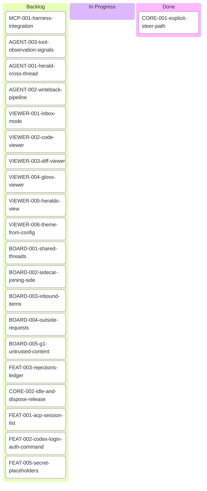

# Foundry Backlog

## Tickets

### Backlog — Last-Mile Wiring

These tickets capture the connections between components that are individually built but not yet wired together. Each loop in FLOW.md has its pieces at 80-90% — the remaining 10-20% is the wiring between them.

| Ticket | Loop | Gap | Priority |
|--------|------|-----|----------|
| [MCP-001](./MCP-001-harness-integration.md) | Loop 2 | MCP runs standalone, not alongside live harness | High |
| [AGENT-003](./AGENT-003-tool-observation-signals.md) | Loop 3 | Hook script generated but not written to disk; no callback endpoint | High |
| [AGENT-002](./AGENT-002-writeback-pipeline.md) | Loop 4 | CorpusCompiler pipeline works but Librarian doesn't feed it | Medium |
| [AGENT-001](./AGENT-001-herald-cross-thread.md) | Cross-thread | Herald class exists but isn't instantiated | Medium |

### Backlog — Viewer

| Ticket | Gap | Priority |
|--------|-----|----------|
| [VIEWER-001](./VIEWER-001-inbox-mode.md) | The attention board: default view, three lanes (Needs you, Just in, Running), `meta.attention`, the controls, private and shared zones | High |
| [VIEWER-002](./VIEWER-002-code-viewer.md) | Code viewer and editor inside Foundry (not a VS Code fork); base for diffs and Gloss | Low |
| [VIEWER-003](./VIEWER-003-diff-viewer.md) | Per-turn and per-thread diffs, branch-vs-base Compare; GitHub link-out is the interim | Low |
| [VIEWER-004](./VIEWER-004-gloss-viewer.md) | Gloss in the code viewer; the top-bar button returns with it | Low |
| [VIEWER-005](./VIEWER-005-heralds-view.md) | A workspace view like the Board: how threads are represented to the Heralds (needs AGENT-001) | Medium |
| [VIEWER-006](./VIEWER-006-theme-from-config.md) | One theme for Kingdom and Foundry from `@inixiative/config` (`theme/public`, `theme/agentic`), loaded at runtime from the package (Aron 11-01) | Medium |

### Backlog — Attention board (Foundry Version 4)

| Ticket | Gap | Priority |
|--------|-----|----------|
| [BOARD-001](./BOARD-001-shared-threads.md) | Shared threads: one member path (local or Kingdom), everything visible except tool calls, a private home and fresh session when shared, `/btw` only (rev 4; §4 to Aron) | High |
| [BOARD-002](./BOARD-002-sidecar-joining-side.md) | The other side's thread: a bridge, not a chat (F2) | High |
| [BOARD-003](./BOARD-003-inbound-items.md) | Slack/Linear/GitHub tags and DMs arrive as threads already investigating; held replies (Kingdom INTEG-002/003 first) | High |
| [BOARD-004](./BOARD-004-outside-requests.md) | Parties off the machine: requests, standing Signets, teammate sessions that wait for Aron (Kingdom FEAT-023 first) | High |
| [BOARD-005](./BOARD-005-g1-untrusted-content.md) | G1: content nobody typed is data on every thread | High |
| [FEAT-003](./FEAT-003-rejections-ledger.md) | A rejections ledger: every action the agent wasn't allowed to take (gate, runtime, owner, model), to leave full-access mode on evidence | Medium |
| [FEAT-005](./FEAT-005-secret-placeholders.md) | Paste secrets as `$$word`: lifted into the thread's scratch pad (agent-session AS-009), used through a tool that returns nothing; `.private` paths never read. Setting `secrets.scratchPad`, off by default (Aron 11-01, 11-02) | High |

---

### Backlog — Runner parity (T3 Code / Paseo, 2026-10-31)

Proposed, not built. Source: Oracle `docs/foundry/reference/COMPARISON.md` §0; delegation in Oracle `SUBAGENTS.md` §0 (Aron 11-01).

| Ticket | Gap | Priority |
|--------|-----|----------|
| [CORE-002](./CORE-002-idle-and-dispose-release.md) | Main-thread native sessions live until shutdown; extend the existing guarded release to idle time and dispose | Medium |
| [FEAT-001](./FEAT-001-acp-session-list.md) | ACP `session/list` missing; hosts can't find past threads | Low |
| [FEAT-002](./FEAT-002-codex-login-auth-command.md) | Kingdom Codex login written to `auth.json`; hand it over in memory through `auth.command` | Medium |
| [CORE-003](./CORE-003-native-settings-load-normally.md) | Main threads load the harness's settings, commands and skills; Foundry excludes only the CLAUDE.md it composes | Medium |
| [FEAT-003](./FEAT-003-worktree-lifecycle.md) | Worktree lifecycle for agent threads: template or classic mode, released on merge | Medium |
| [FEAT-004](./FEAT-004-delegation-placements.md) | Delegated threads are top-level with provenance; fresh access by default; launched through the host | Medium |
| [CORE-004](./CORE-004-fork-and-rewind.md) | Fork and rewind on the native primitives, Foundry's ledger and thread knowledge kept in step; files rewound natively on Claude | Medium |

---

### To figure out

Ideas Aron raised that need a design before they become tickets.

- **Orgs attached to projects** (2026-11-01): a project belongs to orgs — its GitHub org and its Kingdom org — and the viewer should show and use that (filters, routing, which Kingdom pool and Archive it lands in).
- **Skills** (2026-11-01): how Foundry shows and composes them — a Context-tab list by level, per-turn use in Loop, the `/` menu, project settings. Aron's principle: skills fill up the context; if something can live in a Warden, it should — only genuine procedures stay skills.

---

_Last updated: 2026-11-01_
