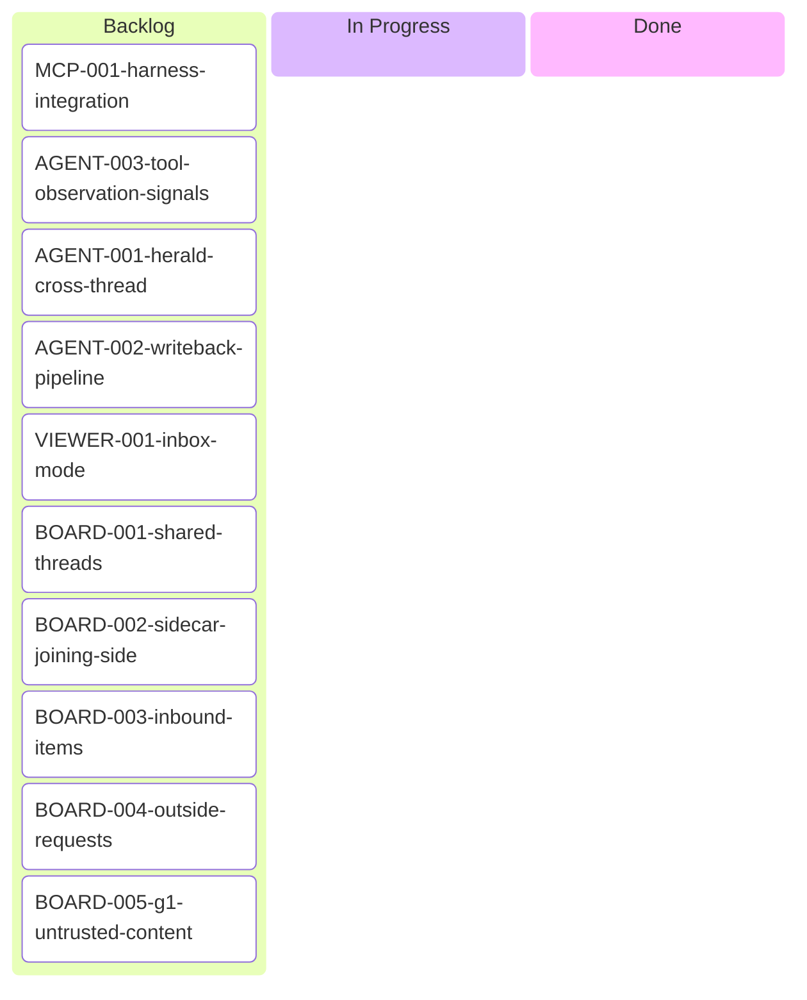

# Foundry Backlog

## Tickets

### Backlog — Last-Mile Wiring

These tickets capture the connections between components that are individually built but not yet wired together. Each loop in FLOW.md has its pieces at 80-90% — the remaining 10-20% is the wiring between them.

| Ticket | Loop | Gap | Priority |
|--------|------|-----|----------|
| [MCP-001](./MCP-001-harness-integration.md) | Loop 2 | MCP runs standalone, not alongside live harness | High |
| [AGENT-003](./AGENT-003-tool-observation-signals.md) | Loop 3 | Hook script generated but not written to disk; no callback endpoint | High |
| [AGENT-002](./AGENT-002-writeback-pipeline.md) | Loop 4 | CorpusCompiler pipeline works but Librarian doesn't feed it | Medium |
| [AGENT-001](./AGENT-001-herald-cross-thread.md) | Cross-thread | Herald class exists but isn't instantiated | Medium |

### Backlog — Viewer

| Ticket | Gap | Priority |
|--------|-----|----------|
| [VIEWER-001](./VIEWER-001-inbox-mode.md) | The attention board: default view, three lanes (Needs you, Just in, Running), `meta.attention`, the controls, private and shared zones | High |

### Backlog — Attention board (Foundry Version 4)

| Ticket | Gap | Priority |
|--------|-----|----------|
| [BOARD-001](./BOARD-001-shared-threads.md) | Shared threads: one member path (local or Kingdom), everything visible except tool calls, a private home and fresh session when shared, `/btw` only (rev 4; §4 to Aron) | High |
| [BOARD-002](./BOARD-002-sidecar-joining-side.md) | The other side's thread: a bridge, not a chat (F2) | High |
| [BOARD-003](./BOARD-003-inbound-items.md) | Slack/Linear/GitHub tags and DMs arrive as threads already investigating; held replies (Kingdom INTEG-002/003 first) | High |
| [BOARD-004](./BOARD-004-outside-requests.md) | Parties off the machine: requests, standing Signets, teammate sessions that wait for Aron (Kingdom FEAT-023 first) | High |
| [BOARD-005](./BOARD-005-g1-untrusted-content.md) | G1: content nobody typed is data on every thread | High |

---

_Last updated: 2026-11-01_
